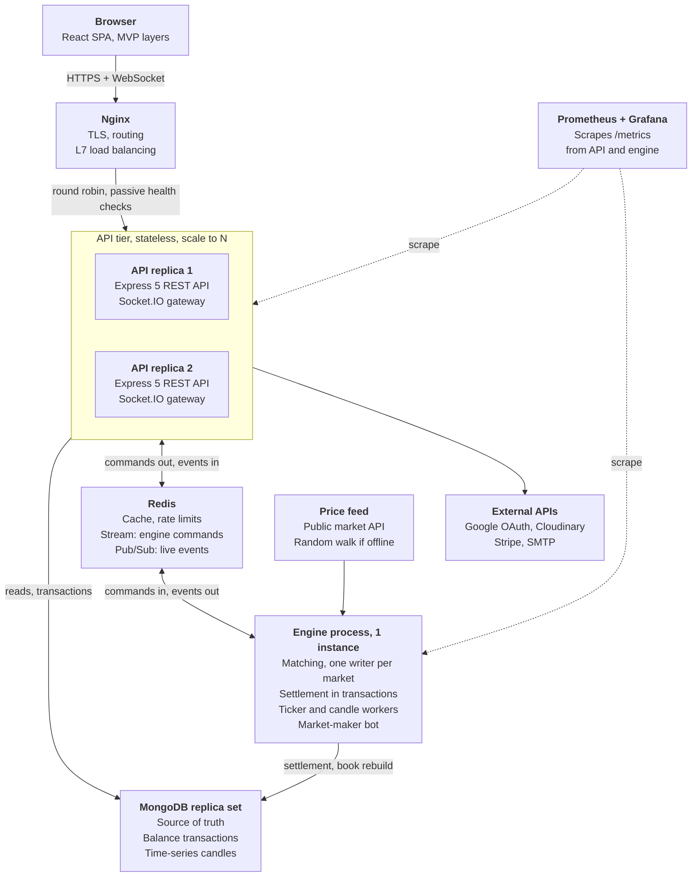

# Orichal · Crypto Exchange Platform: Architecture Declaration

Oct 25, 2026 · Divyanshu Kirpal

Revision 3 adds the UI design in [section 7](#7-ui-design) and brings the earlier sections in line with it. [Section 8](#8-frontend-build-log-static-phase) logs the frontend's static phase, which builds the client first in plain HTML, CSS and JavaScript with static data. Every change, and every problem the first audit and the second pass found, is listed in the [Review log](#review-log) at the end of this file.

## Overview

Orichal is a simulated spot exchange: users trade BTC, ETH, SOL and BNB against USDT with demo funds. An in-house matching engine fills orders by price-time priority, and a market-maker bot keeps every order book liquid. No real money or blockchain is involved.

**Stack**

| Part | Choice |
| --- | --- |
| Client | React 19 + Vite, React Router 7, Axios, Zustand, Tailwind CSS, Socket.IO client, Lightweight Charts (candles), Recharts (admin charts), decimal.js, sonner (toasts), qrcode.react. Static phase: plain HTML, CSS and JavaScript for now; React later ([section 8](#8-frontend-build-log-static-phase)) |
| Server | Node 22, Express 5, Mongoose 9, CommonJS as in Weavyn; ioredis, Socket.IO, jsonwebtoken, bcrypt, otplib, google-auth-library, Zod, helmet, cors, cookie-parser, rate-limiter-flexible, multer + Cloudinary, nodemailer, pino + pino-http, prom-client, ua-parser-js, decimal.js, Stripe (stretch) |
| Data | MongoDB as a replica set in both environments, because transactions need one. Redis with AOF persistence for cache, rate limits, the engine command stream and live events |
| Infra | Docker Compose for the local demo; Vercel, Render and MongoDB Atlas in the cloud (see Two environments); GitHub Actions for CI |
| Tests | Jest + Supertest + mongodb-memory-server on the server, Vitest + React Testing Library on the client, k6 for load |

**Two backend processes, one codebase.** `server.js` runs the REST API and the WebSocket gateway and keeps no state, so any number can run behind a load balancer. `engine.js` runs the matching engine and the market-data workers. The two never call each other: both read and write MongoDB, and Redis carries commands to the engine and events back.

**Exactly one engine.** The engine holds a Redis lock, `engine:leader`, with a 15-second TTL that it renews every 5 seconds and checks before every command. A second engine started by mistake waits as a standby, and takes over with freshly rebuilt books if the first one stops renewing. A clean shutdown releases the lock, so a restart doesn't wait out the TTL. A paused old leader that wakes up can't fill an order twice either: settlement only updates orders still in the state the engine expected (section 6, flow B).

`ENGINE_MODE=inline` runs the engine inside an API process, which is enough for a single Render service; the same lock keeps it to one engine if that service is ever scaled out. Switch to the separate process once orders work end to end.

**Two environments**

|  | Local demo (Docker Compose) | Cloud |
| --- | --- | --- |
| Client | `client` container serving the build, behind the edge Nginx | Vercel; `vercel.json` rewrites `/api/*` to the Render API so the refresh cookie stays first-party |
| API | 2 or more `api` replicas behind Nginx | Render web service |
| Engine | One `engine` container, restarted by Docker if it dies | A second Render service, or `ENGINE_MODE=inline` on a single API instance |
| MongoDB | Single-node replica set `rs0` | Atlas, a three-member replica set |
| Redis | Container with AOF on | A managed Redis-compatible service with Streams, Pub/Sub, persistence on and eviction set to volatile-lru or noeviction |
| TLS and load balancing | Nginx with a mkcert certificate | Vercel and Render |
| Monitoring | Prometheus and Grafana containers | Render logs; a Prometheus elsewhere can scrape /metrics using METRICS\_TOKEN |

Free hosting tiers that sleep when idle also pause the engine and the bot, so run the demo from the local stack or an always-on instance.



This is the Docker Compose topology. The API never matches orders and the engine never serves HTTP. Redis Streams carry commands down to the engine; Pub/Sub carries events back to every replica, which pushes them to its own sockets.

**Decisions that shape everything else**

- Money is Decimal128 in MongoDB, a string in JSON and a decimal.js value in code. The only floats are the numbers a chart draws, made inside the chart presenter.
- Only `wallet.service.js` changes balances, always inside a transaction, and every change writes a ledger entry.
- Only the engine changes an order book, one command at a time per market, and the leader lock keeps it to one engine.
- Access tokens last 15 minutes and live in memory. Refresh tokens last 7 days in an httpOnly cookie and rotate on every use, with a 30-second grace so parallel tabs don't trip reuse detection. This replaces Weavyn's single 7-day JWT because the balances here behave like money.
- MongoDB is the source of truth. Redis state (books, tickers, forming candles) can be rebuilt from it, and live events arrive at most once, so clients resync after every reconnect.
- **Core** is what the demo and viva need. **Stretch** gets built only after Core works end to end.

**Non-functional targets**

Targets to measure, not results. Run load tests against the local stack: Atlas's free tier allows up to 100 operations a second, below what a load test needs ([MongoDB pricing](https://www.mongodb.com/cloud/pricing)).

| Requirement | Target | How it is checked |
| --- | --- | --- |
| Order acknowledged (POST /orders to 202) | p95 under 150 ms at 20 orders a second | `loadtest/place-orders.js` (k6) on the local stack, spread over 50 seeded load-test users |
| Fill visible to the user (202 to `order.update`) | p95 under 500 ms | `engine_command_seconds` histogram in Grafana, plus client timing |
| Balance correctness | Every human account's ledger adds up to its wallet exactly | `scripts/check-ledger.js` after every test run |
| Engine recovery | Books rebuilt and matching again within 30 s of an engine crash | Kill the engine container during the demo |
| API availability | One API replica can die with no lost or duplicated orders | Stop a replica mid-session; clients retry with the same Idempotency-Key |
| Storage | Under 200 MB on Atlas with the bot running all day | Capacity estimate in section 3, Atlas metrics |

**MVP layers**

| Layer | Client (`client/src`) | Server (`server/src`) | Rule |
| --- | --- | --- | --- |
| Model | `models/`: API clients, socket client, domain rules, stores, static content | `model/`: Mongoose schemas, services, matching engine, adapters for Redis, email, storage and the price feed | Knows nothing about React, `req` or `res` |
| View | `views/`: pages, layouts, components | `view/`: routes, the response envelope, the socket gateway and relay | Displays data and forwards user actions. No business or formatting logic |
| Presenter | `presenters/`: one hook per page or widget, plus formatters | `presenter/`: request handlers, mappers, validators. `workers/` plays this role in the engine process | Pulls from the Model, formats, tells the View what to show |

Rules every file follows:

1. Only route-level components call presenter hooks: `App.jsx`, the route guards, layouts and pages. Every component in `views/components` receives props and callbacks.
2. A presenter returns `{ vm, actions }`. `vm` holds display-ready values such as "62,140.50" and `tone: "up"`; `actions` holds the event handlers. Form field values live in the presenter as controlled inputs.
3. Views never import from `models/` and never format: no `toFixed`, no date formatting, no colour picked from a number.
4. A view may keep purely visual state (a dropdown open, a hover) and may drive a drawing library through a ref, as PriceChart does with Lightweight Charts. Anything that changes data, or should survive navigation, belongs in the presenter.
5. Server routes contain no logic: `router.post(path, ...middleware, presenter.fn)`. Presenters never call Mongoose, and services never touch `req` or `res`.
6. On the server, the View is the HTTP and WebSocket surface the client sees. `respond.js` and `eventRelay.js` only send what a presenter already shaped.

## What real exchanges have

Crypto exchanges and stock brokers organise their pages into the same seven areas. This build takes the core of each area.

| Area | Crypto exchanges (Binance, Coinbase, Kraken, CoinDCX) | Stock brokers (Zerodha Kite, Groww) | In this build |
| --- | --- | --- | --- |
| Public | Home, markets list, coin info pages, fee schedule, announcements, help centre, status page, legal pages | Home, stock pages with fundamentals, brokerage calculator, support | Home, Markets, Coin detail, Fees, Legal |
| Sign-up and security | Register, login, 2FA, email or phone verification, password reset, Google or Apple login, identity verification (KYC) | Account opening with PAN + Aadhaar e-KYC, login with TOTP | Register, login, 2FA, email verification, password reset, Google login and simulated KYC; no phone or Apple login |
| Trading | Spot terminal (chart, order book, trades, order form), simple Buy/Sell or Convert, margin, futures, options, P2P, trading bots, copy trading | Watchlist + order window, market depth, option chain, GTT and basket orders, IPO, mutual funds | Spot terminal, Convert, watchlist |
| Funds | Wallet overview, deposit (address + QR, bank or UPI), withdraw, internal transfers, history, portfolio P&L | Funds and margin, add or withdraw money, holdings, positions, P&L and tax reports | Wallet, Deposit, Withdraw, History |
| Orders | Open orders, order history, trade history, order detail | Order book (open and executed), trades, GTT list | Orders page with three tabs and a detail drawer |
| Account | Profile, devices, anti-phishing code, withdrawal whitelist, API keys, notification settings, price alerts, referrals, VIP fee tiers | Profile, bank accounts, nominee, trading segments, alerts | Profile, Security, Verification, Alerts, Notifications |
| Back office | Dashboard, users, KYC review, withdrawal approvals, listings, fee config, risk surveillance, audit logs, support desk | The same, plus risk management (RMS) and compliance reports | Dashboard, Users, KYC, Withdrawals, Markets, Assets, Audit logs, System |

Left out on purpose: margin, futures, options, P2P, staking, API keys, referrals and real fiat rails. Each adds regulation or financial maths but no new system design concept.

## 1. Folder structure

One repo, two apps. `client/` and `server/` are split by MVP layer at the top level and by feature inside each layer, so the pattern shows from the tree alone. Comments mark files whose job isn't obvious from the name.

### Repository root

```text
crypto-exchange/
├── client/                          # React app (below)
├── server/                          # API + engine (below)
├── infra/
│   ├── nginx/
│   │   ├── nginx.conf               # TLS; / to the client container; /api and /socket.io to the API replicas with WebSocket upgrade headers; blocks /metrics
│   │   └── certs/                   # git-ignored, made with mkcert
│   │       ├── localhost.pem
│   │       └── localhost-key.pem
│   ├── mongo/
│   │   └── init-replica.js          # run by the mongo healthcheck: rs.initiate with host mongo:27017 if not yet initiated
│   ├── redis/
│   │   └── redis.conf               # appendonly yes; maxmemory 256mb; maxmemory-policy volatile-lru
│   ├── prometheus/
│   │   └── prometheus.yml           # dns_sd_configs on the api service name, so every replica is scraped; engine:9101
│   └── grafana/
│       ├── provisioning/
│       │   ├── datasources/
│       │   │   └── datasource.yml
│       │   └── dashboards/
│       │       └── dashboards.yml
│       └── dashboards/
│           └── exchange-overview.json
├── docs/
│   ├── requirements.md              # functional and non-functional requirements (labs 5-6)
│   ├── openapi.yaml                 # REST contract for section 4
│   ├── postman/
│   │   └── crypto-exchange.postman_collection.json
│   └── diagrams/                    # draw.io files for the case-study report
│       ├── context-diagram.drawio
│       ├── use-case-diagram.drawio
│       ├── hld-architecture.drawio
│       ├── component-diagram.drawio
│       ├── class-diagram-engine.drawio
│       ├── sequence-place-order.drawio
│       ├── sequence-login-2fa.drawio
│       └── er-diagram.drawio
├── loadtest/
│   └── place-orders.js              # k6: 50 seeded load-test users place and cancel orders at 20 a second; reports p95 latency
├── .github/
│   └── workflows/
│       └── ci.yml                   # lint, test and build both apps, build Docker images
├── docker-compose.yml               # nginx, client, api (scale to 2+), engine, mongo, redis, prometheus, grafana; reload nginx after changing the api scale
├── .gitignore
└── README.md                        # setup, seeding, demo script, known limits
```

### client/

Static phase: the client is plain HTML, CSS and JavaScript for now, with the same layers in the folders [section 8](#8-frontend-build-log-static-phase) lists; this tree is the React version for later.

```text
client/
├── public/
│   ├── favicon.svg                           # the Orichal mark (section 7)
│   └── coins/
│       ├── btc.svg
│       ├── eth.svg
│       ├── sol.svg
│       ├── bnb.svg
│       └── usdt.svg
├── src/
│   ├── main.jsx                              # mounts <App/>
│   ├── App.jsx                               # AppProviders + router; calls useSessionPresenter
│   ├── app/
│   │   ├── router.jsx                        # every route in section 2; admin pages lazy-loaded
│   │   ├── AppProviders.jsx                  # Toaster and ErrorBoundary
│   │   ├── ErrorBoundary.jsx                 # catches render errors and shows ErrorState
│   │   └── guards/
│   │       ├── ProtectedRoute.jsx            # logged-in only
│   │       ├── AdminRoute.jsx                # role admin only
│   │       └── GuestRoute.jsx                # logged-out only
│   ├── config/
│   │   ├── env.js                            # VITE_API_URL, VITE_WS_URL, VITE_GOOGLE_ENABLED
│   │   ├── routes.js                         # route path constants
│   │   └── constants.js                      # chart intervals, order types, page sizes
│   ├── models/                               # MODEL
│   │   ├── api/
│   │   │   ├── httpClient.js                 # axios; adds the token; one shared refresh for parallel 401s, serialised across tabs with the Web Locks API
│   │   │   ├── auth.api.js
│   │   │   ├── user.api.js
│   │   │   ├── market.api.js
│   │   │   ├── order.api.js                  # retries a failed POST once with the same Idempotency-Key
│   │   │   ├── wallet.api.js                 # sends an Idempotency-Key with deposits and withdrawals
│   │   │   ├── kyc.api.js
│   │   │   ├── alert.api.js
│   │   │   ├── notification.api.js
│   │   │   └── admin.api.js
│   │   ├── realtime/
│   │   │   └── socketClient.js               # one Socket.IO connection, WebSocket only; resubscribes and signals a resync after reconnect; reconnects with the new token after a refresh
│   │   ├── domain/
│   │   │   ├── money.js                      # decimal.js helpers: add, mul, roundToStep, compare
│   │   │   ├── order.rules.js                # tick, step, min notional and balance checks; total, fee estimate and what the engine will do
│   │   │   ├── orderBook.model.js            # buffered deltas, snapshot, seq check, price grouping
│   │   │   ├── candles.model.js              # merges live candle updates into a loaded series
│   │   │   ├── portfolio.rules.js            # values balances at live prices, allocation %, small balances (under 1 USDT)
│   │   │   ├── withdrawal.rules.js           # at least minWithdraw, above the fee, fits decimals, within available, address format (section 7)
│   │   │   └── password.rules.js             # strength score
│   │   ├── content/
│   │   │   └── legal.content.js              # terms, privacy and risk text keyed by slug
│   │   └── stores/                           # Zustand
│   │       ├── auth.store.js                 # user, access token (memory only), status; BroadcastChannel tells other tabs about login and logout
│   │       ├── ticker.store.js               # latest ticker per market, fed by the socket
│   │       ├── balance.store.js              # balances, fed by the API and balance.update
│   │       ├── preferences.store.js          # theme, hide small balances
│   │       ├── notification.store.js         # unread count, latest items
│   │       └── connection.store.js           # socket status: connected, reconnecting, offline
│   ├── presenters/                           # PRESENTER
│   │   ├── shared/
│   │   │   ├── useSessionPresenter.js        # restores the session once per page load, applies the theme, connects the socket; guards call it only to read guest/user/admin status
│   │   │   ├── useNavbarPresenter.js         # used by Public, Trade, Account and Admin layouts; includes connection status
│   │   │   ├── useCursorList.js              # "load more" lists
│   │   │   └── usePagedTable.js              # page-number tables (admin)
│   │   ├── market/
│   │   │   ├── useHomePresenter.js
│   │   │   ├── useMarketsPresenter.js
│   │   │   └── useCoinDetailPresenter.js
│   │   ├── trade/
│   │   │   ├── useTradePresenter.js          # composes the next six; sends book price clicks and the book itself to the form
│   │   │   ├── useMarketHeaderPresenter.js
│   │   │   ├── useChartPresenter.js          # turns candle strings into numbers for the chart only
│   │   │   ├── useOrderBookPresenter.js
│   │   │   ├── useRecentTradesPresenter.js
│   │   │   ├── useOrderFormPresenter.js
│   │   │   ├── useMyOrdersPresenter.js
│   │   │   └── useConvertPresenter.js
│   │   ├── auth/
│   │   │   ├── useLoginPresenter.js
│   │   │   ├── useRegisterPresenter.js
│   │   │   ├── useVerifyEmailPresenter.js
│   │   │   ├── useForgotPasswordPresenter.js
│   │   │   ├── useResetPasswordPresenter.js
│   │   │   └── useOAuthCallbackPresenter.js  # reads #ticket or ?error, then clears it from the URL
│   │   ├── wallet/
│   │   │   ├── useWalletPresenter.js
│   │   │   ├── useDepositPresenter.js
│   │   │   ├── useWithdrawPresenter.js
│   │   │   └── useTransactionsPresenter.js
│   │   ├── orders/
│   │   │   └── useOrdersPresenter.js
│   │   ├── alerts/
│   │   │   └── useAlertsPresenter.js
│   │   ├── notifications/
│   │   │   └── useNotificationsPresenter.js
│   │   ├── account/
│   │   │   ├── useProfilePresenter.js
│   │   │   ├── useSecurityPresenter.js
│   │   │   └── useVerificationPresenter.js
│   │   ├── admin/
│   │   │   ├── useAdminDashboardPresenter.js
│   │   │   ├── useAdminUsersPresenter.js
│   │   │   ├── useAdminUserDetailPresenter.js
│   │   │   ├── useAdminKycPresenter.js
│   │   │   ├── useAdminWithdrawalsPresenter.js
│   │   │   ├── useAdminMarketsPresenter.js
│   │   │   ├── useAdminAssetsPresenter.js
│   │   │   ├── useAdminAuditLogsPresenter.js
│   │   │   └── useAdminSystemPresenter.js
│   │   ├── info/
│   │   │   ├── useFeesPresenter.js
│   │   │   └── useLegalPresenter.js
│   │   └── formatters/
│   │       ├── number.format.js              # price by tick size, compact volume, signed %
│   │       ├── date.format.js
│   │       └── status.format.js              # status → label + tone
│   ├── views/                                # VIEW
│   │   ├── layouts/
│   │   │   ├── PublicLayout.jsx
│   │   │   ├── AuthLayout.jsx
│   │   │   ├── TradeLayout.jsx                # tabs for chart, book and trades below 768 px
│   │   │   ├── AccountLayout.jsx
│   │   │   └── AdminLayout.jsx
│   │   ├── pages/
│   │   │   ├── market/
│   │   │   │   ├── HomePage.jsx
│   │   │   │   ├── MarketsPage.jsx
│   │   │   │   └── CoinDetailPage.jsx
│   │   │   ├── trade/
│   │   │   │   ├── TradePage.jsx
│   │   │   │   └── ConvertPage.jsx
│   │   │   ├── auth/
│   │   │   │   ├── LoginPage.jsx
│   │   │   │   ├── RegisterPage.jsx
│   │   │   │   ├── VerifyEmailPage.jsx
│   │   │   │   ├── ForgotPasswordPage.jsx
│   │   │   │   ├── ResetPasswordPage.jsx
│   │   │   │   └── OAuthCallbackPage.jsx
│   │   │   ├── wallet/
│   │   │   │   ├── WalletPage.jsx
│   │   │   │   ├── DepositPage.jsx
│   │   │   │   ├── WithdrawPage.jsx
│   │   │   │   └── TransactionsPage.jsx
│   │   │   ├── orders/
│   │   │   │   └── OrdersPage.jsx
│   │   │   ├── alerts/
│   │   │   │   └── AlertsPage.jsx
│   │   │   ├── notifications/
│   │   │   │   └── NotificationsPage.jsx
│   │   │   ├── account/
│   │   │   │   ├── ProfilePage.jsx
│   │   │   │   ├── SecurityPage.jsx
│   │   │   │   └── VerificationPage.jsx
│   │   │   ├── admin/
│   │   │   │   ├── AdminDashboardPage.jsx
│   │   │   │   ├── AdminUsersPage.jsx
│   │   │   │   ├── AdminUserDetailPage.jsx
│   │   │   │   ├── AdminKycPage.jsx
│   │   │   │   ├── AdminWithdrawalsPage.jsx
│   │   │   │   ├── AdminMarketsPage.jsx
│   │   │   │   ├── AdminAssetsPage.jsx
│   │   │   │   ├── AdminAuditLogsPage.jsx
│   │   │   │   └── AdminSystemPage.jsx
│   │   │   └── info/
│   │   │       ├── FeesPage.jsx
│   │   │       ├── LegalPage.jsx
│   │   │       └── NotFoundPage.jsx
│   │   └── components/
│   │       ├── ui/                           # shared primitives, props only
│   │       │   ├── Button.jsx
│   │       │   ├── Input.jsx
│   │       │   ├── NumberInput.jsx           # decimal text input with a step
│   │       │   ├── Select.jsx
│   │       │   ├── Tabs.jsx
│   │       │   ├── Modal.jsx
│   │       │   ├── Drawer.jsx
│   │       │   ├── Table.jsx
│   │       │   ├── Badge.jsx
│   │       │   ├── Card.jsx
│   │       │   ├── Spinner.jsx
│   │       │   ├── Skeleton.jsx
│   │       │   ├── EmptyState.jsx
│   │       │   ├── ErrorState.jsx
│   │       │   ├── Pagination.jsx
│   │       │   ├── ConfirmDialog.jsx
│   │       │   ├── OtpInput.jsx              # 6-digit code
│   │       │   ├── CopyButton.jsx
│   │       │   └── SearchInput.jsx
│   │       ├── navigation/
│   │       │   ├── Navbar.jsx
│   │       │   ├── ConnectionStatus.jsx      # live dot; "Reconnecting" pill while the socket is down
│   │       │   ├── Footer.jsx
│   │       │   ├── UserMenu.jsx
│   │       │   ├── NotificationBell.jsx
│   │       │   ├── ThemeToggle.jsx
│   │       │   ├── VerifyEmailBanner.jsx
│   │       │   ├── AccountSidebar.jsx
│   │       │   ├── AdminSidebar.jsx
│   │       │   └── AdminTopbar.jsx
│   │       ├── home/
│   │       │   ├── HeroSection.jsx
│   │       │   ├── FeatureGrid.jsx
│   │       │   └── CtaBanner.jsx
│   │       ├── market/
│   │       │   ├── AssetIcon.jsx
│   │       │   ├── PriceChange.jsx           # signed % in the tone the presenter picked
│   │       │   ├── TickerStrip.jsx
│   │       │   ├── TopMoversCard.jsx
│   │       │   ├── MarketFilterTabs.jsx
│   │       │   ├── MarketTable.jsx
│   │       │   ├── MarketRow.jsx
│   │       │   ├── WatchlistStar.jsx
│   │       │   ├── CoinHeader.jsx
│   │       │   ├── CoinStats.jsx
│   │       │   ├── CoinAbout.jsx
│   │       │   └── CoinMarketsList.jsx
│   │       ├── charts/
│   │       │   ├── PriceChart.jsx            # Lightweight Charts through a ref; variant "candles" or "area"
│   │       │   ├── ChartToolbar.jsx          # interval buttons
│   │       │   ├── AllocationBar.jsx         # stacked bar and legend, plain HTML
│   │       │   └── VolumeBarChart.jsx        # Recharts
│   │       ├── trade/
│   │       │   ├── MarketHeader.jsx
│   │       │   ├── MarketSelector.jsx
│   │       │   ├── MarketStatusBanner.jsx    # shown while the market is halted
│   │       │   ├── OrderBook.jsx
│   │       │   ├── OrderBookRow.jsx
│   │       │   ├── RecentTrades.jsx
│   │       │   ├── OrderForm.jsx
│   │       │   ├── PercentButtons.jsx        # 25, 50, 75 or 100% of the free balance
│   │       │   ├── OrderSummary.jsx          # total, fee at most, what the engine will do
│   │       │   ├── LoginToTradeCTA.jsx
│   │       │   ├── MyOrdersPanel.jsx
│   │       │   ├── ConvertCard.jsx
│   │       │   └── QuotePreview.jsx
│   │       ├── orders/
│   │       │   ├── OrderFilters.jsx
│   │       │   ├── OpenOrdersTable.jsx
│   │       │   ├── OrderHistoryTable.jsx
│   │       │   ├── TradeHistoryTable.jsx
│   │       │   ├── OrderDetailDrawer.jsx
│   │       │   └── OrderTimeline.jsx         # placed, on the book, fills, what is left
│   │       ├── wallet/
│   │       │   ├── BalanceOverviewCard.jsx
│   │       │   ├── AssetBalanceTable.jsx
│   │       │   ├── AssetSelect.jsx
│   │       │   ├── DepositAddressCard.jsx
│   │       │   ├── SimulateDepositForm.jsx
│   │       │   ├── CardDepositForm.jsx
│   │       │   ├── WithdrawForm.jsx
│   │       │   ├── WithdrawalSummary.jsx     # amount, fee, amount received
│   │       │   ├── KycRequiredNotice.jsx
│   │       │   ├── TransactionTable.jsx
│   │       │   └── LedgerTable.jsx
│   │       ├── alerts/
│   │       │   ├── AlertForm.jsx
│   │       │   └── AlertTable.jsx
│   │       ├── notifications/
│   │       │   ├── NotificationList.jsx
│   │       │   └── NotificationItem.jsx
│   │       ├── account/
│   │       │   ├── ProfileForm.jsx
│   │       │   ├── PreferencesForm.jsx
│   │       │   ├── ChangePasswordForm.jsx
│   │       │   ├── TwoFactorCard.jsx
│   │       │   ├── TwoFactorSetupModal.jsx
│   │       │   ├── SessionList.jsx
│   │       │   ├── ActivityTable.jsx
│   │       │   ├── KycStatusCard.jsx
│   │       │   └── KycForm.jsx
│   │       ├── auth/
│   │       │   ├── LoginForm.jsx
│   │       │   ├── RegisterForm.jsx
│   │       │   ├── TwoFactorPrompt.jsx
│   │       │   ├── GoogleButton.jsx
│   │       │   ├── PasswordStrengthMeter.jsx
│   │       │   └── AuthMessage.jsx           # "check your email", "link expired" and similar states
│   │       └── admin/
│   │           ├── StatCard.jsx
│   │           ├── QueueCard.jsx
│   │           ├── UserFilters.jsx
│   │           ├── UserTable.jsx
│   │           ├── UserProfileCard.jsx
│   │           ├── UserBalancesTable.jsx
│   │           ├── UserActionsPanel.jsx
│   │           ├── KycQueueTable.jsx
│   │           ├── KycReviewPanel.jsx        # beside the queue; below it on narrow screens
│   │           ├── WithdrawalQueueTable.jsx
│   │           ├── RejectReasonModal.jsx
│   │           ├── MarketAdminTable.jsx
│   │           ├── MarketFormModal.jsx
│   │           ├── AssetAdminTable.jsx
│   │           ├── AssetFormModal.jsx
│   │           ├── AuditLogFilters.jsx
│   │           ├── AuditLogTable.jsx
│   │           ├── HealthGrid.jsx
│   │           └── EngineStatusCard.jsx
│   ├── styles/
│   │   └── index.css                         # Tailwind + the theme tokens and fonts in section 7
│   └── tests/
│       ├── order.rules.test.js
│       ├── orderBook.model.test.js           # buffered deltas, stale snapshot, seq gap
│       └── useOrderFormPresenter.test.jsx    # presenters test without rendering any view
├── index.html
├── vite.config.js                            # dev proxy: /api and /socket.io (ws: true) → localhost:4000
├── vercel.json                               # cloud: /api/* rewritten to the Render API, everything else to index.html; security headers
├── eslint.config.js
├── nginx.conf                                # inside the client container: SPA fallback, long cache for hashed assets, security headers
├── Dockerfile                                # build with Node, serve dist/ with Nginx
├── .env.example
└── package.json
```

### server/

```text
server/
├── src/
│   ├── server.js                             # entry 1: REST API + Socket.IO gateway; stateless, run N; drains on SIGTERM
│   ├── engine.js                             # entry 2: takes engine:leader, then starts the workers; /health/live and /metrics on :9101; drains on SIGTERM and releases the lock
│   ├── app.js                                # trust proxy; requestId, httpLogger, metrics; helmet, cors; health routes; webhook routes with express.raw; express.json (100 kb), cookie-parser; global rate limit; /api/v1 routes; notFound; errorHandler
│   ├── config/
│   │   ├── env.js                            # loads and validates env with Zod
│   │   ├── db.js                             # Mongoose connection
│   │   ├── redis.js                          # ioredis clients: commands, publisher, subscriber
│   │   ├── logger.js                         # pino; redacts authorization, cookies, passwords and 2FA codes
│   │   └── constants.js                      # roles, statuses, intervals, ledger types, channel names
│   ├── model/                                # MODEL
│   │   ├── schemas/                          # one Mongoose model per collection (section 3)
│   │   │   ├── User.js
│   │   │   ├── Session.js
│   │   │   ├── VerificationToken.js
│   │   │   ├── Asset.js
│   │   │   ├── Market.js
│   │   │   ├── Wallet.js
│   │   │   ├── LedgerEntry.js
│   │   │   ├── Order.js
│   │   │   ├── Trade.js
│   │   │   ├── Candle.js                     # time-series collection
│   │   │   ├── Transaction.js
│   │   │   ├── KycApplication.js
│   │   │   ├── PriceAlert.js
│   │   │   ├── Notification.js
│   │   │   └── AuditLog.js
│   │   ├── services/
│   │   │   ├── auth.service.js               # register, login, lockout, 2FA branch, email tokens, reset
│   │   │   ├── token.service.js              # access JWT { sub, role, sid }, refresh JWT { sid, ver }; rotation with a 30 s grace; reuse detection
│   │   │   ├── twoFactor.service.js          # TOTP secret and otpauth URL, verify; refuses a code already used
│   │   │   ├── oauth.service.js              # Google auth URL (PKCE, state also set in a cookie), code exchange, ID token check; links an existing account only if Google marks the email verified
│   │   │   ├── user.service.js               # profile, password, sessions, watchlist; admin search, freeze, role (never the last admin)
│   │   │   ├── wallet.service.js             # the only balance writer: lock, unlock, credit, debit, debitLocked; each writes a ledger entry
│   │   │   ├── order.service.js              # checks market rules, account status and the engine heartbeat; locks funds, saves, enqueues; cancel and cancel-all requests
│   │   │   ├── settlement.service.js         # engine fills and cancels → trades, conditional order updates, balance moves and human notifications in one withTransaction (retries write conflicts)
│   │   │   ├── market.service.js             # markets and assets config, cached list, halt, resume and delist; sends config and cancelAll commands to the engine
│   │   │   ├── marketData.service.js         # ticker, book snapshot (top 100), recent trades in Redis; convert quote
│   │   │   ├── candle.service.js             # forming candles in Redis (UTC-aligned), flush closed ones to Mongo, query
│   │   │   ├── transaction.service.js        # simulated deposits; withdrawal request (2FA check, lock), cancel, review
│   │   │   ├── payment.service.js            # Stripe test-mode checkout and webhook handling (stretch)
│   │   │   ├── kyc.service.js                # submit (one open application per user), review, keeps users.kycStatus in step
│   │   │   ├── alert.service.js              # CRUD; checks alerts at most once a second per market
│   │   │   ├── notification.service.js       # create + push to the user's channel
│   │   │   ├── audit.service.js              # append audit logs
│   │   │   ├── adminStats.service.js         # dashboard aggregations
│   │   │   └── health.service.js             # Mongo, Redis, engine heartbeat and leader, stream lag
│   │   ├── engine/                           # pure classes, no I/O, unit-tested (section 6 lists their methods)
│   │   │   ├── PriceLevel.js                 # FIFO queue of orders at one price (an insertion-ordered Map)
│   │   │   ├── OrderBook.js                  # bids high→low, asks low→high, orderId index for cancels
│   │   │   └── MatchingEngine.js             # price-time matching, self-trade prevention; returns fills
│   │   └── adapters/
│   │       ├── cache.adapter.js              # JSON get/set with TTL, hashes, lists, the leader lock
│   │       ├── commandStream.adapter.js      # commands place, cancel, cancelAll, config; XADD (MAXLEN ~10000), XREADGROUP with a fixed consumer name, XACK; recreates the group on NOGROUP
│   │       ├── eventBus.adapter.js           # Redis Pub/Sub: publish, pattern subscribe
│   │       ├── mailer.adapter.js             # nodemailer; logs the link instead of sending when SMTP_URL is empty
│   │       ├── storage.adapter.js            # Cloudinary authenticated uploads (JPEG, PNG), streamed back through the API
│   │       └── priceFeed.adapter.js          # reference prices from a public API; random walk when offline
│   ├── presenter/                            # PRESENTER
│   │   ├── auth.presenter.js
│   │   ├── user.presenter.js
│   │   ├── market.presenter.js
│   │   ├── order.presenter.js
│   │   ├── wallet.presenter.js
│   │   ├── kyc.presenter.js
│   │   ├── alert.presenter.js
│   │   ├── notification.presenter.js
│   │   ├── webhook.presenter.js              # Stripe (stretch)
│   │   ├── admin.presenter.js                # stats, users, audit logs, system health
│   │   ├── health.presenter.js
│   │   ├── mappers/                          # documents → DTOs: Decimal128 to string, secrets removed
│   │   │   ├── user.mapper.js
│   │   │   ├── session.mapper.js             # device name parsed from the user agent
│   │   │   ├── asset.mapper.js
│   │   │   ├── market.mapper.js
│   │   │   ├── order.mapper.js
│   │   │   ├── trade.mapper.js
│   │   │   ├── candle.mapper.js
│   │   │   ├── wallet.mapper.js              # balances and ledger entries
│   │   │   ├── transaction.mapper.js
│   │   │   ├── kyc.mapper.js
│   │   │   ├── alert.mapper.js
│   │   │   ├── notification.mapper.js
│   │   │   └── audit.mapper.js
│   │   └── validators/                       # Zod schemas for body, query and params
│   │       ├── auth.validator.js
│   │       ├── user.validator.js
│   │       ├── market.validator.js
│   │       ├── order.validator.js
│   │       ├── wallet.validator.js
│   │       ├── kyc.validator.js
│   │       ├── alert.validator.js
│   │       └── admin.validator.js
│   ├── workers/                              # PRESENTER role inside the engine process
│   │   ├── engine.worker.js                  # rebuilds books, forming candles and recent trades; replays pending orders; reads commands, runs MatchingEngine, settles, publishes; skips commands already applied; a 30 s sweep catches lost places and cancels, and new markets
│   │   ├── ticker.worker.js                  # recomputes 24h stats from 1m candles plus the forming one, every 60 s
│   │   ├── candle.worker.js                  # flushes candles whose interval has ended
│   │   └── marketMaker.worker.js             # bot-maker ladder (5 levels a side, re-quoted after a 0.2% move or a fill, at most once every 150 s and at least every 5 min) and bot-taker orders (one a minute per market), paced and staggered; cancels its ladder when a market halts
│   ├── view/                                 # VIEW
│   │   ├── routes/
│   │   │   ├── index.js                      # mounts the feature routers under /api/v1 (app.js mounts health and webhook first)
│   │   │   ├── auth.routes.js
│   │   │   ├── user.routes.js
│   │   │   ├── market.routes.js
│   │   │   ├── order.routes.js
│   │   │   ├── wallet.routes.js
│   │   │   ├── kyc.routes.js
│   │   │   ├── alert.routes.js
│   │   │   ├── notification.routes.js
│   │   │   ├── webhook.routes.js             # /api/v1/webhooks/stripe with a raw body for the signature check
│   │   │   ├── admin.routes.js
│   │   │   └── health.routes.js              # /health/live, /health/ready, /metrics (outside /api/v1; /metrics checks METRICS_TOKEN when set)
│   │   ├── http/
│   │   │   └── respond.js                    # ok, created, accepted, noContent, fail: one envelope; Cache-Control: no-store on private data
│   │   └── sockets/
│   │       ├── gateway.js                    # Socket.IO, WebSocket only; verifies the token on handshake; joins the user room and removes the socket from it when the token expires
│   │       ├── market.channel.js             # subscribe/unsubscribe; accepts only tickers, market:* and candles:*
│   │       ├── user.channel.js               # private user room, never joinable by name
│   │       └── eventRelay.js                 # Redis Pub/Sub events → this instance's sockets
│   ├── middleware/
│   │   ├── requestId.js
│   │   ├── httpLogger.js                     # pino-http with the request id
│   │   ├── metrics.js                        # request count + latency histogram
│   │   ├── authenticate.js                   # Bearer JWT → req.user
│   │   ├── authorize.js                      # admin guard; re-reads the role from Mongo so a change applies at once
│   │   ├── validate.js                       # Zod → 400; parsed values on req.input (req.query is read-only in Express 5)
│   │   ├── rateLimit.js                      # Redis-backed: login, register, 2FA, email sends, orders, deposits, global (keyed by the bearer token's user when valid, else the IP)
│   │   ├── idempotency.js                    # Idempotency-Key replay for orders, deposits, withdrawals
│   │   ├── upload.js                         # multer memory storage; JPEG or PNG up to 5 MB
│   │   ├── notFound.js
│   │   └── errorHandler.js                   # AppError → envelope with a code from section 4; hides internals in production
│   └── lib/
│       ├── money.js                          # decimal.js ↔ Decimal128, roundToStep, roundUp to decimals, compare
│       ├── errors.js                         # AppError + error codes
│       ├── pagination.js                     # cursor encode/decode, page/limit parsing
│       ├── crypto.js                         # random tokens, SHA-256, AES-GCM for TOTP secrets
│       └── metricsRegistry.js                # prom-client registry; engine_command_seconds, orders_placed_total, ws_connections, stream_lag
├── scripts/
│   ├── seed.js                               # assets and 4 markets (values in section 3), admin, bot-maker and bot-taker with large balances, 2 demo users; --load-users 50 adds the k6 accounts
│   └── check-ledger.js                       # for every human wallet, adds up the ledger and compares; exits 1 on any difference
├── tests/
│   ├── setup/
│   │   └── testDb.js                         # mongodb-memory-server replica set
│   ├── unit/
│   │   ├── OrderBook.test.js
│   │   ├── MatchingEngine.test.js
│   │   └── money.test.js
│   └── integration/
│       ├── auth.test.js                      # includes refresh rotation, the grace window and reuse
│       ├── orders.test.js
│       ├── settlement.test.js                # fills move balances and the ledger correctly; price improvement unlocks
│       ├── doubleSpend.test.js               # two orders racing for one balance: exactly one is accepted
│       └── wallet.test.js
├── jest.config.js
├── Dockerfile
├── .env.example
└── package.json
```

### Environment variables

`server/.env.example` and `client/.env.example` list these; real secrets never go in the repo.

| Variable | Used by | Meaning or example |
| --- | --- | --- |
| `NODE_ENV` | API, engine | `development` or `production` |
| `PORT` | API | `4000` |
| `METRICS_PORT` | Engine | `9101` |
| `METRICS_TOKEN` | API, engine | When set, `/metrics` needs `Authorization: Bearer <token>`. Set it in the cloud, where no Nginx hides the route |
| `MONGO_URI` | API, engine | `mongodb://mongo:27017/exchange?replicaSet=rs0` locally; the Atlas URI in the cloud |
| `REDIS_URL` | API, engine | `redis://redis:6379` |
| `ENGINE_MODE` | API | `worker` (default) or `inline` |
| `TRUST_PROXY` | API | Number of proxies in front of the API: 1 behind Nginx. Confirm `req.ip` once deployed behind Vercel and Render |
| `CLIENT_ORIGIN` | API | Allowed CORS and Socket.IO origin, e.g. `https://localhost` or the Vercel URL |
| `JWT_ACCESS_SECRET`, `JWT_REFRESH_SECRET` | API | Long random strings, different from each other |
| `ACCESS_TOKEN_TTL`, `REFRESH_TOKEN_TTL` | API | `15m`, `7d` |
| `TOTP_ENC_KEY` | API | 32-byte base64 key for AES-GCM |
| `GOOGLE_CLIENT_ID`, `GOOGLE_CLIENT_SECRET` | API | From the Google Cloud console |
| `GOOGLE_REDIRECT_URI` | API | On the client's origin, e.g. `https://<app>.vercel.app/api/v1/auth/google/callback`, so the oauth\_state cookie comes back on the redirect and the rt cookie lands first-party |
| `SMTP_URL`, `MAIL_FROM` | API | An empty `SMTP_URL` logs links instead of sending |
| `CLOUDINARY_URL` | API | Cloudinary credentials |
| `STRIPE_SECRET_KEY`, `STRIPE_WEBHOOK_SECRET`, `CARD_USDT_RATE` | API | Test-mode keys, and fiat charged per USDT (stretch) |
| `DEMO_CREDIT_USDT` | API | `10000` |
| `SEED_ADMIN_EMAIL`, `SEED_ADMIN_PASSWORD` | Seed script | The first admin account that `seed.js` creates |
| `MARKET_MAKER_ENABLED` | Engine | `true` or `false` |
| `PRICE_FEED_URL` | Engine | Public price endpoint; empty means random walk |
| `LOG_LEVEL` | API, engine | `info` |
| `VITE_API_URL` | Client | `/api/v1`, same origin in both environments |
| `VITE_WS_URL` | Client | Socket origin: same origin locally, the Render URL in the cloud |
| `VITE_GOOGLE_ENABLED` | Client | Shows the Google button |

## 2. Pages and routes

33 pages on 34 routes: 6 public, 6 sign-in, 12 for logged-in users, 9 admin and a 404. Access: **Public** is anyone, **Guest** is logged-out only (logged-in users go to `/markets`), **User** needs a login, **Admin** needs role admin.

| Route | Page | Access | What it shows | Priority |
| --- | --- | --- | --- | --- |
| `/` | HomePage | Public | Hero, live ticker strip, top gainers, losers and volume, feature grid, sign-up banner | Core |
| `/markets` | MarketsPage | Public | Every pair with last price, 24h change, high, low and volume; search, sort, tabs for All, Watchlist, Gainers, Losers | Core |
| `/coins/:code` | CoinDetailPage | Public | e.g. `/coins/BTC`: price chart, 24h stats, market cap, about, pairs to trade | Stretch |
| `/trade/:symbol` | TradePage | Public; the order form needs a login | e.g. `/trade/BTC-USDT`: candles, order book, recent trades, order form, my orders; a halted market shows a banner and a disabled form | Core |
| `/fees` | FeesPage | Public | Maker and taker fee per market; withdrawal fee and minimum per asset | Core |
| `/legal/:slug` | LegalPage | Public | `terms`, `privacy` or `risk`; states that the exchange is simulated | Core |
| `/login` | LoginPage | Guest | Email and password or Google; switches to a 2FA code step when needed | Core |
| `/register` | RegisterPage | Guest | Sign-up with a strength meter; new accounts get 10,000 demo USDT | Core |
| `/forgot-password` | ForgotPasswordPage | Guest | Request a reset link | Stretch |
| `/reset-password` | ResetPasswordPage | Guest | `?token=`: set a new password | Stretch |
| `/verify-email` | VerifyEmailPage | Public | `?token=`: confirms the email address | Stretch |
| `/oauth/callback` | OAuthCallbackPage | Public | Landing after Google: restores the session, asks for the 2FA code (its ticket arrives in the URL fragment) or shows the error | Core |
| `/convert` | ConvertPage | User | Pick a coin and USDT on either side (every market is quoted in USDT), an amount, see a quote, confirm. A market order runs underneath | Stretch |
| `/wallet` | WalletPage | User | Total value, allocation bar, available and in-order amount per asset | Core |
| `/wallet/deposit` | DepositPage | User | `?asset=BTC`: simulated address with QR, simulated deposit, card deposit (stretch) | Core |
| `/wallet/withdraw` | WithdrawPage | User | `?asset=`: address, amount (fee included), fee, amount received, 2FA code when 2FA is on. Blocked until KYC is approved | Core |
| `/wallet/history` | TransactionsPage | User | Tabs for Deposits, Withdrawals and Ledger | Core |
| `/orders` | OrdersPage | User | `?tab=` open, history or trades, across all markets; cancel one or all | Core |
| `/alerts` | AlertsPage | User | Create and cancel price alerts | Stretch |
| `/notifications` | NotificationsPage | User | Full list, mark as read | Stretch |
| `/account` | redirect | User | Sends to `/account/profile` | Core |
| `/account/profile` | ProfilePage | User | Display name, email status, theme, hide small balances | Core |
| `/account/security` | SecurityPage | User | Change password (core); 2FA, devices and recent activity (stretch) | Core |
| `/account/verification` | VerificationPage | User | KYC form and its status | Core |
| `/admin` | AdminDashboardPage | Admin | KPIs, 14-day volume chart, KYC and withdrawal queues | Core |
| `/admin/users` | AdminUsersPage | Admin | Search and filter users | Core |
| `/admin/users/:id` | AdminUserDetailPage | Admin | Profile, balances, open orders, transactions; freeze, change role | Core |
| `/admin/kyc` | AdminKycPage | Admin | Review queue, document viewer, approve or reject | Core |
| `/admin/withdrawals` | AdminWithdrawalsPage | Admin | Approve or reject pending withdrawals | Core |
| `/admin/markets` | AdminMarketsPage | Admin | Create pairs, edit fees and tick or step size, halt or resume trading | Core |
| `/admin/assets` | AdminAssetsPage | Admin | Create and edit assets, switch deposits and withdrawals on or off | Stretch |
| `/admin/audit-logs` | AdminAuditLogsPage | Admin | Filterable audit trail | Stretch |
| `/admin/system` | AdminSystemPage | Admin | Mongo, Redis, engine heartbeat, stream lag, socket count, link to Grafana | Core |
| `*` | NotFoundPage | Public | 404 | Core |

## 3. MongoDB schemas

15 collections, one Mongoose model each in `server/src/model/schemas/`. MongoDB is the source of truth; everything in Redis can be rebuilt from it.

- Every document has `_id` (ObjectId). `createdAt` and `updatedAt` (Date) come from Mongoose timestamps unless a collection says otherwise, so they are not repeated in the tables.
- Decimal128 holds every price, quantity and amount. The API sends these as strings.
- Rounding: trade values keep full Decimal128 precision, and fees round up to the asset's `decimals`. Prices and quantities a user enters must already fit tickSize and stepSize, and deposits and withdrawals must fit `decimals`. Anything finer stays in the wallet as dust.
- `userId` points to users, `market` to markets.symbol and `asset` to assets.code. Symbols and codes act as natural keys because they never change after creation.
- Bot-only records carry `expireAt`, and a TTL index deletes them 24 hours later: closed bot orders, bot-vs-bot trades and bot ledger entries. Trades with a human side and every human record are kept, and bot accounts get no notifications. The capacity estimate at the end of this section shows why.

### users

| Field | Type | Required | Stores |
| --- | --- | --- | --- |
| email | String, unique, lowercase | Yes | Login identity |
| passwordHash | String | No | bcrypt hash; absent for Google-only accounts |
| displayName | String | Yes | Name shown in the app |
| role | String: user, admin | Yes, default user | Access level |
| status | String: active, frozen | Yes, default active | Frozen users cannot trade, deposit or withdraw |
| isBot | Boolean | Yes, default false | Marks the two bot accounts, bot-maker and bot-taker; excluded from user stats |
| emailVerified | Boolean | Yes, default false | Set by the verification link |
| googleId | String, unique, sparse | No | Google account id for OAuth login |
| avatarUrl | String | No | Profile picture from Google |
| twoFactor.enabled | Boolean | Yes, default false | Whether TOTP is on |
| twoFactor.secretEncrypted | String | No | TOTP secret, AES-GCM encrypted |
| twoFactor.enabledAt | Date | No | When 2FA was switched on |
| kycStatus | String: none, pending, approved, rejected | Yes, default none | Copy of the latest KYC decision; gates withdrawals |
| watchlist | Array of String | Yes, default \[\] | Starred market symbols, at most 50 |
| preferences.theme | String: light, dark | Yes, default light | UI theme; only light is drawn so far (section 7) |
| preferences.hideSmallBalances | Boolean | Yes, default false | Wallet table filter |
| failedLoginCount | Number | Yes, default 0 | Wrong passwords in a row |
| lockUntil | Date | No | Set 15 minutes ahead after 5 wrong passwords in a row |
| lastLoginAt | Date | No | Last successful login |

Indexes: `email` unique; `googleId` unique sparse; `{ role, status, createdAt: -1 }` for admin filters.

### sessions

One document per logged-in device.

| Field | Type | Required | Stores |
| --- | --- | --- | --- |
| userId | ObjectId → users | Yes | Owner |
| tokenVersion | Number | Yes, default 0 | Goes up on every rotation. The refresh JWT carries `{ sid, ver }` |
| rotatedAt | Date | No | Time of the last rotation. A token one version behind that arrives within 30 s of it comes from a parallel tab and gets the current token; anything older revokes the session as stolen |
| userAgent | String | No | Browser string, shown as a device name |
| ip | String | No | IP at login |
| lastUsedAt | Date | Yes | Last refresh |
| expiresAt | Date | Yes | 7 days after the last refresh |
| revokedAt | Date | No | Set on logout, revoke, password change or detected reuse |

Indexes: `userId`; `expiresAt` TTL (expireAfterSeconds 0), so MongoDB deletes expired sessions itself.

### verificationTokens

Short-lived tokens for email links; a new request deletes older unused tokens of the same purpose. Timestamps: `createdAt` only.

| Field | Type | Required | Stores |
| --- | --- | --- | --- |
| userId | ObjectId → users | Yes | Owner |
| purpose | String: email\_verify, password\_reset | Yes | What the token unlocks |
| tokenHash | String, unique | Yes | SHA-256 of the emailed token; the raw token is never stored |
| expiresAt | Date | Yes | 24 hours for email, 30 minutes for reset |
| usedAt | Date | No | Set when used; a second use is rejected |

Indexes: `tokenHash` unique; `expiresAt` TTL; `{ userId, purpose }`.

### assets

| Field | Type | Required | Stores |
| --- | --- | --- | --- |
| code | String, unique, uppercase | Yes | e.g. BTC |
| name | String | Yes | e.g. Bitcoin |
| decimals | Number | Yes | Decimal places allowed for deposits, withdrawals and fees (BTC 8, USDT 6) |
| iconUrl | String | No | e.g. `/coins/btc.svg` |
| description | String | No | About text on the coin page |
| circulatingSupply | Decimal128 | No | Used for market cap on the coin page |
| depositEnabled | Boolean | Yes, default true | Admin switch |
| withdrawEnabled | Boolean | Yes, default true | Admin switch |
| withdrawFee | Decimal128 | Yes, default 0 | Flat fee per withdrawal |
| minWithdraw | Decimal128 | Yes | Smallest withdrawal |
| demoDepositLimit | Decimal128 | Yes | Largest simulated deposit, e.g. 1 BTC or 10,000 USDT |
| status | String: active, delisted | Yes, default active | Delisted assets are hidden |

Indexes: `code` unique.

### markets

24h ticker numbers live in Redis, not here. tickSize and stepSize can change only while the market is halted with no open orders, which a halt with cancelOpenOrders arranges. Fee changes apply to new trades only.

| Field | Type | Required | Stores |
| --- | --- | --- | --- |
| symbol | String, unique | Yes | e.g. BTC-USDT |
| baseAsset | String → assets.code | Yes | What is bought or sold (BTC) |
| quoteAsset | String → assets.code | Yes | What it is priced in (USDT) |
| tickSize | Decimal128 | Yes | Smallest price step, e.g. 0.01 |
| stepSize | Decimal128 | Yes | Smallest quantity step, e.g. 0.00001 |
| minQty | Decimal128 | Yes | Smallest order quantity |
| minNotional | Decimal128 | Yes | Smallest order value in quote, e.g. 5 USDT |
| makerFeeRate | Decimal128 | Yes | 0.001 means 0.10% |
| takerFeeRate | Decimal128 | Yes | 0.001 means 0.10% |
| status | String: active, halted, delisted | Yes, default active | Halted: no new orders, cancels still allowed |

Indexes: `symbol` unique; `status`.

**Seed values** (demo numbers set by `scripts/seed.js`)

| Asset | decimals | withdrawFee | minWithdraw | demoDepositLimit |
| --- | --- | --- | --- | --- |
| BTC | 8 | 0.0002 | 0.001 | 1 |
| ETH | 8 | 0.002 | 0.01 | 10 |
| SOL | 8 | 0.01 | 0.1 | 100 |
| BNB | 8 | 0.002 | 0.02 | 20 |
| USDT | 6 | 1 | 10 | 10,000 |

| Market | tickSize | stepSize | minQty | minNotional | Maker fee | Taker fee |
| --- | --- | --- | --- | --- | --- | --- |
| BTC-USDT | 0.01 | 0.00001 | 0.00001 | 5 USDT | 0.08% | 0.10% |
| ETH-USDT | 0.01 | 0.0001 | 0.0001 | 5 USDT | 0.08% | 0.10% |
| SOL-USDT | 0.01 | 0.001 | 0.001 | 5 USDT | 0.08% | 0.10% |
| BNB-USDT | 0.01 | 0.001 | 0.001 | 5 USDT | 0.08% | 0.10% |

### wallets

One document per user per asset, created by upsert on the first credit; GET /wallet/balances fills in zeros for the rest. Only `wallet.service.js` writes here, using conditional updates (`available >= amount`) inside a transaction, so a balance can never go negative.

| Field | Type | Required | Stores |
| --- | --- | --- | --- |
| userId | ObjectId → users | Yes | Owner |
| asset | String → assets.code | Yes | Which coin |
| available | Decimal128 | Yes, default 0 | Free to trade or withdraw |
| locked | Decimal128 | Yes, default 0 | Reserved by open orders and pending withdrawals |

Indexes: `{ userId, asset }` unique.

### ledgerEntries

Append-only record of every balance change; never updated, and deleted only for bot accounts (expireAt). Timestamps: `createdAt` only.

| Field | Type | Required | Stores |
| --- | --- | --- | --- |
| userId | ObjectId → users | Yes | Whose balance moved |
| asset | String | Yes | Which coin |
| type | String: demo\_credit, deposit, withdrawal\_lock, withdrawal, withdrawal\_fee, withdrawal\_unlock, order\_lock, order\_unlock, trade\_debit, trade\_credit, trade\_fee | Yes | Why it moved |
| deltaAvailable | Decimal128 | Yes | Signed change to available |
| deltaLocked | Decimal128 | Yes | Signed change to locked |
| availableAfter | Decimal128 | Yes | Available balance after this change |
| lockedAfter | Decimal128 | Yes | Locked balance after this change |
| refType | String: order, trade, transaction, system | Yes | What caused it |
| refId | ObjectId | No | That document's id; empty for demo\_credit |
| note | String | No | Free text, e.g. a refund reason |
| expireAt | Date | No | Bot accounts only: 24 h after creation |

Indexes: `{ userId, createdAt: -1 }`; `{ userId, asset, createdAt: -1 }`; `{ refType, refId }`; `expireAt` TTL (expireAfterSeconds 0).

### orders

| Field | Type | Required | Stores |
| --- | --- | --- | --- |
| userId | ObjectId → users | Yes | Owner |
| market | String → markets.symbol | Yes | e.g. BTC-USDT |
| side | String: buy, sell | Yes | Direction |
| type | String: limit, market | Yes | Order type |
| timeInForce | String: GTC, IOC | Yes | Limit orders are GTC and rest on the book; market orders are IOC and any unfilled rest is cancelled |
| price | Decimal128 | Limit only | Limit price, a multiple of tickSize |
| quantity | Decimal128 | Limit and market sell | Base amount, a multiple of stepSize |
| quoteQuantity | Decimal128 | Market buy only | Quote amount to spend |
| filledQuantity | Decimal128 | Yes, default 0 | Base filled so far; kept when the order is cancelled |
| executedQuote | Decimal128 | Yes, default 0 | Quote value of all fills; average price = executedQuote / filledQuantity |
| locked | Decimal128 | Yes | Funds still reserved (quote for buys, base for sells); released on cancel or completion |
| fee | Decimal128 | Yes, default 0 | Total fee charged so far |
| feeAsset | String | Yes | The asset received, which is what fees are taken in; derivable from side and market |
| status | String: pending, open, partially\_filled, filled, cancelled, rejected | Yes, default pending | `pending` means the API accepted it and the engine has not applied it yet |
| cancelReason | String: user, ioc\_remainder, self\_trade, market\_halted, account\_frozen | No | Why it was cancelled |
| rejectReason | String | No | e.g. the market was halted when the engine received it |
| cancelRequestedAt | Date | No | Set when a cancel is requested; the engine's 30-second sweep finishes a cancel whose command was lost |
| clientOrderId | String | Yes | The request's Idempotency-Key, or one the server generates; unique per user, so a retried request can't create a second order |
| source | String: web, convert, bot | Yes, default web | Where the order came from |
| expireAt | Date | No | Bot orders only: 24 h after the order closes |

Indexes: `{ userId, status, createdAt: -1 }` for my orders; `{ market, status, createdAt: 1 }` for rebuilding books and the 30-second sweep of pending orders, plus a partial index on cancelRequestedAt for the cancel sweep; `{ userId, clientOrderId }` unique; `expireAt` TTL.

### trades

One document per fill. Timestamps: `createdAt` only (execution time).

| Field | Type | Required | Stores |
| --- | --- | --- | --- |
| market | String | Yes | Pair |
| price | Decimal128 | Yes | Execution price, always the resting order's price |
| quantity | Decimal128 | Yes | Base amount |
| quoteQuantity | Decimal128 | Yes | price × quantity, full precision |
| takerSide | String: buy, sell | Yes | Side of the incoming order; colours the recent-trades list |
| makerOrderId | ObjectId → orders | Yes | Resting order |
| takerOrderId | ObjectId → orders | Yes | Incoming order |
| makerUserId | ObjectId → users | Yes | Maker's owner |
| takerUserId | ObjectId → users | Yes | Taker's owner |
| makerFee | Decimal128 | Yes | Fee paid by the maker |
| makerFeeAsset | String | Yes | Asset of the maker fee |
| takerFee | Decimal128 | Yes | Fee paid by the taker |
| takerFeeAsset | String | Yes | Asset of the taker fee |
| expireAt | Date | No | Only when both sides are bot accounts: 24 h after the trade |

Indexes: `{ market, createdAt: -1 }`; `{ makerUserId, createdAt: -1 }`; `{ takerUserId, createdAt: -1 }`; `expireAt` TTL. User ids are copied from the orders on purpose, so trade history needs no `$lookup`. Fees are stored because the rate can change later.

### candles

A MongoDB time-series collection (timeField `openTime`, metaField `meta`). Intervals are aligned to UTC, and the collection keeps 90 days (expireAfterSeconds). Insert-only: a candle is written once, when its interval closes, and the forming candle lives in Redis. No timestamps.

| Field | Type | Required | Stores |
| --- | --- | --- | --- |
| openTime | Date | Yes | Interval start |
| meta.market | String | Yes | Pair |
| meta.interval | String: 1m, 5m, 15m, 1h, 4h, 1d | Yes | Candle size |
| open | Decimal128 | Yes | First trade price |
| high | Decimal128 | Yes | Highest price |
| low | Decimal128 | Yes | Lowest price |
| close | Decimal128 | Yes | Last trade price |
| volume | Decimal128 | Yes | Base volume |
| quoteVolume | Decimal128 | Yes | Quote volume |
| tradeCount | Number | Yes | Trades in the interval |

Indexes: `{ meta.market, meta.interval, openTime: -1 }`.

### transactions

Deposits and withdrawals. For a withdrawal, `amount` is what leaves the wallet, fee included, and the recipient gets amount − fee.

| Field | Type | Required | Stores |
| --- | --- | --- | --- |
| userId | ObjectId → users | Yes | Owner |
| type | String: deposit, withdrawal | Yes | Direction |
| method | String: simulated, card | Yes, default simulated | `card` is Stripe test mode (stretch) |
| asset | String | Yes | Coin |
| amount | Decimal128 | Yes | Deposit: amount credited. Withdrawal: amount debited, fee included |
| fee | Decimal128 | Yes, default 0 | Withdrawal fee, taken out of amount |
| fiatAmount | Decimal128 | No | Card deposits: amount charged |
| fiatCurrency | String | No | Card deposits: currency charged, e.g. INR |
| address | String | No | Deposit address shown, or withdrawal destination |
| txHash | String | No | Fake hash set on completion |
| externalRef | String, unique, sparse | No | Stripe checkout session id; makes a repeated webhook harmless |
| status | String: pending, completed, rejected, cancelled | Yes | Simulated deposits complete at once, card deposits wait for the webhook, withdrawals wait for an admin |
| reviewedBy | ObjectId → users | No | Admin who decided |
| reviewedAt | Date | No | When they decided |
| rejectReason | String | No | Shown to the user |
| idempotencyKey | String | No | From the Idempotency-Key header; unique per user |

Indexes: `{ userId, createdAt: -1 }`; `{ type, status, createdAt: 1 }` for the admin queue, oldest first; `{ userId, idempotencyKey }` unique and partial; `externalRef` unique sparse.

### kycApplications

One open (pending or approved) application per user, enforced by a partial unique index on `isOpen`; a rejected user may submit again. Use dummy documents only.

| Field | Type | Required | Stores |
| --- | --- | --- | --- |
| userId | ObjectId → users | Yes | Applicant |
| fullName | String | Yes | Legal name as on the document |
| dateOfBirth | Date | Yes | Must be 18 or older |
| country | String, ISO 3166 alpha-2 | Yes | e.g. IN |
| documentType | String: passport, national\_id, driving\_licence | Yes | Document kind |
| documentNumberLast4 | String | Yes | The form sends the full number; only the last 4 characters are kept |
| documentImageId | String | Yes | Cloudinary authenticated asset id; streamed only to admins |
| selfieImageId | String | No | Optional second image |
| status | String: pending, approved, rejected | Yes, default pending | Review state |
| isOpen | Boolean | Yes, default true | True while pending or approved; set to false on rejection |
| reviewedBy | ObjectId → users | No | Admin |
| reviewedAt | Date | No | Decision time |
| rejectReason | String | No | Shown to the user |

Indexes: `{ userId }` unique where `isOpen` is true (partial); `{ status, createdAt: 1 }`; `{ userId, createdAt: -1 }`.

### priceAlerts

At most 20 active alerts per user.

| Field | Type | Required | Stores |
| --- | --- | --- | --- |
| userId | ObjectId → users | Yes | Owner |
| market | String | Yes | Pair |
| condition | String: above, below | Yes | Fires when the last price reaches or crosses the target |
| targetPrice | Decimal128 | Yes | Trigger price |
| status | String: active, triggered, cancelled | Yes, default active | Alert state |
| triggeredAt | Date | No | When it fired |
| triggeredPrice | Decimal128 | No | Price that fired it |

Indexes: `{ market, status, condition, targetPrice }` so the engine fetches only alerts that just crossed; `{ userId, status }`.

### notifications

Timestamps: `createdAt` only.

| Field | Type | Required | Stores |
| --- | --- | --- | --- |
| userId | ObjectId → users | Yes | Recipient |
| type | String: order\_filled, order\_cancelled, price\_alert, deposit, withdrawal, kyc, security | Yes | Icon and grouping |
| title | String | Yes | Short line |
| body | String | Yes | Detail |
| link | String | No | Client route to open, e.g. `/orders?tab=history` |
| readAt | Date | No | Unread while empty |

Indexes: `{ userId, readAt, createdAt: -1 }`; TTL on `createdAt` after 90 days. Bot accounts never get notifications, so bot trading adds nothing here.

### auditLogs

Append-only. Timestamps: `createdAt` only.

| Field | Type | Required | Stores |
| --- | --- | --- | --- |
| actorId | ObjectId → users | No | Who acted; empty for system actions |
| actorRole | String: user, admin, system | Yes | Actor type |
| action | String | Yes | e.g. auth.login, auth.login\_failed, user.2fa\_enabled, admin.user\_frozen, admin.withdrawal\_approved, admin.market\_halted, admin.kyc\_document\_viewed |
| targetType | String: user, order, transaction, kyc, market, asset | No | What it acted on |
| targetId | String | No | Id or symbol of the target |
| metadata | Object | No | Before and after values, reason |
| ip | String | No | Request IP |
| userAgent | String | No | Request browser string |

Indexes: `{ createdAt: -1 }`; `{ actorId, createdAt: -1 }`; `{ action, createdAt: -1 }`.

### Redis keyspace

Not collections, but part of the data design. Redis runs with AOF persistence (`appendonly yes`), so the command stream survives a restart. With the default `appendfsync everysec` a crash can lose the last second of writes; pending orders and `cancelRequestedAt` in Mongo cover that. `maxmemory-policy volatile-lru` evicts only keys with a TTL, so streams, tickers and books are never dropped.

| Key | Type | Holds | TTL |
| --- | --- | --- | --- |
| `ticker:{symbol}` | Hash | last, open, high, low, volume, quoteVolume, changePct over 24h | None |
| `book:{symbol}` | String (JSON) | Top 100 levels per side and `seq`, rewritten with every delta batch (at most every 100 ms) | None |
| `trades:{symbol}` | List | Last 50 public trades (LPUSH + LTRIM) | None |
| `candle:{symbol}:{interval}` | Hash | The forming candle | None |
| `cache:markets` | String (JSON) | Market list for GET /markets; cache-aside, deleted on admin edit | 30 s |
| `cache:assets` | String (JSON) | Asset list; deleted on admin edit | 300 s |
| `stream:engine:{symbol}` | Stream | Engine commands in order per market: place, cancel, cancelAll, config; consumer group `engine` | Trimmed to about 10,000 entries; pending orders and cancelRequestedAt in Mongo are the backstop |
| `events:market:{symbol}` | Pub/Sub channel | ticker, orderbook, trade, candle, market.status | n/a |
| `events:user:{userId}` | Pub/Sub channel | order.update, balance.update, notification | n/a |
| `engine:leader` | String | Id of the engine instance allowed to match | 15 s, renewed every 5 s |
| `rl:{rule}:{id}` | String | Rate-limit counters | Window length |
| `idem:{userId}:{key}` | String (JSON) | Stored response for an Idempotency-Key | 24 h |
| `login:2fa:{ticket}` | Hash | userId and attempts left (5) while a TOTP code is pending | 5 min |
| `2fa:setup:{userId}` | String | Unconfirmed TOTP secret, encrypted | 10 min |
| `totp:used:{userId}` | String | Last accepted TOTP time step, so a code can't be used twice | 90 s |
| `oauth:{state}` | String | PKCE verifier for one Google login; the browser holds the same state in its oauth\_state cookie | 10 min |
| `heartbeat:engine` | String | Last engine tick, written every 5 s | 15 s |
| `heartbeat:api:{instanceId}` | Hash | Alive marker and socket count for one API instance | 15 s |

For the ER diagram and the BCNF discussion: users 1–N sessions, verificationTokens, wallets, ledgerEntries, orders, transactions, kycApplications, priceAlerts, notifications and auditLogs (as actor); assets 1–N wallets and transactions, and 1–N markets as base or quote; markets 1–N orders, trades, candles and priceAlerts; orders 1–N trades, as maker or taker. Three fields are deliberate denormalisation that a relational design would drop to reach BCNF: users.kycStatus (derivable from kycApplications), the user ids on trades (derivable from the orders) and orders.feeAsset (derivable from side and market). The fees on trades are not denormalised: they record the rate charged at that moment.

### Capacity estimate

The bot writes far more than demo users do. Assumptions, for 4 markets: the 10-order ladder is re-quoted at most 600 times a day per market (one re-quote per 150 s allows 576), the taker places one order a minute per market, each taker order fills about 1.5 times, and a record costs about 0.55 to 0.8 KB with its share of the indexes.

| Record | Per day | Kept |
| --- | --- | --- |
| Orders | about 29,800 | Bot orders: 24 h after they close |
| Trades | about 8,600 | Bot-vs-bot: 24 h. With a human on either side: forever |
| Ledger entries | about 111,000 | Bot accounts: 24 h. Humans: forever |
| Candles | about 7,400 | 90 days (expireAfterSeconds); about 1.5 MB a day before time-series compression |
| Storage written | about 85 to 120 MB | Levels off near one day of bot data plus candles and human records: roughly 110 to 160 MB |

Without the purge, the bot alone would fill Atlas's 512 MB free tier in under a week. Re-quotes are paced and staggered across markets because the same tier allows up to 100 operations a second ([MongoDB pricing](https://www.mongodb.com/cloud/pricing)).

## 4. API endpoints

73 REST endpoints under `/api/v1`, 3 health routes outside it, and 10 WebSocket events. Each group below names its route file (View) and presenter file.

**Conventions**

- Base path `/api/v1`. A breaking change goes to `/api/v2`.
- Every response is `{ success: true, data, meta? }` or `{ success: false, error: { code, message, details? } }`. The Returns column shows `data`; error codes are in the table below.
- Prices, quantities and amounts travel as strings, e.g. `"0.00150000"`, candles included. The chart presenter turns candles into numbers only for drawing.
- Auth column: **No** is public, **Yes** is any logged-in user, **Admin** is role admin, **Cookie** means the `rt` refresh cookie identifies the session. Logged-in calls send `Authorization: Bearer <access token>`.
- The refresh token sits in an httpOnly, Secure, SameSite=Strict cookie `rt` with path `/api/v1/auth`. The client and the REST API always share an origin (Nginx locally; in the cloud `vercel.json` rewrites `/api/*` to Render), so the cookie stays first-party. Split across two sites it would be a third-party cookie, which Safari blocks by default. The socket connects to Render directly and needs no cookie.
- Authenticated responses send `Cache-Control: no-store`, because Vercel's CDN honours upstream cache headers on rewritten requests ([Vercel rewrites](https://vercel.com/docs/routing/rewrites)). Public market data may send a short `max-age`.
- Feeds take `?cursor=&limit=` (max 100) and return `nextCursor`. Admin tables take `?page=&limit=` and return `page` and `total`.
- Rate limits: login 5/min per IP + email pair, so a campus network or the k6 run can still sign in many accounts; 2FA codes 5/min per user or ticket; register 10/hour per IP; forgot-password 3/hour per email and verification emails 3/hour per user; orders 10/s per user, placing and cancelling together; deposits 5/min per user; everything else 120/min per user, or 600/min per IP for anonymous calls, since a whole lab can share one IP. Over a limit returns 429 with Retry-After. `TRUST_PROXY` must be right, or every request looks as if it came from the proxy.
- `Idempotency-Key` works on POST `/orders`, `/wallet/deposits` and `/wallet/withdrawals`. A retry with the same key gets the first response back; on orders the key is also stored as `clientOrderId`.
- The client checks order and withdrawal rules for instant feedback, and the server checks everything again; only the server's answer counts.
- Another user's order, transaction or alert returns 404, not 403, so ids can't be probed.

**Error codes**

| HTTP | Code | When |
| --- | --- | --- |
| 400 | `VALIDATION_ERROR` | Body, query or params fail the Zod schema |
| 400 | `INVALID_2FA_CODE` | Wrong or reused TOTP code |
| 401 | `UNAUTHENTICATED` | Missing, expired or revoked token or cookie |
| 403 | `FORBIDDEN` | Wrong role, or a frozen account trying to trade, deposit or withdraw |
| 403 | `KYC_REQUIRED` | Withdrawal before KYC is approved |
| 404 | `NOT_FOUND` | Missing, or not the caller's |
| 409 | `CONFLICT` | Duplicate email, open KYC application, full watchlist or alert list, cancelling an order that is already closed, an Idempotency-Key still in progress or reused with a different body, tick change on a live market |
| 409 | `MARKET_HALTED` | New order on a halted market |
| 413 | `PAYLOAD_TOO_LARGE` | JSON body over 100 kb, or an upload over 5 MB |
| 422 | `INSUFFICIENT_BALANCE` | Not enough available funds |
| 422 | `MARKET_RULES` | Price or quantity breaks tickSize, stepSize, minQty or minNotional |
| 423 | `ACCOUNT_LOCKED` | Too many wrong passwords; retry after lockUntil |
| 429 | `RATE_LIMITED` | Over a rate limit |
| 503 | `ENGINE_UNAVAILABLE` | Engine heartbeat older than 15 s; placing and cancelling orders is refused |
| 500 | `INTERNAL` | Anything unexpected; details hidden in production |

**Response shapes (DTOs)**, built by the mappers in `presenter/mappers/`:

| DTO | Fields |
| --- | --- |
| User | id, email, displayName, role, status, emailVerified, kycStatus, twoFactorEnabled, hasPassword, avatarUrl, preferences, createdAt |
| AdminUser | User fields plus isBot, failedLoginCount, lastLoginAt |
| Session | id, device (parsed from the user agent), ip, lastUsedAt, createdAt, current |
| Asset | code, name, decimals, iconUrl, description, circulatingSupply, depositEnabled, withdrawEnabled, withdrawFee, minWithdraw, demoDepositLimit, status |
| Market | symbol, baseAsset, quoteAsset, status, tickSize, stepSize, minQty, minNotional, makerFeeRate, takerFeeRate, ticker { last, open, high, low, volume, quoteVolume, changePct } |
| Order | id, market, side, type, timeInForce, price, quantity, quoteQuantity, filledQuantity, executedQuote, avgPrice, fee, feeAsset, status, cancelReason, rejectReason, clientOrderId, createdAt, updatedAt |
| PublicTrade | id, price, quantity, takerSide, time |
| MyTrade | id, orderId, market, side, role (maker or taker), price, quantity, quoteQuantity, fee, feeAsset, time |
| Candle | time (Unix seconds, a number), open, high, low, close, volume (strings) |
| Balance | asset, available, locked, total |
| LedgerEntry | id, asset, type, deltaAvailable, deltaLocked, availableAfter, lockedAfter, refType, refId, time |
| Transaction | id, type, method, asset, amount, fee, receiveAmount (withdrawals), fiatAmount and fiatCurrency (card deposits), address, txHash, status, rejectReason, createdAt; admin lists add userId and userEmail |
| Kyc | id, status, fullName, dateOfBirth, country, documentType, documentNumberLast4, rejectReason, createdAt, reviewedAt; admin lists add userEmail and hasSelfie |
| Alert | id, market, condition, targetPrice, status, triggeredAt, triggeredPrice, createdAt |
| Notification | id, type, title, body, link, read, createdAt |
| AuditLog | id, actor { id, email, role }, action, targetType, targetId, metadata, ip, createdAt |
| Quote | spend, receive, avgPrice, fee, priceImpactPct |

### Health · `health.routes.js` → `health.presenter.js`

| Method | Path | Purpose | Returns | Auth |
| --- | --- | --- | --- | --- |
| GET | `/health/live` | Liveness: the process answers | `{ status: "ok" }` | No |
| GET | `/health/ready` | Readiness of this instance: Mongo and Redis only. The engine's state is reported in `/admin/system/health` and never fails readiness, so an engine outage can't take the whole API down | `{ status, checks: { mongo, redis } }` | No |
| GET | `/metrics` | Prometheus scrape. Nginx blocks it locally; in the cloud it needs the METRICS\_TOKEN bearer token | Prometheus text format | Token when METRICS\_TOKEN is set |

The engine process serves the same `/health/live` and `/metrics` on port 9101 for Docker and Prometheus; Nginx doesn't route to it. Open-source Nginx only checks upstreams passively: after `max_fails` failed requests it skips a replica for `fail_timeout`, then tries it again. Docker healthchecks call `/health/ready`, but Compose uses them only to order startup (`depends_on: condition: service_healthy`); it restarts containers that exit, not ones that turn unhealthy.

### Auth · `auth.routes.js` → `auth.presenter.js`

| Method | Path | Purpose | Returns | Auth |
| --- | --- | --- | --- | --- |
| POST | `/auth/register` | Body `{ email, password, displayName }`. Creates the account, credits the demo USDT, sends the verification email | `201 { user: User, accessToken }` and the `rt` cookie | No |
| POST | `/auth/login` | Body `{ email, password }`. Five wrong passwords in a row lock the account for 15 min | `{ user, accessToken }` and cookie, or `{ requires2fa: true, loginTicket }` | No |
| POST | `/auth/login/2fa` | Body `{ loginTicket, code }`; 5 attempts per ticket | `{ user, accessToken }` and cookie | No |
| POST | `/auth/refresh` | Rotates the cookie. A token one version behind within 30 s of the last rotation gets the current one; anything older revokes the session | `{ accessToken }` | Cookie |
| POST | `/auth/logout` | Revokes the session the cookie names and clears it; works after the access token has expired | `204` | Cookie |
| GET | `/auth/google` | Starts Google OAuth. Keeps the PKCE verifier in Redis under a random `state` for 10 min and puts the same state in an httpOnly `oauth_state` cookie (SameSite=Lax, so it comes back on the redirect from Google) | `302` to Google | No |
| GET | `/auth/google/callback` | Requires `state` to match the `oauth_state` cookie and its Redis entry, then deletes both. Exchanges the code, verifies the ID token, then finds, links or creates the user; a new account gets the demo USDT. Sets the `rt` cookie only when 2FA is off | `302` to `/oauth/callback`; with 2FA on, `/oauth/callback#ticket=…`; on failure `/oauth/callback?error=…` | No |
| POST | `/auth/verify-email` | Body `{ token }` | `{ emailVerified: true }` | No |
| POST | `/auth/verify-email/resend` | Sends a new link | `{ sent: true }` | Yes |
| POST | `/auth/forgot-password` | Body `{ email }`; same reply whether or not the email exists | `{ sent: true }` | No |
| POST | `/auth/reset-password` | Body `{ token, newPassword }`; revokes every session and clears the lockout | `{ reset: true }` | No |

### Account · `user.routes.js` → `user.presenter.js`

| Method | Path | Purpose | Returns | Auth |
| --- | --- | --- | --- | --- |
| GET | `/users/me` | Current user | `{ user: User }` | Yes |
| PATCH | `/users/me` | Body `{ displayName?, preferences? }` | `{ user }` | Yes |
| PATCH | `/users/me/password` | Body `{ currentPassword, newPassword }`; revokes other sessions. Not offered to Google-only accounts | `{ changed: true }` | Yes |
| POST | `/users/me/2fa/setup` | Creates an unconfirmed TOTP secret. The client draws the QR from otpauthUrl with qrcode.react; manualKey is for typing in by hand | `{ otpauthUrl, manualKey }` | Yes |
| POST | `/users/me/2fa/enable` | Body `{ code }` | `{ twoFactorEnabled: true }` | Yes |
| POST | `/users/me/2fa/disable` | Body `{ code, password? }`; the password is required only when the account has one | `{ twoFactorEnabled: false }` | Yes |
| GET | `/users/me/sessions` | Logged-in devices | `{ sessions: [Session] }` | Yes |
| DELETE | `/users/me/sessions/:id` | Log out one device | `204` | Yes |
| DELETE | `/users/me/sessions` | Log out every other device | `{ revoked }` | Yes |
| GET | `/users/me/activity` | Security events read from audit logs, `?cursor=` | `{ items: [{ action, ip, device, createdAt }], nextCursor }` | Yes |
| GET | `/users/me/watchlist` | Starred markets | `{ watchlist: ["BTC-USDT"] }` | Yes |
| PUT | `/users/me/watchlist/:symbol` | Star a market; at most 50, unknown symbols rejected | `{ watchlist }` | Yes |
| DELETE | `/users/me/watchlist/:symbol` | Unstar a market | `{ watchlist }` | Yes |

### Assets and markets · `market.routes.js` → `market.presenter.js`

| Method | Path | Purpose | Returns | Auth |
| --- | --- | --- | --- | --- |
| GET | `/assets` | Active assets | `{ assets: [Asset] }` | No |
| GET | `/assets/:code` | One asset and the markets that trade it | `{ asset: Asset, markets: [symbol] }` | No |
| GET | `/markets` | Active and halted markets with the 24h ticker, served from Redis | `{ markets: [Market] }` | No |
| GET | `/markets/:symbol` | One market with its ticker | `{ market: Market }` | No |
| GET | `/markets/:symbol/orderbook` | Depth snapshot, `?depth=` 1 to 100, default 50 | `{ seq, bids: [[price, qty]], asks: [[price, qty]] }` | No |
| GET | `/markets/:symbol/trades` | Last 50 public trades | `{ trades: [PublicTrade] }` | No |
| GET | `/markets/:symbol/candles` | `?interval=1h&from=&to=&limit=500`; closed candles plus the forming one | `{ candles: [Candle] }` | No |
| GET | `/markets/:symbol/quote` | Convert preview, `?side=buy&amount=100`, walking the current book; amount is the USDT to spend on a buy or the coin to sell on a sell. An estimate: the market order fills against the book as it stands when the engine runs it | `Quote` | No |

### Orders and my trades · `order.routes.js` → `order.presenter.js`

| Method | Path | Purpose | Returns | Auth |
| --- | --- | --- | --- | --- |
| POST | `/orders` | Body `{ market, side, type, price?, quantity?, quoteQuantity? }` plus the `Idempotency-Key` header, stored as clientOrderId. Checks market rules and account status, locks funds and queues the order; 503 when the engine is down | `202 { order: Order }`, status `pending` | Yes |
| GET | `/orders` | `?state=open` or `history`, plus `market`, `cursor`, `limit` | `{ items: [Order], nextCursor }` | Yes |
| GET | `/orders/:id` | One of my orders with its fills | `{ order: Order, fills: [MyTrade] }` | Yes |
| DELETE | `/orders/:id` | Sets cancelRequestedAt, then queues a cancel behind the order's own place command, so it can't overtake it; the result arrives as `order.update` | `202 { orderId, cancelRequested: true }` | Yes |
| DELETE | `/orders` | Marks my open orders with cancelRequestedAt and queues one cancelAll per market, `?market=` optional | `202 { cancelRequested }` | Yes |
| GET | `/trades` | My fills, `?market=&cursor=&limit=` | `{ items: [MyTrade], nextCursor }` | Yes |

### Wallet · `wallet.routes.js` → `wallet.presenter.js`

| Method | Path | Purpose | Returns | Auth |
| --- | --- | --- | --- | --- |
| GET | `/wallet/balances` | Every active asset, zero balances included | `{ balances: [Balance] }` | Yes |
| GET | `/wallet/ledger` | `?asset=&type=&cursor=` | `{ items: [LedgerEntry], nextCursor }` | Yes |
| GET | `/wallet/transactions` | Deposits and withdrawals, `?type=&cursor=` | `{ items: [Transaction], nextCursor }` | Yes |
| GET | `/wallet/deposit-address/:asset` | Fixed fake address for this user and asset | `{ asset, address }` | Yes |
| POST | `/wallet/deposits` | Body `{ asset, amount }`, up to the asset's demoDepositLimit | `201 { transaction: Transaction, balance: Balance }` | Yes |
| POST | `/wallet/deposits/card` | Body `{ amount }` in USDT. Creates a Stripe test-mode Checkout session; the credit arrives by webhook (stretch) | `{ checkoutUrl }` | Yes |
| POST | `/wallet/withdrawals` | Body `{ asset, amount, address, code? }`. `amount` includes the fee and the recipient gets amount − fee. Needs approved KYC, and the 2FA code when 2FA is on; locks the amount | `201 { transaction }`, status `pending` | Yes |
| DELETE | `/wallet/withdrawals/:id` | Cancels my pending withdrawal and unlocks the amount | `{ transaction }` | Yes |

### Webhooks · `webhook.routes.js` → `webhook.presenter.js`

| Method | Path | Purpose | Returns | Auth |
| --- | --- | --- | --- | --- |
| POST | `/webhooks/stripe` | Stripe event (stretch), read as a raw body. Verifies the signature, credits USDT on `checkout.session.completed` once per session, cancels on `checkout.session.expired` | `{ received: true }` | No; the Stripe signature replaces auth |

### KYC · `kyc.routes.js` → `kyc.presenter.js`

| Method | Path | Purpose | Returns | Auth |
| --- | --- | --- | --- | --- |
| GET | `/kyc/me` | My latest application | `{ status, application: Kyc }` | Yes |
| POST | `/kyc` | Multipart: `fullName`, `dateOfBirth`, `country`, `documentType`, `documentNumber`, plus `documentImage` and an optional `selfieImage` (JPEG or PNG, 5 MB each). Keeps only the last 4 characters of the number; 409 while an application is open | `201 { application: Kyc }` | Yes |

### Alerts · `alert.routes.js` → `alert.presenter.js` (stretch)

| Method | Path | Purpose | Returns | Auth |
| --- | --- | --- | --- | --- |
| GET | `/alerts` | `?status=active` | `{ alerts: [Alert] }` | Yes |
| POST | `/alerts` | `{ market, condition, targetPrice }` | `201 { alert: Alert }` | Yes |
| DELETE | `/alerts/:id` | Cancel an alert | `204` | Yes |

### Notifications · `notification.routes.js` → `notification.presenter.js` (stretch)

| Method | Path | Purpose | Returns | Auth |
| --- | --- | --- | --- | --- |
| GET | `/notifications` | `?unread=true&cursor=` | `{ items: [Notification], nextCursor, unreadCount }` | Yes |
| PATCH | `/notifications/:id/read` | Mark one as read | `{ notification }` | Yes |
| PATCH | `/notifications/read-all` | Mark all as read | `{ updated }` | Yes |

### Admin · `admin.routes.js` → admin, kyc, wallet and market presenters

Every admin route runs `authenticate`, then `authorize('admin')`, which re-reads the role from MongoDB so a demotion applies at once. Every change, and every view of a KYC document, writes an audit log.

| Method | Path | Purpose | Returns | Auth |
| --- | --- | --- | --- | --- |
| GET | `/admin/stats` | Dashboard KPIs and 14-day volume. User counts exclude bot accounts; volume and fees include the bot; fees are valued in USDT at current prices | `{ users, volume24h, fees24h, openOrders, pendingKyc, pendingWithdrawals, volumeSeries }` | Admin |
| GET | `/admin/users` | `?search=` (email prefix) `&role=&status=&page=&limit=` | `{ items: [AdminUser], page, total }` | Admin |
| GET | `/admin/users/:id` | One user with balances, recent orders and transactions in one call | `{ user: AdminUser, balances, recentOrders, recentTransactions }` | Admin |
| PATCH | `/admin/users/:id/status` | Body `{ status, reason }`; freezing cancels the user's open orders (account\_frozen); a frozen user can still log in and look | `{ user }` | Admin |
| PATCH | `/admin/users/:id/role` | Body `{ role }`; refuses to demote the last admin | `{ user }` | Admin |
| GET | `/admin/kyc` | `?status=&page=` | `{ items: [Kyc], page, total }` | Admin |
| GET | `/admin/kyc/:id/document` | Streams the document image through the API, `?image=document` or `selfie` | Image bytes | Admin |
| PATCH | `/admin/kyc/:id` | Body `{ decision: "approve" or "reject", reason? }` | `{ application }` | Admin |
| GET | `/admin/withdrawals` | `?status=&page=`, oldest first | `{ items: [Transaction], page, total }` | Admin |
| PATCH | `/admin/withdrawals/:id` | Body `{ decision, reason? }`; approve debits the locked amount, reject unlocks it | `{ transaction }` | Admin |
| GET | `/admin/markets` | All markets, halted and delisted included | `{ markets: [Market] }` | Admin |
| POST | `/admin/markets` | Body `{ symbol, baseAsset, quoteAsset, tickSize, stepSize, minQty, minNotional, makerFeeRate, takerFeeRate }`; both assets must exist | `201 { market }` | Admin |
| PATCH | `/admin/markets/:symbol` | Fees, minimums or status (halt, resume, delist), sent to the engine as a config command on the market's stream. Halting with cancelOpenOrders: true, or delisting, also cancels every open order (market\_halted). Tick and step change only while halted with no open orders | `{ market }` | Admin |
| GET | `/admin/assets` | All assets | `{ assets: [Asset] }` | Admin |
| POST | `/admin/assets` | Body `{ code, name, decimals, withdrawFee, minWithdraw, demoDepositLimit, iconUrl?, description?, circulatingSupply? }` | `201 { asset }` | Admin |
| PATCH | `/admin/assets/:code` | Any asset field except code and decimals, which existing balances depend on | `{ asset }` | Admin |
| GET | `/admin/audit-logs` | `?action=&actorId=&cursor=` | `{ items: [AuditLog], nextCursor }` | Admin |
| GET | `/admin/system/health` | Mongo, Redis, engine, API instances, sockets | `{ mongo, redis, engine: { leaderId, heartbeatAge, marketsLoaded, streamLag }, apiInstances, sockets }` | Admin |

### WebSocket events · `view/sockets/`

Socket.IO at `/socket.io`, WebSocket transport only, so the load balancer needs no sticky sessions. Public rooms need no token. When the handshake carries a valid access token in `auth.token`, the socket also joins `user:{userId}`. The gateway drops it from that room once the token expires, socketClient reconnects with the fresh token after every refresh, and logout disconnects the socket.

| Direction | Event | Room | Payload |
| --- | --- | --- | --- |
| Client → server | `subscribe` | Joins `tickers`, `market:{symbol}` or `candles:{symbol}:{interval}`; any other name is refused, so nobody can join a user room by name | `{ channel }` |
| Client → server | `unsubscribe` | Leaves that room | `{ channel }` |
| Server → client | `ticker` | `tickers`, `market:{symbol}` | `{ symbol, last, open, high, low, volume, quoteVolume, changePct }`, at most once a second per market |
| Server → client | `orderbook` | `market:{symbol}` | `{ symbol, seq, bids, asks }`: changed levels only, quantity `"0"` removes a level, at most every 100 ms |
| Server → client | `trade` | `market:{symbol}` | PublicTrade plus `symbol` |
| Server → client | `candle` | `candles:{symbol}:{interval}` | Candle plus `symbol` and `interval`, at most once a second |
| Server → client | `market.status` | `market:{symbol}` | `{ symbol, status }` when the engine applies a halt, resume or delist |
| Server → client | `order.update` | `user:{userId}` | `{ order: Order }` |
| Server → client | `balance.update` | `user:{userId}` | Balance |
| Server → client | `notification` | `user:{userId}` | `{ notification: Notification }` |

Every API instance subscribes to the Redis channels and pushes only to its own sockets. Redis Pub/Sub is fire-and-forget, so delivery is at most once: after any reconnect, presenters refetch the book snapshot, open orders, balances and the unread count instead of trusting the event stream.

## 5. Component tree

Only route-level components call a presenter (shown with `←`): App, the route guards, layouts and pages. Every other component takes props and callbacks. `*` marks a shared component, and the table at the end lists where each is used. The layout each page sits in is in brackets.

### Layouts

```text
App                             ← useSessionPresenter         (session restore, theme, socket)
└── AppProviders → Toaster, ErrorBoundary → ErrorState*
    └── router: ProtectedRoute, AdminRoute, GuestRoute ← useSessionPresenter, then a layout

PublicLayout                    ← useNavbarPresenter
├── Navbar*
│   ├── ConnectionStatus            a live dot, or a "Reconnecting" pill while the socket is down
│   ├── UserMenu*
│   ├── NotificationBell* → NotificationList* → NotificationItem*
│   └── ThemeToggle*
├── VerifyEmailBanner*
├── <page>
└── Footer*

TradeLayout                     ← useNavbarPresenter          (full height, no footer; tabs below 768 px)
├── Navbar*
├── VerifyEmailBanner*
└── <page>

AccountLayout                   ← useNavbarPresenter
├── Navbar*
├── VerifyEmailBanner*
├── AccountSidebar              (Profile, Security, Verification)
├── <page>
└── Footer*

AdminLayout                     ← useNavbarPresenter
├── AdminSidebar
├── AdminTopbar → ThemeToggle*, UserMenu*
└── <page>

AuthLayout                      (no presenter: brand panel and a centred card)
└── <page>
```

### Market and info pages

```text
HomePage                        ← useHomePresenter            [PublicLayout]
├── HeroSection → Button*
├── TickerStrip → AssetIcon*, PriceChange*
├── TopMoversCard x3 (gainers, losers, volume) → AssetIcon*, PriceChange*
├── FeatureGrid
└── CtaBanner → Button*

MarketsPage                     ← useMarketsPresenter         [PublicLayout]
├── SearchInput*
├── MarketFilterTabs → Tabs*
├── MarketTable → Table*, Skeleton*, EmptyState*
│   └── MarketRow → AssetIcon*, PriceChange*, WatchlistStar
└── ErrorState*

CoinDetailPage                  ← useCoinDetailPresenter      [PublicLayout]
├── CoinHeader → AssetIcon*, PriceChange*, Button*
├── ChartToolbar*
├── PriceChart* (area)
├── CoinStats
├── CoinAbout
└── CoinMarketsList → Button*

FeesPage                        ← useFeesPresenter            [PublicLayout]
└── Table* x2 (trading fees, withdrawal fees) → AssetIcon*

LegalPage                       ← useLegalPresenter           [PublicLayout]
└── Card*

NotFoundPage                    (no presenter)                [PublicLayout]
└── EmptyState* → Button*
```

### Trade pages

```text
TradePage                       ← useTradePresenter           [TradeLayout]
├── MarketStatusBanner              vm.header, only while the market is halted
├── MarketHeader                    vm.header
│   ├── MarketSelector → SearchInput*, AssetIcon*, PriceChange*
│   └── PriceChange*
├── ChartToolbar*                   vm.chart
├── PriceChart* (candles)           vm.chart
├── OrderBook                       vm.book: asks, last price and spread, bids, as a price ladder
│   ├── Select* (price grouping)
│   └── OrderBookRow (one per level)  tags your own resting amount
├── RecentTrades                    vm.trades
├── OrderForm                       vm.form, when logged in; disabled with a reason when halted or frozen
│   ├── Tabs* (buy or sell), Tabs* (limit or market)
│   ├── NumberInput* (price, amount, total; a market buy takes a total)
│   ├── PercentButtons
│   ├── OrderSummary                  total, fee at most, and what the engine will do
│   └── Button*
├── LoginToTradeCTA → Button*      in place of OrderForm when logged out
└── MyOrdersPanel                   vm.myOrders
    ├── Tabs*                         Open, History, Trades
    ├── Button* (one per open order)  the Open tab: pick an order, or cancel it
    ├── OrderTimeline*                the picked order: placed, on the book, fills, what is left
    ├── LedgerTable*                  the ledger entries that order wrote
    ├── OrderHistoryTable*
    ├── TradeHistoryTable*
    └── OrderDetailDrawer* → Drawer*

ConvertPage                     ← useConvertPresenter         [PublicLayout]
├── ConvertCard
│   ├── AssetSelect* x2 (from, to)
│   ├── NumberInput*
│   ├── QuotePreview                  labelled as an estimate
│   └── Button*
└── ConfirmDialog*
```

### Auth pages

```text
LoginPage                       ← useLoginPresenter           [AuthLayout]
├── LoginForm → Input*, Button*, GoogleButton*
└── TwoFactorPrompt* → OtpInput*, Button*      shown when the server asks for 2FA

RegisterPage                    ← useRegisterPresenter        [AuthLayout]
└── RegisterForm → Input*, PasswordStrengthMeter*, Button*, GoogleButton*

VerifyEmailPage                 ← useVerifyEmailPresenter     [AuthLayout]
└── AuthMessage* → Button*

ForgotPasswordPage              ← useForgotPasswordPresenter  [AuthLayout]
├── Input*, Button*
└── AuthMessage*

ResetPasswordPage               ← useResetPasswordPresenter   [AuthLayout]
├── Input*, PasswordStrengthMeter*, Button*
└── AuthMessage*

OAuthCallbackPage               ← useOAuthCallbackPresenter   [AuthLayout]
├── Spinner*
├── TwoFactorPrompt*
└── AuthMessage*
```

### Wallet pages

```text
WalletPage                      ← useWalletPresenter          [PublicLayout]
├── BalanceOverviewCard → Button* (Deposit, Withdraw)
├── AllocationBar
└── AssetBalanceTable → Table*, AssetIcon*, Button*, EmptyState*

DepositPage                     ← useDepositPresenter         [PublicLayout]
├── AssetSelect*
├── Tabs* (Simulated, Card)
├── DepositAddressCard → CopyButton*            QR from qrcode.react
├── SimulateDepositForm → NumberInput*, Button*
├── CardDepositForm → NumberInput*, Button*     stretch
├── TransactionTable*                           recent deposits
└── Table*                                      most per deposit, from the assets list

WithdrawPage                    ← useWithdrawPresenter        [PublicLayout]
├── KycRequiredNotice → Button*                 when KYC is not approved
├── KycStatusCard*                              once KYC is approved
├── AssetSelect*
├── WithdrawForm → Input*, NumberInput*, OtpInput*, Button*
├── WithdrawalSummary
├── TransactionTable*                           my pending withdrawals, each with cancel
├── Table*                                      fees and minimums, from the assets list
└── ConfirmDialog*

TransactionsPage                ← useTransactionsPresenter    [PublicLayout]
├── Tabs* (Deposits, Withdrawals, Ledger)
├── Select* x2 (asset, entry group)             on the Ledger tab
├── TransactionTable* → Table*, Badge*, CopyButton*
├── LedgerTable* → Table*
├── Button* (load more)
└── EmptyState*
```

### Orders, alerts and notifications

```text
OrdersPage                      ← useOrdersPresenter          [PublicLayout]
├── Tabs* (Open, History, Trades)
├── OrderFilters → Select* x2 (market, side)
├── OpenOrdersTable* → Table*, Badge*, Button*
├── OrderHistoryTable* → Table*, Badge*
├── TradeHistoryTable* → Table*
├── OrderDetailDrawer* → Drawer*, OrderTimeline*, LedgerTable*, Button* (cancel the rest)
├── ConfirmDialog* (cancel all)
└── Button* (load more), EmptyState*

AlertsPage                      ← useAlertsPresenter          [PublicLayout]
├── AlertForm → Select*, NumberInput*, Button*
└── AlertTable → Table*, Badge*, Button*, EmptyState*

NotificationsPage               ← useNotificationsPresenter   [PublicLayout]
├── Button* (mark all read)
├── NotificationList* → NotificationItem*
└── Button* (load more), EmptyState*
```

### Account pages

```text
ProfilePage                     ← useProfilePresenter         [AccountLayout]
├── ProfileForm → Input*, Badge*, Button*
└── PreferencesForm → Select*, Button*

SecurityPage                    ← useSecurityPresenter        [AccountLayout]
├── ChangePasswordForm → Input*, PasswordStrengthMeter*, Button*
├── TwoFactorCard → Badge*, Button*
├── TwoFactorSetupModal → Modal*, OtpInput*, Button*   QR from qrcode.react
├── SessionList → Card*, Button*
└── ActivityTable → Table*

VerificationPage                ← useVerificationPresenter    [AccountLayout]
├── KycStatusCard* → Badge*
└── KycForm → Input*, Select*, Button*         file input for the document
```

### Admin pages

```text
AdminDashboardPage              ← useAdminDashboardPresenter  [AdminLayout]
├── StatCard x6 (users, 24h volume, 24h fees, open orders, pending KYC, pending withdrawals)
├── VolumeBarChart → Tabs* (chart or table), Table*
└── QueueCard x2 → Button*

AdminUsersPage                  ← useAdminUsersPresenter      [AdminLayout]
├── UserFilters → SearchInput*, Select* x2
├── UserTable → Table*, Badge*
└── Pagination*

AdminUserDetailPage             ← useAdminUserDetailPresenter [AdminLayout]
├── UserProfileCard → Badge*
├── UserActionsPanel → Button*, Select*
├── UserBalancesTable → Table*, AssetIcon*
├── OpenOrdersTable* (read-only)
├── TransactionTable*
└── ConfirmDialog*

AdminKycPage                    ← useAdminKycPresenter        [AdminLayout]
├── Tabs* (Pending, Approved, Rejected)
├── KycQueueTable → Table*, Badge*
├── KycReviewPanel → Button*
├── RejectReasonModal* → Modal*, Input*, Button*
└── Pagination*

AdminWithdrawalsPage            ← useAdminWithdrawalsPresenter [AdminLayout]
├── Tabs* (Pending, Completed, Rejected)
├── WithdrawalQueueTable → Table*, Badge*, Button*, CopyButton*
├── RejectReasonModal*
├── ConfirmDialog*
└── Pagination*

AdminMarketsPage                ← useAdminMarketsPresenter    [AdminLayout]
├── MarketAdminTable → Table*, Badge*, Button*
├── MarketFormModal → Modal*, Input*, NumberInput*, Select*, Button*
└── ConfirmDialog* (halt, resume)

AdminAssetsPage                 ← useAdminAssetsPresenter     [AdminLayout]
├── AssetAdminTable → Table*, AssetIcon*, Badge*, Button*
└── AssetFormModal → Modal*, Input*, NumberInput*, Button*

AdminAuditLogsPage              ← useAdminAuditLogsPresenter  [AdminLayout]
├── AuditLogFilters → Select*, Input*
├── AuditLogTable → Table*
└── Button* (load more)

AdminSystemPage                 ← useAdminSystemPresenter     [AdminLayout]
├── HealthGrid → Card*, Badge*
└── EngineStatusCard → Card*, Table*
```

### Shared components

| Component | Used by |
| --- | --- |
| Everything in `ui/` | Every page; Button, Table, Tabs and Badge on almost all of them |
| Navbar (with NotificationBell), VerifyEmailBanner | PublicLayout, TradeLayout, AccountLayout |
| Footer | PublicLayout, AccountLayout |
| UserMenu, ThemeToggle | Navbar, AdminTopbar |
| AssetIcon | Home, Markets, Coin detail, Trade, Fees, Wallet, AssetSelect, Admin user detail, Admin assets |
| PriceChange | Home, Markets, Coin detail, Trade |
| PriceChart, ChartToolbar | Trade, Coin detail |
| OpenOrdersTable | Orders, Admin user detail |
| OrderHistoryTable, TradeHistoryTable, OrderDetailDrawer | Trade (in MyOrdersPanel), Orders |
| OrderTimeline | Trade (in MyOrdersPanel), OrderDetailDrawer |
| LedgerTable | Transactions, Trade (in MyOrdersPanel), OrderDetailDrawer |
| TransactionTable | Transactions, Deposit, Withdraw, Admin user detail |
| AssetSelect | Deposit, Withdraw, Convert |
| KycStatusCard | Verification, Withdraw |
| NotificationList, NotificationItem | NotificationBell, Notifications page |
| TwoFactorPrompt | Login, OAuth callback |
| GoogleButton | LoginForm, RegisterForm |
| PasswordStrengthMeter | Register, Reset password, Security |
| AuthMessage | Verify email, Forgot password, Reset password, OAuth callback |
| RejectReasonModal | Admin KYC, Admin withdrawals |

## 6. MVP mapping

Every feature splits the same way on both sides: Model files hold data and rules, View files render and forward actions, Presenter files sit between them. A feature with both a screen and an API appears in both tables; screen-only features (layouts) and engine-only ones (matching, the bot) appear in one. File extensions are dropped below.

### Client

Presenters format through the three files in `presenters/formatters/`. App.jsx and the route guards are route-level views; ErrorBoundary also lives in `app/`.

| Feature | Model (`models/`) | View (`views/`, `app/`) | Presenter (`presenters/`) |
| --- | --- | --- | --- |
| Session and route guards | auth.store, auth.api, httpClient, socketClient, connection.store | App, ErrorBoundary, ProtectedRoute, AdminRoute, GuestRoute | useSessionPresenter |
| Login and register | auth.api, auth.store, password.rules | LoginPage, RegisterPage, AuthLayout, LoginForm, RegisterForm, TwoFactorPrompt, PasswordStrengthMeter, GoogleButton | useLoginPresenter, useRegisterPresenter |
| Google OAuth | auth.api, auth.store | OAuthCallbackPage, GoogleButton, AuthMessage, TwoFactorPrompt | useOAuthCallbackPresenter |
| Email verification and reset (stretch) | auth.api, password.rules | VerifyEmailPage, ForgotPasswordPage, ResetPasswordPage, AuthMessage, VerifyEmailBanner | useVerifyEmailPresenter, useForgotPasswordPresenter, useResetPasswordPresenter |
| Layouts and navigation | auth.store, preferences.store, notification.store, connection.store | PublicLayout, TradeLayout, AccountLayout, AdminLayout, Navbar, ConnectionStatus, Footer, UserMenu, ThemeToggle, AccountSidebar, AdminSidebar, AdminTopbar | useNavbarPresenter |
| Home and markets list | market.api, user.api, ticker.store, socketClient | HomePage, MarketsPage, AssetIcon, PriceChange, HeroSection, TickerStrip, TopMoversCard, FeatureGrid, CtaBanner, MarketFilterTabs, MarketTable, MarketRow, WatchlistStar | useHomePresenter, useMarketsPresenter |
| Coin detail (stretch) | market.api, ticker.store, candles.model | CoinDetailPage, CoinHeader, CoinStats, CoinAbout, CoinMarketsList, PriceChart, ChartToolbar | useCoinDetailPresenter |
| Trade terminal: header, chart, book, trades | market.api, socketClient, ticker.store, orderBook.model, candles.model | TradePage, MarketStatusBanner, MarketHeader, MarketSelector, PriceChart, ChartToolbar, OrderBook, OrderBookRow, RecentTrades | useTradePresenter, useMarketHeaderPresenter, useChartPresenter, useOrderBookPresenter, useRecentTradesPresenter |
| Place and cancel orders | order.api, order.rules, money, balance.store | OrderForm, PercentButtons, OrderSummary, LoginToTradeCTA, MyOrdersPanel, OrderTimeline, LedgerTable, OrderHistoryTable, TradeHistoryTable, OrderDetailDrawer | useOrderFormPresenter, useMyOrdersPresenter |
| Orders page | order.api | OrdersPage, OrderFilters, OpenOrdersTable, OrderHistoryTable, TradeHistoryTable, OrderDetailDrawer, OrderTimeline, LedgerTable | useOrdersPresenter, useCursorList |
| Convert (stretch) | market.api, order.api, money | ConvertPage, ConvertCard, QuotePreview, AssetSelect | useConvertPresenter |
| Wallet overview | wallet.api, balance.store, ticker.store, portfolio.rules | WalletPage, BalanceOverviewCard, AllocationBar, AssetBalanceTable | useWalletPresenter |
| Deposits | wallet.api, market.api, balance.store | DepositPage, AssetSelect, DepositAddressCard, SimulateDepositForm, CardDepositForm, TransactionTable | useDepositPresenter |
| Withdrawals | wallet.api, market.api, withdrawal.rules, auth.store | WithdrawPage, WithdrawForm, WithdrawalSummary, KycRequiredNotice, KycStatusCard, TransactionTable | useWithdrawPresenter |
| Transaction and ledger history | wallet.api | TransactionsPage, TransactionTable, LedgerTable | useTransactionsPresenter, useCursorList |
| Profile and preferences | user.api, auth.store, preferences.store | ProfilePage, ProfileForm, PreferencesForm | useProfilePresenter |
| Security: password, 2FA, devices | user.api, password.rules | SecurityPage, ChangePasswordForm, TwoFactorCard, TwoFactorSetupModal, SessionList, ActivityTable | useSecurityPresenter |
| KYC | kyc.api | VerificationPage, KycStatusCard, KycForm | useVerificationPresenter |
| Price alerts (stretch) | alert.api | AlertsPage, AlertForm, AlertTable | useAlertsPresenter |
| Notifications (stretch) | notification.api, notification.store, socketClient | NotificationBell, NotificationList, NotificationItem, NotificationsPage | useNavbarPresenter, useNotificationsPresenter |
| Fees and legal | market.api, legal.content | FeesPage, LegalPage, NotFoundPage | useFeesPresenter, useLegalPresenter |
| Admin dashboard | admin.api | AdminDashboardPage, StatCard, QueueCard, VolumeBarChart | useAdminDashboardPresenter |
| Admin users | admin.api | AdminUsersPage, AdminUserDetailPage, UserFilters, UserTable, UserProfileCard, UserActionsPanel, UserBalancesTable | useAdminUsersPresenter, useAdminUserDetailPresenter, usePagedTable |
| Admin KYC review | admin.api | AdminKycPage, KycQueueTable, KycReviewPanel, RejectReasonModal | useAdminKycPresenter |
| Admin withdrawals | admin.api | AdminWithdrawalsPage, WithdrawalQueueTable, RejectReasonModal | useAdminWithdrawalsPresenter |
| Admin markets and assets (assets stretch) | admin.api | AdminMarketsPage, AdminAssetsPage, MarketAdminTable, MarketFormModal, AssetAdminTable, AssetFormModal | useAdminMarketsPresenter, useAdminAssetsPresenter |
| Admin audit logs (stretch) | admin.api | AdminAuditLogsPage, AuditLogFilters, AuditLogTable | useAdminAuditLogsPresenter |
| Admin system health | admin.api | AdminSystemPage, HealthGrid, EngineStatusCard | useAdminSystemPresenter |

### Server

The entry files (`server.js`, `engine.js`, `app.js`), `config/`, `middleware/`, `lib/` and `view/routes/index.js` are shared plumbing used by every row; they hold no feature logic.

| Feature | Model (`model/`) | View (`view/`) | Presenter (`presenter/`, `workers/`) |
| --- | --- | --- | --- |
| Register, login, refresh, logout | User, Session, auth.service, token.service, wallet.service (demo credit), audit.service | auth.routes with the rateLimit middleware, respond | auth.presenter, auth.validator, user.mapper |
| Google OAuth | User, oauth.service, token.service, cache.adapter | auth.routes | auth.presenter |
| Two-factor auth (stretch) | User, twoFactor.service, cache.adapter | auth.routes, user.routes | auth.presenter, user.presenter, user.validator |
| Email verification and reset (stretch) | VerificationToken, auth.service, mailer.adapter | auth.routes | auth.presenter, auth.validator |
| Profile, devices, watchlist, activity | User, Session, AuditLog, user.service, audit.service | user.routes | user.presenter, user.validator, user.mapper, session.mapper, audit.mapper |
| Assets, markets and market data | Asset, Market, Candle, market.service, marketData.service, candle.service, cache.adapter | market.routes | market.presenter, market.validator, asset.mapper, market.mapper, trade.mapper, candle.mapper |
| Place and cancel orders | Order, Wallet, LedgerEntry, order.service, wallet.service, commandStream.adapter | order.routes, with the idempotency and rateLimit middleware | order.presenter, order.validator, order.mapper, trade.mapper |
| Matching and settlement | PriceLevel, OrderBook, MatchingEngine, Trade, settlement.service, wallet.service, marketData.service, candle.service, alert.service, notification.service, cache.adapter (leader lock), commandStream.adapter, eventBus.adapter | eventRelay, gateway, market.channel, user.channel | engine.worker, order.mapper, trade.mapper, wallet.mapper |
| Market stats and liquidity bot | priceFeed.adapter, order.service, marketData.service, candle.service | eventRelay | ticker.worker, candle.worker, marketMaker.worker, market.mapper, candle.mapper |
| Balances, deposits, withdrawals, history | Wallet, LedgerEntry, Transaction, wallet.service, transaction.service, twoFactor.service | wallet.routes | wallet.presenter, wallet.validator, wallet.mapper, transaction.mapper |
| Card deposits (stretch) | Transaction, payment.service, wallet.service | wallet.routes, webhook.routes | wallet.presenter, webhook.presenter |
| KYC | KycApplication, User, kyc.service, storage.adapter | kyc.routes, with the upload middleware | kyc.presenter, kyc.validator, kyc.mapper |
| Price alerts (stretch) | PriceAlert, alert.service | alert.routes | alert.presenter, alert.validator, alert.mapper |
| Notifications (stretch) | Notification, notification.service, eventBus.adapter | notification.routes, user.channel | notification.presenter, notification.mapper |
| Admin stats, users, audit, system | adminStats.service, user.service, order.service, audit.service, health.service | admin.routes | admin.presenter, admin.validator, user.mapper, audit.mapper |
| Admin KYC review | kyc.service, storage.adapter, notification.service, audit.service | admin.routes | kyc.presenter, kyc.validator, kyc.mapper |
| Admin withdrawals | transaction.service, wallet.service, notification.service, audit.service | admin.routes | wallet.presenter, wallet.validator, transaction.mapper |
| Admin markets and assets | Market, Asset, market.service, cache.adapter, commandStream.adapter | admin.routes | market.presenter, market.validator, market.mapper, asset.mapper |
| Health and metrics | health.service, lib/metricsRegistry | health.routes | health.presenter |

### Five flows through the layers

**A. Place a limit buy (client, API, engine, client)**

1. OrderForm calls `actions.submit()`. It holds no logic.
2. useOrderFormPresenter runs order.rules (tick, step, min notional, available balance). On failure it fills `vm.errors`; otherwise it calls order.api.place with a new Idempotency-Key, which order.api retries once with the same key after a network error.
3. order.routes runs authenticate, rateLimit, idempotency and validate(order.validator), then order.presenter.place.
4. order.service.placeOrder checks the account status, the market status and the engine heartbeat (503 if stale). In one transaction it locks the quote funds through wallet.service (`order_lock`) and saves the order as `pending` with the key as clientOrderId. Then it adds a `place` command to `stream:engine:BTC-USDT`.
5. order.mapper shapes the order and respond.accepted sends 202. The presenter adds a pending row and shows a toast.
6. The engine matches and settles (flow B). eventRelay pushes `order.update` and `balance.update` to `user:{userId}`.
7. useMyOrdersPresenter and balance.store merge the updates. If the socket dropped in between, the presenters refetch open orders and balances when it reconnects.

**B. Matching and settlement (engine process)**

1. engine.js takes the `engine:leader` lock. engine.worker then rebuilds each market's OrderBook from open and partially filled orders, oldest first, and rebuilds the forming candles and the recent-trades lists from Mongo.
2. It applies orders still `pending` in Mongo, then reads the streams with XREADGROUP (group `engine`, a fixed consumer name), starting with its own unacknowledged entries. Every 30 s a sweep applies orders pending for over 30 s, cancels open orders whose cancelRequestedAt is over 30 s old (the reason follows from the market and account status), and reloads the market list, so a lost XADD, a lost cancel or a new market is picked up.
3. Every command is idempotent: a place whose order is no longer `pending`, or a cancel for an order no longer on the book, is acknowledged and skipped, and a repeated cancelAll or config changes nothing more. A config command reloads that market's settings and publishes market.status when the status changed; a place that reaches a halted market is rejected. Each market runs one command at a time.
4. MatchingEngine.process walks the opposite side from the best price, FIFO within a price, always at the resting order's price. It cancels the taker's own resting orders instead of matching them, and returns fills and the remainder without any I/O.
5. settlement.service.settle writes everything in one `withTransaction` call, which retries write conflicts: insert trades, update both orders, and move balances through wallet.service (`trade_debit`, `trade_credit`, `trade_fee`, plus `order_unlock` for price improvement or an unspent market-buy remainder). Every order update is conditional on the status and filledQuantity the engine expected; if one matches nothing, the transaction aborts, so a stale book or a paused old leader can't fill an order twice. The same transaction inserts a notification for each human owner whose order filled in full or was cancelled by the system (self-trade, halt, freeze).
6. After commit it sends XACK, updates `ticker:`, `trades:`, `book:` and the forming candles in Redis, checks price alerts (at most once a second per market) and publishes market and user events, those notifications included. A crash between commit and publish loses only derived data: the book is rebuilt on restart and tickers correct themselves within a minute.
7. If the transaction still fails after its retries, the engine reloads that market's book from Mongo, so the database stays the source of truth.

**C. Live order book**

1. useOrderBookPresenter subscribes to `market:BTC-USDT` first and buffers the `orderbook` deltas.
2. It then loads `GET /markets/BTC-USDT/orderbook`, which carries `seq`. Buffered deltas with seq at or below it are dropped; the rest apply in order.
3. From then on each delta must carry the previous seq plus 1. A gap, or a socket reconnect, starts again from step 1.
4. The presenter groups levels by the chosen step, adds running totals, depth-bar widths and the spread, formats the numbers and sets each row's tone.
5. OrderBook renders the rows. A row click calls `actions.pickPrice`, and useTradePresenter hands that price to the order form.

**D. Withdrawal with admin approval**

1. useWithdrawPresenter checks withdrawal.rules (at least minWithdraw, above the fee, fits `decimals`, within available) and the user's KYC and 2FA flags, then posts to `/wallet/withdrawals`.
2. transaction.service verifies the 2FA code, locks the amount, fee included (`withdrawal_lock`), and saves a `pending` transaction.
3. useAdminWithdrawalsPresenter lists pending withdrawals, oldest first.
4. Approve: transaction.service debits the locked amount as `withdrawal` (amount − fee) plus `withdrawal_fee` (fee), sets a fake txHash, and writes an audit log and a notification. Reject, or the user cancelling: it unlocks the amount (`withdrawal_unlock`) and stores the reason.

**E. Refresh rotation across tabs**

1. A request returns 401. httpClient starts one refresh for every request that failed together and holds a Web Lock, so other tabs wait for it.
2. `POST /auth/refresh` reads the `rt` cookie, `{ sid, ver }`. When ver equals the session's tokenVersion, token.service increments it, sets rotatedAt, and returns a new access token with a new cookie.
3. When ver is one behind and rotatedAt is under 30 s old, another tab has just rotated: the server returns an access token and the current cookie without rotating again.
4. Anything older means a replayed token: the session is revoked, an audit log is written, and the client lands on `/login`.
5. After a refresh, socketClient reconnects with the new access token, and auth.store tells the other tabs about logins and logouts through BroadcastChannel.

### Engine classes and matching rules

The LLD class diagram (`class-diagram-engine.drawio`) draws these three classes. None of them does I/O, so the unit tests drive them directly.

| Class | Holds | Main methods |
| --- | --- | --- |
| PriceLevel | One price, its resting orders in an insertion-ordered Map (orderId → remaining quantity) and their total quantity; the Map gives FIFO order and O(1) removal | `push(order)`, `peek()`, `reduce(orderId, qty)`, `remove(orderId)` |
| OrderBook | Bids sorted high to low and asks low to high (a sorted price list plus price → PriceLevel), and an index orderId → (side, price, userId) for cancels and cancel-all | `add(order)`, `cancel(orderId)`, `cancelAll(userId?)`, `bestBid()`, `bestAsk()`, `depth(n)`, `drainDeltas()` |
| MatchingEngine | One OrderBook per market, plus each market's settings (status, fee rates, stepSize and the two assets' decimals) and its `seq` | `load(market, openOrders)`, `configure(market)`, `process(command)` returning `{ fills, remainder, cancelled, deltas }` |

Rules MatchingEngine applies:

- Price-time priority: best price first, then oldest first within a price. Every fill executes at the resting order's price.
- A limit order matches while the best opposite price crosses its limit, then rests with what is left (GTC).
- A market sell fills its quantity against the bids until it is filled or the book runs out; the rest is cancelled (IOC, reason ioc\_remainder).
- A market buy spends quoteQuantity. At each level it takes the smaller of the level's quantity and the remaining quote divided by the price, rounded down to stepSize, and stops when the remaining quote can't buy one step. The unspent quote is unlocked.
- Self-trade prevention: when the taker would match a resting order of the same user, that resting order is cancelled (`self_trade`) and matching continues.
- Fees are charged in the asset received. Buyer fee = quantity × rate, in base; seller fee = quote × rate, in quote; both rounded up to the asset's decimals. The resting side pays makerFeeRate and the incoming side takerFeeRate. No wallet receives the fees: they leave circulation, and the admin dashboard sums them from trades and withdrawals. A fee account would be the next step if that income had to be spent.

## 7. UI design

The screens are drawn in the [Orichal design file](https://claude.ai/artifact/XD339GstJgDqqTCGUM3YQw), which opens only for people it has been shared with. Its Screens page has 20 boards covering 18 of the 33 pages. Its Components page has the shared header (Navbar), Footer and AdminSidebar, plus a UI kit board with the colours, type and parts described below. The two rounds of directions that came before sit on their own pages. Only the light theme is drawn so far.

### Name and mark

Orichal is short for orichalcum, the metal that Plato's account of Atlantis prizes second only to gold. The mark is two open rings with a channel cut through them around a solid centre, after the ringed city in that story, drawn in brass. The wordmark is ORICHAL in capitals, Barlow Semi Condensed 700 with 0.12em letter spacing. `client/public/favicon.svg` is the mark on its own:

```xml
<svg xmlns="http://www.w3.org/2000/svg" viewBox="0 0 24 24" fill="none">
  <path d="M10.2 21.84A10 10 0 1 1 13.8 21.84" stroke="#735520" stroke-width="1.8"/>
  <path d="M10.2 18.25A6.5 6.5 0 1 1 13.8 18.25" stroke="#735520" stroke-width="1.8"/>
  <circle cx="12" cy="12" r="2.2" fill="#735520"/>
</svg>
```

### Look

Warm paper-coloured panels on a slightly darker ground, square corners, 1 px rules and ink-black primary buttons: closer to a lab instrument than to the dark trading terminal most exchanges use. The first round tried three dark takes on that terminal and was dropped because it looked generic, the same look many scam sites copy. The trade screen is built around what the engine does: a price ladder, each order's lifecycle, and the ledger entries behind every balance.

### Colour

`client/src/styles/index.css` declares these on `:root`. Expose them to Tailwind as theme colours, so classes such as `bg-panel` and `text-sell` work.

| Token | Hex | Use |
| --- | --- | --- |
| `--bg-page` | `#DED3C2` | Page ground |
| `--bg-panel` | `#E9E1D2` | Panels and cards |
| `--bg-inset` | `#F2ECE1` | Fields, the ladder's price column, plates |
| `--line` | `#C4B9A7` | Panel borders |
| `--line-soft` | `#D8CEBE` | Dividers inside panels |
| `--line-row` | `#E0D8C9` | Table and ladder rows |
| `--ink` | `#161616` | Text, primary buttons, the footer and admin sidebar |
| `--ink-2` | `#524C44` | Secondary text |
| `--ink-3` | `#605A51` | Labels, axes, hints |
| `--buy` | `#07602B` | Buy, price up, bids, success |
| `--sell` | `#B82927` | Sell, price down, asks, errors |
| `--brass` | `#735520` | The mark, part fills, waiting states |
| `--brass-light` | `#C8A468` | The mark on ink |

- Table rows hover to `#E3D9C8`. On ink (the footer, the admin sidebar and the sign-in brand panel), text is `#E9E1D2`, secondary text `#C9C0AF` or `#B0A795`, and rules `#3A362F`.
- Every text colour reaches 4.5:1 on panels and insets. Red text falls to 4.2:1 on the page ground, so `--sell` text sits on a panel or an inset. White text is 7.7:1 on `--buy` and 6.2:1 on `--sell`.
- Green and red always come with a sign, an arrow or a word (Buy, ▲ +1.84%), so colour is never the only clue.
- Colour-blind pair: buy `#1346AB`, sell `#A14301`, with white text at 8.4:1 and 6.3:1. The same page-ground rule applies to `#A14301` as text (4.3:1). The design file can switch the Trade screen to this pair; the app has no setting for it yet (see Open items).

| Asset | Colour | Tile letter |
| --- | --- | --- |
| USDT | `#2A78D6` | White |
| BTC | `#EDA100` | Ink |
| ETH | `#6250D6` | White |
| SOL | `#E87BA4` | Ink |
| BNB | `#1BAF7A` | Ink |

The lettered tiles in the mockups stand in for `client/public/coins/*.svg`. The colours stay as each asset's identity in the allocation bar, which keeps the fixed order USDT, BTC, ETH, SOL, BNB instead of sorting by value, so neighbours never change. In that order the five pass a colour-vision check; SOL next to BNB needs the 2 px gaps and the labelled legend, which the design has. The mockups' BNB tile is orange (`#EB6834`), which sits too close to SOL's pink when the two touch, hence aqua.

### Type

Barlow Semi Condensed (400, 500, 600, 700) sets the words, and Azeret Mono (400, 500, 600) sets the numbers that must line up: prices, amounts, times and ids. Large totals such as the wallet value stay in Barlow, whose figures sit tighter at that size. Both fonts use the SIL Open Font License; self-host the files in the client build, so the security headers need no outside font origin.

| Use | Font | Size / weight |
| --- | --- | --- |
| Home hero | Barlow Semi Condensed | 72 / 700 |
| Page title | Barlow Semi Condensed | 38 / 700 |
| Section heading | Barlow Semi Condensed | 22 / 700 |
| Panel label | Barlow Semi Condensed | 13 / 700, capitals, 0.1em spacing |
| Body and table text | Barlow Semi Condensed | 15 / 400 |
| Headline price | Azeret Mono | 30 / 600 |
| Amounts | Azeret Mono | 15 / 500 |
| Ladder, tape and dense tables | Azeret Mono | 12 / 400 |

### Shape, focus and touch

- Corners are square. Panels are `--bg-panel` boxes with a 1 px `--line` border on the page ground.
- Focus is a 2 px `--ink` outline with a 2 px offset; text fields darken their border to `--ink` instead.
- On a phone, touch targets are at least 44 px, the trade page switches to Chart, Book and Trades tabs, and a Buy and Sell bar stays at the bottom.

### Status markers

`status.format.js` turns each value into a label and a tone, and the view draws the matching marker.

| Field | Value | Label | Marker |
| --- | --- | --- | --- |
| `orders.status` | `pending` | Pending | Hollow square |
| `orders.status` | `open` | Open | Solid ink square |
| `orders.status` | `partially_filled` | Partly filled | Half-filled brass square |
| `orders.status` | `filled` | Filled | Green tick |
| `orders.status` | `cancelled` | Cancelled | Grey dash |
| `orders.status` | `rejected` | Rejected | Red cross |
| `markets.status` | `active` | Open | Green square |
| `markets.status` | `halted` | Halted | Brass pause bars |
| `users.kycStatus` | `none` | Not started | Outlined tag |
| `users.kycStatus` | `pending` | Pending review | Brass clock |
| `users.kycStatus` | `approved` | Approved | Green tick |
| `users.kycStatus` | `rejected` | Rejected, with the reason | Red cross |

Delisted markets are hidden from users, so they need no marker.

### Display rules

Presenters apply these through the formatters, so views stay free of formatting:

- Pairs read BTC/USDT; symbols and routes stay `BTC-USDT`.
- Prices follow the market's tickSize. Amounts follow stepSize in the ticket and the ladder, and the asset's `decimals` in wallet and ledger tables: 0.04210 BTC in the ladder, 0.05243750 BTC in the wallet.
- Changes carry a sign and an arrow, ▲ +1.84% or ▼ −2.31%, with a true minus sign.
- Ids shorten to their first and last four characters in capitals, 66F3·A91C. The order drawer shows the full client order id.
- Lifecycle times show milliseconds, 14:05:42.081; lists show 25 Oct 14:32.
- Addresses shorten in the middle, sim-usdt-2be4…a0c1.

### Screens drawn

| Route | Board | State shown |
| --- | --- | --- |
| `/` | Home · signed out | Signed out |
| `/markets` | Markets | All tab, BNB halted; adds a Status column |
| `/trade/:symbol` | Trade (F · Open engine), Trade · phone | BTC-USDT, signed in, one sell order part filled |
| `/login` | Log in, Log in · 2FA code | Both steps |
| `/register` | Register | Password strength shown |
| `/wallet` | Wallet | Four assets held, BNB at zero |
| `/wallet/deposit` | Deposit | BTC, simulated |
| `/wallet/withdraw` | Withdraw | USDT, 2FA on, KYC approved |
| `/wallet/history` | History · Ledger tab | Newest first, first page |
| `/orders` | Orders · detail drawer open | Open tab, the part-filled order in the drawer |
| `/account/profile` | Account · Profile | Email not confirmed |
| `/account/security` | Account · Security | 2FA on, three devices |
| `/account/verification` | Account · Verification (KYC) | Not started |
| `/admin` | Admin · Dashboard | Chart view |
| `/admin/users` | Admin · Users | First page |
| `/admin/kyc` | Admin · KYC review | Pending tab, the oldest application open |
| `/admin/withdrawals` | Admin · Withdrawals | Pending tab |
| `/admin/system` | Admin · System | All healthy, BNB halted |

Not drawn yet: `/fees`, `/legal/:slug`, `/oauth/callback`, `/admin/users/:id`, `/admin/markets` and the 404 page (Core), and `/coins/:code`, `/forgot-password`, `/reset-password`, `/verify-email`, `/convert`, `/alerts`, `/notifications`, `/admin/assets` and `/admin/audit-logs` (Stretch). The header, footer and admin sidebar already link to several of them.

The boards share one demo world: Demo trader (demo@orichal.app, joined 24 Oct 2026) with four open orders and balances that match their ledger, and an admin, Rohan Sethi. Some boards show different moments on purpose. Verification is at Not started to show the form, while Withdraw shows an approved check so that its form can be used.

### Patterns

| Pattern | Components | What it does |
| --- | --- | --- |
| Price ladder | OrderBook, OrderBookRow | One row per level. Prices sit in a middle column, asks in red above and bids in green below, with size bars growing outward: bids to the left, asks to the right. A double rule holds the last price and the spread, in price and in ticks. A row holding your resting order carries an ink tag with your amount. It adds "1st in queue" only when your amount is the whole level, because the book feed doesn't say who is ahead. Clicking a row copies its price into the ticket |
| Order ticket | OrderForm, PercentButtons, OrderSummary | Buy or sell, limit or market, price, amount and total, and 25 to 100% of the free balance. "What the engine will do" says whether the order rests, and where it queues, or fills now as a taker. The fee line shows the most it can be, at the taker rate |
| Order lifecycle | OrderTimeline | Placed (the 202, with the amount locked), on the book, each fill with its time, price and maker or taker, then waiting, filled or cancelled with the reason. On the trade page it shows the open order picked from a strip of buttons; in OrderDetailDrawer, that order |
| Order ledger | LedgerTable | The ledger entries one order wrote (`order_lock`, `trade_debit`, `trade_credit`, `trade_fee`, `order_unlock`), beside its timeline |
| Ledger tab | LedgerTable | Every entry with the free and locked balance after it (availableAfter, lockedAfter) and its source, Order or Trade with a short id. Filters by asset and by entry group |
| Allocation bar | AllocationBar | Value per asset as one stacked bar with 2 px gaps, then a legend with the percent and USDT value. The balances table below has every figure |
| Connection | ConnectionStatus | A green dot and "Matching engine live" while the socket is up; a brass "Reconnecting… prices may be stale" pill while it is down. After a reconnect, presenters reload as section 6 describes |
| Halted market | MarketStatusBanner, OrderForm | An ink banner with a brass pause mark. The place button turns grey and reads "Market halted" |
| Notices | VerifyEmailBanner, KycRequiredNotice, KycStatusCard, EmptyState, toasts | As drawn on the UI kit board |

### Rules the screens state

The copy on the screens commits to these, so the code should match:

- A small balance is one worth under 1 USDT; Hide small balances drops those rows.
- Simulated addresses are `sim-`, the asset code in lower case, a hyphen and 16 hex characters, e.g. `sim-btc-7f3a91c2e6b04d58`. Withdrawals accept only that shape.
- Sign-up needs a tick for the Terms and the Risk notice, and a KYC submission a tick for "This is a sample document, not a real ID". Both are checked in the form only.
- The 2FA step shows the tries left on its ticket, 5 to start.
- The admin System page refreshes every 5 s.

### What the screens need from the API

None of these is in sections 3 and 4 yet; each needs a decision before its screen is built.

| Screen | Shows | Suggested change |
| --- | --- | --- |
| Order lifecycle (Trade, Orders) | When the order reached the book | `appliedAt` on orders, set by settlement when an order leaves `pending`, and in the Order DTO |
| Order lifecycle | The order's ledger entries | `GET /orders/:id` also returns `ledger: [LedgerEntry]`: the caller's entries whose ref is the order or one of its trades, found through the `{ refType, refId }` index |
| Header | "Matching engine live" | The client sees only its own socket. Either relabel it "Live", or push an engine status from `heartbeat:engine` to the `tickers` room, which would be an 11th socket event |
| History, Withdraw | Entry groups such as "Trades and fees", "13 of 21 shown", and my pending withdrawals | `?type=` on the ledger takes a comma-separated list, and `/wallet/transactions` takes `?status=`. Cursor feeds return no total, so drop "of 21" or add a count |
| Profile, Security, 2FA step | Whether Google is linked, when 2FA was turned on, the tries left | `googleLinked` and `twoFactorEnabledAt` in the User DTO, and `{ attemptsLeft }` in the details of `INVALID_2FA_CODE` |
| Admin dashboard | New users this week, the change on the day before, the bot's share of open orders | `/admin/stats` adds `usersNew7d`, `volumePrev24h` and `openOrdersBot`. The oldest waits come from the two queue lists |
| Admin KYC, Admin withdrawals | The applicant's name and account age | Admin Kyc and Transaction lists add `userDisplayName`, and Kyc adds `userCreatedAt` |
| Admin system | Redis memory and AOF, and per market: commands waiting, the last command, book levels, the last trade, bot quoting | `/admin/system/health` adds `redis: { usedMemory, maxMemory, aof }` and `engine.markets: [...]`, which the engine can write to Redis with each heartbeat |

### Open items

- Dark theme: not drawn. ThemeToggle and `preferences.theme` stay, and the default is light until dark screens exist.
- Coin icons: the lettered tiles stand in for `client/public/coins/*.svg`.
- Google button: it needs Google's own "G" mark, as Google's sign-in branding rules require.
- Colour-blind pair: to let users switch, add `preferences.marketColors` (green-red or blue-orange) to users, preferences.store and PreferencesForm.
- The 15 pages not drawn yet, listed under Screens drawn.

## 8. Frontend build log (static phase)

This phase builds the client first, and only the client. It keeps the MVP layers, routes, layouts, components and display rules of sections 2, 5, 6 and 7, and changes three things for now:

| Part | Sections 1 to 7 | Static phase |
| --- | --- | --- |
| Client | React 19 + Vite, Tailwind CSS, Zustand, Axios and the other libraries in the Overview | Plain HTML, CSS and JavaScript (ES modules), with no framework and no build step; React later |
| Server | Node/Express API and the engine | Not built; `server/` holds a README that reserves it |
| Data | REST API and Socket.IO | Static JSON in the section 4 DTO shapes and envelope, read through a mock API with the same functions and returns, plus a fake socket on timers |

Node runs only tooling: npm scripts, the dev server and a check of the static data. Sections 1 to 7 stay the plan for the full build; where this phase does something else, they carry a short note pointing here.

### How the design was read

- `ui_design/Orichal.pdf` is the design file's Components page, on 5 pages.
- `ui_design/Orichal (1).pdf` is its Screens page: the 20 boards on 21 pages, with Home over two.
- The two are different exports, not copies. Neither contains the rejected directions A to E (Graphite terminal, Calm night, Swiss signal, Assay, Plain speech).
- Each page is one JPEG at three times the board's size (a 1440 px board is 4320 px wide) under an invisible text layer. pdftoppm isn't installed, so a page range won't open; the whole file does, and each board's JPEG can be cut out of the file without a library for a closer look.
- Section 7 gives the exact values: hex codes, sizes and token names. The boards give layout, copy, numbers and states. Where this document and the boards disagree, the boards win on looks and this document on behaviour, and the conflict goes in the table below.

### PDF page index

Sizes are CSS pixels. Letter pages show a 1440 px board at twice its size, with page ground filling the rest of the page.

| PDF | Page | Board | State shown | Size |
| --- | --- | --- | --- | --- |
| Orichal.pdf | 1 | AppHeader | Signed in, Trade active, 3 unread | 1440 × 52 |
| Orichal.pdf | 2 | AppFooter | | 1440 × 260 |
| Orichal.pdf | 3 | AdminSidebar | Dashboard active, KYC 7, Withdrawals 3 | 236 × 520 |
| Orichal.pdf | 4 | UI kit, part 1 | Colour, type, buttons and tabs, fields | Letter page |
| Orichal.pdf | 5 | UI kit, part 2 | Status markers; banners, notices and toasts; ladder row anatomy | Letter page |
| Orichal (1).pdf | 1 | Home · signed out | Header to the sign-up banner | Letter page |
| Orichal (1).pdf | 2 | Home · signed out, continued | Footer | Letter page |
| Orichal (1).pdf | 3 | Markets | All tab, BNB halted | 1440 × 920 |
| Orichal (1).pdf | 4 | Trade (F · Open engine) | BTC-USDT, signed in, one sell order part filled | 1440 × 920 |
| Orichal (1).pdf | 5 | Trade · phone | Chart tab, 4 open orders | 390 × 844 |
| Orichal (1).pdf | 6 | Wallet | Four assets held, BNB at zero | 1440 × 1220 |
| Orichal (1).pdf | 7 | Deposit | BTC, simulated | 1440 × 1080 |
| Orichal (1).pdf | 8 | Withdraw | USDT, 2FA on, KYC approved | 1440 × 1420 |
| Orichal (1).pdf | 9 | History · Ledger tab | Newest first, first page | Letter page |
| Orichal (1).pdf | 10 | Orders · detail drawer open | Open tab, order 66F3·A512 in the drawer | 1440 × 1060 |
| Orichal (1).pdf | 11 | Log in | Email and password | 1440 × 900 |
| Orichal (1).pdf | 12 | Log in · 2FA code | Three digits typed, 5 tries left | 1440 × 900 |
| Orichal (1).pdf | 13 | Register | Password strength shown | 1440 × 960 |
| Orichal (1).pdf | 14 | Account · Profile | Email not confirmed | Letter page |
| Orichal (1).pdf | 15 | Account · Security | 2FA on, three devices | 1440 × 1720 |
| Orichal (1).pdf | 16 | Account · Verification (KYC) | Not started | 1440 × 1500 |
| Orichal (1).pdf | 17 | Admin · Dashboard | Chart view | 1440 × 1120 |
| Orichal (1).pdf | 18 | Admin · Users | First page | 1440 × 1000 |
| Orichal (1).pdf | 19 | Admin · KYC review | Pending tab, the oldest application open | 1440 × 1000 |
| Orichal (1).pdf | 20 | Admin · Withdrawals | Pending tab | 1440 × 900 |
| Orichal (1).pdf | 21 | Admin · System | All healthy, BNB halted | 1440 × 1000 |

### Log

- **25 Oct 2026 · Reading and plan.** Read this document and both PDFs in full and wrote the page index above. The boards' demo world adds up: the 13 ledger rows on History, plus 8 older ones (the sign-up credit, the 2,000 USDT deposit, a BTC buy, and the ETH buy's lock and debit), give the Wallet board's balances exactly, and the open orders' locks equal the held amounts. The plan (folder tree, page order, data files and open questions) waits for approval; no client files exist yet.
- **25 Oct 2026 · Plan approved.** The owner approved the plan and its defaults, added Playwright for screenshot checks at 1440 and 390 px, and set the time rule below. Added `.gitignore` (node_modules, Playwright output, the extracted board images in `.boards/`) and `CLAUDE.md` with the standing rules for later sessions.
- **25 Oct 2026 · Foundations (step 3).**
  - *Tooling.* `package.json` with five scripts: `dev` (`serve` on port 5173; `client/serve.json` rewrites any path without a file to `index.html`), `check:data`, `boards`, `vendor` and `shots`. An npm override lifts `serve`'s `compression` to 1.8.2, which fixes the audit's two high findings. `scripts/extract-boards.mjs` cuts each board's JPEG and text layer out of the PDFs; the text layer gives exact font sizes and positions, which the pages are measured against. `scripts/screenshots.mjs` drives Playwright. `scripts/check-data.mjs` runs about 3,400 checks.
  - *Assets and styles.* Barlow Semi Condensed (400 to 700) and Azeret Mono (400 to 600) are self-hosted from the `@fontsource` packages in `client/assets/fonts`, so no outside font origin is needed. The favicon is the section 7 mark. `assets/icons/sprite.svg` holds the icons the boards use. `styles/tokens.css` holds the section 7 tokens, the asset colours, the colour-blind pair behind an unused switch and an empty dark-theme hook. `base.css` and `layouts.css` come next, then one sheet per component group.
  - *Model.* `models/domain/money.js` does BigInt fixed-point arithmetic at 18 places with explicit rounding, and reproduces every board total. Beside it sit `order.rules`, `withdrawal.rules`, `portfolio.rules`, `password.rules`, `orderBook.model` (seq, buffering, grouping) and `candles.model`. `models/data/` holds 25 seed files in the section 4 envelope and DTO shapes. `models/api/` has one client per section 4 group, all through `http.js`, which also holds the `fetch` transport for the real API. `models/realtime/socket.js` is an EventTarget with Socket.IO's interface. The stores cover session, preferences, balances, tickers, connection and notifications.
  - *The mock backend* (`models/api/mock/`). `db.js` seeds and saves; `market.js` simulates the bot ladder, the bot taker, tickers, candles and book deltas; `engine.js` handles orders and settlement; `wallet.js` is the only balance writer; `session.js` covers sign-in, tickets and lockout; `routes/` has every Core endpoint; `server.js` is the router, the latency and the socket gateway. A browser run placed, filled, cancelled, deposited, withdrew and approved, and every wallet still matched its ledger.
  - *App and views.* `app/routes.js` lists all 34 routes and `app/router.js` is a History API router. `app/guards.js` applies the Guest, User and Admin rules, and `app/main.js` starts it all. `views/dom.js` builds and patches the DOM. There are five layouts and the shared navigation components. Each Core page has a placeholder until its step, and the Stretch pages share a "not built yet" page. The 404 page is built from the UI kit's empty state.
- **25 Oct 2026 · Shared components (step 4).** Built from the UI kit board and checked two ways: a scratchpad page rendered the kit's parts with the app's own components for a side-by-side look, and a script compared every text run's position and size in the page with the board's text layer. The header, footer, admin sidebar and admin topbar now sit within 2 px of their boards.
  - `views/components/ui/`: Field, NumberField, Select, SearchInput, Checkbox and RadioCards in `Field.js`; segmented, underline and Buy/Sell tabs in `Tabs.js`, with arrow keys; `StatusMarker.js` draws the section 7 markers in SVG; `Table.js`; `OtpInput.js` is one real input under six drawn boxes, so autofill and paste work; `CopyButton.js`; `EmptyState.js` with Skeleton and ErrorState; `Panel.js`; Drawer, Modal and ConfirmDialog in `Overlay.js`, which trap focus and give it back; `Pagination.js`.
  - Also `market/AssetIcon.js`, `market/PriceChange.js`, `trade/MarketStatusBanner.js` and `wallet/KycRequiredNotice.js`.
  - Styles in `styles/components/`: `fields.css`, `tabs.css`, `data.css` (markers, tiles, tables, pagination, copy), `panels.css` and `overlays.css`.
- **25 Oct 2026 · Home.** `presenters/market/home.presenter.js` (useHomePresenter) reads the tickers store, a new assets store and the live BTC/USDT book. `presenters/shared/liveBook.js` runs flow C for any presenter, and `presenters/trade/ladder.js` builds the price ladder's rows for Home and Trade.
  - Views: `views/components/home/` (HeroSection, TickerStrip, TopMoversCard, FeatureGrid, CtaBanner) and `views/components/trade/OrderBook.js`, a real table whose prices become buttons on the trade page. Styles: `styles/pages/home.css` and `styles/components/ladder.css`.
  - Pages now load their own style sheet before drawing (`views/loadStyle.js`, awaited by the router).
  - `scripts/compare.mjs` (`npm run compare`) checks a page against a board's text layer. Home matches within 3 px everywhere except the live prices and times.
- **26 Oct 2026 · Markets.** `presenters/market/markets.presenter.js` (useMarketsPresenter) builds tabs with live counts, search by code or name, sorting on the five number columns, the watchlist star (optimistic, put back if the request fails) and the halted-market footnote.
  - Views: `views/components/market/MarketTable.js` (MarketTable, MarketRow, WatchlistStar) and `views/pages/market/MarketsPage.js`; styles in `styles/pages/markets.css`.
  - The board's column edges are reproduced with fixed column widths. Every text run is within 2 px of the board, offset only by the verify-email banner, which shows while the demo address is unconfirmed.
- **26 Oct 2026 · Trade, desktop and phone.** `presenters/trade/trade.presenter.js` (useTradePresenter) composes the six presenters section 1 lists for the page: `marketHeader`, `chart`, `orderBook`, `recentTrades`, `orderForm` and `myOrders`, all in `presenters/trade/`. They share one redraw, and the composer hands ladder clicks and the live book to the ticket (flow C, step 5).
  - *Model.* `models/stores/order.store.js` holds the signed-in user's open orders: loaded from `GET /orders`, merged from `order.update`, with a placed order added at once as pending. An update older than the one held is ignored, since the socket can beat the 202. `models/data/candles.BTC-USDT.15m.json` holds the board's 80 candles, digitised from the chart image and ending with the O, H, L and C it prints. The mock market now builds every interval from one 15-minute series, so 1m, 5m, 1h, 4h and 1d agree with what the board draws. It also waits for a demo reset to finish before answering requests.
  - *Views.* In `views/components/trade/`: MarketHeader (with the market switcher), RecentTrades, OrderForm (with PercentButtons, OrderSummary and LoginToTradeCTA) and MyOrdersPanel. Also `charts/PriceChart.js` (PriceChart and ChartToolbar in SVG), `orders/OrderTimeline.js`, `wallet/LedgerTable.js`, `ui/Popover.js` (shared with the header) and `views/pages/trade/TradePage.js`. Styles are in `styles/pages/trade.css`, `components/chart.css` and `components/orders.css`, plus a full-height variant in `ladder.css`.
  - *Checks.* Compared with both boards, every text run is within 2 to 3 px except live values. `npm run compare` and `npm run shots` gained `--verified`, which confirms the demo email first so the banner doesn't shift the page. A Playwright script exercised 48 behaviours: the ticket's maths, shares and tick errors; a ladder pick; placing a resting order, then its timeline, ledger and cancel; a taker fill; market orders; intervals and grouping; the market switcher; a halted market; an unknown market; the logged-out page; and the phone sheet.
- **26 Oct 2026 · Log in and its 2FA step.** `presenters/auth/login.presenter.js` (useLoginPresenter) checks the fields, then calls `POST /auth/login`. When the account has two-factor on, it moves to the code step, which shows the tries left on the ticket (5 to start, from `INVALID_2FA_CODE.details.attemptsLeft`). A ticket that runs out of tries sends the user back to the password. A locked account is told the time sign-in reopens. After signing in, the page goes to `?next=` when that is a path on this site, otherwise `/admin` for an admin and `/markets` for everyone else.
  - Views: `views/components/auth/LoginForm.js`, `TwoFactorPrompt.js` (shared with the OAuth callback page later) and `AuthParts.js` (GoogleButton, the "or" rule, PasswordField with its Show button, PasswordStrengthMeter, the brand panel's words, and the demo sign-in helper). The page is `views/pages/auth/LoginPage.js`, which fills both halves of AuthLayout. Styles are in `styles/pages/auth.css`. `Field` takes `describedBy` for an extra description.
  - `npm run compare` gained `--height` (the sign-in boards are 900 and 960 px tall, and centre their cards) and ordered `--fill`, `--click` and `--wait-for` steps, so the code step can be measured. Both boards match with no run off by more than 2 px. A Playwright script went through 24 sign-in behaviours: empty fields, a wrong password, Show, the demo fill, a wrong code and the tries left, going back, signing in, the guest-only guard, `next` (and an outside `next` ignored), the lockout, and Google.
- **26 Oct 2026 · Register.** `presenters/auth/register.presenter.js` (useRegisterPresenter) checks the display name (2 to 40 characters), the email and the password, and requires the tick for the Terms and the Risk notice (the form alone checks it, as section 7 says). It then calls `POST /auth/register`, starts the session and lands on `?next=` or `/markets` with a toast. The password meter comes from `password.rules`: four bars, a word (Too weak, Fair, Good, Strong) and what would raise it, tied to the field with `aria-describedby`. A taken email or a refused field shows under that field.
  - Views: `views/components/auth/RegisterForm.js` and `views/pages/auth/RegisterPage.js`; the brand panel's "10,000 USDT" is in `AuthParts.js`. The board matches, filled the way it is drawn ("Good", box ticked), with no run off by more than 2 px. Nine checks covered the empty form, three of the meter's levels, a taken email, and an account that signs in with 10,000 USDT and the confirm-email banner.
- **26 Oct 2026 · Wallet.** `presenters/wallet/wallet.presenter.js` (useWalletPresenter) values every balance at the live last prices through `portfolio.rules`. It gives the total and splits it into free and held (orders and pending withdrawals). It builds the allocation bar in the fixed asset order and one table row per asset. USDT shows to the cent, coins to their decimals, and zero as "0". Hide small balances drops rows worth under 1 USDT and is saved on the account with `PATCH /users/me`, so it follows the user. Balance events keep every figure live.
  - Views: `views/components/wallet/BalanceOverviewCard.js`, `views/components/charts/AllocationBar.js` (plain HTML with 2 px gaps and a legend), `views/components/wallet/AssetBalanceTable.js` and `views/pages/wallet/WalletPage.js`; styles in `styles/pages/wallet.css`. The board matches except for its hidden "Actions" header. Thirteen checks covered the figures, the links, hiding small balances (kept after a reload and saved on the account), and an order that moves 500 USDT from free to held while the page is open.
- **26 Oct 2026 · Deposit.** `presenters/wallet/deposit.presenter.js` (useDepositPresenter) follows `?asset=` and keeps it in the address bar as the asset changes, so Back works. It loads the simulated address (`GET /wallet/deposit-address/:asset`) and checks a deposit against the asset's decimals and `demoDepositLimit` before `POST /wallet/deposits`. It lists the five latest deposits and the most per deposit from the assets list.
  - Views: `views/components/wallet/FundsParts.js` holds AssetSelect, DepositAddressCard, SimulateDepositForm, RecentTransactions (the short list beside a form) and LimitsTable, all of which Withdraw reuses. `views/components/ui/QrCode.js` draws the vendored encoder's modules as one SVG path. The page is `views/pages/wallet/DepositPage.js`, with styles in `styles/pages/funds.css`. `NumberField` gained `labelOutside` and `beside`.
  - The board was drawn 1425 px wide, leaving room for a scrollbar, so `npm run compare` gained `--dx` and measures it 7.6 px over. Every run is within 2 px except the 12 px panel labels, which stay 13 px as decided. Seventeen checks covered the default asset, the address and its QR, switching to BTC (and Back), Copy, the three amount errors, a 0.25 BTC deposit (toast, the recent list and the balance), and the card tab.
- **26 Oct 2026 · Withdraw.** `presenters/wallet/withdraw.presenter.js` (useWithdrawPresenter) follows flow D. It checks the address, the amount and the 2FA code with `withdrawal.rules`: a simulated address for that asset, the fee included, at least the minimum, more than the fee, within the decimals and the free balance. It shows what leaves the wallet, the fee and what they receive, and asks for confirmation before `POST /wallet/withdrawals` locks the amount. Pending withdrawals are listed with Cancel (`DELETE /wallet/withdrawals/:id`). Until KYC is approved, the form gives way to KycRequiredNotice, whose words follow the KYC status.
  - Views: `views/components/wallet/WithdrawForm.js` (WithdrawForm and WithdrawalSummary), `views/components/account/KycStatusCard.js`, the fees table in `FundsParts.js`, and `views/pages/wallet/WithdrawPage.js`. Styles are in `styles/pages/funds.css`.
  - The board matches, filled as drawn, except for a text-matching artifact and the 12 px panel labels. Nineteen checks covered the form's errors, Max, the summary, the confirmation, a wrong code (nothing locked), a right one (500 USDT locked and listed), cancelling (500 free again), `?asset=BTC`, and the KYC gate for a new account.
- **26 Oct 2026 · History.** `presenters/wallet/transactions.presenter.js` (useTransactionsPresenter) runs the Deposits, Withdrawals and Ledger tabs from `?tab=`, each a "load more" list through the new `presenters/shared/cursorList.js` (useCursorList). The ledger shows each entry's change to free and locked, the balance after it and its source (an order, a trade, a deposit or withdrawal, or the sign-up credit), with links. It filters by asset and by entry group, sending the group as a comma-separated `?type=`. Its footer says how many of the total are shown (the `total` the mock adds, an API need from section 7). A pending withdrawal can be cancelled from its tab.
  - Views: `LedgerHistoryTable` in `views/components/wallet/LedgerTable.js`, `views/components/wallet/TransactionTable.js` and `views/pages/wallet/TransactionsPage.js`; styles in `styles/pages/history.css`. The breadcrumb styles moved to `base.css`.
  - This board was also drawn 1425 px wide. Every run matches except the times, which follow the real clock. Fourteen checks covered the first page (13 of 21), loading older entries, both filters together, the empty filter message, the Deposits tab and Back, and a withdrawal that is listed pending and then cancelled.
- **26 Oct 2026 · Orders and the detail drawer.** `presenters/orders/orders.presenter.js` (useOrdersPresenter) runs the Open, History and Trades tabs across every market. Open reads `order.store`; History and Trades are "load more" lists of `GET /orders?state=history` and `GET /trades`. Each tab filters by market and side. Each open order has Cancel, and Cancel all asks first. The drawer shows one order from `GET /orders/:id`: the fill bar, average fill, what came in net of the fee, the fee with maker or taker, what it still locks, the client order id, its lifecycle and ledger lines, and "Cancel the remaining …" while it is open.
  - The address bar leads. `?tab=` picks the tab, and `?order=` opens the drawer. When a link on the page opened it, Close and Escape step back, so Back and Forward open and close it too. A trade link (`?trade=`, from History) opens the order that trade filled and lights the trade's row. An order named without a tab moves the page to History once it turns out closed.
  - `order.update` refreshes what is on screen without a skeleton (a new quiet `refresh()` in `presenters/shared/cursorList.js`). A cancel shows "Cancelling…" until the order's update arrives.
  - `presenters/orders/orderLifecycle.js` now holds the lifecycle and ledger lines that Trade's useMyOrdersPresenter built. They come in two wordings: Trade's in full, and the drawer's shorter one, as each board draws them.
  - Views: `views/components/orders/OrderTables.js` (OpenOrdersTable, OrderHistoryTable, TradeHistoryTable), `OrderDetailDrawer.js`, `OrderFilters.js` and `views/pages/orders/OrdersPage.js`. Page styles are in `styles/pages/orders.css` and the drawer's in `styles/components/orders.css`.
  - Shared fixes, from this board and the kit:
    - LedgerTable takes its column names, and draws the asset in mono with semibold headers, as the Trade board also does.
    - The drawer has an ink edge and a 12 px hard shadow on the scrim. The scrim's measured ink is 33.5%.
    - Here a tab's count is followed by 2.4 px, as in the kit's "Open 4" tab. Markets' tabs have no such gap, so the rule stays on this page.
    - `.table-wrap` is positioned. A screen-reader-only header had widened the phone page to 999 px.
    - `presenters/shared/navigation.js` gains `back()`.
    - `scripts/screenshots.mjs` no longer pipes `serve`'s output: the unread pipe filled and stalled the server after a few dozen page loads.
  - The board matches apart from these: the times, which follow the real clock; order A91C, which is Pending for a moment after the demo starts, as drawn, and then Open; and the 13 px panel labels.
  - Thirty-seven checks covered the tabs and Back; opening the drawer from a link, then Escape, Back, Forward and Close; focus moving in and back; both filters; cancelling one order and then all BTC/USDT orders (after "Keep them"); the History drawer of the cancelled order; a trade link; an untabbed link to a filled order; and the phone drawer's ledger. Trade's 48 checks still pass.
- **26 Oct 2026 · Profile.** `presenters/account/profile.presenter.js` (useProfilePresenter) edits the display name (2 to 40 characters, as on Register) and saves it with `PATCH /users/me`; the header shows the new name at once. Discard puts the saved name back. Beside it: the email with a Not confirmed or Confirmed tag, Google sign-in (`googleLinked`, one of section 7's API needs) and the join date. Preferences (theme, hide small balances) save together to the account and to this browser. They reach the Wallet, and Dark is listed but disabled until it is designed.
  - Views: `views/components/account/ProfileForm.js`, `PreferencesForm.js` and `views/pages/account/ProfilePage.js`. Styles are in `styles/pages/account.css`, which Security and Verification will share. Panel gains a footer row of actions and can be a form.
  - This board is the first to draw the account layout:
    - The sidebar is 220 px, not 217.
    - The banner is 54 px with 15 px text and a small secondary "Resend link", as the kit draws it too. It had been 36 px with 14 px text. On other boards the signed-in pages are compared with `--verified`, and CLAUDE.md now says the banner pushes a page 55 px.
    - Status tags take a tone: brass while something waits, green once done.
  - Checkboxes are now the browser's own, in ink (`accent-color`). The boards draw them so: white with a grey edge when clear (here), and ink with a white tick when checked (Register, the kit). The square ink box drawn before matched neither.
  - The board matches apart from the join date, which moves with the demo clock (24 Oct on the board), and the 13 px panel labels. Fourteen checks covered a refused short name, saving with Enter (header and reload), Discard, preferences reaching the Wallet, the disabled Dark theme, "Resend link" turning the tag to Confirmed, `/account` opening Profile, and no sideways scroll on phones. The Auth (33), Wallet (13) and Trade (48) checks still pass.
- **26 Oct 2026 · Security.** `presenters/account/security.presenter.js` (useSecurityPresenter) runs four parts.
  - Two-factor: since when it has been on (`twoFactorEnabledAt`, one of section 7's API needs). Turning it off asks for the password and a code. Turning it on shows the QR code and the key from `POST /users/me/2fa/setup`, then takes a code.
  - Change password: the new password has Register's strength meter, and the new one is typed twice. Changing it signs out every other device. A Google-only account is told there is no password to change.
  - Signed-in devices: each with its last use and IP. Any device but this one can be signed out, or all the others at once.
  - Recent activity: from `GET /users/me/activity`, ten at a time, with failed attempts in red.
  - The simulator's code (123456, now `DEMO_CODE` in `presenters/shared/demoAccounts.js`) is named in the dialogs, with "Use the demo code". Password and two-factor changes are confirmed by the account's own security notification, which the header shows as a toast, so they add no second one.
  - Views: `views/components/account/TwoFactorCard.js`, `TwoFactorSetupModal.js`, `ChangePasswordForm.js`, `SessionList.js`, `ActivityTable.js` and `views/pages/account/SecurityPage.js`; styles in `styles/pages/account.css`. PasswordStrengthMeter's styles moved from `pages/auth.css` to `components/fields.css`, since two pages use it now. The account layout's phone column became `minmax(0, 1fr)`, so a wide table scrolls inside its panel instead of widening the page.
  - The board matches apart from these: the dates, which follow the demo clock; the meter's words, since the board shows a typed password; and the 13 px panel labels. Signing in adds a "Logged in" row for now above the drawn rows.
  - Twenty-seven checks covered the page at rest, signing out one device and then the rest, turning two-factor off (a wrong password, then right) and on again (a wrong code, then the demo code), Escape and focus, the password form's four refusals and its success, and the new password signing in. Register still matches its board at 960 px tall.
- **26 Oct 2026 · Verification.** `presenters/account/verification.presenter.js` (useVerificationPresenter) reads `GET /kyc/me` and shows the identity check's status with three steps: send, review, withdrawals open. The step you are at is marked "now". While there is nothing to review (not started, or rejected), it shows the form:
  - name, date of birth, country, document type and number, a photo of the document and an optional selfie, and the "sample document" tick, which only the form asks for (section 7);
  - the date is one field, DD / MM / YYYY, with its separators added as you type, and must be a real date at least 18 years ago;
  - images must be JPEG or PNG, at most 5 MB, checked before sending;
  - it posts multipart to `POST /kyc`.
  - Once it is sent, the step moves to review and the page shows what was sent (the document's last four characters only). Approved opens withdrawals, with a link to Withdraw. Rejected shows the reason and brings the form back with the name, date, country and type filled in.
  - Views: `KycStatusPanel` beside Withdraw's KycStatusCard in `views/components/account/KycStatusCard.js`; `views/components/account/KycForm.js` (KycForm, KycApplication); the new `views/components/ui/FileDrop.js` (a dashed box over a real file input, which takes a dropped file too); and `views/pages/account/VerificationPage.js`. The countries are the inhabited ISO 3166 codes in `presenters/shared/countries.js`, named through Intl as on the admin pages. `fileSize` joins `number.format.js`.
  - RadioCards take this board's measures: 48 px, 18 px circles, 16 px bold labels. This page is their only user.
  - Icons inside these pages are sized in CSS, since the global `.icon` rule holds them at 16 px.
  - `npm run compare` and `npm run shots` take `--kyc=none` to put the demo trader back at Not started, the moment this board draws.
  - The board matches apart from the 13 px panel labels. Seventeen checks covered:
    - the missing fields, the masked date, an impossible date and an under-18 date;
    - a PDF refused, Remove, a chosen photo and a dropped selfie;
    - sending (Pending review, with the summary and the session updated);
    - an approval, and a rejection that brings the form back filled;
    - no sideways scroll on phones.
- **26 Oct 2026 · Admin dashboard.** `presenters/admin/dashboard.presenter.js` (useAdminDashboardPresenter) reads `GET /admin/stats` and the first three of each queue, oldest first. It reloads every 30 seconds, and the topbar says when it last did.
  - Six numbers: users and how many joined this week; volume and fees over 24 hours, the volume with its change on the day before; open orders and how many belong to the market maker's ladder; and each queue's size with how long its oldest has waited. A queue with something waiting is outlined in brass.
  - The traded volume of the last fourteen full days is shown as bars or as a table (Chart and Table tabs). The highest and the latest bars are labelled, and the bars read as one sentence to screen readers.
  - The two queues show three rows each, the oldest wait in brass, with "Review the queue".
  - Views: `views/components/admin/StatCard.js`, `QueueCard.js`, `views/components/charts/VolumeBarChart.js` (bars in HTML, sized by the presenter's numbers) and `views/pages/admin/AdminDashboardPage.js`, which fills the topbar's title slot. Styles are in `styles/pages/admin.css`, for every admin page.
  - This is the first admin board, so it checked the layout:
    - The topbar and page are padded 24.6 and 24.4 px, not 22.
    - The sidebar's queue badges are 21.7 px wide on all five admin boards.
    - The ink sidebar now runs the page's full height, with the menu sticky.
  - The board matches apart from the live and clock-bound parts: the update time, the change on the day before, the dates of the fourteen days, waits a minute apart, and the ladder (see the conflicts). Twenty-one checks covered:
    - the six numbers and the topbar;
    - the bars, their scale, labels and summary;
    - the table view and the arrow keys;
    - the queues, their oldest-first order and their links;
    - the sidebar badges, the phone menu and no sideways scroll;
    - a trader being turned away from `/admin`.
- **26 Oct 2026 · Admin users.** `presenters/admin/users.presenter.js` (useAdminUsersPresenter) lists people from `GET /admin/users`, newest first and ten to a page. The search box looks up a name or an email and runs when you stop typing. Role and status filters sit beside it. Each row shows the initials (brass for an admin), name, email, role (an ink tag for Admin), account status, identity check, join date, last login, and a link to the person's page. The topbar counts everyone and says the two bot accounts are hidden.
  - Views: UserFilters and UserTable in `views/components/admin/UserTable.js`, and `views/pages/admin/AdminUsersPage.js`; styles in `styles/pages/admin.css`.
  - Pagination takes this board's measures: 35.7 px buttons on a 40 px pitch. On a phone the numbers give way to "1 of 6".
  - The topbar's second line is `.admin-subtitle` on every admin page.
  - A bug found by the checks: the "Showing 51–54" line changed before the page's rows did. It now follows the rows on screen.
  - The board matches apart from these: the dates (the demo clock); Rohan's address; the KYC marks, which the board writes as characters (✓ ◷ ✕), so its labels start 15 px left of ours; and Frozen's lock, which is wider there.
  - Sixteen checks covered paging to page 2 and to the last page, searching by name and by email, a search with no match, the role and status filters, the link to a person, and the phone pager with no sideways scroll.
- **26 Oct 2026 · Admin KYC review.** `presenters/admin/kyc.presenter.js` (useAdminKycPresenter) lists identity checks by status from `GET /admin/kyc`. Pending is oldest first with each wait (the oldest in brass); Approved and Rejected are newest decision first. The tabs sit in the topbar, Pending with its count.
  - The open application sits beside the list, the oldest by default: who sent it and when, how long it has waited, the account's age, name, date of birth with age, country, and the document's last four characters.
  - Opening it fetches the document image through `GET /admin/kyc/:id/document`, which writes to the audit log; the mock answers with a placeholder, drawn as the board draws it.
  - Approve, or reject with a reason in RejectReasonModal (a field and three common reasons; Withdrawals will share it). Either one reloads the list and, through a new `queuesChanged()` beside the navbar presenter, the sidebar's counts at once rather than within 15 seconds.
  - Views: KycQueueTable and KycReviewPanel in `views/components/admin/KycReview.js`, `views/components/admin/RejectReasonModal.js` and `views/pages/admin/AdminKycPage.js`. Forms inside dialogs share `.dialog-form` in `overlays.css`, which was `.twofa-form` on Security.
  - The board matches apart from the times. When comparing, `--wait-for=.doc-ready` waits for the image. Seventeen checks covered:
    - the queue and the open application, with its image audited once per opening;
    - opening another applicant;
    - rejecting (the reason takes focus, an empty one is refused, a common one fills in), with the queue, its count and the sidebar going down;
    - approving, with the account approved;
    - the Approved and Rejected lists with their decisions;
    - no sideways scroll on phones.
- **26 Oct 2026 · Admin withdrawals.** `presenters/admin/withdrawals.presenter.js` (useAdminWithdrawalsPresenter) lists requests by status from `GET /admin/withdrawals`: Pending oldest first, Completed and Rejected newest decision first. The tabs sit in the topbar, Pending with its count.
  - Each row shows when the request came and how long it has waited (the oldest in brass), who sent it with their identity check (`userKycStatus`, one of section 7's API needs), the amount, fee and what arrives, and the address with Copy.
  - Approve asks first, in a ConfirmDialog that says what will go where. Reject takes a reason in the shared RejectReasonModal. Both reload the sidebar's counts at once.
  - Under the table, two cards say what each decision writes to the ledger, as drawn.
  - Views: `views/components/admin/WithdrawalQueueTable.js` and `views/pages/admin/AdminWithdrawalsPage.js`.
  - On phones the admin layout gives its spare height to the page, not the ink sidebar row.
  - The board matches apart from the times and the KYC marks, which the board writes as characters. Thirteen checks covered:
    - the queue and its facts, the oldest wait, and Copy;
    - backing out of an approval, then approving, with `withdrawal` and `withdrawal_fee` written to the ledger and the sidebar count falling;
    - rejecting with a common reason, with `withdrawal_unlock` written;
    - the Completed (with the hash) and Rejected (with the reason) lists;
    - no sideways scroll on phones.
- **26 Oct 2026 · Admin system.** `presenters/admin/system.presenter.js` (useAdminSystemPresenter) reads `GET /admin/system/health` every 5 seconds, and the topbar says when it last did. It shows:
  - a card for each part of the stack: MongoDB with its replica set and ping; Redis with its append-only file and a memory bar; the matching engine with its leader and heartbeat (it shows "No leader" once the lock would have lapsed); the command streams with what waits; WebSockets per API instance; and the API instances that answer `/health/ready`;
  - the engine market by market: status, commands waiting, the last command to the millisecond, book levels, the last trade and whether the market maker is quoting;
  - the note on Prometheus, as drawn.
  - Redis and the per-market rows are section 7's API needs, and the mock serves them.
  - "Open Grafana" explains that Grafana comes with the backend, since this phase has no docker-compose.
  - Views: HealthGrid and EngineStatusCard in `views/components/admin/SystemHealth.js`, and `views/pages/admin/AdminSystemPage.js`. A page's own topbar action sits at the slot's right end (`.admin-topbar-action`); `seconds()` joins `date.format.js`.
  - The board matches apart from the live numbers and Grafana's place: the board leaves out the theme toggle there, and the toggle stays. Twelve checks covered the six states, the Mongo, Redis and engine details, the four markets with BNB/USDT halted, the refresh, Grafana's note, and no sideways scroll on phones. The other admin pages' checks still pass.
- **26 Oct 2026 · The checks join the repo.** The behaviour checks each page was built with had lived outside the repo. They are now `scripts/checks/<page>.check.mjs`, one file per page, unchanged apart from their set-up. `harness.mjs` starts the server and signs in as `screenshots.mjs` does, and prints only the failures and a count. `npm run checks` runs them all, and `npm run checks -- <page>` runs one.
  - All sixteen pass: Trade 48, Log in and Register 33, Wallet 13, Deposit 17, Withdraw 19, History 14, Orders 36 (37 with `--shots`, which adds the phone drawer's check), Profile 14, Security 27, Verification 17, the five admin pages 21, 16, 17, 13 and 12, and the mock end to end 36.
  - `scripts/data/` keeps the seed generator and the candle scripts as a record. They still reproduce all 26 data files byte for byte, but they write only to a folder you name: the committed JSON is the source of truth.
- **26 Oct 2026 · Fees (undesigned).** `presenters/info/fees.presenter.js` (useFeesPresenter) reads `GET /markets` and `GET /assets` through the tickers and assets stores. `views/pages/info/FeesPage.js` draws two tables, as section 5 has it: per market the maker and taker rates, plus the smallest order, smallest amount, price step and status; per asset whether deposits are free, the withdrawal fee and the smallest withdrawal. Between them, two notes say who pays which rate and that the fee comes out of what you receive. Styles are in `styles/pages/info.css`, shared with Legal.
  - No board: it follows the wallet's fee tables, and says "Not drawn yet". The extra columns go beyond section 2's list because they are the other limits a trader meets on the ticket.
  - Eleven checks (`fees.check.mjs`): reached from the footer, the rates and limits, BNB/USDT halted, the five assets, the notes, a failed load with Try again, and the tables scrolling inside their panels on phones with no sideways scroll.
- **26 Oct 2026 · Legal (undesigned).** `presenters/info/legal.presenter.js` (useLegalPresenter) holds the terms of use, privacy and risk notice, and `views/pages/info/LegalPage.js` shows one at a time in a panel (section 5's Card). Each opens with a brass-ruled note that Orichal is a simulator, as section 2 asks. The switcher is a row of real links marked `aria-current`, so Back and Forward move between them; an unknown slug says so and offers the three.
  - No board: set like the account pages' panels, and marked "Not drawn yet". Privacy says that this version keeps everything in the browser's local storage.
  - Twelve checks (`legal.check.mjs`): reached from the footer, the simulator note, titles, the current link, moving between the three and back, the unknown slug, and no sideways scroll on phones for each.
- **26 Oct 2026 · 404 (undesigned).** `views/pages/info/NotFoundPage.js`, built with the foundations, stays as it was: section 5's EmptyState with the address, "Go to markets" and "Home", marked "Not drawn yet". One fix: a long address with no break points pushed phones sideways, so the address in `.empty-state-page` now wraps anywhere (`styles/components/notices.css`).
  - Twelve checks (`not-found.check.mjs`): the words, address and title, both ways back, a deeper unknown path, markup in the address kept as text, the same page when signed in, and no sideways scroll on phones, with a long address too.
- **26 Oct 2026 · Admin user detail (undesigned).** `presenters/admin/userDetail.presenter.js` (useAdminUserDetailPresenter) reads `GET /admin/users/:id` and shows, as section 5 lists them:
  - UserProfileCard: role, account status, email, identity check, two-factor, how they sign in, joined, last login, wrong passwords in a row, and holdings valued in USDT;
  - UserActionsPanel: freeze or unfreeze with a reason in the shared RejectReasonModal (`PATCH …/status`). Freezing says how many open orders it cancels. A frozen account shows who froze it, when and why, from the newest `admin.user_frozen` audit entry (`GET /admin/audit-logs?action=`);
  - the role select, then a ConfirmDialog (`PATCH …/role`). The only admin can't be made a user, and an admin can't freeze themselves or change their own role; the mock refuses both too;
  - UserBalancesTable, OpenOrdersTable read-only, and the deposits and withdrawals.
  - Views: `views/components/admin/UserDetail.js` and `views/pages/admin/AdminUserDetailPage.js`; styles in `styles/pages/admin.css`. The page title becomes the person's name once it loads.
  - Shared parts grew options: OpenOrdersTable `readOnly` (no Cancel; ids as text, since the drawer is the owner's), `AccountTransactionTable` beside TransactionTable, and RejectReasonModal's labels, tone and a line above the field.
  - Mock: `recentOrders` keeps the newest ten and adds any older order still open, so the page lists every open order. The seed gains the audit entry for Daniel Okafor's freeze, which was missing (section 4: every admin change is audited). It is added in `scripts/data/make-data.mjs` too, with a fixed id, so the generator still reproduces the data.
  - No board: marked "Not drawn yet". Thirty checks (`admin-user-detail.check.mjs`): reached from Users; the topbar, title, facts, balances, read-only open orders and the deposit; freezing (the reason is required, four orders cancelled as `account_frozen`, locks released, audited), unfreezing; backing out of a role change, promoting and demoting; your own page; the API refusing to demote the last admin; Daniel's reason; an unknown id; no sideways scroll on phones.
- **26 Oct 2026 · Admin markets (undesigned).** `presenters/admin/markets.presenter.js` (useAdminMarketsPresenter) lists each market's status, fees, minimums, tick and step from `GET /admin/markets`. MarketFormModal edits fees and minimums at any time, and tick and step only while halted (the mock's 409 shows on the field if orders remain). Halt asks first, with "Also cancel every open order"; Resume asks too. Views: `views/components/admin/MarketAdmin.js`, `views/pages/admin/AdminMarketsPage.js`.
  - *Rules.* `models/domain/market.rules.js`, shared by the form and the mock, sets what sections 3 and 4 leave open: tick and step are powers of ten within the assets' decimals, the smallest amount fits the step, fees run from 0 to under 100%, and a new market is quoted in USDT on an asset that has none.
  - *Nothing can be created yet.* All five assets already have a USDT market, and adding assets is the stretch Assets page. The create form is built to the rules, and the page says why it can't be used. The mock's POST checks them (400, or 409 for an existing pair); a new pair can't be sent in this phase.
  - *Mock.* PATCH checks every field before changing any, and a tick or step change rescales the halted market in the simulator (`market.setRules`). Fixed: a halted market rebuilt the bot's ladder from its seed book on reload (BNB only looked right because its seed book is empty).
  - Thirty-three checks (`admin-markets.check.mjs`) cover the edits and refusals (Fees shows the new fee), both halts, the halt on Markets and Trade in the session and after a reload, resume bringing the book back, the new tick in the running book, the create form, the API's refusals and phones. The reload and new-tick checks fail against the old simulator.
- **26 Oct 2026 · OAuth callback (undesigned).** `presenters/auth/oauthCallback.presenter.js` (useOAuthCallbackPresenter) reads `?error=` and `#ticket=` once and clears both from the address bar with `tidyAddress()`, a new helper in `presenters/shared/navigation.js` that leaves the router alone. The page shows the error, naming a few known codes and repeating only a short code otherwise. It says Google sign-in needs the server, and links to logging in by email or creating an account (Go to markets when signed in).
  - Views: AuthMessage (section 5's shared card) and the brand panel's OAuthAside in `views/components/auth/AuthParts.js`, and `views/pages/auth/OAuthCallbackPage.js`, in AuthLayout; styles in `styles/pages/auth.css`.
  - Fifteen checks (`oauth-callback.check.mjs`): the error and title, the address cleared and gone after a reload, an unknown code, markup not repeated, the ticket cleared, both links, the signed-in case, and no sideways scroll on phones.

### Conflicts and differences

The owner approved these decisions on 25 Oct 2026.

| Where | Sections 1 to 7 | Boards | Decision |
| --- | --- | --- | --- |
| Demo trader's KYC | One user has one kycStatus | Verification shows Not started; Withdraw and Admin · Users show Approved. Section 7 says boards show different moments on purpose | Approved. Newly registered accounts start at Not started and see the drawn form |
| VerifyEmailBanner | In the Public, Trade and Account layouts while the email is unconfirmed | Only Account · Profile shows it, 54 px tall with 15 px text | On every page while unconfirmed, at the drawn size. "Resend link" confirms the address a moment later, standing in for the emailed link |
| ConnectionStatus | Always shown | Missing from the signed-out header and the phone header | Follow the boards |
| Admin account | `SEED_ADMIN_EMAIL`, no address given | Rohan Sethi, rohan.sethi@example.com; the brief asks for admin@orichal.app | Rohan Sethi signs in as admin@orichal.app, and his row shows that address |
| USDT in the wallet table | Amounts follow the asset's decimals, 6 for USDT | 2 decimals (6,823.50), while the ledger shows 6 (1,616.000800) | Follow the boards |
| History footer, "13 of 21 shown" | Cursor feeds return no total | Shows a total | The mock adds the eight API needs in section 7, this count among them; each stays a pending decision for the real API |
| Google button | Needs Google's "G" mark (Open items) | Text only | Text only until Google sign-in works |
| Order ticket | PercentButtons set 25 to 100% of the free balance | 75% lit while 0.02000 BTC is 76.9% of 1,616.00 USDT | A button lights only when the amount equals its share |
| BNB tile | Aqua `#1BAF7A` | Orange `#EB6834` | Aqua, already settled in section 7 |
| Charts and QR code | Lightweight Charts, Recharts and qrcode.react | Candles, volume bars and a QR code | Drawn in SVG by the views; the QR code uses the MIT `qrcode-generator` file, vendored |
| Demo times | Lists show times such as 25 Oct 14:32; no time zone is stated | One fixed moment, 25 Oct 2026 around 14:32 | The real clock, shown in the browser's time zone. When the demo data is first created or reset, every timestamp moves forward by one offset so the newest lands just before now, keeping the boards' gaps (the oldest KYC application has waited 2 h 14 m). The data is then saved, so it ages normally |
| Client folders | `client/public/` for the favicon and coins; `src/styles/index.css`; `App.jsx`, `router.jsx` and `guards/*.jsx`; presenters as hooks | — | `client/assets/` (favicon, fonts, icons, vendored files); `client/styles/` split into tokens, base, layouts, components and pages; `src/app/` holds routes, router, guards and main. Presenters are factories returning `{ vm, actions, subscribe, dispose }`; views are functions of `(vm, actions)` drawn through `views/dom.js` |
| Server | Express API, engine, MongoDB and Redis | — | `client/src/models/api/mock/` stands in, with the same endpoints, envelope, DTOs and socket events. Market data (tickers, book, tape, candles) restarts from the boards' snapshot on each page load; everything a user does is saved |
| Demo data beyond the boards | — | The boards show the demo trader, ten users, seven KYC applicants and three withdrawals | The other 44 people, their sign-up credits, 18 resting buy orders, a few deposits and withdrawals, and the approved and rejected KYC applications are generated to fit the boards (54 people, 22 open orders), and checked by `check:data`. The demo trader's 8 older ledger entries are a BTC buy of 0.0625 at 60,160.00 and an ETH buy of 0.4 at 3,000.00; with the sign-up credit and the 2,000 USDT deposit they give the boards' balances exactly |
| API needs in section 7 | Not yet in sections 3 and 4 | Used by the boards | All eight are in the mock and still pending for the real API: `appliedAt` on orders; `GET /orders/:id` returns `ledger`; an `engine.status` socket event; ledger `?type=` lists with a `total`, and transactions `?status=`; `googleLinked`, `twoFactorEnabledAt` and `INVALID_2FA_CODE.details.attemptsLeft`; `usersNew7d`, `volumePrev24h` and `openOrdersBot` on `/admin/stats`; `userDisplayName` and `userCreatedAt` on the admin lists, plus `userKycStatus` on admin withdrawals (the board shows it); `redis` and `engine.markets` on the system health |
| Header badge | — | "Simulator · demo funds", a static tag | A button that opens the demo controls (what is mocked, the demo accounts, reset the demo data, drop the connection, fail the next request). Marked as not drawn |
| Theme toggle | Switches the theme | The moon button | Kept; it explains in a toast that only the light theme is drawn |
| Panel labels | 13 / 700, capitals, 0.1em | 13 px on Trade and Wallet; 12 px on Withdraw, Profile and some other panels | 13 px everywhere, as section 7 sets exact sizes. Field labels (EMAIL, TO ADDRESS) stay 12 px, as every board draws them; section 7 doesn't size them |
| Toasts | sonner | Ink boxes without a close button | Same boxes with a small dismiss button: toasts disappear on a timer, so a way to close them sooner (and to reach them by keyboard) helps |
| Home section titles | Hero 72, page title 38, section heading 22 | "The last 24 hours" and "How the exchange works" are 32 px | 32 px, as drawn: section 7's table doesn't cover these two, and the feature titles keep the 22 px section heading |
| Home hero ladder | HomePage shows the live ticker; the hero isn't specified | A ladder with a sample order "You · 1st in queue" at 62,140.50, its timeline and its ledger line | Live: asks and bids from the BTC/USDT book; the sample order stays first in its queue at the last price (or a tick above the best bid), so the ledger line follows its price. At load it shows exactly the board's numbers; its times are when the page opened |
| Ladder bars | — | Each side's bars measured against the larger of both sides' biggest levels (0.40 is 95% of 0.42) | The same: one scale for both sides |
| Home when signed in | — | Only the signed-out board | "Open the trade screen" replaces "Create a demo account", and the sign-up note and banner are hidden. Not drawn |
| Space above the footer on Home | — | The export splits Home over two pages, so the gap before the footer is unclear (about 104 px on page 1, more after the break) | 104 px |
| Markets: sorting, search, watchlist | Search, sort and the four tabs | The tabs and the search field; no sort marks | The number column headers are sort buttons (aria-sort; an arrow appears beside the label once sorted). A guest who stars a market is sent to log in, since the watchlist lives on the account. Not drawn |
| Markets on a phone | — | Only the 1440 px board | High, low, volume, status and the Trade button fold away below 768 px; the row's pair links to the trade page |
| Trade: the 14:15 candle | Candles are built from trades | The sell order filled at 62,400.00 at 14:21:07, but the 14:15 candle tops out near 62,166 | Its high is 62,400.00, from that fill. The rest of the chart is the board's, digitised |
| Trade: candle intervals | The candle worker keeps every interval | Only 15m is drawn | All intervals come from one 15-minute series (shorter ones split, longer ones added up), so they agree. Older history is generated |
| Trade: open orders | useMyOrdersPresenter and balance.store merge the updates (flow A, step 7) | — | A small `order.store` merges `order.update`, so the ladder's tags, Your orders and later the Orders page share one list |
| Trade: Your orders | MyOrdersPanel has Open, History and Trades tabs with history and trade tables | The open orders as a strip, and the picked one's lifecycle and ledger; no tabs | Follow the board. History and trades are on the Orders page; the phone panel links there ("See all") |
| Trade: ladder depth | — | 12 levels a side; the demo trader's sell at 62,400.00 isn't on it | Each half shows the levels that fit, up to 15. The demo trader's sell is the 13th ask, tagged "You · 1st in queue" because it is the whole level |
| Trade: the pending buy | The engine applies pending orders when it starts | "Buy 0.01 @ 62,000 · pending" | The mock applies it about half a second after load, as the engine would after a restart. The strip then reads "Buy 0.01 @ 62,000" and the ladder tags 62,000.00 |
| Trade: the ticket at rest | — | 62,140.50 and 0.02000 typed in | The price starts at the last price and the amount starts empty, so nothing is placed by accident. "What the engine will do" keeps room for three lines, so the tape doesn't jump |
| Trade: market orders | A market buy takes a total | Only a limit order | The price field is disabled. A buy takes the total to spend and shows the amount it should get (≈); a sell takes the amount and shows the total (≈). The fee is an estimate too. Not drawn |
| Trade: halted, logged out, unknown market | A halted market shows a banner and a disabled form; LoginToTradeCTA when logged out | Only BTC/USDT, signed in | Halted: the banner, an empty book and a grey "Market halted" button. Logged out: "Log in to trade" in the ticket and in Your orders. An unknown symbol: a message and a link to Markets. Not drawn |
| Trade: market switcher | MarketSelector with a search | "Bitcoin ▾"; "BTC/USDT ▾" on the phone | A popover of the markets with price and change, and a search field. Not drawn |
| Trade: the phone ticket | A Buy and Sell bar on a phone | The bar; no ticket | Buy and Sell open the ticket in a bottom sheet (a dialog), and so does a price on the Book tab. Not drawn |
| Trade from 768 to 1199 px | Tabs below 768 px | Only 1440 and 390 px | Two columns that scroll: the chart and Your orders across, then the ladder beside the ticket and the tape. Not drawn |
| Chart grid and volume bars | — | Grid lines every 300; grey volume bars | Grid lines at round steps (1, 2, 3 or 5 × 10ⁿ) at least 50 px apart. The bars use a new token, `--chart-volume` #CFC7B9, sampled from the board |
| Phone header | — | 56 px, a bare bell and menu, the market switcher before the demo tag | Every page's header follows it below 768 px; from 768 px up it stays 52 px with framed buttons |
| Log in: the demo accounts | The brief: a mock sign-in that is clearly a mock | The fields hold demo@orichal.app and a password | The fields start empty. Under the card, a dashed "Demo sign-in" box (marked not drawn) says the sign-in is a mock and fills in the trader or the admin; on the code step it offers the trader's code |
| Log in: Google | GoogleButton starts `GET /auth/google` | "Continue with Google" | The button stays; until the backend exists it shows a toast saying so (approved: Google sign-in waits for the backend) |
| Log in: the code | TwoFactorPrompt sends the code with a button | "Verify and log in" | The button stays, and six digits also send themselves, once, as authenticator fields usually do |
| Log in: where it lands | GuestRoute sends signed-in users to `/markets` | — | After signing in: `?next=` when it is a path on this site; otherwise `/admin` for an admin and `/markets` for everyone else |
| Register: after sign-up | — | Not drawn | The new account goes to `?next=` or `/markets`, with a toast that the 10,000 USDT is in the wallet and a confirmation link was sent. The confirm-email banner shows until "Resend link" is used |
| Register: the Terms and Risk links | — | Underlined links inside the tick's label | They open in a new tab, so the half-filled form isn't lost |
| Register: the tick box | UI kit: 18 px box | 14 px box on this board | 14 px here, as drawn; the whole label is the click target |
| Wallet: Withdraw in a row | — | BNB's Withdraw is grey | Withdraw is grey text, not a link, when nothing of that asset is free or its withdrawals are off. USDT's Trade link opens the last market traded |
| Wallet on a phone | — | Only the 1440 px board | The panels stack. The table keeps the asset, its total and its value; free, held and the row links fold away, and Deposit and Withdraw stay at the top |
| Deposit: the asset at first | `?asset=BTC` picks it | BTC | USDT when the address names no asset (the Wallet's Deposit button); `?asset=` otherwise. An unknown code falls back to USDT |
| Deposit: the Card tab | CardDepositForm, Stretch | "Card · USDT, test mode" beside Simulated | Shown, and only for USDT. It explains that card deposits need Stripe on the server, and is marked not built |
| Deposit: recent deposits | TransactionTable | One deposit with its hash | The five latest, with "All history" opening History's Deposits tab. The sign-up credit stays off the list, as the board's note says |
| Withdraw: confirming | ConfirmDialog | Not drawn | "Request withdrawal" opens a confirmation that says what arrives where and what stays locked; the request goes out from there |
| Withdraw: before KYC | KycRequiredNotice until approved | Only the approved state | The notice replaces the form, with words for Not started, Pending review and Rejected (with the reason), and a link to Verification. Not drawn |
| Withdraw: the form at rest | — | An address, 500.00 USDT and four code digits typed | Empty fields. Max fills the free amount (USDT to the cent, rounded down) |
| History: the tab at first | Tabs for Deposits, Withdrawals and Ledger, in that order | The Ledger tab | The Ledger tab when the address names none, as drawn; `?tab=` otherwise |
| History: the ledger's pages | Cursor feeds; "load more" | "Newest first, 13 of 21 shown" | Pages of 13, as drawn. The Deposits and Withdrawals tabs load 20 at a time |
| History: Deposits and Withdrawals tabs | TransactionTable | Only the Ledger tab is drawn | Tables in the Ledger tab's style: time, asset, amount, method or fee and what arrives, address and hash with Copy, status, and Cancel on a pending withdrawal. Marked not drawn |
| History: source links | — | Underlined sources | An order opens `/orders?order=`, a trade `/orders?tab=trades&trade=` (the Orders page answers both), and a deposit or withdrawal its tab here |
| Orders: the filters | OrderFilters → Select x2 (market, side) | Two selects under the drawer; only "Market" and "Side" show | History's inline selects: Market · All and Side · Both sides, at the board's widths |
| Orders: the Side filter | `GET /orders` and `GET /trades` take market, cursor and limit | A Side select | The mock also takes `?side=`. Like section 7's API needs, a pending decision for the real API |
| Orders: Cancel all | `DELETE /orders`, `?market=` optional; ConfirmDialog | A "Cancel all" button | It asks first and names the orders ("Cancel all 3 open BTC/USDT orders?"). With a side picked, the shown orders are cancelled one by one, since the endpoint takes only a market |
| Orders: History and Trades tabs | OrderHistoryTable, TradeHistoryTable | Only the Open tab is drawn | Tables in the Open tab's style: History adds the filled amount, average and why an order was cancelled; Trades has the order, maker or taker and the fee. Marked not drawn |
| Orders: the drawer and the address bar | `?tab=` only | — | `?order=` opens the drawer and Close steps back; `?trade=` opens the order the trade filled; an untabbed closed order moves to History |
| Orders: a closed order's drawer | — | Only an open order is drawn | The same layout without Cancel; "Received", and the closing status with its time in place of "Still locked" |
| Orders: lifecycle words | Section 7, Order lifecycle | The drawer: "Accepted by the API, 0.02500 BTC locked."; Trade: "The API accepted it (202) and locked …" | Each as drawn, from one shared module |
| Order ledger: column names | LedgerTable | Trade: Type, Asset, Available, Locked. The drawer: Entry, Asset, Free, Locked | Each as drawn |
| Profile: Save changes at rest | ProfileForm → Button | Discard and Save changes look ready while nothing has changed | As drawn: both stay enabled. Saving an unchanged name saves it again; Discard puts the saved name back |
| Profile: the theme | `preferences.theme` light or dark; only light is drawn | A Theme select showing Light | Light, and "Dark (not designed yet)" listed but disabled. The header's toggle explains the same |
| Profile: Member since | — | 24 Oct 2026 | The join date moves with the demo clock like every other time, so it can read a day later |
| Checkboxes | UI kit: an ink box with a white tick | Unchecked on Profile: the browser's white box with a grey edge | The browser's checkbox in ink, which gives both drawn states |
| Security: what is built | Section 2: change password is Core; 2FA, devices and activity are stretch | All four drawn | All four built, since the board draws them and the mock serves them |
| Security: the password form at rest | — | Three typed passwords and "Strong." | Empty fields. The meter shows four grey bars and "At least 8 characters." from the start, so nothing jumps as you type |
| Security: the order of devices | `GET /users/me/sessions` | This device, then Safari (used yesterday), then Firefox (used today) | This device first, then the others in the order they signed in, as drawn. The API sorts by last use, so the presenter reorders |
| Security: turning two-factor on and off | TwoFactorSetupModal (QR from qrcode.react) | Only "Turn off" is drawn | Two dialogs in the confirm dialog's style: off asks for the password and a code; on shows the QR (the vendored encoder) and the key, then takes a code. Marked not drawn |
| Security: recent activity | `GET /users/me/activity` | Six rows, the newest a login at 25 Oct 14:02 | Pages of ten. Signing in adds a row for now above the drawn ones |
| Verification: the status | KycStatusCard → Badge | A status panel with three steps (Withdraw draws a small card) | KycStatusCard keeps Withdraw's card; Verification's panel is KycStatusPanel in the same file |
| Verification: after sending | — | Only Not started is drawn | The steps move on; under review it shows what was sent; approved links to Withdraw; rejected gives the reason and the form again, filled in. Marked not drawn |
| Verification: date of birth | Kyc.dateOfBirth (a date, 18 or older) | One field reading DD / MM / YYYY | That field, with the separators added as you type. It is sent as YYYY-MM-DD |
| Verification: country | Kyc.country (ISO code) | A select showing India | Every inhabited country, by name, India first chosen as drawn |
| Verification: the photos | Multipart images, JPEG or PNG, 5 MB each | Two dashed boxes: "Choose a file or drop it here" | FileDrop: a real file input under the box, which takes a dropped file too. The type and size are checked before sending; a chosen file shows its name, size and Remove (not drawn) |
| Admin dashboard: the ladder | The bot quotes 5 levels a side on each market | "52 · 40 of them are the market maker's ladder" | The ladder counts the active markets only. With BNB/USDT halted, as on Markets, it is 30, and the 52 still holds (22 people's orders) |
| Admin sidebar: queue badges | Components board: 34 px wide | Every admin screen board: 21.7 px | 21.7 px, as the five screen boards draw it |
| Admin dashboard: the volume table | VolumeBarChart → Tabs (chart or table), Table | Only the chart is drawn | Day and volume, newest first. Not drawn |
| Admin dashboard: freshness | — | "Updated 14:32:10" | The time of the last load; it reloads every 30 seconds |
| Admin users: search | `GET /admin/users?search=` (an email prefix) | "Search by name or email" | The mock matches the start of an email or of any word in the name. A pending decision for the real API |
| Admin KYC: after a decision | KycReviewPanel → Button | Only the pending queue is drawn | Approved and Rejected lists, newest decision first, with when (and why); the panel shows the decision instead of the buttons. Not drawn |
| Admin KYC: rejecting | RejectReasonModal → Modal, Input, Button | "Reject with a reason" | A dialog with the reason the person sees and three common ones to pick. Not drawn |
| Admin KYC: the images | `GET /admin/kyc/:id/document` streams the image | A placeholder drawing, "The real image is streamed to admins only" | Opening an application fetches its document image (audited); the mock answers with a placeholder, drawn as on the board. A selfie, when sent, opens on request (also audited; not drawn) |
| Admin withdrawals: approving | ConfirmDialog in the tree | Approve and Reject buttons | Approve asks first, saying what goes to which address and the fee taken |
| Admin withdrawals: after a decision | — | Only Pending is drawn | Completed and Rejected lists, newest first, with when, the hash or the reason. Not drawn |
| Admin system: the topbar | AdminTopbar → ThemeToggle, UserMenu; "link to Grafana" | "Open Grafana ↗" where the other boards have the theme toggle | The page's button sits left of the toggle, which stays. In this phase it explains that Grafana comes with the backend |
| Admin system: inline code | — | A space after code is drawn wider, as if set in the code's type | 3 px more after code that a space follows |
| Admin users: identity-check marks | Status markers: tick, clock, cross | Written as characters: "✓ Approved", "◷ Pending" | StatusMarker's drawn marks, as everywhere else; "Not started" plain, without a box |

### Checklist

Foundations

- [x] CLAUDE.md, README.md, `server/README.md`
- [x] package.json, the dev server with the index.html fallback, `check:data`
- [x] Folders, tokens.css, base.css, fonts, favicon
- [x] Router, guards, layouts
- [x] Mock API, fake socket, money.js

Components

- [x] AppHeader: Navbar, ConnectionStatus, UserMenu, NotificationBell, ThemeToggle
- [x] AppFooter
- [x] AdminSidebar and AdminTopbar, AccountSidebar
- [x] Buttons, fields, select, checkbox and radio, tabs
- [x] Status markers, tables
- [x] OtpInput, CopyButton
- [x] Banners and notices: MarketStatusBanner, VerifyEmailBanner, KycRequiredNotice
- [x] EmptyState, toasts

Pages drawn

- [x] Home
- [x] Markets
- [x] Trade, desktop
- [x] Trade, phone
- [x] Log in and its 2FA step
- [x] Register
- [x] Wallet
- [x] Deposit
- [x] Withdraw
- [x] History
- [x] Orders and the detail drawer
- [x] Profile
- [x] Security
- [x] Verification
- [x] Admin dashboard
- [x] Admin users
- [x] Admin KYC review
- [x] Admin withdrawals
- [x] Admin system

Core pages not drawn, built simply and marked undesigned

- [x] Fees
- [x] Legal
- [x] 404
- [x] Admin user detail
- [x] Admin markets (nothing can be created yet: every asset has its USDT market)
- [x] OAuth callback: shows Google's error and says sign-in waits for the backend

Stretch pages come later.

Open items

- [ ] Dark theme: not drawn. The toggle stays, and the tokens leave room for a dark set
- [ ] Coin icons: the lettered tiles stand in
- [ ] Google sign-in waits for the backend (the OAuth callback page says so); the button still lacks the "G" mark
- [ ] Colour-blind pair: no setting yet
- [ ] The API needs listed in section 7
- [x] Visual checks with Playwright at 1440 and 390 px (approved), plus `npm run compare` against the boards' text layers
- [x] Behaviour checks for every page in `scripts/checks/` (`npm run checks`)

### Component map

Each component in section 5 against its file in this phase, filled in as the files are written. Paths are under `client/src/`.

| Section 5 | This phase |
| --- | --- |
| App, AppProviders, ErrorBoundary | `app/main.js` (toaster, start-up); `app/router.js` draws PageError when a page fails |
| ProtectedRoute, AdminRoute, GuestRoute | `app/guards.js` |
| router.jsx | `app/routes.js`, `app/router.js` |
| useSessionPresenter | `presenters/shared/session.presenter.js` |
| useNavbarPresenter | `presenters/shared/navbar.presenter.js` |
| PublicLayout, TradeLayout, AccountLayout, AdminLayout, AuthLayout | `views/layouts/*.js` |
| Navbar, ConnectionStatus, UserMenu, NotificationBell, ThemeToggle | `views/components/navigation/AppHeader.js` |
| Footer | `views/components/navigation/AppFooter.js` |
| VerifyEmailBanner | `views/components/navigation/VerifyEmailBanner.js` |
| AccountSidebar | `views/components/navigation/AccountSidebar.js` |
| ProfilePage, useProfilePresenter | `views/pages/account/ProfilePage.js`, `presenters/account/profile.presenter.js` |
| ProfileForm, PreferencesForm | `views/components/account/ProfileForm.js`, `PreferencesForm.js` |
| SecurityPage, useSecurityPresenter | `views/pages/account/SecurityPage.js`, `presenters/account/security.presenter.js` |
| TwoFactorCard, TwoFactorSetupModal | `views/components/account/TwoFactorCard.js`, `TwoFactorSetupModal.js` (turning it on, and off) |
| ChangePasswordForm, SessionList, ActivityTable | `views/components/account/ChangePasswordForm.js`, `SessionList.js`, `ActivityTable.js` |
| AdminSidebar, AdminTopbar | `views/components/navigation/AdminSidebar.js`, `AdminTopbar.js` |
| AdminDashboardPage, useAdminDashboardPresenter | `views/pages/admin/AdminDashboardPage.js`, `presenters/admin/dashboard.presenter.js` |
| StatCard, QueueCard | `views/components/admin/StatCard.js`, `QueueCard.js` |
| AdminUsersPage, useAdminUsersPresenter | `views/pages/admin/AdminUsersPage.js`, `presenters/admin/users.presenter.js` |
| UserFilters, UserTable | `views/components/admin/UserTable.js` |
| AdminUserDetailPage, useAdminUserDetailPresenter | `views/pages/admin/AdminUserDetailPage.js`, `presenters/admin/userDetail.presenter.js` |
| UserProfileCard, UserActionsPanel, UserBalancesTable | `views/components/admin/UserDetail.js`; the open orders and transactions use OpenOrdersTable (`readOnly`) and `AccountTransactionTable` |
| AdminKycPage, useAdminKycPresenter | `views/pages/admin/AdminKycPage.js`, `presenters/admin/kyc.presenter.js` |
| KycQueueTable, KycReviewPanel | `views/components/admin/KycReview.js` |
| RejectReasonModal | `views/components/admin/RejectReasonModal.js` (KYC review, withdrawals, and freezing or unfreezing on Admin · User) |
| AdminWithdrawalsPage, useAdminWithdrawalsPresenter | `views/pages/admin/AdminWithdrawalsPage.js`, `presenters/admin/withdrawals.presenter.js` |
| WithdrawalQueueTable | `views/components/admin/WithdrawalQueueTable.js` |
| AdminMarketsPage, useAdminMarketsPresenter | `views/pages/admin/AdminMarketsPage.js`, `presenters/admin/markets.presenter.js`; the rules in `models/domain/market.rules.js` |
| MarketAdminTable, MarketFormModal | `views/components/admin/MarketAdmin.js`; halt and resume use ConfirmDialog |
| AdminSystemPage, useAdminSystemPresenter | `views/pages/admin/AdminSystemPage.js`, `presenters/admin/system.presenter.js` |
| HealthGrid, EngineStatusCard | `views/components/admin/SystemHealth.js` |
| VolumeBarChart | `views/components/charts/VolumeBarChart.js` (HTML bars and a table) |
| Spinner, ErrorState | `views/components/ui/PageStates.js` (whole pages), `views/components/ui/EmptyState.js` (panels) |
| Button | CSS classes in `styles/components/buttons.css` on real `<button>` and `<a>` elements |
| Input, NumberInput, Select, SearchInput | `views/components/ui/Field.js` (Field, NumberField, Select, SearchInput, Checkbox, RadioCards) |
| Tabs | `views/components/ui/Tabs.js` |
| Badge | `views/components/ui/StatusMarker.js` |
| Table, Pagination | `views/components/ui/Table.js`, `Pagination.js` ("1 of 6" on phones) |
| Card | `views/components/ui/Panel.js` |
| Modal, Drawer, ConfirmDialog | `views/components/ui/Overlay.js` |
| EmptyState, Skeleton | `views/components/ui/EmptyState.js` |
| OtpInput, CopyButton | `views/components/ui/OtpInput.js`, `CopyButton.js` |
| AssetIcon, PriceChange | `views/components/market/AssetIcon.js`, `PriceChange.js` |
| MarketStatusBanner | `views/components/trade/MarketStatusBanner.js` |
| KycRequiredNotice | `views/components/wallet/KycRequiredNotice.js` |
| Toaster (sonner) | `views/components/ui/Toaster.js`, fed by `presenters/shared/toasts.js` |
| HomePage, useHomePresenter | `views/pages/market/HomePage.js`, `presenters/market/home.presenter.js` |
| HeroSection, TickerStrip, TopMoversCard, FeatureGrid, CtaBanner | `views/components/home/*.js` |
| OrderBook, OrderBookRow | `views/components/trade/OrderBook.js`; rows built by `presenters/trade/ladder.js` |
| useOrderBookPresenter's live book (flow C) | `presenters/shared/liveBook.js` |
| MarketsPage, useMarketsPresenter | `views/pages/market/MarketsPage.js`, `presenters/market/markets.presenter.js` |
| MarketTable, MarketRow, WatchlistStar | `views/components/market/MarketTable.js` |
| MarketFilterTabs, SearchInput | `Tabs` and `SearchInput` from `views/components/ui/` |
| TradePage, useTradePresenter | `views/pages/trade/TradePage.js`, `presenters/trade/trade.presenter.js` |
| useMarketHeaderPresenter, useChartPresenter, useOrderBookPresenter, useRecentTradesPresenter, useOrderFormPresenter, useMyOrdersPresenter | `presenters/trade/marketHeader.presenter.js`, `chart.presenter.js`, `orderBook.presenter.js`, `recentTrades.presenter.js`, `orderForm.presenter.js`, `myOrders.presenter.js` |
| MarketHeader, MarketSelector | `views/components/trade/MarketHeader.js` (the popover helpers are in `views/components/ui/Popover.js`) |
| PriceChart, ChartToolbar | `views/components/charts/PriceChart.js` |
| RecentTrades | `views/components/trade/RecentTrades.js` |
| OrderForm, PercentButtons, OrderSummary, LoginToTradeCTA | `views/components/trade/OrderForm.js` |
| MyOrdersPanel | `views/components/trade/MyOrdersPanel.js` |
| OrderTimeline | `views/components/orders/OrderTimeline.js`, its steps from `presenters/orders/orderLifecycle.js` |
| LedgerTable | `views/components/wallet/LedgerTable.js` (the per-order columns, named per board; History adds its own) |
| OrdersPage, useOrdersPresenter | `views/pages/orders/OrdersPage.js`, `presenters/orders/orders.presenter.js` |
| OrderFilters | `views/components/orders/OrderFilters.js` |
| OpenOrdersTable, OrderHistoryTable, TradeHistoryTable | `views/components/orders/OrderTables.js` (OpenOrdersTable takes `readOnly` for Admin · User) |
| OrderDetailDrawer | `views/components/orders/OrderDetailDrawer.js` (in a Drawer from `views/components/ui/Overlay.js`) |
| LoginPage, useLoginPresenter | `views/pages/auth/LoginPage.js`, `presenters/auth/login.presenter.js` |
| RegisterPage, useRegisterPresenter | `views/pages/auth/RegisterPage.js`, `presenters/auth/register.presenter.js` |
| RegisterForm | `views/components/auth/RegisterForm.js` |
| OAuthCallbackPage, useOAuthCallbackPresenter, AuthMessage | `views/pages/auth/OAuthCallbackPage.js`, `presenters/auth/oauthCallback.presenter.js`; AuthMessage in `views/components/auth/AuthParts.js` |
| LoginForm, TwoFactorPrompt | `views/components/auth/LoginForm.js`, `TwoFactorPrompt.js` |
| GoogleButton, PasswordStrengthMeter | `views/components/auth/AuthParts.js`, with the brand panel's words, PasswordField and the demo sign-in helper |
| WalletPage, useWalletPresenter | `views/pages/wallet/WalletPage.js`, `presenters/wallet/wallet.presenter.js` |
| BalanceOverviewCard, AssetBalanceTable | `views/components/wallet/BalanceOverviewCard.js`, `AssetBalanceTable.js` |
| AllocationBar | `views/components/charts/AllocationBar.js` |
| DepositPage, useDepositPresenter | `views/pages/wallet/DepositPage.js` (with the Card tab's note), `presenters/wallet/deposit.presenter.js` |
| AssetSelect, DepositAddressCard, SimulateDepositForm | `views/components/wallet/FundsParts.js`, with the QR in `views/components/ui/QrCode.js` |
| TransactionTable (recent deposits), Table (most per deposit) | `RecentTransactions` and `LimitsTable` in `views/components/wallet/FundsParts.js` |
| WithdrawPage, useWithdrawPresenter | `views/pages/wallet/WithdrawPage.js`, `presenters/wallet/withdraw.presenter.js` |
| WithdrawForm, WithdrawalSummary | `views/components/wallet/WithdrawForm.js` |
| KycStatusCard | `views/components/account/KycStatusCard.js` (KycStatusCard on Withdraw, KycStatusPanel with the steps on Verification) |
| VerificationPage, useVerificationPresenter | `views/pages/account/VerificationPage.js`, `presenters/account/verification.presenter.js` |
| KycForm | `views/components/account/KycForm.js` (with KycApplication, what was sent) and `views/components/ui/FileDrop.js` |
| TransactionTable (pending withdrawals), Table (fees and minimums) | `RecentTransactions` and `FeesTable` in `views/components/wallet/FundsParts.js` |
| TransactionsPage, useTransactionsPresenter, useCursorList | `views/pages/wallet/TransactionsPage.js`, `presenters/wallet/transactions.presenter.js`, `presenters/shared/cursorList.js` |
| TransactionTable | `views/components/wallet/TransactionTable.js`, with `AccountTransactionTable` (both kinds, read-only) for Admin · User |
| LedgerTable (Ledger tab) | `LedgerHistoryTable` in `views/components/wallet/LedgerTable.js` |
| FeesPage, useFeesPresenter | `views/pages/info/FeesPage.js`, `presenters/info/fees.presenter.js` |
| LegalPage, useLegalPresenter | `views/pages/info/LegalPage.js`, `presenters/info/legal.presenter.js` |
| NotFoundPage | `views/pages/info/NotFoundPage.js` |
| httpClient | `models/api/http.js` |
| socketClient | `models/realtime/socket.js` |
| auth, user, market, order, wallet, kyc, notification, admin APIs | `models/api/*.api.js` |
| auth.store, preferences.store, balance.store, ticker.store, connection.store, notification.store | `models/stores/session.store.js` and the others under `models/stores/`; also `order.store.js` (open orders) and `asset.store.js` |
| money, order.rules, withdrawal.rules, portfolio.rules, password.rules, orderBook.model, candles.model | `models/domain/*.js` |
| number.format, date.format, status.format | `presenters/formatters/*.js` |

## System Design syllabus coverage

Most units of 24CSE0318 map to a concrete part of the build. The operating-system internals in lectures 23-27 do not, apart from race conditions and the LRU link to page replacement, and the table says so instead of stretching.

| Course topic | Lectures | Where it shows up |
| --- | --- | --- |
| Scalability, vertical and horizontal | 1-4 | The API is stateless, so `docker compose up --scale api=3` adds replicas; reload Nginx afterwards, since it resolves `api` once at start. The engine would scale by giving each instance its own set of markets (design note) |
| Availability and fault tolerance | 1-4 | Mongo replica set. A standby engine takes over through the leader lock and rebuilds its books, unacknowledged stream commands are read again, and Nginx passive checks plus client retries with the same Idempotency-Key ride over a dead replica |
| Latency vs throughput | 1-4 | Matching runs in memory, but each market handles one command at a time, so its throughput is bounded by one settlement transaction per command. Deltas are batched every 100 ms. The k6 run measures both against the Overview targets |
| CI/CD | 1-4, 18-22 | GitHub Actions runs lint, tests and both builds on every push, then builds the Docker images |
| CAP and consistency patterns | 5-8 | Balances and orders are strongly consistent (primary reads, transactions). Tickers, books and charts are eventually consistent. Your own orders are read-your-writes through the user socket, with a refetch after reconnects |
| Requirements, HLD, LLD | 5-8 | Non-functional targets in the Overview, `docs/requirements.md`, and the HLD, context, use case, component, class and sequence diagrams in `docs/diagrams/` |
| Monolith vs microservices vs serverless | 5-8 | A modular monolith for the API plus one separate engine service; each presenter and service pair marks a future service boundary. Serverless doesn't fit the engine, which needs long-lived in-memory books and sockets |
| Event-driven architecture | 5-8 | Commands, admin config changes included, travel in order on Redis Streams, and events on Redis Pub/Sub; the API and engine never call each other |
| API composition, BFF | 5-8 | `GET /admin/users/:id` composes user, balances, orders and transactions for one admin screen |
| Database design, normalisation to BCNF | 9-12 | 15 collections with references and an ER diagram; section 3 names each denormalised field and why it exists |
| Transactions and ACID | 9-12 | Order placement, settlement and withdrawals each run as one multi-document transaction, and withTransaction retries write conflicts |
| Indexing | 9-14 | A compound index per query pattern, listed under each collection, plus TTL and partial unique indexes |
| Sharding | 13-14 | Design note: shard orders and trades by `market`, wallets by `userId` |
| Replication | 13-14 | Transactions need a replica set: one member locally, three on Atlas, where admin analytics read with secondaryPreferred |
| NoSQL types, time-series DB, SQL vs NoSQL | 13-14 | MongoDB for documents, Redis for key-value, streams and pub/sub, a time-series collection for candles |
| TCP, HTTP, WebSockets, TLS | 15-17 | REST over HTTPS for commands, WebSockets for streaming; TLS ends at Nginx locally and at Vercel and Render in the cloud |
| REST, versioning, rate limiting, webhooks, API gateway | 15-17 | `/api/v1`, Idempotency-Key, Redis-backed rate limits, the Stripe webhook (stretch), Nginx in the gateway role |
| Load balancing, consistent hashing, health checks | 15-17 | Nginx L7 round robin with passive health checks; WebSocket-only transport, so no sticky sessions. Consistent hashing would map markets to engine shards once there is more than one engine (design note) |
| DNS and CDN | 18-22 | The client build is served from Vercel's CDN; hashed assets get long cache headers |
| Security: access control, OAuth 2.0, JWT, SSO | 18-22 | bcrypt, a 15-minute JWT with a rotating refresh token, Google sign-in with PKCE, TOTP 2FA with attempt limits, admin role, Helmet, CORS, audit logs |
| Monitoring and logging | 18-22 | `/metrics` on API and engine for Prometheus, a provisioned Grafana dashboard, pino JSON logs with request ids and redaction |
| Race conditions | 23-27 | Conditional balance updates stop a double spend (doubleSpend.test.js proves it); one writer per market stops matching races |
| Process scheduling, memory management, paging, virtual memory | 23-27 | No real counterpart in this project. The nearest analogies: each market's commands run one at a time from a queue, and Redis LRU eviction mirrors page replacement |
| Caching, LRU and LFU, cache-aside, write-through | 28-30 | The market list is cache-aside, the ticker is written through on each trade, and Redis evicts with volatile-lru. LFU isn't used, because recent market data is what gets read |
| Beyond the syllabus: throttling, Raft and Paxos | Extra | Per-route rate limits; MongoDB replica-set elections use a Raft-inspired protocol |

Labs 19-22 (SQL queries) sit outside this project because it uses MongoDB. The ER diagram and the BCNF note in section 3 cover the database-design labs.

## Build order

Build one layer at a time; each step ends with a check to run before the next one starts.

1. **Skeleton.** docker-compose with Mongo rs0 and Redis, `app.js` with trust proxy, respond.js and errorHandler, `/health/ready`, and the client router with empty pages in their layouts. Check: `/health/ready` reports Mongo and Redis up.
2. **Auth and seed.** Register, login, refresh with rotation and the grace window, logout, guards, Google OAuth and `seed.js`. Check in Postman: a refresh token replayed more than 30 s after its rotation revokes the session, and two refreshes within 30 s both succeed.
3. **Wallet.** wallet.service with the ledger, demo credit, simulated deposits and WalletPage. Check: `scripts/check-ledger.js` reports no difference.
4. **Engine, pure.** PriceLevel, OrderBook and MatchingEngine with unit tests, before any I/O. Check: tests pass for partial fills, price-time priority, self-trade prevention, fee rounding and market buys by quote amount.
5. **Orders end to end.** order.service, the stream, engine.worker and settlement, with `ENGINE_MODE=inline` first. Check: two users trade, every balance matches a hand calculation, and doubleSpend.test.js passes.
6. **Market data and real time.** Tickers, book snapshots and deltas, candles, gateway and relay, both bot accounts, TradePage and MarketsPage. Check: two browser windows show the same book, and a forced seq gap resyncs.
7. **Rest of Core.** OrdersPage, withdrawals, KYC and the admin pages, then move the engine to its own process. Check: a second engine started on purpose waits as a standby, and a halt with cancelOpenOrders empties the book. Stretch features come after this.
8. **Scale demo.** Two API replicas behind Nginx, Prometheus, Grafana, CI and the k6 run. Check: stop one API container mid-session and keep trading, and record p95 latencies against the Overview targets.

## Review log

Revision 2 fixes 61 problems that the first audit found in revision 1 (20 errors, 14 contradictions, 27 gaps) and 42 more that a second pass found in the fixed doc (13 errors, 7 contradictions, 22 gaps). Within each pass, errors come first, then contradictions, then gaps.

The second pass exported the doc and checked it with a script: every file in the folder trees against the component tree and both MVP tables, the counts (73 REST endpoints, 3 health routes, 10 socket events, 33 pages on 34 routes), enums, Redis keys and phrases the first pass retired. It then reread every section by hand.

Revision 3 adds the UI design in section 7 and changes the earlier sections to match it. The UI design table lists those changes and what is still open. The same kind of script checked the client side again: every view file against the component tree and the client MVP table, every model and presenter file against that table, and the counts.

Section 8 starts the frontend's static phase. The last table lists what that phase changes in the plan, one row per real change.

### First audit (revision 1)

| Type | Section | What was wrong | Fix |
| --- | --- | --- | --- |
| Error | 6 MVP, 1 Folders | One bot account both quoted and took liquidity, so self-trade prevention cancelled its own orders and no trade ever printed | Two bot accounts: bot-maker keeps a 5-level ladder, bot-taker places one order a minute per market |
| Error | 4 API | The Google callback set the refresh cookie even with 2FA on, skipping the second factor, and put the 2FA ticket in the query string | Cookie only when 2FA is off; otherwise a one-time ticket in the URL fragment, redeemed at `/auth/login/2fa` |
| Error | 4 API | The callback found or created users by email, so a Google account could take over an existing password account | Links an existing account only if Google marks the email verified |
| Error | 4 API | `subscribe` accepted any room name, so a socket could join another user's `user:{id}` room | Only `tickers`, `market:*` and `candles:*` are accepted; the user room comes from the verified token |
| Error | 4 API | `/health/ready` failed when the engine was down, so an engine outage would take every API replica out of rotation | Readiness checks Mongo and Redis only; engine state is on `/admin/system/health`, and orders get 503 `ENGINE_UNAVAILABLE` |
| Error | 1 Folders | No `trust proxy`, so rate limits and audit logs saw the proxy's IP | `app.js` sets it from `TRUST_PROXY` |
| Error | 1 Folders | Every router was mounted after `express.json`, which consumes the raw body the Stripe signature check needs | `app.js` mounts the webhook with `express.raw` before `express.json` |
| Error | 3 Schemas, 4 API | Two tabs refreshing together sent the same refresh token twice, which reuse detection treats as theft, logging the user out | 30-second grace on `rotatedAt`, a Web Lock around refresh, BroadcastChannel between tabs |
| Error | 4 API | The refresh cookie used SameSite=None across Vercel and Render, a third-party cookie that Safari blocks | `vercel.json` rewrites `/api/*` to Render, so the cookie is first-party and SameSite=Strict |
| Error | 2 Pages, 3 Schemas | The withdraw page took the fee out of the amount ("amount received") while the schema and the lock added it on top ("amount + fee") | `amount` is gross with the fee included everywhere; the recipient gets amount − fee |
| Error | 1 Folders | `wallet.service` had no plain debit, so a fee on funds just received had no operation | lock, unlock, credit, debit and debitLocked, each with a ledger entry |
| Error | Overview | `engine.js` said "run exactly 1" with nothing enforcing it | Redis leader lock `engine:leader`, 15 s TTL renewed every 5 s; a second engine waits as a standby |
| Error | 6 MVP | Flow C fetched the book snapshot before subscribing, so deltas in between were lost and the seq check refetched in a loop | Subscribe and buffer first, then fetch the snapshot with `seq` and drop older deltas |
| Error | 3 Schemas | `book:{symbol}` held 50 levels rewritten every 250 ms while deltas went out every 100 ms, so snapshots lagged the deltas | Rewritten with every delta batch, top 100 levels; `?depth=` 1 to 100 |
| Error | 3 Schemas, 6 MVP | `clientOrderId` and the Idempotency-Key were separate keys, and nothing made a retry reuse either | The Idempotency-Key is the `clientOrderId`, required and unique per user; `order.api` retries with the same key |
| Error | 4 API | Logout needed a valid access token, so a user whose token had expired couldn't log out | Logout works from the `rt` cookie alone |
| Error | 1 Folders | Prometheus scraped the `api` service name, which reaches one random replica | `dns_sd_configs` scrapes every replica |
| Error | 1 Folders | `init-replica.js` was a Mongo init script, but those run on a temporary server before the replica set exists | The mongo healthcheck runs it and initiates `rs0` once |
| Error | 4 API | Disabling 2FA demanded a password that Google-only accounts don't have | Password required only when the account has one; the User DTO carries `hasPassword` |
| Error | 6 MVP | Engine commands weren't idempotent, so a command redelivered after a crash could fill twice | A place for an order no longer pending, or a cancel for an order off the book, is acknowledged and skipped |
| Contradiction | Overview, 4 API | "No float ever touches a price" while candles travelled as numbers | Candles are strings too; only the chart presenter makes floats, for drawing |
| Contradiction | Overview | "They talk only through Redis", yet both processes read and write MongoDB | Both use MongoDB; Redis carries commands down and events back |
| Contradiction | 1 Folders | Nginx was said to serve a static client, and the compose list had no client container | Nginx routes `/` to a client container listed in `docker-compose.yml` |
| Contradiction | Syllabus, 4 API | "Nginx health checks drop a dead replica", but open-source Nginx only checks passively | Passive checks named as such |
| Contradiction | Syllabus | Admin analytics "read from secondaries" on a single-node replica set | Secondaries exist only on Atlas |
| Contradiction | Syllabus | "Every unit of 24CSE0318 shows up somewhere", operating-system internals included | The OS lectures are marked as having no real counterpart |
| Contradiction | What real exchanges have | "All of these" for sign-up, though phone and Apple login aren't built | Lists exactly what is built |
| Contradiction | 3 Schemas | Trade fees were called denormalised copies of order data | They record the fee charged at that moment, so they are facts, not copies |
| Contradiction | 4 API | "Each client receives each event exactly once" over Redis Pub/Sub | At most once; clients refetch after every reconnect |
| Contradiction | 6 MVP | "Every presenter uses the three formatters" | Presenters format through those files when they format |
| Contradiction | Overview, 5 Components | "Only pages and layouts call presenters", but App and the guards call `useSessionPresenter` | Rule 1 names App, the guards, layouts and pages |
| Contradiction | 1 Folders | `routes/index.js` "mounts every router under /api/v1", but the health routes sit outside it | `index.js` mounts the feature routers; `app.js` mounts health and webhook first |
| Contradiction | Build order | Step 2's check said any replayed refresh token revokes the session, which the grace window contradicts | A replay after 30 s revokes; two refreshes within 30 s both succeed |
| Contradiction | Byline | The byline showed Chirag Dawra | Divyanshu Kirpal |
| Gap | 3 Schemas | No rounding rules for prices, quantities and fees | Inputs must fit tick, step and decimals; trades keep full precision; fees round up to the asset's decimals |
| Gap | 4 API | Most endpoints had no request body | Bodies listed per endpoint |
| Gap | 4 API | No error codes | Error table with HTTP status, code and when |
| Gap | 1 Folders | No environment variables | Env table for API, engine and client |
| Gap | 3 Schemas | The bot's writes would fill Atlas's 512 MB free tier in under a week | Bot-only records expire after 24 h; capacity estimate added |
| Gap | 4 API | A socket kept its user room after its access token expired | The gateway removes it at expiry; the client reconnects with the new token |
| Gap | 4 API | Nothing limited TOTP guesses or code reuse | 5 attempts per ticket and per minute; `totp:used` refuses a code already accepted |
| Gap | 3 Schemas | "One open KYC application per user" wasn't enforced | Partial unique index on `isOpen` |
| Gap | 6 MVP | Transactions didn't retry write conflicts | `withTransaction` retries; after that the engine reloads the book |
| Gap | 1 Folders | No tests or check scripts | Unit, integration and double-spend tests; `seed.js` and `check-ledger.js` |
| Gap | 4 API | A demoted admin kept access until the token expired, and the last admin could be demoted | `authorize` re-reads the role; the last admin can't be demoted |
| Gap | 4 API | Freezing an account didn't affect tokens already issued | Services check the account status on every request |
| Gap | 4 API | tickSize could change under resting orders | Tick and step change only while halted with no open orders |
| Gap | 1 Folders | No graceful shutdown | Both processes drain on SIGTERM |
| Gap | 1 Folders | Nginx had no WebSocket upgrade headers, and scaling ignored that Nginx resolves `api` once | Upgrade headers; reload Nginx after scaling |
| Gap | 3 Schemas | Redis had no persistence, so a restart could lose the command stream | AOF on, volatile-lru eviction |
| Gap | Overview | No non-functional targets | NFR table with how each is checked |
| Gap | Overview | No rule for the state a view may keep | Rule 4: purely visual state only |
| Gap | 5 Components | No error boundary, connection status, halted-market banner or mobile trade layout | ErrorBoundary, ConnectionStatus, MarketStatusBanner, trade tabs below 768 px |
| Gap | 6 MVP | No low-level design for the engine | Engine classes, methods and matching rules |
| Gap | 4 API | Register allowed 3 sign-ups an hour per IP, which a class on one network would hit | 10 an hour per IP |
| Gap | 3 Schemas | No seed values | Seed tables for 5 assets and 4 markets |
| Gap | Overview | Atlas's free tier allows only 100 operations a second | Load tests run locally; bot re-quotes are paced |
| Gap | 4 API | Viewing a KYC document left no trace | Each view writes an audit log |
| Gap | 1 Folders | Alerts were checked after every price change | At most once a second per market |
| Gap | 1 Folders | Logs could capture tokens, passwords and 2FA codes | pino redaction |
| Gap | 1 Folders | Email needed SMTP even in development | An empty `SMTP_URL` logs the link instead |

### Second pass (the fixes re-checked)

| Type | Section | What was wrong | Fix |
| --- | --- | --- | --- |
| Error | 4 API, 3 Schemas | The OAuth state lived only in Redis, not tied to the browser, so an attacker could finish their own Google login in a victim's browser (login CSRF) | `/auth/google` also sets an httpOnly `oauth_state` cookie (SameSite=Lax); the callback requires a match, then deletes the cookie and the Redis entry |
| Error | 6 MVP, 3 Schemas | Halts and fee changes reached the engine over Pub/Sub, which can drop a message and races orders already queued | `market.service` sends a `config` command on the market's own stream, so it applies in order; `events:system` removed |
| Error | 4 API, 3 Schemas | Tick and step could change only with an empty book, but a halt left the bot's ladder up and nothing could cancel other orders; cancel reason `admin` had no source | Halting with `cancelOpenOrders`, or delisting, cancels every open order (`market_halted`) through a `cancelAll` command; the bot cancels its ladder on any halt; `admin` removed |
| Error | 6 MVP, 3 Schemas | An order saved just before an API crash, with no XADD, stayed pending until the engine restarted, and a lost cancel had no backstop | A 30-second sweep re-applies stale pending orders and finishes cancels marked by the new `cancelRequestedAt` field |
| Error | Overview, 1 Folders, 4 API | The k6 run (2 demo users at 20 orders a second) would hit the 10 orders/s per-user limit | `seed.js --load-users 50`; k6 spreads the load at 0.4 orders/s per user; login is limited per IP + email pair |
| Error | 4 API | Anonymous calls shared 120/min per IP, which a lab behind one IP would use up on public pages | 600/min per IP for anonymous calls |
| Error | 4 API, 1 Folders | `/metrics` was hidden only by the local Nginx; on Render it would be public | `METRICS_TOKEN`: when set, `/metrics` needs it as a bearer token |
| Error | 3 Schemas, 6 MVP | Nothing kept bots out of order notifications: over 5,000 a day from the taker alone, each kept 90 days | Bot accounts get none; human notifications are written by settlement |
| Error | 6 MVP | Notifications were written after the commit, so a crash could lose them, contradicting "loses only derived data" (found by a third check) | Inserted inside the settlement transaction, pushed after commit |
| Error | 4 API | 2FA setup returned a server-drawn `qrDataUrl`, but the server has no QR library and the page draws the QR with qrcode.react | Returns `otpauthUrl` and `manualKey`; the client draws the QR |
| Error | 4 API | An admin could change an asset's decimals under existing balances | `decimals` is fixed once created, like `code` |
| Error | 2 Pages, 4 API | Convert offered any two assets, but every market is quoted in USDT | One side is USDT; the quote's `amount` is defined for buys and sells |
| Error | 4 API | "Nginx checks passively, so Docker healthchecks use /health/ready" implied healthchecks steer traffic; Compose only uses them to order startup | Reworded to what Nginx and Compose each do |
| Contradiction | 1 Folders, 4 API | `gateway.js` "drops sockets whose token expired" against the socket section's "drops it from that room" | Both say the socket leaves its user room; public streams continue |
| Contradiction | 5 Components | The shared table put VerifyEmailBanner in AccountLayout; the tree didn't | Added to the AccountLayout tree |
| Contradiction | 2 Pages | The withdraw page always asked for a 2FA code; the endpoint needs one only when 2FA is on | "2FA code when 2FA is on" |
| Contradiction | 6 MVP | "Each feature appears once in the client table and once in the server table", untrue for layouts and the engine | Says which features sit in one table |
| Contradiction | 3 Schemas | "About 90 MB a day" was the low end of the stated per-record cost, and candles were kept forever though they grow daily | 85 to 120 MB a day; candles kept 90 days; the total levels off near 110 to 160 MB |
| Contradiction | 1 Folders, 3 Schemas | The estimate assumed at most 600 re-quotes a day, but the bot re-quoted on every 0.2% move with no minimum gap | At most one re-quote per 150 s, 576 a day |
| Contradiction | 3 Schemas | `isBot` described one market-maker account; there are two | Names bot-maker and bot-taker |
| Gap | 6 MVP | Settlement trusted the engine's book, so a stale book or a paused old leader could fill an order twice | Each order update is conditional on the status and filledQuantity the engine expected; a miss aborts the transaction |
| Gap | 6 MVP | MatchingEngine must reject halted markets and compute fees, but held no market settings | Holds status, fee rates, stepSize and decimals; `configure(market)` |
| Gap | 6 MVP | Forming candles and recent-trades lists weren't rebuilt when the engine started | Rebuilt from Mongo with the books |
| Gap | 1 Folders | The leader lock wasn't released on a clean shutdown, so each restart waited out the 15 s TTL | Released on SIGTERM |
| Gap | 6 MVP | Fees were credited to no wallet, and the doc didn't say so | Stated: fees leave circulation and the dashboard sums them |
| Gap | 4 API | Password reset left the account lockout in place | Reset clears it |
| Gap | 4 API | Verification emails could be resent 120 times a minute | 3 an hour per user |
| Gap | 4 API | No codes for an oversized body, a full list, cancelling a closed order or a reused Idempotency-Key | 413 `PAYLOAD_TOO_LARGE`; 409 `CONFLICT` covers the rest |
| Gap | 4 API | Google sign-up didn't say new accounts get the demo USDT | Stated in the callback |
| Gap | 1 Folders | The `app.js` order left out cookie-parser, request ids, logging, metrics and the global limiter | Full order listed; the global limiter reads the user from the bearer token itself |
| Gap | Overview | Cloud Redis persistence and eviction weren't specified | Persistence on, eviction volatile-lru or noeviction |
| Gap | 3 Schemas | Redis AOF syncs once a second, so a crash can lose the last second of commands | Stated; pending orders and `cancelRequestedAt` cover it |
| Gap | 3 Schemas | The engine heartbeat's write interval wasn't stated | Every 5 s, 15 s TTL |
| Gap | 3 Schemas | The ER note missed ledger entries, tokens, audit logs and the asset links | Every relationship listed |
| Gap | 6 MVP, 4 API | IOC remainders and freezes didn't name their cancel reasons | `ioc_remainder` and `account_frozen` named where they happen |
| Gap | 6 MVP | AssetIcon, PriceChange, the entry files, `config/` and `routes/index.js` were in no MVP row | Added to the home row and the plumbing note |
| Gap | 1 Folders | App and the guards both call `useSessionPresenter`, with no note that the restore runs once | Restore runs once per page load; guards only read the status |
| Gap | 1 Folders | `wallet.api` didn't say it sends an Idempotency-Key | Stated |
| Gap | 1 Folders | No env vars for the seeded admin | `SEED_ADMIN_EMAIL`, `SEED_ADMIN_PASSWORD` |
| Gap | 4 API | The unread count wasn't refetched after a reconnect | Refetched with the book, orders and balances |
| Gap | Syllabus | Secondary reads named no read preference | `secondaryPreferred` |
| Gap | Overview | pino-http was used but missing from the stack | Added |

### UI design (revision 3)

| Type | Section | What changed | Why |
| --- | --- | --- | --- |
| Change | Title, Overview | The exchange is named Orichal | Chosen with the UI design; section 7 has the name, mark and wordmark |
| Change | 3 Schemas | `preferences.theme` defaults to light instead of dark | Only the light theme is drawn |
| Change | Overview, 1 Folders, 2 Pages, 5 Components, 6 MVP | AllocationDonut is now AllocationBar, a stacked bar in plain HTML; Recharts draws only the admin charts | Lengths along one bar compare shares more accurately than a donut's angles |
| Change | 1 Folders, 5 Components, 6 MVP | PercentSlider is now PercentButtons: 25, 50, 75 and 100% | The ticket uses four buttons |
| Change | 1 Folders, 5 Components, 6 MVP | KycReviewDrawer is now KycReviewPanel, beside the queue | The reviewer sees the queue and the open application together |
| Change | 5 Components | On the trade page, MyOrdersPanel's Open tab is a strip of open orders with the picked one's timeline and ledger entries; OpenOrdersTable stays on /orders and the admin user page | Keeps the terminal short and shows each order's path through the engine |
| Change | 1 Folders, 5 Components | ConnectionStatus always shows: a live dot, or the Reconnecting pill | The header shows the live state at all times |
| Addition | 1 Folders, 5 Components, 6 MVP | OrderTimeline, shared by MyOrdersPanel and OrderDetailDrawer; LedgerTable becomes shared too | Both places show placed, on the book and each fill, with the ledger entries each step wrote |
| Addition | 1 Folders, 5 Components | OrderSummary says what the engine will do with the order, worked out by order.rules from the book that useTradePresenter passes to the form | The ticket explains rest or fill before the user places the order |
| Addition | 5 Components, 6 MVP | Deposit lists recent deposits and the most per deposit; Withdraw lists pending withdrawals, fees and minimums, and shows KycStatusCard once KYC is approved; the Ledger tab filters by asset and entry group; the admin volume chart has a table view | Drawn on those screens |
| Addition | 1 Folders | portfolio.rules defines a small balance (under 1 USDT), withdrawal.rules uses the address format in section 7, favicon.svg is the mark and index.css holds the section 7 tokens | Rules and assets the screens state |
| Addition | 7 UI design | New section: name and mark, look, colour, type, shape, status markers, display rules, screens drawn, patterns, rules, API needs and open items | The design needed a home in this doc |
| Open | 7 UI design | Eight API changes the screens need, and the open items, are listed but not yet applied to sections 3 and 4 | Each needs a decision first |

### Frontend, static phase

| Type | Section | What changed | Why |
| --- | --- | --- | --- |
| Change | Overview | The client is built first in plain HTML, CSS and JavaScript with static data and a mock API; React + Vite + Tailwind and the server come later. The Stack table's Client row says so | The brief for this phase: frontend only, static data, no frameworks or build tools |
| Addition | 8 Frontend build log | New section: what the phase changes, how the design PDFs were read, the PDF page index, a dated log, conflicts with their decisions, a checklist and the component map | Keeps the phase's choices next to the plan they depart from |
| Change | 7 UI design, 8 | Demo times follow the real clock in the browser's time zone. Seeding or resetting the demo data moves every board timestamp forward by one offset, so the newest lands just before now with the boards' gaps kept, and then saves it | The owner's call: the demo should age like a live account instead of sitting at 25 Oct 14:32 |
| Change | Overview, 5 Components | Candles, the admin volume chart and the deposit QR code are drawn without Lightweight Charts, Recharts or qrcode.react: SVG in the views, plus one vendored MIT QR encoder | No frameworks in this phase, and the three drawings are small |
| Change | 1 Folders | `client/` is laid out for plain modules: `assets/`, `styles/`, `src/app/` for the router and guards, presenters as factories, views drawn through `views/dom.js` | No JSX, no bundler; the MVP layers and their rules stay as written |
| Addition | 1 Folders | `client/src/models/api/mock/`: a mock backend with the section 4 endpoints, envelope and socket events, a market simulator and a matching engine | Lets every screen work end to end before the server exists; deleted when it does |
| Addition | 4 API | The mock answers the eight API needs of section 7 (and the admin withdrawals' `userKycStatus`) | The boards need them; each stays a pending decision for the real API |
| Addition | Repository root | `scripts/` with `check-data`, `extract-boards`, `screenshots` and `copy-vendor`; `serve` and Playwright as dev dependencies | Tooling for the static phase; Node runs only these |
| Change | 6 Flow A, step 7 | Open orders live in `models/stores/order.store.js`, which merges `order.update` and ignores copies older than the one it holds | The ladder's "You" tags, Your orders and the Orders page read one list, and a late 202 can't undo an update the socket already delivered |
| Change | 7 UI design | VerifyEmailBanner is 54 px tall with 15 px text and a small secondary button; checkboxes are the browser's own in ink | As the Profile board and the kit draw them |
| Change | 5 Components | The admin sidebar's ink runs the page's full height, its menu sticky; its queue badges are 21.7 px wide | As every admin screen board draws it |
| Change | 5 Components | KycStatusCard is drawn two ways: a small card on Withdraw, and a status panel with three steps on Verification | The two boards draw it differently for different jobs |
| Change | 2 Routes | `/account/security` builds two-factor, devices and activity now, not as stretch | The Security board draws them and the mock already serves their endpoints |
| Addition | 4 API | The mock's `GET /orders` and `GET /trades` also take `?side=` | The Orders board filters by side; a pending decision for the real API |
| Change | 2 Routes, 5 Components | `/orders` also answers `?order=` (the drawer, which Close and Back shut) and `?trade=` (the order that trade filled) | History links to orders and trades, and the drawer belongs in the browser's history |
| Change | 7 Patterns, Order lifecycle | One module builds the lifecycle and ledger lines for Trade and the order drawer, in each board's wording | The two boards word the same steps differently |
| Change | 7 UI design, 8 | The Trade board's 14:15 candle reaches 62,400.00, and every candle interval comes from one 15-minute series | The board's sell order filled at 62,400.00 inside that candle, and the intervals must agree with each other |
| Addition | Repository root | `scripts/checks/` holds a Playwright behaviour check per page (`npm run checks`); `scripts/data/` keeps the seed and candle generators as a record | The checks guard each page's behaviour from now on, and the record shows how the demo data was made |
| Addition | 4 API | The mock's `GET /admin/users/:id` returns in `recentOrders` the newest ten orders plus any older one still open; a pending decision for the real API | The admin user page lists every open order, and freezing cancels them all |
| Change | 3 Schemas (auditLogs), 8 | The seed's frozen user, Daniel Okafor, gains the `admin.user_frozen` audit entry with its reason | Every admin change writes an audit log (section 4), and the user page shows why an account is frozen |
| Addition | 3 Schemas (markets), 4 API | `models/domain/market.rules.js`: tick and step are powers of ten within the assets' decimals, the smallest amount fits the step, fees run from 0 to under 100%, and a new market is quoted in USDT with an asset that has none | Sections 3 and 4 name the fields but not their limits; the admin form and the mock need the same ones |
| Change | 2 Routes | `/oauth/callback` shows Google's error, clears `?error=` and `#ticket=`, and says Google sign-in waits for the backend; restoring the session and the code step come with the server | Google sign-in needs the server |
| Open | 2 Routes, 4 API | `/admin/markets` can't create a pair in this phase: every asset has a USDT market and adding assets is the stretch Assets page. The form, the rules and the mock's checks are built | Logged as the owner asked; it opens with the Assets page or the backend |

### Sources

- [Vercel rewrites](https://vercel.com/docs/routing/rewrites): Vercel's CDN can cache rewritten responses from the upstream's cache headers, hence `Cache-Control: no-store` on private data.
- [MongoDB Atlas pricing](https://www.mongodb.com/cloud/pricing): the free tier's 512 MB of storage and limit of 100 operations a second.
