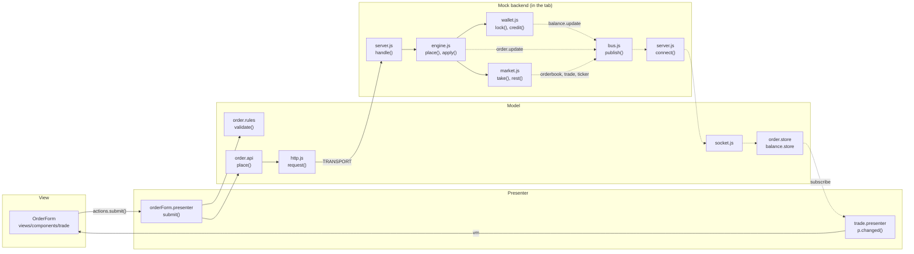

# The Orichal frontend: a beginner's guide

> **Since the server phase (CE-2):** `npm run dev` starts the Express server in `server/`, which serves this client and its API from one origin. The mock backend this guide describes moved to `server/src` in M2, and `serve` with `client/serve.json` was removed; the links to those files open them on the `frontend-static` branch, as they were. The client's pages, presenters and views are as described here; [`docs/backend-guide.md`](backend-guide.md) explains the server.

## Contents

1. [What Orichal is and how to run it](#1-what-orichal-is-and-how-to-run-it)
2. [Web basics](#2-web-basics)
3. [The tech stack](#3-the-tech-stack)
4. [The big picture](#4-the-big-picture)
5. [Two traces through the code](#5-two-traces-through-the-code)
6. [File by file](#6-file-by-file)
7. [CSS](#7-css)
8. [Testing and tooling](#8-testing-and-tooling)
9. [Where to look](#9-where-to-look)
10. [Terms to cram](#10-terms-to-cram)

## 1. What Orichal is and how to run it

Orichal is a simulated spot crypto exchange built for a course project. A *spot exchange* is a market where people buy and sell an asset for immediate delivery. On Orichal you trade four coins (BTC, ETH, SOL and BNB) against USDT, a coin that tracks the US dollar, using demo funds. No real money moves and there is no blockchain.

The project is planned in [the architecture declaration](../architecture_declaration/crypto-exchange-architecture-declaration%20(1).md), and the screens are drawn in the PDFs in [`ui_design/`](../ui_design). This guide describes the **static frontend phase**: only the part that runs in the browser has been built. Instead of a real server, a fake one written in JavaScript (the *mock backend*) runs inside the browser tab and answers every request. Section 8 of the architecture declaration is the build log for this phase.

### Running it

You need Node.js 20 or later (see [section 3](#3-the-tech-stack)). From the project folder:

```powershell
npm install
npm run dev
```

`npm install` downloads the tools listed in [`package.json`](../package.json) into `node_modules/`. `npm run dev` starts a small web server on port 5173. Open http://localhost:5173 in a browser. Any page can be opened directly, for example http://localhost:5173/trade/BTC-USDT.

### Demo accounts

Signing in is a mock: the accounts below live in the demo data, and nothing is checked against a real server.

| Account | Email | Password | Two-factor code |
| --- | --- | --- | --- |
| Demo trader | `demo@orichal.app` | `orichal-demo` | `123456` |
| Admin (Rohan Sethi) | `admin@orichal.app` | `orichal-demo` | none |

The demo trader has two-factor sign-in switched on (after the password, sign-in asks for a six-digit code from an authenticator app), an approved identity check and an unconfirmed email, so a banner asks them to confirm it. Their wallet starts with 1,616.000800 USDT free and 5,207.500000 USDT held by open orders, plus some BTC, ETH and SOL. You can also create an account on the Register page; a new account starts with 10,000 demo USDT.

The **Simulator · demo funds** badge in the header opens the demo controls. From there you can reset the demo data, drop the live connection for a few seconds to see the reconnecting state, or make the next request fail to see an error state.

## 2. Web basics

This section covers the few ideas the rest of the guide depends on.

### The browser, HTML, CSS and JavaScript

A **browser** (Chrome, Firefox, Edge, Safari) is a program that downloads files from a web address and turns them into a page you can see and use. It understands three languages, each with its own job.

- **HTML** (HyperText Markup Language) describes the *structure* of a page: headings, paragraphs, buttons, form fields, tables. It is written as *elements*, each marked by *tags* such as `<button>` and `</button>`. Tags can carry *attributes*, for example `<html lang="en">`.
- **CSS** (Cascading Style Sheets) describes how the page *looks*: colours, fonts, spacing and layout. A CSS file is a list of *rules*. Each rule has a *selector* that picks elements (such as `.btn` for every element with the class `btn`) and *declarations* that style them (such as `color: red`).
- **JavaScript** (JS) describes how the page *behaves*. It reacts to clicks and typing, fetches data, and changes the page while you use it.

When the browser reads HTML it builds the **DOM** (Document Object Model): a live tree of objects, one per element, that JavaScript can read and change. Changing the DOM changes what is on screen. An **event** is something that happens on the page, such as a click or a key press; JavaScript can *listen* for events and run a function when one happens.

### Servers, APIs and JSON

A **server** is a program on another computer that waits for requests and answers them. The browser and the server talk over **HTTP** (HyperText Transfer Protocol). Each request has a *method* that says what it wants (`GET` reads, `POST` creates, `PATCH` and `PUT` change, `DELETE` removes), a *path* such as `/wallet/balances`, and sometimes a *body* of data. Each response has a *status code*: `200` means OK, `201` created, `202` accepted for later, `204` done with nothing to return, `400` a bad request, `401` not signed in, `403` not allowed, `404` not found, `409` a conflict, `422` a rule broken, and `500` a server fault.

An **API** (Application Programming Interface) is the list of requests a server agrees to answer and the shape of each answer. Orichal's API is listed in section 4 of the architecture declaration. Every answer comes wrapped in the same **envelope**: `{ "success": true, "data": … }` when it worked, or `{ "success": false, "error": { "code", "message", "details" } }` when it did not.

**JSON** (JavaScript Object Notation) is the text format the data travels in. It writes objects in braces and lists in square brackets, for example `{ "asset": "USDT", "available": "1616.000800" }`. Orichal's demo data is stored as JSON files in [`client/src/models/data/`](../client/src/models/data).

### How the browser loads Orichal

1. You open http://localhost:5173/trade/BTC-USDT. The dev server (the `serve` tool) has no file at that path, so the rule in [`client/serve.json`](https://github.com/DivyanshuKirpal/backend_engineering_2/blob/frontend-static/client/serve.json) sends back [`client/index.html`](../client/index.html) instead. Every address gets the same HTML file; JavaScript decides which page to draw. This is called a **single-page application** (SPA).
2. The browser reads the `<head>` of `index.html`. It starts downloading three fonts early (`<link rel="preload">`), then the shared style sheets (`tokens.css`, `base.css`, `layouts.css` and the component sheets), then the script `<script type="module" src="/src/app/main.js">`.
3. The `<body>` holds an empty `<div id="app">` with the words "Loading Orichal…", a `<div id="toasts">` for pop-up messages, and a `<noscript>` note for browsers with JavaScript switched off.
4. Module scripts run once the HTML has been read. [`main.js`](../client/src/app/main.js) imports the modules it needs, and they import theirs, so the browser downloads the whole chain of files the start-up needs.
5. `main.js` restores the session (are you signed in?) and starts the router. The router works out which page the address asks for, downloads that page's code and its own style sheet, and draws it into `#app`.

From then on, clicking a link inside Orichal does not load a new HTML file. The router changes the address bar and swaps the page in place.

## 3. The tech stack

Everything the browser runs is plain HTML, CSS and JavaScript, written by hand. Node.js and npm are used only for tooling: the dev server, the data check, screenshots and the behaviour checks.

### The languages

| Technology | What it is | What Orichal uses it for | Where |
| --- | --- | --- | --- |
| HTML | The markup language for a page's structure | One shell page; every other element is built by the views | [`client/index.html`](../client/index.html), `client/src/views/` |
| CSS | The style sheet language | All the looks: colours, type, layout, the phone layouts; *custom properties* hold the design tokens | [`client/styles/`](../client/styles) |
| JavaScript | The programming language browsers run | Everything that happens: routing, the mock backend, the rules, the presenters and the views | [`client/src/`](../client/src) |
| ES modules | JavaScript's own module system: each file is a *module* that shares what it `export`s and loads what it needs with `import` | Every file. `<script type="module">` loads the first one; dynamic `import()` loads layouts and pages only when needed; *top-level await* lets `main.js` wait for the session before routing | [`app/main.js`](../client/src/app/main.js), [`app/routes.js`](../client/src/app/routes.js), [`app/router.js`](../client/src/app/router.js) |
| Promises and async/await | A *Promise* stands for a result that arrives later; `async` functions can `await` one without blocking the page | Every API call, page load and timer-based step | Everywhere; `Promise.all` in [`mock/db.js`](https://github.com/DivyanshuKirpal/backend_engineering_2/blob/frontend-static/client/src/models/api/mock/db.js) and [`router.js`](../client/src/app/router.js) |
| JSON | A text format for data | The seed data and every API response | [`client/src/models/data/`](../client/src/models/data) |

### Browser APIs

An *API* in this sense is a set of objects and functions the browser provides to JavaScript.

| API | What it is | What Orichal uses it for | Where |
| --- | --- | --- | --- |
| DOM | The browser's live tree of elements, with functions to create and change them | Building and updating every page | [`views/dom.js`](../client/src/views/dom.js) |
| DOM events | Notifications such as `click`, `input`, `submit`, `keydown` | Every button and field; link interception in the router | Views; [`router.js`](../client/src/app/router.js) |
| `fetch` | The built-in function for HTTP requests | Loading the seed JSON files; `fetchTransport` for the future real server | [`mock/db.js`](https://github.com/DivyanshuKirpal/backend_engineering_2/blob/frontend-static/client/src/models/api/mock/db.js), [`api/http.js`](../client/src/models/api/http.js) |
| History API | `history.pushState`, `replaceState`, `back()` and the `popstate` event, which change the address without a page load | The router; the Orders drawer's Back; tidying the OAuth address | [`router.js`](../client/src/app/router.js), [`shared/navigation.js`](../client/src/presenters/shared/navigation.js) |
| `URL`, `URLSearchParams` | Objects that parse and build web addresses and their `?key=value` queries | Matching routes, reading queries, building API URLs | [`router.js`](../client/src/app/router.js), [`http.js`](../client/src/models/api/http.js), [`orders.presenter.js`](../client/src/presenters/orders/orders.presenter.js) |
| `localStorage` | A small key-value store per site that survives reloads | The mock database (`orichal.demo.v1`), the refresh-cookie stand-in (`orichal.rt`), preferences (`orichal.prefs`), the last market (`orichal.lastMarket`) | [`mock/db.js`](https://github.com/DivyanshuKirpal/backend_engineering_2/blob/frontend-static/client/src/models/api/mock/db.js), [`mock/session.js`](https://github.com/DivyanshuKirpal/backend_engineering_2/blob/frontend-static/client/src/models/api/mock/session.js), [`preferences.store.js`](../client/src/models/stores/preferences.store.js), [`lastMarket.js`](../client/src/presenters/shared/lastMarket.js) |
| `EventTarget`, `CustomEvent` | The browser's base class for objects that send events, and an event that carries data in `detail` | The socket client; the `app:navigate` event; the admin queue refresh | [`realtime/socket.js`](../client/src/models/realtime/socket.js), [`navigation.js`](../client/src/presenters/shared/navigation.js), [`navbar.presenter.js`](../client/src/presenters/shared/navbar.presenter.js) |
| `BroadcastChannel` | A message channel between tabs of the same site | Logging out in one tab logs out the others | [`session.store.js`](../client/src/models/stores/session.store.js) |
| `BigInt` | Whole numbers of any size, written `10n` | Exact money arithmetic | [`domain/money.js`](../client/src/models/domain/money.js) |
| `Intl` | The browser's internationalisation library | `Intl.DisplayNames` gives country names for the identity check. Numbers and dates are formatted by hand rather than with `Intl.NumberFormat`, so rounding goes through money.js and the output matches the boards digit for digit | [`status.format.js`](../client/src/presenters/formatters/status.format.js), [`countries.js`](../client/src/presenters/shared/countries.js) |
| SVG | Scalable Vector Graphics: shapes written as elements the browser draws | Icons, status markers, the candle chart, the QR code, the favicon | [`sprite.svg`](../client/assets/icons/sprite.svg), [`StatusMarker.js`](../client/src/views/components/ui/StatusMarker.js), [`PriceChart.js`](../client/src/views/components/charts/PriceChart.js), [`QrCode.js`](../client/src/views/components/ui/QrCode.js) |
| `matchMedia` | Tests a CSS media query from JavaScript and reports changes | Switching the trade page between its desk and phone layouts | [`TradePage.js`](../client/src/views/pages/trade/TradePage.js) |
| `ResizeObserver` | Reports when an element changes size | The candle chart measures its box | [`PriceChart.js`](../client/src/views/components/charts/PriceChart.js) |
| `MutationObserver` | Reports changes to the DOM | A dialog notices it was removed and gives focus back | [`Overlay.js`](../client/src/views/components/ui/Overlay.js) |
| `queueMicrotask`, `requestAnimationFrame` | Run a function right after the current code, or just before the next screen paint | Batching redraws; moving focus after a draw | [`presenter.js`](../client/src/presenters/shared/presenter.js), [`router.js`](../client/src/app/router.js), [`Tabs.js`](../client/src/views/components/ui/Tabs.js) |
| `setTimeout`, `setInterval` | Run a function later, or repeatedly | The mock's network delay and engine delay, the market simulator, admin refreshes, toasts | [`mock/server.js`](https://github.com/DivyanshuKirpal/backend_engineering_2/blob/frontend-static/client/src/models/api/mock/server.js), [`mock/market.js`](https://github.com/DivyanshuKirpal/backend_engineering_2/blob/frontend-static/client/src/models/api/mock/market.js), [`presenter.js`](../client/src/presenters/shared/presenter.js) |
| Web Crypto (`crypto.randomUUID`, `getRandomValues`) | Secure random numbers from the browser | Idempotency keys, mock ids, tokens and addresses | [`http.js`](../client/src/models/api/http.js), [`mock/db.js`](https://github.com/DivyanshuKirpal/backend_engineering_2/blob/frontend-static/client/src/models/api/mock/db.js), [`mock/session.js`](https://github.com/DivyanshuKirpal/backend_engineering_2/blob/frontend-static/client/src/models/api/mock/session.js) |
| `FormData`, `File`, drag and drop | A form's fields and files as one object; files dropped on an element | The identity-check upload | [`kyc.api.js`](../client/src/models/api/kyc.api.js), [`FileDrop.js`](../client/src/views/components/ui/FileDrop.js) |
| Clipboard API | `navigator.clipboard.writeText` | Copy buttons for addresses and hashes | [`CopyButton.js`](../client/src/views/components/ui/CopyButton.js) |
| `pagehide` event | Fires when the user leaves or closes the page | Saving the mock database one last time | [`mock/db.js`](https://github.com/DivyanshuKirpal/backend_engineering_2/blob/frontend-static/client/src/models/api/mock/db.js) |

### Tooling

| Tool | What it is | What Orichal uses it for | Where |
| --- | --- | --- | --- |
| Node.js | A program that runs JavaScript outside the browser | Running the tooling scripts only; nothing in the app needs it | [`scripts/`](../scripts), [`package.json`](../package.json) |
| npm | Node's package manager: it installs packages and runs named scripts | `npm install`, `npm run dev`, `npm run checks` and the rest | [`package.json`](../package.json), [`package-lock.json`](../package-lock.json) |
| serve | A small static file server | The dev server on port 5173, with the SPA rewrite | [`client/serve.json`](https://github.com/DivyanshuKirpal/backend_engineering_2/blob/frontend-static/client/serve.json); started by `npm run dev` and by the scripts |
| Playwright | A library that drives real browsers from code | Screenshots, board comparison and the behaviour checks, in Chromium | [`screenshots.mjs`](../scripts/screenshots.mjs), [`compare.mjs`](../scripts/compare.mjs), [`checks/harness.mjs`](../scripts/checks/harness.mjs) |
| Self-hosted fonts | Font files served by the site itself instead of a font service; from the `@fontsource` packages | Barlow Semi Condensed for text, Azeret Mono for numbers | [`client/assets/fonts/`](../client/assets/fonts), `@font-face` in [`tokens.css`](../client/styles/tokens.css), preloads in [`index.html`](../client/index.html) |
| Vendored QR encoder | `qrcode-generator` (MIT licence), copied into the project | Deposit address QR codes | [`assets/vendor/qrcode-generator.mjs`](../client/assets/vendor/qrcode-generator.mjs), [`QrCode.js`](../client/src/views/components/ui/QrCode.js), [`copy-vendor.mjs`](../scripts/copy-vendor.mjs) |
| Git | Version control: it records every change as a *commit* | One commit per finished page; `.gitignore` keeps `node_modules/`, `.boards/` and `.screenshots/` out | [`.gitignore`](../.gitignore) |

### Why there is no framework

The architecture declaration plans the finished client in React 19 with Vite, Tailwind CSS, Zustand and Axios. This phase deliberately uses none of them, nor jQuery: the course phase allows only HTML, CSS, JavaScript with ES modules, the DOM, events, `fetch`, Promises, async/await and npm ([`CLAUDE.md`](../CLAUDE.md), Scope). That has three effects.

- There is no *build step*: no tool compiles or bundles the code. The files the browser runs are exactly the files in the repository, so you can read any of them and see what runs.
- The jobs a framework would do are done by small, readable pieces of the project: [`views/dom.js`](../client/src/views/dom.js) builds and updates the DOM (React's job), [`models/stores/createStore.js`](../client/src/models/stores/createStore.js) holds shared state (Zustand's), [`models/api/http.js`](../client/src/models/api/http.js) sends requests (Axios's), and [`app/router.js`](../client/src/app/router.js) maps addresses to pages (React Router's).
- The layers are kept as the plan draws them, so when React arrives the models and presenters can stay and only the views need rewriting.

## 4. The big picture

### The folder tree

```text
backend_engineering_2/
├── architecture_declaration/       the plan (sections 1 to 7) and this phase's build log (section 8)
├── ui_design/                      the two design PDFs: the screen boards and the UI kit
├── docs/                           this guide
├── server/                         reserved for the Express API; only a README for now
├── scripts/                        Node tooling: data check, boards, screenshots, compare, vendor
│   ├── checks/                     the Playwright behaviour checks, one file per page
│   └── data/                       how the seed data was generated, kept as a record
└── client/                         everything the browser loads
    ├── index.html                  the one page shell
    ├── serve.json                  dev server settings
    ├── assets/                     favicon, icon sprite, fonts/, vendor/ (the QR encoder)
    ├── styles/                     tokens.css, base.css, layouts.css
    │   ├── components/             one sheet per family of shared components
    │   └── pages/                  one sheet per page or group of pages
    └── src/
        ├── app/                    start-up, routes, guards, router
        ├── models/                 data, rules and state
        │   ├── api/                one client per API group, and http.js
        │   │   └── mock/           the fake backend, with routes/ for its endpoints
        │   ├── data/               seed JSON in the API's shapes
        │   ├── domain/             money.js and the business rules
        │   ├── realtime/           the socket client
        │   └── stores/             shared state with subscribe
        ├── presenters/             one per page or widget, grouped by area
        │   ├── formatters/         numbers, dates, statuses and asset tiles to text
        │   └── shared/             session, navbar, toasts, live book, cursor lists
        └── views/                  dom.js, mountView.js, loadStyle.js
            ├── layouts/            the five page frames
            ├── pages/              one module per page, grouped by area
            └── components/         ui/ (the kit), trade/, charts/, navigation/ and the rest
```

### Model, View, Presenter

The code is split into three layers, a pattern called **MVP** (Model, View, Presenter). Each layer has rules, set in [`CLAUDE.md`](../CLAUDE.md), and a search of the code confirms them: no view imports a model, and no model imports a presenter or a view.

| Layer | Folder | May | May not |
| --- | --- | --- | --- |
| Model | `client/src/models/` | Hold data and state, fetch from the API, apply the business rules, calculate money with `money.js` | Touch the DOM; know which page is showing |
| Presenter | `client/src/presenters/` | Call models, keep a page's own state, format every number and date through `formatters/`, return `{ vm, actions }` | Build DOM; do money arithmetic with ordinary numbers |
| View | `client/src/views/` | Build DOM through `views/dom.js` from `(vm, actions)`, call actions on clicks and typing | Import models; format numbers or dates; call presenters (only page and layout modules do) |

Two more rules cut across the layers. Money is a decimal string everywhere and is computed only in `models/domain/money.js`, with BigInt, never with floating-point numbers; charts get ordinary numbers from their presenter, for drawing only. And every URL is root-relative (`/styles/…`, `/src/…`).

Here is one real example, BTC/USDT's row on the Markets page.

1. **Model.** The ticker store ([`ticker.store.js`](../client/src/models/stores/ticker.store.js)) holds the market as the API sent it, all decimal strings: `{ symbol: "BTC-USDT", tickSize: "0.01", ticker: { last: "62140.50", changePct: "1.84", quoteVolume: "10430315.52", … } }`. A `ticker` event from the socket replaces the `ticker` part.
2. **Presenter.** [`markets.presenter.js`](../client/src/presenters/market/markets.presenter.js) subscribes to that store and builds each row of its view model with the formatters: `pair: "BTC/USDT"`, `last: fmtPrice("62140.50", "0.01")` which is `"62,140.50"`, `change: change("1.84")` which is `{ arrow: "▲", text: "+1.84%", tone: "up" }`, and `quoteVolume: "10.43M USDT"`. Its `actions` include `toggleStar(symbol)`, which calls `userApi.star` or `unstar`.
3. **View.** [`MarketTable.js`](../client/src/views/components/market/MarketTable.js) prints `r.last` in a cell exactly as given and wires the star button to `onClick: () => onToggle(row.symbol)`. It never sees `"62140.50"` or knows how many decimals BTC/USDT has.
4. **Page.** [`MarketsPage.js`](../client/src/views/pages/market/MarketsPage.js) joins them: `mountView(outlet, createMarketsPresenter(), MarketsView)`. When the store changes, the presenter calls `p.changed()`, and `mountView` redraws the view with the new view model.

Because the view only prints strings, it can be tested by looking at the page, and because the presenter never touches the DOM, its numbers can be checked without one.

### The mock backend

The plan's backend (an Express API, a matching engine, MongoDB and Redis) does not exist yet. So that the frontend can be built and tested in full, the folder [`client/src/models/api/mock/`](https://github.com/DivyanshuKirpal/backend_engineering_2/tree/frontend-static/client/src/models/api/mock) holds a fake one that runs inside the browser tab. It answers the same endpoints with the same `{ success, data }` envelope and the same data shapes as section 4 of the plan, keeps a database in `localStorage`, runs a market simulator and a matching engine, and pushes the same live events a socket server would.

The app reaches it through one line in [`http.js`](../client/src/models/api/http.js): `const TRANSPORT = mockTransport;`. `request()` builds a plain object `{ method, path, query, body, headers }` and passes it to `TRANSPORT`. In this phase that is the mock's `handle()`, which waits a moment, finds the route, runs the handler and returns `{ status, body }`, just as an HTTP response would have. For live events, [`socket.js`](../client/src/models/realtime/socket.js) calls the mock's `connect()` instead of opening a WebSocket.

When the real server arrives, [`server/README.md`](../server/README.md) lists the change:

1. Point `TRANSPORT` in `http.js` at `fetchTransport`, which already sends the same request with `fetch()` to `/api/v1`.
2. Make `socket.js` wrap a Socket.IO client, keeping its `subscribe`, `on` and `connect` methods.
3. Delete `models/api/mock/`.

Presenters and views do not change, because they only ever see the data `request()` resolves with and the events the socket dispatches. Two things outside the folder also go: `demo-accounts.json`, and the demo controls in `navbar.presenter.js`, which call the mock directly.

### How a request and a live update move through the layers

This diagram follows a limit order from the ticket to the screen. Solid arrows are calls; dotted arrows are events.



The request goes down the left side: the view calls an action, the presenter checks the order with the rules and calls the API client, and `http.js` hands it to the mock server, which runs the engine. The engine and the wallet publish events on the bus. The gateway passes them to the socket, the socket to the stores, the stores to the presenter, and the presenter redraws the view.

## 5. Two traces through the code

Both traces follow the demo trader on a 1440 px screen. Each step names the file and the function that does the work.

### Trace 1: opening /trade/BTC-USDT

You type http://localhost:5173/trade/BTC-USDT into a fresh tab while signed in as the demo trader.

**Loading the shell**

1. `serve` finds no file at `/trade/BTC-USDT`, so the rewrite in [`client/serve.json`](https://github.com/DivyanshuKirpal/backend_engineering_2/blob/frontend-static/client/serve.json) returns `index.html`. The browser loads the fonts, the shared style sheets and the module [`app/main.js`](../client/src/app/main.js), which imports its chain of modules.
2. Importing the stores runs their set-up code once: [`ticker.store.js`](../client/src/models/stores/ticker.store.js), [`balance.store.js`](../client/src/models/stores/balance.store.js) and the others register their `socket.on(…)` listeners, and [`session.store.js`](../client/src/models/stores/session.store.js) opens its BroadcastChannel.
3. `main.js` draws the empty `Toaster`, then calls `restoreSession()` in [`session.presenter.js`](../client/src/presenters/shared/session.presenter.js) and waits for it.

**Restoring the session (and starting the mock)**

4. `restoreSession()` sets `data-theme="light"` with `applyTheme()` and starts `loadMarkets()` without waiting for it.
5. `loadMarkets()` calls `marketApi.markets()` in [`market.api.js`](../client/src/models/api/market.api.js), which calls `get('/markets')` and so `request('GET', '/markets')` in [`http.js`](../client/src/models/api/http.js). `request` hands the request object to `TRANSPORT`, the mock's `handle()` in [`mock/server.js`](https://github.com/DivyanshuKirpal/backend_engineering_2/blob/frontend-static/client/src/models/api/mock/server.js).
6. This first request starts the mock: `whenReady()` runs `boot()`. `db.open()` in [`mock/db.js`](https://github.com/DivyanshuKirpal/backend_engineering_2/blob/frontend-static/client/src/models/api/mock/db.js) loads the saved database from `localStorage`, or on a first visit fetches the seventeen seed files and shifts their times to now. `market.init()` in [`mock/market.js`](https://github.com/DivyanshuKirpal/backend_engineering_2/blob/frontend-static/client/src/models/api/mock/market.js) loads the four books, tapes and candles and puts the open orders on the books. `market.start()` sets the simulator's timers. `engine.replayPending()` in [`mock/engine.js`](https://github.com/DivyanshuKirpal/backend_engineering_2/blob/frontend-static/client/src/models/api/mock/engine.js) schedules the seeded pending order (the demo trader's buy of 0.01000 BTC at 62,000.00) to be applied in a moment.
7. `handle()` waits its random delay, finds the `GET /markets` handler in [`routes/markets.js`](https://github.com/DivyanshuKirpal/backend_engineering_2/blob/frontend-static/client/src/models/api/mock/routes/markets.js), which maps each market with `marketDto` and reads its live ticker from the simulator, and returns `{ status: 200, body: { success: true, data: { markets } } }`. `request` returns `data`, and the ticker store becomes `ready`. `goLive()` subscribes the socket to the `tickers` room and to each `market:{symbol}` room; the socket has no connection yet, so it remembers the rooms.
8. Meanwhile `restoreSession()` calls `authApi.refresh()`, which posts `/auth/refresh`. The mock's `session.refresh()` in [`mock/session.js`](https://github.com/DivyanshuKirpal/backend_engineering_2/blob/frontend-static/client/src/models/api/mock/session.js) reads the stand-in cookie `orichal.rt`, finds the demo trader's session and issues a new access token. `setAccessToken` keeps it in memory, and `userApi.me()` reads `GET /users/me`, sent with `Authorization: Bearer …`.
9. `startUser({ user, accessToken })` calls `signIn` in the session store: the store becomes `{ status: 'user', user }` and `socket.connect(accessToken)` in [`socket.js`](../client/src/models/realtime/socket.js) opens a connection with the mock's `connect()`. That joins the private room `user:66f19a3c5e7b2d4f8a1c0e01` and the public rooms remembered in step 7, and sets the socket's status to `connected`, which the connection store passes on. `startUser` also copies the account's preferences and starts `loadBalances()` and `loadNotifications()`.

**Routing**

10. `main.js` calls `start(#app)` in [`router.js`](../client/src/app/router.js). `resolve({ initial: true })` calls `match('/trade/BTC-USDT')` in [`routes.js`](../client/src/app/routes.js), which returns the trade route and `params: { symbol: 'BTC-USDT' }`.
11. `guard(route, url)` in [`guards.js`](../client/src/app/guards.js) returns `null`: the route's access is `public`.
12. No layout is mounted yet, so the router imports [`TradeLayout.js`](../client/src/views/layouts/TradeLayout.js) and calls its `mount(root, ctx)`. It creates a navbar presenter with `createNavbarPresenter()`, draws `AppHeader` with "Matching engine live" and the bell, and `VerifyEmailBanner` (the demo trader's email is unconfirmed), and returns its `outlet`.
13. The router draws `PageLoading()` into the outlet, imports [`TradePage.js`](../client/src/views/pages/trade/TradePage.js), and waits for its four sheets through `loadStyle`. Then it calls `mount(outlet, ctx, layout)`.

**The page and its presenters**

14. `TradePage.mount` calls `createTradePresenter('BTC-USDT')` in [`trade.presenter.js`](../client/src/presenters/trade/trade.presenter.js). It subscribes to the tickers, assets, session and balance stores, calls `loadMarkets()` and `loadAssets()`, and remembers BTC-USDT as the last market. Then it creates the six children, and each starts its own loading:
    - [`chart.presenter.js`](../client/src/presenters/trade/chart.presenter.js) joins `candles:BTC-USDT:15m` and loads 240 candles from `GET /markets/BTC-USDT/candles`.
    - [`recentTrades.presenter.js`](../client/src/presenters/trade/recentTrades.presenter.js) joins `market:BTC-USDT` and loads `GET /markets/BTC-USDT/trades`.
    - [`myOrders.presenter.js`](../client/src/presenters/trade/myOrders.presenter.js) calls `loadOpenOrders()` in [`order.store.js`](../client/src/models/stores/order.store.js) (`GET /orders?state=open`), then picks the oldest BTC/USDT order and loads `GET /orders/:id` for its lifecycle.
    - [`orderBook.presenter.js`](../client/src/presenters/trade/orderBook.presenter.js) calls `createLiveBook` in [`liveBook.js`](../client/src/presenters/shared/liveBook.js), which joins `market:BTC-USDT`, starts buffering `orderbook` deltas, and loads the snapshot `GET /markets/BTC-USDT/orderbook?depth=50`.
    - [`marketHeader.presenter.js`](../client/src/presenters/trade/marketHeader.presenter.js) and [`orderForm.presenter.js`](../client/src/presenters/trade/orderForm.presenter.js) load nothing. The ticket fills its price with the last price the first time it builds its view model.
15. `TradePage.mount` checks `matchMedia('(max-width: 767px)')`, which is false at 1440 px, and draws.

**The first draw**

16. `draw()` reads `presenter.vm`. The markets are already in the ticker store, so the status is `ready` and the view model holds the header, the ticket and the loading states of the chart, book, tape and orders. `TradeView` builds `MarketHeader` and the `Desk` grid with `h()`, and `render()` in [`dom.js`](../client/src/views/dom.js) puts them into the outlet. The panels still loading show "Loading candles…", "Loading the order book…" and so on.
17. The router sets the title to "BTC/USDT · Trade · Orichal". On a first load it leaves focus where it is; after an in-app navigation it would move focus to the page's `<h1>`.
18. As each response arrives, its presenter changes its state and calls `p.changed()`. The redraws are queued with `queueMicrotask`, so several arrivals in the same moment cause one redraw. `render()` updates the DOM in place: the ladder's rows, the candles and the tape appear while the ticket keeps any focus it has.

**From then on: live updates**

19. Every 1.4 to 3.2 seconds `requote()` in `market.js` moves the bot's ladder and `publishBook()` publishes the changed levels with the next `seq` on `market:BTC-USDT` through [`bus.js`](https://github.com/DivyanshuKirpal/backend_engineering_2/blob/frontend-static/client/src/models/api/mock/bus.js). The gateway passes the event to the socket, which dispatches an `orderbook` event. The live book checks the sequence number with `apply()` in [`orderBook.model.js`](../client/src/models/domain/orderBook.model.js): the next number is applied and the ladder redraws; a skipped one reloads the snapshot.
20. Every 6 to 20 seconds `botTrade()` takes from the best level and `print()` publishes `trade` (the tape adds a row), `ticker` (the ticker store updates the header's price and 24-hour figures), `candle` (the chart merges it with `candles.model.merge`) and `orderbook`.
21. A moment after start-up the engine applies the seeded pending order: its `order.update` event moves it from pending to open in the order store, and it rests on the book at 62,000.00.

### Trace 2: placing a limit buy and seeing it fill

The demo trader has 1,616.000800 USDT free. Suppose the book still looks as the board drew it: best bid 62,140.40, best ask 62,141.10. They buy 0.01000 BTC at 62,140.50, one tick above the best bid.

**Typing**

1. In `OrderForm` ([`OrderForm.js`](../client/src/views/components/trade/OrderForm.js)) the price field is a `NumberField`. Each key press fires `input`, and the field's handler calls `actions.setPrice(text)` in [`orderForm.presenter.js`](../client/src/presenters/trade/orderForm.presenter.js). `setPrice` accepts the text only if it looks like part of a number, stores it, and calls `p.changed()`. Typing the amount calls `setQuantity` the same way.
2. On each redraw the presenter's `vm()` builds the order `{ market: 'BTC-USDT', side: 'buy', type: 'limit', price: '62140.50', quantity: '0.01' }`, checks it with `rules.validate` in [`order.rules.js`](../client/src/models/domain/order.rules.js) (the price fits the 0.01 tick, the amount fits the 0.00001 step, 621.405 USDT is above the 5 USDT minimum and below the free balance), and asks `rules.engineWillDo` what would happen against the live book from `book.levels()`. No ask is at or below 62,140.50 and the price beats the best bid, so the answer is `{ kind: 'rest', place: 'newBest' }`, printed as "Rest at 62,140.50 as the new best bid, first in its queue. It fills when a sell order crosses that price." The view model also gives the total "621.41", the fee line "0.00001000 BTC" (the most it could be, at the 0.1% taker rate) and the button "Place buy · 0.01000 BTC".
3. `render()` updates the ticket in place, so the caret stays in the field being typed into.

**Submitting**

4. Clicking the button submits the form. Its `onSubmit` handler calls `e.preventDefault()`, so the browser does not reload the page, and then `actions.submit()`.
5. `submit()` validates again, sets `busy` (the button reads "Placing…"), and calls `orderApi.place(order)` in [`order.api.js`](../client/src/models/api/order.api.js).
6. `place()` makes one key with `idempotencyKey()`, a random UUID from `crypto.randomUUID()`, and sends `request('POST', '/orders', { body, headers: { 'Idempotency-Key': key } })`. If that failed with a network error, it would send again with the same key.
7. `request()` adds the `Authorization` header and calls `TRANSPORT`, the mock's `handle()`. After 220 to 520 ms it finds `POST /orders` in [`routes/orders.js`](https://github.com/DivyanshuKirpal/backend_engineering_2/blob/frontend-static/client/src/models/api/mock/routes/orders.js). The handler calls `session.requireUser(ctx)` and `requireFields`, then `engine.place(user.id, ctx.body, ctx.headers['idempotency-key'])`. (`handle()` lower-cased the header names.)

**The engine accepts it**

8. `place()` in [`engine.js`](https://github.com/DivyanshuKirpal/backend_engineering_2/blob/frontend-static/client/src/models/api/mock/engine.js) checks that the account is active and BTC/USDT is not halted, looks the key up in `db().idempotency` (it is new), and runs the same `rules.validate` against the trader's free balances. It builds the order record: `status: 'pending'`, `timeInForce: 'GTC'`, the price fixed to 2 places and the quantity to 5, `clientOrderId` set to the key.
9. `rules.lockFor()` says a limit buy locks price × quantity of USDT: 621.405. `wallet.lock()` in [`mock/wallet.js`](https://github.com/DivyanshuKirpal/backend_engineering_2/blob/frontend-static/client/src/models/api/mock/wallet.js) runs `write()`: free goes from 1,616.000800 to 994.595800 and locked from 5,207.500000 to 5,828.905000, worked out with `money.add`. It appends an `order_lock` ledger entry (−621.405000 free, +621.405000 locked) and publishes `balance.update` to `user:{id}`.
10. The engine stores the order, records the key, and publishes `order.update` with status `pending`. It schedules `apply()` 280 to 720 ms later and returns the Order DTO. The route answers `202 Accepted` with `{ order }`.
11. The `balance.update` and `order.update` events were published while the request was still being handled, so they reach the client before the 202 response. The balance store replaces the USDT balance, and `mergeOrder` in the order store adds the pending order. When the response arrives, `submit()` calls `mergeOrder(placed)` too; the store keeps the newest copy of each order by its `updatedAt`, so nothing is duplicated.
12. `submit()` shows a toast titled "Order placed" that reads "Buy 0.01000 BTC at 62,140.50. The engine takes it from here.", clears the amount, and calls `onPlaced`, which makes My orders pick the new order and load its lifecycle. The ticket now shows "Free 994.60 USDT".

**The engine applies it**

13. `apply()` checks the market is still active, records `appliedAt`, and calls `market.take('BTC-USDT', { side: 'buy', limit: '62140.50', quantity: '0.01', userId })` in [`market.js`](https://github.com/DivyanshuKirpal/backend_engineering_2/blob/frontend-static/client/src/models/api/mock/market.js). The best ask, 62,141.10, is above the limit, so `take()` stops at once and returns no fills.
14. A limit order that did not fill becomes `open`, and `market.rest(order)` puts it on the book: it joins the `humans` map at 62,140.50 with nobody ahead of it. `publishBook()` publishes an `orderbook` delta with the new level and the next `seq`. The engine publishes `order.update` with status `open`.
15. On the client, the live book applies the delta and the ladder redraws with a row at 62,140.50 tagged "You · 1st in queue". The order store replaces the order, and My orders reloads its detail 150 ms later: the timeline now reads "Placed. The API accepted it (202) and locked 621.405 USDT." and "On the book. The engine queued it at 62,140.50."

**The fill**

16. Within a few seconds `botTrade()` in `market.js` decides to sell. It takes from the best bid, which is now the trader's order (the bot's own ladder never quotes through a person's order), usually the whole 0.01000 BTC. For each fill that hit a person's order it calls the engine's hook, `makerFill()`, and then `print()`.
17. `makerFill()` calls `settle(order, fill, 'maker', tradeId, time)`. The resting order is the *maker*, so the fee is the maker rate, 0.08%: 0.00000800 BTC. `settle` writes three ledger entries through the wallet: `trade_debit` (−621.405000 locked USDT), `trade_credit` (+0.01000000 BTC) and `trade_fee` (−0.00000800 BTC). The fill was at the order's own price, so no price improvement is unlocked. The order's filled quantity, executed quote, fee and average price are updated, its status becomes `filled`, and a fill record is stored. Each wallet write publishes `balance.update`; `pushOrder` publishes `order.update`; `notifyFilled` stores and publishes a notification: "Order filled. Buy 0.01000 BTC at 62,140.50".
18. `print()` adds the trade to the tape, updates the ticker and the candles, and publishes `trade`, `ticker`, `candle` and an `orderbook` delta that removes the 62,140.50 level.

**The redraw**

19. In the browser the socket dispatches each event, and the stores and presenters react:
    - the order store's `mergeOrder` drops the order from the open list, because `filled` is not an open status;
    - the balance store updates USDT (locked back to 5,207.500000) and BTC (0.00999200 more free);
    - the notification store adds the notification, and the bell's count goes up by one;
    - the live book removes the level, so the "You" tag goes;
    - the tape gets a row at 62,140.50 in the sell colour, read out to screen readers as "Seller took", and the header and chart take the new last price.
20. My orders keeps the order picked, so its last step stays in view. Its `order.update` listener reloads `GET /orders/:id`, and `lifecycle()` in [`orderLifecycle.js`](../client/src/presenters/orders/orderLifecycle.js) adds "Filled. 0.01000 BTC at 62,140.50. You were the maker." The ledger beside it lists the four entries the order wrote. All these changes call `p.changed()` within a few milliseconds, and the queued microtask redraws the page once.

## 6. File by file

Paths below are relative links, so they open on click in VS Code and on GitHub. "Signature" means the function's name and the inputs it takes. Where a file exports many small helpers, they are listed in one line each.

### 6.1 package.json

[`package.json`](../package.json) describes the project to npm.

- `"type": "module"` tells Node.js to read the tooling scripts as ES modules (see [section 3](#3-the-tech-stack)).
- `"scripts"` names the commands `npm run …` can start: `dev`, `check:data`, `boards`, `vendor`, `shots`, `compare` and `checks`. [Section 8](#8-testing-and-tooling) explains each one.
- `"devDependencies"` lists the five tools npm installs: the two `@fontsource` font packages, `playwright`, `qrcode-generator` and `serve`. They are *dev* dependencies because the browser never loads anything from `node_modules/`; the fonts and the QR encoder are copied into `client/assets` by `npm run vendor`.
- `"overrides"` pins `compression`, a package that `serve` depends on, to version 1.8.2.
- `"engines"` asks for Node 20 or later.

[`package-lock.json`](../package-lock.json) is written by npm. It records the exact version of every package installed, so every machine installs the same ones. Nobody edits it by hand.

### 6.2 client/index.html

[`client/index.html`](../client/index.html) is the only HTML file, the *shell* every page is drawn into.

- `<html lang="en" data-theme="light">`: the language, for screen readers, and the theme, which the CSS reads (see [section 7](#7-css)).
- `<meta name="viewport" …>` makes phones lay the page out at their own width instead of zooming out.
- The favicon, three font preloads, thirteen shared style sheets, and one module script, [`/src/app/main.js`](../client/src/app/main.js).
- `<div id="app">` is the root the router draws layouts and pages into. `<div id="toasts">` holds the pop-up messages. `<noscript>` explains that the demo needs JavaScript.

### 6.3 client/serve.json

[`client/serve.json`](https://github.com/DivyanshuKirpal/backend_engineering_2/blob/frontend-static/client/serve.json) configures the `serve` dev server.

- `rewrites`: any path that has no file behind it gets `/index.html`, so a link straight to `/wallet` works. This is what makes the single-page app possible on a plain file server.
- `directoryListing: false`: never show a list of files.
- A `Cache-Control: no-cache` header on everything, so the browser checks for a newer file on every load and you always run the latest code.

### 6.4 client/assets

[`client/assets/`](../client/assets) holds the files the pages use that are not code or styles.

- [`favicon.svg`](../client/assets/favicon.svg): the Orichal mark (two open rings with a solid centre) in the brass colour `#735520`, shown in the browser tab.
- [`icons/sprite.svg`](../client/assets/icons/sprite.svg): an *SVG sprite*, one file holding every icon as a `<symbol>` with an id (`mark`, `bell`, `search`, `chevron-down`, `copy`, `lock`, `star`, `logout` and about twenty more). The `Icon` view draws one with `<use href="/assets/icons/sprite.svg#bell">`, so the icons load once and take the text colour.
- [`fonts/`](../client/assets/fonts): seven self-hosted font files in WOFF2, a compressed web font format. Barlow Semi Condensed (weights 400, 500, 600 and 700) is the text face; Azeret Mono (400, 500 and 600) is the face for numbers, whose digits all have the same width so columns of prices line up. All seven follow the same pattern: one file per weight, copied from the `@fontsource` packages by `npm run vendor` and declared with `@font-face` rules in `tokens.css`.
- [`vendor/qrcode-generator.mjs`](../client/assets/vendor/qrcode-generator.mjs): a third-party QR code encoder by Kazuhiko Arase, under the MIT licence, copied unchanged from the `qrcode-generator` package. It exports `qrcode(typeNumber, errorCorrectionLevel)`. Only `views/components/ui/QrCode.js` imports it, to draw the deposit address as a QR code. *Vendored* means a copy of someone else's code kept inside the project.

### 6.5 client/styles

The style sheets are covered as a system in [section 7](#7-css). One line each:

- [`tokens.css`](../client/styles/tokens.css): the fonts' `@font-face` rules and every design token (colours, type sizes, spacing, radii, shadows) as CSS custom properties.
- [`base.css`](../client/styles/base.css): the reset, the page defaults, the type classes such as `.t-mono` and `.t-price`, focus rings and the screen-reader-only class.
- [`layouts.css`](../client/styles/layouts.css): the frames the five layouts draw (public, trade, account, admin, auth).
- [`components/`](../client/styles/components): one sheet per family of shared components, all following the same pattern (a header comment naming the UI-kit panel, then rules on the components' classes):
  - [`buttons.css`](../client/styles/components/buttons.css): `.btn` and its variants, icon buttons;
  - [`chart.css`](../client/styles/components/chart.css): the candle chart and its toolbar;
  - [`data.css`](../client/styles/components/data.css): status markers, asset tiles, price changes, tables, pagination, copy buttons;
  - [`fields.css`](../client/styles/components/fields.css): labels, inputs, number fields, selects, checkboxes, the code boxes;
  - [`footer.css`](../client/styles/components/footer.css) and [`header.css`](../client/styles/components/header.css): the footer and the header with its menus;
  - [`ladder.css`](../client/styles/components/ladder.css): the price ladder;
  - [`navigation.css`](../client/styles/components/navigation.css): the account and admin sidebars;
  - [`notices.css`](../client/styles/components/notices.css): the verify-email bar, empty states, page states, toasts;
  - [`orders.css`](../client/styles/components/orders.css): the order timeline, the ledger table and the order drawer;
  - [`overlays.css`](../client/styles/components/overlays.css): drawers, modals and confirm dialogs over a scrim;
  - [`panels.css`](../client/styles/components/panels.css): panels, the halted-market banner, the KYC notice, skeletons;
  - [`tabs.css`](../client/styles/components/tabs.css): segmented and underlined tabs and the Buy and Sell toggle.
- [`pages/`](../client/styles/pages): one sheet per page or group of pages, each scoped by the page's class: [`account.css`](../client/styles/pages/account.css) (Profile, Security, Verification), [`admin.css`](../client/styles/pages/admin.css) (every admin page), [`auth.css`](../client/styles/pages/auth.css) (Log in, its code step, Register, the OAuth callback), [`funds.css`](../client/styles/pages/funds.css) (Deposit and Withdraw), [`history.css`](../client/styles/pages/history.css), [`home.css`](../client/styles/pages/home.css), [`info.css`](../client/styles/pages/info.css) (Fees and Legal), [`markets.css`](../client/styles/pages/markets.css), [`orders.css`](../client/styles/pages/orders.css), [`trade.css`](../client/styles/pages/trade.css) and [`wallet.css`](../client/styles/pages/wallet.css).

### 6.6 client/src/app: start-up and routing

#### [`app/main.js`](../client/src/app/main.js)

The entry point that `index.html` loads. It has no exports; it runs once, top to bottom:

1. Finds `#toasts` and draws the `Toaster` view into it, and redraws it each time the toast list in `presenters/shared/toasts.js` changes.
2. Logs any promise that failed without a handler (`unhandledrejection`), so a mistake shows in the browser console.
3. `await restoreSession()`: asks the mock server whether this browser holds a session, so the guards know if you are signed in before the first page is chosen. A top-level `await` like this works only in a module script.
4. `start(document.getElementById('app'))` hands the root element to the router.

#### [`app/routes.js`](../client/src/app/routes.js)

The table of every address the app answers: 34 routes for 33 pages (`/account` only redirects to `/account/profile`). Each route is an object:

```js
  { path: '/trade/:symbol', title: 'Trade', layout: 'trade', access: 'public', load: page('trade/TradePage.js') },
```

- `path` is the pattern; `:symbol` is a *parameter* that matches any one segment, so `/trade/BTC-USDT` gives `{ symbol: 'BTC-USDT' }`.
- `layout` names one of the five layouts; `access` is `public`, `guest` (signed-out only), `user` or `admin`.
- `load` is a function that imports the page module with a dynamic `import()`, so a page's code downloads only when it is first opened.
- `stretch: true` marks the nine stretch pages, which load `NotBuiltPage.js` through `notBuilt(name)`.

Exports:

- `routes`: the array above, with `'*'` last as the 404 page.
- `match(pathname)` → `{ route, params }`. Turns each route's path into a regular expression (`:name` becomes `([^/]+)`), tries them in order, decodes the parameters, and falls back to the `'*'` route. The router calls it on every navigation.

#### [`app/guards.js`](../client/src/app/guards.js)

The plan's GuestRoute, ProtectedRoute and AdminRoute, as one function.

- `guard(route, url)` → `null` to allow the route, or `{ redirect, message? }`. It reads only `sessionState()` from the session presenter. A signed-in user who opens a guest page goes to `/markets`; a guest who opens a user or admin page goes to `/login?next=…`, so login can send them back; a user who is not an admin goes to `/markets` with the message "That page is for admins only."

#### [`app/router.js`](../client/src/app/router.js)

A small router built on the browser's **History API**, which lets JavaScript change the address bar without loading a new page. It keeps the current layout mounted while pages that share it change, and lets a page handle a change of query (such as `?tab=history`) itself.

Exports:

- `start(element)`: runs once from `main.js`. It listens for clicks on links (`onLinkClick`), for the browser's Back and Forward buttons (`popstate`), and for the `app:navigate` event presenters fire through `navigate()`. It also re-checks the open page when a session ends (a logout here or in another tab), then draws the first page.
- `go(to, { replace })`: changes the address with `history.pushState` (a new history entry) or `history.replaceState` (replacing the current one), then calls `resolve()`.

Internal functions:

- `onLinkClick(e)` catches a left click on any same-origin `<a href>` and calls `go()` instead of letting the browser load the URL. It leaves alone clicks with a modifier key, links with `target`, `download` or `data-external`, and in-page anchors such as the skip link.
- `resolve({ initial, quiet })` draws whatever the address now asks for:

```js
  const { route, params } = match(url.pathname);

  if (route.redirect) return go(route.redirect, { replace: true });
  const verdict = guard(route, url);
  if (verdict) {
    if (verdict.message) toast({ title: verdict.message, tone: 'error' });
    return go(verdict.redirect, { replace: true });
  }
…
  let mod;
  try {
    mod = await route.load();
    if (mod.styles) await Promise.all(mod.styles.map(loadStyle));
  } catch (err) {
```

It matches the route, follows a redirect, and asks the guard. If the same page is already open with the same parameters and has an `update()` function, only `update(ctx)` runs. If the layout changes, the old page and layout unmount and the new layout module is imported and mounted. Then it draws `PageLoading()` into the layout's outlet, imports the page module, waits for the page's own style sheets (`mod.styles`) through `loadStyle`, and calls the page's `mount(outlet, ctx, layout)`. A failed import draws `PageError` with a Try again button. Finally it sets `document.title`, scrolls to the top, and moves keyboard focus to the new page's `<h1>` so a screen reader announces it.

A counter called `token` guards against races: every `resolve()` takes a new number, and if another navigation started while this one waited for an import, the older one stops (`if (mine !== token) return`).

The `ctx` object every page receives is `{ path, params, query, title, pattern }`.

### 6.7 client/src/models: data, rules and state

The models layer owns everything that is data or a rule about data: the API clients, the mock backend, the seed data, money arithmetic and the business rules, the socket, and the stores.

#### The API clients

[`models/api/http.js`](../client/src/models/api/http.js) is the one door every API call goes through.

```js
export async function request(method, path, { query, body, headers = {} } = {}) {
  const send = () => TRANSPORT({
…
    headers: { ...headers, ...(accessToken ? { Authorization: `Bearer ${accessToken}` } : {}) },
  });

  let res;
  try {
    res = await send();
    if (res.status === 401 && !NO_REFRESH.has(path) && (await refreshToken())) res = await send();
  } catch (err) {
…
  }

  if (res.status === 204) return null;
  if (res.body?.success) return res.body.data;
  throw new ApiError(res.status, res.body?.error);
}
```

`request(method, path, { query, body, headers })` builds one request and hands it to `TRANSPORT`, a function that takes `{ method, path, query, body, headers }` and returns a promise of `{ status, body }`. It adds the **access token** (a short-lived string that proves which signed-in session is asking) as an `Authorization: Bearer …` header when one is held. If the answer is `401` (not signed in) and the path is not one of the sign-in calls in `NO_REFRESH`, it calls `refreshToken()` once and sends the request again. A transport that throws (a network failure) becomes an `ApiError` with code `NETWORK`. A `204` resolves with `null`, a success envelope resolves with its `data`, and an error envelope is thrown as an `ApiError`. So callers never see the envelope: they get the data or catch an error.

Everything else in the file:

- `class ApiError extends Error` with `status`, `code` and `details` (for example `code: 'INSUFFICIENT_BALANCE'`).
- `fetchTransport({ method, path, query, body, headers })`: the transport for the real server. It builds `/api/v1` + path with the query, sends it with `fetch()` (JSON, or `FormData` for file uploads, with `credentials: 'same-origin'` so the refresh cookie travels), and returns `{ status, body }`. It is written but not used yet.
- `const TRANSPORT = mockTransport;`: in this phase every request goes to `handle()` in the mock server. Changing this one line points the app at a real server.
- `setAccessToken(token)` and `getAccessToken()`: the access token lives in a variable in this module, never in storage, so other scripts cannot read it from `localStorage`.
- `refreshToken()` (internal): posts `/auth/refresh` and keeps the new token. If several requests get a 401 at once, they share one refresh (`refreshing ??= …`).
- `get(path, query)`, `post(path, body, headers)`, `patch(path, body)`, `put(path, body)` and `del(path, query)`: one-line shortcuts for `request`.
- `idempotencyKey()` → a fresh random UUID from `crypto.randomUUID()`.

The eight API clients all follow one pattern: one file per group of endpoints in section 4 of the architecture declaration, one exported function per endpoint, each a single call to `get`, `post`, `patch`, `put` or `del` that resolves with the response's `data`. A comment above each function names what it returns. Parameters that go in the path are escaped with `encodeURIComponent`.

| File | Exports |
| --- | --- |
| [`auth.api.js`](../client/src/models/api/auth.api.js) | `register`, `login` (returns `{ user, accessToken }` or `{ requires2fa, loginTicket }`), `loginTwoFactor`, `refresh`, `logout`, `resendVerification` |
| [`user.api.js`](../client/src/models/api/user.api.js) | `me`, `updateMe`, `changePassword`, `setupTwoFactor`, `enableTwoFactor`, `disableTwoFactor`, `sessions`, `revokeSession`, `revokeOtherSessions`, `activity`, `watchlist`, `star`, `unstar` |
| [`market.api.js`](../client/src/models/api/market.api.js) | `assets`, `asset`, `markets`, `market`, `orderbook(symbol, depth)`, `trades(symbol)`, `candles(symbol, { interval, from, to, limit })` |
| [`order.api.js`](../client/src/models/api/order.api.js) | `place`, `list({ state, market, side, cursor, limit })`, `one(id)`, `cancel(id)`, `cancelAll({ market })`, `myTrades` |
| [`wallet.api.js`](../client/src/models/api/wallet.api.js) | `balances`, `ledger({ asset, types, cursor, limit })`, `transactions`, `depositAddress`, `deposit`, `cardDeposit`, `withdraw`, `cancelWithdrawal` |
| [`kyc.api.js`](../client/src/models/api/kyc.api.js) | `mine`, `submit` (builds a `FormData`, since the real endpoint takes file uploads) |
| [`notification.api.js`](../client/src/models/api/notification.api.js) | `list`, `markRead`, `markAllRead` |
| [`admin.api.js`](../client/src/models/api/admin.api.js) | `stats`, `users`, `user`, `setUserStatus`, `setUserRole`, `kyc`, `kycDocument`, `decideKyc`, `withdrawals`, `decideWithdrawal`, `markets`, `createMarket`, `updateMarket`, `assets`, `auditLogs`, `systemHealth` |

Two functions do more than one call. `order.api.js`'s `place({ market, side, type, price, quantity, quoteQuantity })` creates one **Idempotency-Key** before sending. A request is *idempotent* when sending it twice has the same effect as sending it once; the key is what lets the server tell a repeat from a new order. The function sends the key, and if the first attempt fails with a network error it sends again *with the same key*, so the server can recognise the retry and never places a second order. `wallet.api.js`'s `deposit` and `withdraw` also send a fresh Idempotency-Key header.

#### The mock backend: models/api/mock/

The mock backend is a fake server written in browser JavaScript. It answers the same endpoints, with the same envelope and data shapes, as the planned Express server, and it pushes the same live events. It exists so the whole frontend can be built and tested before any backend exists. When the real server arrives the folder is deleted ([`server/README.md`](../server/README.md) lists the three steps).

[`mock/server.js`](https://github.com/DivyanshuKirpal/backend_engineering_2/blob/frontend-static/client/src/models/api/mock/server.js) is the front door, standing in for the planned Express app (Express is a web server framework for Node.js) and its Socket.IO gateway (the part that pushes live events to browsers).

```js
export async function handle({ method, path, query = {}, body = null, headers = {} }) {
  await whenReady();
  const [lo, hi] = method === 'GET' ? latency.GET : latency.WRITE;
  await sleep((lo + Math.random() * (hi - lo)) * (settings.slow ? 4 : 1));
…
  const route = routes.find((r) => r.method === method && r.pattern.test(path));
…
  try {
    const { status = 200, data } = await route.handler({
      method, path, params, query, body: parsedBody, headers: lowerHeaders,
      user: who?.user ?? null, session: who?.session ?? null,
    });
    return { status, body: status === 204 ? null : { success: true, data } };
  } catch (err) {
```

- At load, it collects the route lists from the eight files in `routes/` and turns each `[method, path, handler]` into a regular expression, the same way `routes.js` does on the client.
- `whenReady()` → a promise that resolves once `boot()` has opened the database (`db.open()`), loaded the market simulator (`market.init()`), started its timers (`market.start()`) and replayed orders left pending (`engine.replayPending()`). It runs once.
- `handle({ method, path, query, body, headers })` → `{ status, body }`. It waits a random 140 to 380 ms for a read, or 220 to 520 ms for a write, so loading states are visible. If the demo control "fail the next request" is set, it answers `503`. Otherwise it finds the route, decodes the path parameters, lower-cases the header names, finds the signed-in user from the `Authorization` header (`session.fromHeader`), turns a `FormData` body into a plain object, and calls the handler with a context object `ctx`. The handler returns `{ status, data }`, which becomes a success envelope; a thrown `MockError` becomes an error envelope with its status and code; anything else is logged and becomes a `500`.
- `connect({ token, onEvent })` → `{ join(room), leave(room), close() }`: opens a fake socket connection. Public rooms (`tickers`, `market:BTC-USDT`, `candles:BTC-USDT:15m`) are joined by name and checked against a pattern. A valid token also joins the private room `user:{id}`, which cannot be joined by name. Each room is a listener on the event bus that forwards events to `onEvent`.
- `failNextRequest()`, `setSlowNetwork(on)` and `resetDemo()`: the demo controls. `resetDemo()` stops the simulator, clears the stand-in cookie, re-seeds the database and starts again; requests that arrive meanwhile wait for it.

[`mock/db.js`](https://github.com/DivyanshuKirpal/backend_engineering_2/blob/frontend-static/client/src/models/api/mock/db.js) is the mock's database, one JavaScript object saved to `localStorage` under the key `orichal.demo.v1`. **localStorage** is a small key-value store the browser keeps for each site, so data survives a reload.

- `fetchSeed(file)` → the `data` of one seed JSON file, fetched from `/src/models/data/` and checked to be a `{ success, data }` envelope.
- `newestTime(value)` → the latest ISO timestamp anywhere inside a value, in milliseconds. `shiftTimes(value, ms)` → a copy with every ISO timestamp moved by `ms`.
- `seed()` (internal) loads all seventeen seed files at once with `Promise.all`, finds the newest timestamp in them, and shifts every timestamp so that one lands 1.5 seconds before now. This is how a demo account seeded weeks ago still shows "today, 14:02". It also builds the `credentials` map from `demo-accounts.json` and empty `lockouts` and `idempotency` maps.
- `open()`: loads the saved copy, or seeds a new one, saves it, and saves again when the page is hidden (`pagehide`). `db()` returns the open database object; route handlers read and change it directly.
- `persist()`: saves within 200 ms, so several writes in a row are saved once. Every write path calls it.
- `reset()`: removes the saved copy and seeds again.
- `newId()` → a 24-character hex id shaped like a MongoDB ObjectId (seconds since 1970, random bytes and a counter). `uuid()` → a random UUID.

Market data (tickers, books, trades, candles) is not saved here: the simulator restarts it from the seed files on each page load.

[`mock/bus.js`](https://github.com/DivyanshuKirpal/backend_engineering_2/blob/frontend-static/client/src/models/api/mock/bus.js) stands in for Redis Pub/Sub, the message system the real server would use to pass events from the engine to the socket gateway.

- `publish(channel, event, payload)`: calls every listener on that channel. A listener that throws is logged and the rest still run.
- `listen(channel, listener)` → a function that stops listening.

[`mock/session.js`](https://github.com/DivyanshuKirpal/backend_engineering_2/blob/frontend-static/client/src/models/api/mock/session.js) is the mock sign-in. A real server keeps the **refresh token** in an *httpOnly cookie*, which page scripts cannot read; here the `localStorage` key `orichal.rt` stands in for that cookie, and only the mock reads it. Access tokens live in a `Map` in memory.

- `readCookie()`, `clearCookie()`; `issueToken(sessionId)` → a new access token string.
- `fromHeader(headers)` → `{ user, session }` for a valid `Authorization: Bearer` header, or `null`.
- `requireUser(ctx)` and `requireAdmin(ctx)`: return the user or throw `401` or `403`. Almost every route handler starts with one of them.
- `deviceName(ua)` → a label such as "Chrome 130 on Windows" from the browser's user agent string.
- `audit(actor, action, { targetType, targetId, metadata, device, ip })`: appends an audit-log entry.
- `startSession(user)` → `{ session, accessToken }`: signs a user in on this browser, resets their failed-login count, writes `auth.login` to the audit log and sets the stand-in cookie. `refresh()` → `{ user, session, accessToken }` from the cookie, or throws `401`. `endSession()` revokes the session and clears the cookie. `currentSessionId()`.
- `newTicket(userId)`, `ticket(id)` and `dropTicket(id)`: the short-lived login tickets for the two-factor step, with five attempts and a five-minute expiry. `LOCK_AFTER` (5) and `LOCK_MINUTES` (15) set when wrong passwords lock an account.

[`mock/wallet.js`](https://github.com/DivyanshuKirpal/backend_engineering_2/blob/frontend-static/client/src/models/api/mock/wallet.js) is the only code that changes a balance, as the planned `wallet.service` would be. Every change writes one **ledger entry** (a permanent record of one change to a balance) with the balances after it, and publishes `balance.update` to the owner's room.

- `balance(userId, asset)` → a Balance object `{ asset, available, locked, total }` (zero if the wallet does not exist yet). `balances(userId)` → one per active asset.
- `write(userId, asset, type, dAvailable, dLocked, ref)` (internal) adds the two changes with `money.add`, throws `422 INSUFFICIENT_BALANCE` if either would go below zero, stores the new figures at the asset's decimals, and pushes the ledger entry. Bot accounts keep no ledger.
- Five one-line wrappers name the moves: `credit` (more free), `debit` (less free), `lock` (free to locked), `unlock` (locked to free) and `debitLocked` (less locked, when a locked amount is spent). `decimalsOf(asset)`.

[`mock/engine.js`](https://github.com/DivyanshuKirpal/backend_engineering_2/blob/frontend-static/client/src/models/api/mock/engine.js) is the mock **matching engine** and settlement: the code that decides which orders trade with which, and moves the money when they do.

- `place(userId, body, idempotencyKey)` → the Order DTO with status `pending`. It refuses frozen accounts and unknown or halted markets, returns the earlier order if this Idempotency-Key was seen before, checks the order with `order.rules.validate` against the user's free balances, builds the order record (limit orders are GTC, *good till cancelled*; market orders are IOC, *immediate or cancel*), locks the funds with `wallet.lock(… 'order_lock' …)`, publishes `order.update`, and schedules `apply()` 280 to 720 ms later, the way a real engine picks up a command from a queue.
- `apply(orderId)` (internal) is the engine's turn. A halted market rejects the order and unlocks its funds. Otherwise it records `appliedAt`, asks the simulator to walk the book with `market.take()`, cancels the user's own resting orders that the order met (*self-trade prevention*: you cannot trade with yourself), and settles each fill. A limit order that is not fully filled becomes `open` and rests on the book with `market.rest()`; what a market order could not fill is unlocked, and the order ends `filled` or `cancelled` with reason `ioc_remainder`. Then `market.print()` puts the trades on the tape, and `order.update` and a notification go to the owner.
- `settle(order, fill, role, tradeId, time)` (internal) moves the money for one side of one fill:

```js
  if (order.side === 'buy') {
    wallet.debitLocked(order.userId, quote, quoteAmount, 'trade_debit', ref);
    wallet.credit(order.userId, base, fill.quantity, 'trade_credit', ref);
    wallet.debit(order.userId, base, fee, 'trade_fee', ref);
```

  A buyer spends locked USDT, receives the coin, and pays the fee in the coin they received. If a limit buy filled below its own price, the difference is unlocked as a "Price improvement". A seller spends locked coin, receives USDT and pays the fee in USDT. The fee rate is the maker rate for a resting order and the taker rate for the incoming one, rounded up. The order's filled quantity, executed quote, fee, average price and status are updated, and a fill record is stored.
- `makerFill({ orderId, price, quantity, tradeId, time })`: settles a person's resting order when the simulator's bot trades against it. The simulator calls it through the hook registered at the bottom of the file (`market.onMakerFill(makerFill)`).
- `cancel(userId, orderId)` → `{ orderId, cancelRequested: true }`: marks the request and, a moment later, `runCancel` takes the order off the book and unlocks what it still holds (`finishCancel`). A cancel on a pending order waits until the engine has applied it. `cancelAll(userId, symbol)` cancels each open order.
- `systemCancel({ symbol, userId, reason })` → how many were cancelled: used when an admin halts a market or freezes an account.
- `replayPending()`: on start-up, applies orders still pending, as a real engine would after a restart.
- `toOrderDto(o)` → the Order shape the API sends. `notify(userId, type, title, body, link)` stores a notification and pushes it to the user's room.

[`mock/market.js`](https://github.com/DivyanshuKirpal/backend_engineering_2/blob/frontend-static/client/src/models/api/mock/market.js) is the market simulator: what the planned engine process, market-maker bot, and ticker and candle workers do, in miniature. Each market's book has two parts. The *anonymous ladder* is the bot and "the rest of the world", started from the board's snapshot in `orderbook.BTC-USDT.json` and its siblings. People's resting orders sit on top of it at their own prices. Prices are held as whole numbers of **ticks** (the smallest price step, `0.01` USDT on BTC/USDT) and sizes as whole numbers of **steps** (the smallest amount, `0.00001` BTC), and turned back into decimal strings with `money.js`, so no floating-point rounding touches them.

- `init()`: loads the markets, books, trade tapes and candles from the seed files, moves the tapes' times onto the real clock, subtracts the seeded people's orders from the board's levels to get the anonymous ladder, builds candles for every interval (`buildCandles`), and puts every open order from the database on its book with `rest()`.
- `take(symbol, { side, limit, quantity, quote, userId })` → `{ fills, selfTrades }`: walks the opposite side of the book for an incoming order, best price first and, within a price, oldest first. This is **price-time priority**. It stops at the limit price, when the quantity is filled, or when a market buy's USDT budget (`quote`) runs out. Each fill is at the *resting* order's price.

```js
  for (const [p] of sorted(levels(s)[opposite], opposite)) {
    if (remaining <= 0) break;
    if (limitT != null && (side === 'buy' ? p > limitT : p < limitT)) break;
    const priceStr = priceOf(s, p);
…
    const anon = anonList.find((l) => l.p === p);
    const people = [...s.humans.values()].filter((h) => h.p === p && h.side !== side).sort((a, b) => a.createdAt.localeCompare(b.createdAt));
```

  At each price it builds a queue: the anonymous size that was there before the first person's order (`ahead`), then the people's orders by time, then the rest of the anonymous size. A person's own order in that queue is not traded but returned in `selfTrades`.
- `rest(order)` puts a person's open order on the book behind what already rests at that price; `unrest(orderId)` takes it off. Both publish the changed levels.
- `print(symbol, fills, takerSide, timeIso)`: adds the trades to the tape, updates the ticker (last price, 24-hour high, low, volume and change) and the candles, and publishes `trade`, `ticker` and `orderbook` events.
- `publishBook(s)` (internal) compares the levels with the last ones published and sends only the changed ones, with a sequence number `seq` one higher than the last. Quantity `"0"` means a level is gone. This is the *delta* half of flow C (see the order book model below).
- Reads for the routes: `snapshot(symbol, depth)` → `{ seq, bids, asks }`; `best(symbol)`; `restingFor(userId, symbol)`; `has`, `ticker`, `trades`, `status`, `candles(symbol, interval, limit)`.
- Admin changes: `setStatus(symbol, next, detail)` halts or resumes a market (on a halt the bot pulls its ladder and keeps it as a template for the resume) and publishes `market.status`; `setRules(symbol, { tickSize, stepSize })` moves a halted market onto new sizes.
- The simulation: `start()` sets two random timers per market, `requote` every 1.4 to 3.2 seconds (the ladder drifts on a slow random walk that pulls back towards its starting middle, and never quotes through a person's order) and `botTrade` every 6 to 20 seconds (a bot taker trades at the best price, which is how people's resting orders get filled as makers). It also rolls candles over every second and publishes an `engine.status` heartbeat every five seconds. `stop()` and `clear()` undo it.
- `noteCommand`, `engineMarkets()`, `heartbeatAge()` and `volumeSinceStart()` feed the admin System and Dashboard pages. `onMakerFill(hook)` registers the engine's settlement function. `INTERVALS` lists the six candle intervals in seconds.

The candle helpers (`buildCandles`, `generate`, `addUp`, `splitRecent`, `splitCandle`, `updateCandles`, `rollCandles`) keep every interval consistent with one series of 15-minute candles: longer intervals add 15-minute candles up, shorter ones split each into a path that touches its open, high, low and close. Candles older than the BTC/USDT board's 80 are generated with a random walk.

The smaller mock files:

- [`mock/errors.js`](https://github.com/DivyanshuKirpal/backend_engineering_2/blob/frontend-static/client/src/models/api/mock/errors.js): `class MockError(status, code, message, details)` and shortcuts `badRequest` (400 `VALIDATION_ERROR`), `unauthenticated` (401), `forbidden` (403), `notFound` (404) and `conflict` (409).
- [`mock/util.js`](https://github.com/DivyanshuKirpal/backend_engineering_2/blob/frontend-static/client/src/models/api/mock/util.js): `newestFirst(field)` and `oldestFirst(field)` sort functions; `cursorPage(list, query, map)` → `{ items, nextCursor }` for "load more" feeds; `numberedPage(list, query, map)` → `{ items, page, total }` for admin tables; `requireFields(body, fields)` throws 400 naming the missing fields; `lower(s)`.
- [`mock/mappers.js`](https://github.com/DivyanshuKirpal/backend_engineering_2/blob/frontend-static/client/src/models/api/mock/mappers.js): turn stored records into the response shapes (DTOs, *data transfer objects*) and drop internal fields such as the owner's id: `userDto`, `adminUserDto`, `sessionDto`, `ledgerDto`, `fillDto`, `transactionDto`, `kycDto`, `notificationDto`, `auditDto`.
- [`mock/text.js`](https://github.com/DivyanshuKirpal/backend_engineering_2/blob/frontend-static/client/src/models/api/mock/text.js): `grouped(value)` puts thousands commas into the numbers the mock writes into notification text. The client's own formatting lives in the presenters.

The route files in [`mock/routes/`](https://github.com/DivyanshuKirpal/backend_engineering_2/tree/frontend-static/client/src/models/api/mock/routes) all follow one pattern. Each default-exports an array of `[method, path, handler]` entries. A handler receives `ctx` (`method`, `path`, `params`, `query`, `body`, `headers`, `user`, `session`), usually starts with `session.requireUser(ctx)` or `requireAdmin(ctx)`, checks the body, reads or changes `db()`, calls `persist()`, and returns `{ status, data }` or throws a `MockError`.

| File | Endpoints |
| --- | --- |
| [`routes/auth.js`](https://github.com/DivyanshuKirpal/backend_engineering_2/blob/frontend-static/client/src/models/api/mock/routes/auth.js) | `POST /auth/register` (new user, 10,000 USDT `demo_credit`, deposit addresses), `/auth/login` (five wrong passwords lock sign-in for 15 minutes; two-factor accounts get a `loginTicket`), `/auth/login/2fa`, `/auth/refresh`, `/auth/logout`, `/auth/verify-email/resend` (confirms the email itself 3.5 seconds later) |
| [`routes/users.js`](https://github.com/DivyanshuKirpal/backend_engineering_2/blob/frontend-static/client/src/models/api/mock/routes/users.js) | `GET`/`PATCH /users/me`, `PATCH /users/me/password`, `POST /users/me/2fa/setup`, `/enable`, `/disable` (the code is always `123456`), sessions, activity, and the watchlist (`PUT`/`DELETE /users/me/watchlist/:symbol`) |
| [`routes/markets.js`](https://github.com/DivyanshuKirpal/backend_engineering_2/blob/frontend-static/client/src/models/api/mock/routes/markets.js) | `GET /assets`, `/assets/:code`, `/markets`, `/markets/:symbol`, `/orderbook`, `/trades`, `/candles`, read from the simulator; exports `marketDto(config)` |
| [`routes/orders.js`](https://github.com/DivyanshuKirpal/backend_engineering_2/blob/frontend-static/client/src/models/api/mock/routes/orders.js) | `POST /orders` (202, through `engine.place` with the `idempotency-key` header), `GET /orders?state=open\|history`, `GET /orders/:id` (with its fills and ledger entries), `DELETE /orders/:id`, `DELETE /orders`, `GET /trades` |
| [`routes/wallet.js`](https://github.com/DivyanshuKirpal/backend_engineering_2/blob/frontend-static/client/src/models/api/mock/routes/wallet.js) | `GET /wallet/balances`, `/wallet/ledger` (filters by asset and a comma-separated `type`), `/wallet/transactions`, `/wallet/deposit-address/:asset`; `POST /wallet/deposits` (credited at once), `/wallet/deposits/card` (503: needs the backend), `/wallet/withdrawals` (needs approved KYC, the identity check; checks the two-factor code; locks the amount); `DELETE /wallet/withdrawals/:id` |
| [`routes/kyc.js`](https://github.com/DivyanshuKirpal/backend_engineering_2/blob/frontend-static/client/src/models/api/mock/routes/kyc.js) | `GET /kyc/me`, `POST /kyc` (checks age 18+, country, document type and number, JPEG or PNG under 5 MB; keeps only file names) |
| [`routes/notifications.js`](https://github.com/DivyanshuKirpal/backend_engineering_2/blob/frontend-static/client/src/models/api/mock/routes/notifications.js) | `GET /notifications` (with `unreadCount`), `PATCH /notifications/:id/read`, `/notifications/read-all` |
| [`routes/admin.js`](https://github.com/DivyanshuKirpal/backend_engineering_2/blob/frontend-static/client/src/models/api/mock/routes/admin.js) | `GET /admin/stats`, users (list, one, `PATCH` status with `systemCancel` on freeze, `PATCH` role, never removing the last admin), KYC (list, document, decide), withdrawals (list, decide: approve spends the locked amount and fee, reject unlocks it), markets (list, create refused with 409, `PATCH` with every field checked first), assets, audit logs, `GET /admin/system/health`. Every change writes an audit entry |

#### Seed data: models/data/

[`client/src/models/data/`](../client/src/models/data) holds the 26 JSON files the demo starts from. Every file has the same pattern: a `{ "success": true, "data": … }` envelope with the data in the shape of section 4's DTOs, so the mock can serve it as a real API would. Lists are `items` arrays (with `page` and `total` in `users.json`).

- Accounts and money: `users.json` (56 users, bots included), `demo-accounts.json` (the two sign-ins, which go away with the mock), `sessions.json`, `balances.json`, `ledger.json`, `orders.json`, `fills.json`, `transactions.json`, `deposit-addresses.json`, `watchlists.json`, `notifications.json`, `kyc.json`, `audit-logs.json`.
- Markets: `assets.json` (USDT, BTC, ETH, SOL and BNB with decimals, fees and limits), `markets.json` (the four markets with their rules and a starting ticker), `orderbook.<SYMBOL>.json` and `trades.<SYMBOL>.json` for each market, and `candles.BTC-USDT.15m.json` (the 80 candles the Trade board draws).
- Admin: `admin-stats.json`, `system-health.json`.

The numbers match the boards. For example, the demo trader's USDT balance is `{ "available": "1616.000800", "locked": "5207.500000", "total": "6823.500800" }`, and `npm run check:data` proves that each balance equals the sum of that user's ledger entries.

#### Rules and money: models/domain/

[`models/domain/money.js`](../client/src/models/domain/money.js) is the only place amounts are calculated. Prices, quantities and balances are **decimal strings** everywhere (`"0.02500000"`), because JavaScript's ordinary numbers are *floating-point*: they store values in binary and cannot hold most decimals exactly (`0.1 + 0.2` gives `0.30000000000000004`). That is not acceptable for money. money.js turns each string into a **BigInt**, a JavaScript whole number of any size, scaled by 10^18:

```js
const SCALE = 18;
const ONE = 10n ** BigInt(SCALE);
…
function units(value) {
  if (typeof value === 'bigint') return value;
  const text = String(value).trim();
  if (!DECIMAL.test(text)) throw new TypeError(`Not a decimal string: ${value}`);
  const negative = text.startsWith('-');
  const bare = text.replace(/^[+-]/, '');
  const [whole, fraction = ''] = bare.split('.');
  if (fraction.length > SCALE) throw new RangeError(`More than ${SCALE} decimals: ${value}`);
  const big = BigInt(whole || '0') * ONE + BigInt((fraction + '0'.repeat(SCALE)).slice(0, SCALE) || '0');
  return negative ? -big : big;
}
```

`units("1616.0008")` splits the string at the point, pads the fraction to 18 digits, and returns `1616000800000000000000n` (the `n` marks a BigInt). Adding two such numbers is exact. `text(big)` (internal) turns the result back into a string, dropping trailing zeros. `divRound(n, d, mode)` (internal) divides two scaled integers and rounds the quotient in one of five *rounding modes*: `down` (toward zero), `up` (away from zero), `floor`, `ceil` and `halfUp` (the school rule, for display).

Exports, each taking and returning decimal strings:

- Arithmetic: `add`, `sub`, `neg`, `abs`, `sum(values)`, `mul(a, b, mode)`, `div(a, b, decimals, mode)`, `pct(part, whole, decimals)` (a percentage).
- Comparison: `cmp` (−1, 0 or 1), `eq`, `gt`, `gte`, `lt`, `lte`, `isZero`, `isNegative`, `isPositive`, `min`, `max`.
- Rounding and shape: `round(a, decimals, mode)`; `roundToStep(a, step, mode)` rounds to a multiple of a tick or step; `fitsStep(a, step)` and `fitsDecimals(a, decimals)`; `fixed(a, decimals)` returns exactly that many places (`fixed("1616.0008", 2)` is `"1616.00"`); `decimalsOf(step)` counts places (`"0.00001"` gives 5); `isDecimal(value)`; `normalize(a)`.
- `toNumber(a)`: the one way out to an ordinary number, used only to draw charts.

[`models/domain/order.rules.js`](../client/src/models/domain/order.rules.js) holds the order rules. Both the order ticket (for instant feedback) and the mock engine (for the real decision) call them, so the two cannot disagree. Results are codes and raw values; presenters turn them into sentences.

- `lockFor(market, order)` → `{ asset, amount }` an order locks when accepted: a sell locks its quantity of the coin; a market buy locks its USDT budget; a limit buy locks price × quantity of USDT.
- `stillLocked(market, order)` → what an open order still holds after part-fills.
- `feeAtMost(market, order, decimals)` → the most the fee can be (the taker rate, rounded up, in the asset received). `orderTotal(order)` → price × quantity.
- `validate(market, order, free)` → `{ ok, errors }`. It checks that the market is active, the price is positive and a multiple of `tickSize` (with a suggested nearest price), the quantity is positive, a multiple of `stepSize` and at least `minQty`, the order is worth at least `minNotional` (5 USDT on BTC/USDT), and the locked amount fits the free balance. Errors are keyed by field: `price`, `quantity`, `total` or `form`.
- `amountForShare(market, { side, type, price }, free, share)` → the amount for the 25, 50, 75 and 100% buttons, rounded down to the step.
- `engineWillDo(market, order, book)` → what the engine would do with this order against the current book: `{ kind: 'rest', place: 'newBest' | 'join' | 'behind', … }`, `{ kind: 'take', filled, avgPrice, levels, rest, spent }` or `{ kind: 'none' }`. The ticket prints it as the "What the engine will do" sentence.

The other domain files, one line per export:

- [`orderBook.model.js`](../client/src/models/domain/orderBook.model.js), the client's live book (flow C): `createBook()` → `{ seq, bids, asks, buffer }`; `buffer(book, delta)` holds a delta that came before the snapshot; `load(book, snapshot)` → `'ok'` or `'gap'`, loads the snapshot and replays buffered deltas newer than it; `apply(book, delta)` → `'ok'`, `'stale'` (already included) or `'gap'` (a sequence number was skipped, so the book must reload); `side(book, which, depth)` → levels best first; `group(levels, step, which)` merges levels into wider price steps (bids round down, asks round up); `best(book)`.
- [`candles.model.js`](../client/src/models/domain/candles.model.js): `merge(series, candle)` → a new series where a live candle replaces the last one if it has the same time, is appended if newer, and is ignored if older.
- [`market.rules.js`](../client/src/models/domain/market.rules.js): `QUOTE_ASSET` (`'USDT'`), `CONFIG_FIELDS`, `isPowerOfTen(v)`, `validateConfig(config, decimals)` (tick and step are powers of ten within the assets' decimals, fees from 0 to under 100%), `assetsWithoutMarket(assets, markets)` and `validateNewMarket(body, assets, markets)`. Shared by the admin markets form and the mock.
- [`password.rules.js`](../client/src/models/domain/password.rules.js): `strength(password)` → `{ score (0 to 4), level, missing, longEnough }` from length and kinds of characters; `MIN_LENGTH` (8).
- [`portfolio.rules.js`](../client/src/models/domain/portfolio.rules.js): `valueOf(asset, amount, lastPrices)` → the USDT value at the last price; `valuePortfolio(balances, lastPrices)` → rows in `ASSET_ORDER` with value and share, plus the total, free and held values; `isSmall(value)` (under `SMALL_BALANCE_USDT`, 1 USDT).
- [`withdrawal.rules.js`](../client/src/models/domain/withdrawal.rules.js): `addressPattern(asset)` and `isAddressFor(asset, address)` (a simulated address is `sim-`, the asset code, a hyphen and 16 hex characters); `summary(asset, amount)` → what leaves, the fee, and what arrives; `validate(asset, { address, amount, code }, free, user)` → `{ ok, errors }`, checking KYC, the address, decimals, the minimum, the fee, the balance and the two-factor code.

#### The socket: models/realtime/socket.js

[`models/realtime/socket.js`](../client/src/models/realtime/socket.js) is the client's one live connection. A real exchange pushes prices and order updates over a **WebSocket**, a connection that stays open so the server can send messages at any time. Here it connects to the mock gateway's `connect()` instead.

`class Socket extends EventTarget`. **EventTarget** is the browser's built-in class for objects that send events; the DOM's elements are EventTargets too. The class re-dispatches each server event (`ticker`, `orderbook`, `trade`, `candle`, `market.status`, `order.update`, `balance.update`, `notification`, `engine.status`) as a `CustomEvent` with the payload in `detail`. Private fields (`#connection`, `#rooms`, `#token`) start with `#` and cannot be reached from outside the class. One instance is exported as `socket`.

- `connect(token)`: closes any connection and opens one with this access token (or none, for a guest). Called on sign-in and sign-out.
- `subscribe(room)` → an unsubscribe function. Counts subscribers per room, so the room is joined once and left when the last subscriber goes.
- `on(event, handler)` → a function that stops listening. The handler gets the payload directly.
- `simulateDrop(ms)`: the demo control. It closes the connection, sets `status` to `reconnecting` (a `status` event), reopens after `ms`, and dispatches `reconnect`. After a `reconnect`, stores and presenters reload their data rather than trust events they may have missed, because delivery is *at most once*.

#### Stores: models/stores/

A **store** holds one piece of shared state and tells its subscribers when it changes. [`createStore.js`](../client/src/models/stores/createStore.js) is the whole mechanism:

```js
export function createStore(initial) {
  let state = initial;
  const listeners = new Set();
  return {
    get: () => state,
    set(patch) {
      state = typeof patch === 'function' ? patch(state) : { ...state, ...patch };
      for (const listener of [...listeners]) listener(state);
    },
    subscribe(listener) {
      listeners.add(listener);
      return () => listeners.delete(listener);
    },
  };
}
```

`createStore(initial)` keeps `state` in a closure (a variable only these three functions can reach). `set` takes either a patch object, merged into a new state object, or an updater function. The state is replaced, never changed in place, and every listener is called. `subscribe` returns the function that unsubscribes. This plays the part Zustand plays in the React plan.

Every data store follows the same pattern: a `status` of `idle`, `loading`, `ready` or `error`; a `load…()` function that shares one request between callers who ask at the same time (`loading ??= …`); and socket listeners that patch the state as events arrive and reload after `reconnect`.

| File | Store and exports | Fed by |
| --- | --- | --- |
| [`session.store.js`](../client/src/models/stores/session.store.js) | `session` (`{ status: 'unknown' \| 'guest' \| 'user', user }`); `signIn({ user, accessToken })` sets the token, the store and reconnects the socket; `signOut({ broadcast })`; `setUser(user)`; `currentUser()`; `isAdmin()` | Sign-in presenters. A **BroadcastChannel** named `orichal-auth` (a browser channel between tabs of the same site) tells other tabs about a logout, and they sign out too |
| [`ticker.store.js`](../client/src/models/stores/ticker.store.js) | `tickers` (`{ status, markets }`); `loadMarkets()` (`GET /markets`, then joins `tickers` and every `market:{symbol}` room); `marketBySymbol(symbol)`; `lastPrices()` → `{ "BTC-USDT": "62140.50", … }` | `ticker` and `market.status` events |
| [`balance.store.js`](../client/src/models/stores/balance.store.js) | `balances` (`{ status, list }`); `loadBalances()`; `clearBalances()`; `freeByAsset()` → `{ USDT: "1616.000800", … }` | `balance.update` events |
| [`order.store.js`](../client/src/models/stores/order.store.js) | `openOrders` (`{ status, list }`); `loadOpenOrders()` (follows the cursor until every page is in); `clearOpenOrders()`; `mergeOrder(order)`; `isOpen(order)` | `order.update` events. `mergeOrder` ignores an update older than the one held, because the socket event can arrive before the `202` answer; finished orders leave the list. It empties when a different user signs in |
| [`asset.store.js`](../client/src/models/stores/asset.store.js) | `assets` (`{ status, list }`); `loadAssets()` (once per visit); `assetByCode(code)` | Nothing live: assets change only when an admin edits them |
| [`notification.store.js`](../client/src/models/stores/notification.store.js) | `notifications` (`{ status, items, unreadCount }`, the latest eight); `loadNotifications()`, `clearNotifications()`, `markAllRead()`, `markRead(id)` | `notification` events |
| [`connection.store.js`](../client/src/models/stores/connection.store.js) | `connection` (`{ socket, engineHeartbeatAt }`) | The socket's `status` and `engine.status` events; the header's "Matching engine live" reads it |
| [`preferences.store.js`](../client/src/models/stores/preferences.store.js) | `preferences` (`{ theme, hideSmallBalances }`); `setPreferences(patch)` saves to `localStorage` key `orichal.prefs` | The account's own copy wins when the session restores |

### 6.8 client/src/presenters

A presenter sits between the models and a view. It reads stores and calls API clients, keeps the page's own state (which tab is open, what was typed), turns raw data into ready-to-print text through the formatters, and hands the view two things: `vm`, the **view model** (a plain object describing everything the view should show), and `actions`, the functions the view calls when the user does something. The architecture declaration plans these as React hooks named `useXPresenter`; this phase writes them as plain factory functions named `createXPresenter`, which do the same job without React.

Every page presenter follows one pattern:

1. `const p = createPresenter()` for the plumbing.
2. Subscribe to the stores it reads with `p.own(store.subscribe(() => p.changed()))`, and start the loads it needs (`loadMarkets()`, `loadAssets()`, an API call).
3. Keep its own state in local variables inside the factory (a *closure*).
4. Build the view model in a `vm` getter, so each read gives a fresh object built from the current state.
5. Change state only in `actions`, then call `p.changed()`.
6. Return `{ vm, actions, subscribe: p.subscribe, dispose: p.dispose }`.

Smaller presenters for parts of a page (the trade widgets) take the parent's `p` instead and return `{ vm(), actions }`.

#### [`shared/presenter.js`](../client/src/presenters/shared/presenter.js)

```js
export function createPresenter() {
  const listeners = new Set();
  const cleanups = [];
  let queued = false;
  let disposed = false;

  return {
    /** Call after any state change; listeners run once per tick. */
    changed() {
      if (queued || disposed) return;
      queued = true;
      queueMicrotask(() => {
        queued = false;
        if (!disposed) for (const fn of [...listeners]) fn();
      });
    },
```

- `createPresenter()` → `{ changed, subscribe, own, dispose, disposed }`. `changed()` does not redraw at once: it queues one *microtask* (a job the browser runs as soon as the current code finishes), so ten state changes in a row cause one redraw. `own(cleanup)` collects functions to run on `dispose()`, such as store unsubscriptions, socket listeners and timers. After `dispose()` nothing redraws again.
- `every(p, ms, fn)`: runs `fn` every `ms` milliseconds with `setInterval` until the presenter is disposed. The admin pages use it to reload.

#### Formatters: presenters/formatters/

Only presenters format. Views print the strings they are given.

- [`number.format.js`](../client/src/presenters/formatters/number.format.js): every number on screen. Input is a decimal string; rounding goes through `money.js`. `grouped(text)` adds thousands commas and a true minus sign (−). `fixed(value, decimals)` rounds and groups, or returns "—" for a missing value. `price(value, tickSize)` (`"62140.5"` at tick `0.01` gives `62,140.50`), `qty(value, stepSize)`, `amount(value, decimals)`, `signed(value, decimals, { zero })` (`+624.000000`, `−0.02500000`), `change(pct)` → `{ arrow, text, tone, label }` (`▲ +1.84%`, so the direction is in the arrow and sign, not only the colour), `millions`, `compact` (`10.43M`), `plain` (trailing zeros dropped), `significant(value, figures)`, `share`, `shortId(id)` (`66F3·A91C`), `shortAddress(address)` (`sim-usdt-2be4…a0c1`), `rate(value)` (`"0.0008"` gives `0.08%`), `pair(symbol)` (`BTC-USDT` gives `BTC/USDT`), `megabytes`, `fileSize`.
- [`date.format.js`](../client/src/presenters/formatters/date.format.js): every time on screen, in the browser's own time zone. `dayMonth` (25 Oct), `fullDate` (24 Oct 2026), `hourMinute` (14:32), `clock` (14:32:10), `precise` (14:05:42.081, for an order's lifecycle), `listTime`, `ledgerTime`, `dayTime`, `relativeDay` (today, 08:02), `waited` (2 h 14 m), `seconds`, `ago`, `age(dateOfBirth)`, `birthDate`, `calendarDay`, `candleLabel` and `localSeconds` for chart labels.
- [`status.format.js`](../client/src/presenters/formatters/status.format.js): status values to `{ label, marker, tone }`, so the view draws a marker shape *and* a word, and colour is never the only signal. `orderStatus`, `marketStatus`, `accountStatus`, `transactionStatus`, `kycStatus`, `kycShort`, `cancelReason`, `sideLabel`, `sideTone`, `roleLabel`, `documentLabel`, `countryName(code)` (through `Intl.DisplayNames`, the browser's built-in list of country names), `activityLabel` and `isWarningActivity`.
- [`asset.format.js`](../client/src/presenters/formatters/asset.format.js): `tile(code)` → the letter a coin's round tile shows (BNB is N, because B is Bitcoin's), standing in for coin icons; `assetName(code, list)` (Bitcoin).

#### Shared presenters: presenters/shared/

- [`session.presenter.js`](../client/src/presenters/shared/session.presenter.js), the plan's useSessionPresenter. `restoreSession()` runs once per page load: it applies the theme, starts loading the markets, calls `/auth/refresh` and `/users/me`, and either signs the user in with `startUser` or marks the visitor a guest. `startUser({ user, accessToken })` signs in, copies the account's preferences, and loads balances and notifications. `endUser()` logs out and clears the user's stores. `refreshUser()` re-reads the user (it runs when a `security` or `kyc` notification arrives, for example after the email is confirmed). `sessionState()` → `{ status, isAdmin }` for the guards; `onSessionChange(fn)`; `applyTheme()` sets `data-theme` on `<html>`.
- [`navbar.presenter.js`](../client/src/presenters/shared/navbar.presenter.js), the plan's useNavbarPresenter. `createNavbarPresenter({ admin })` drives the header, the verify-email banner, the admin sidebar and the demo controls: the nav links with the current one marked, the connection label ("Matching engine live" or "Reconnecting… prices may be stale"), the notification bell, the user menu, logout, resending the verification link, and the demo actions (reset, drop the connection, fail the next request). On admin pages it reloads the KYC and withdrawal queue counts every 15 seconds, and at once when `queuesChanged()` is called. `initials(name)` → "RS" for Rohan Sethi. It is the one presenter that imports from the mock (`failNextRequest`, `resetDemo`), because the demo controls exist only while the mock does.
- [`navigation.js`](../client/src/presenters/shared/navigation.js): `navigate(to, { replace })` fires the `app:navigate` event the router listens for, so presenters can change page without importing the router. `tidyAddress(to)` rewrites the address bar without navigating; `back()` steps back in history.
- [`toasts.js`](../client/src/presenters/shared/toasts.js): `toastList` (a store of up to four toasts); `toast({ title, body, mono, tone, duration })` → an id, removed after five seconds; `dismissToast(id)`; `errorToast(title, error)` uses the API's message. A **toast** is a short message that pops up in a corner and goes away by itself.
- [`lastMarket.js`](../client/src/presenters/shared/lastMarket.js): `lastMarket` (a store of the last market traded on this browser, saved in `localStorage`, BTC-USDT at first) and `rememberMarket(symbol)`. The header's Trade link opens it.
- [`liveBook.js`](../client/src/presenters/shared/liveBook.js): `createLiveBook(symbol, onChange, { depth })` → `{ status, error, side(which, n), best(), retry, dispose }`. It runs flow C of the architecture: subscribe first, then load the snapshot.

```js
  const offRoom = socket.subscribe(`market:${symbol}`);
  const offDelta = socket.on('orderbook', (delta) => {
    if (delta.symbol !== symbol || disposed) return;
    if (loading || book.seq == null) {
      bookModel.buffer(book, delta);
      return;
    }
    if (bookModel.apply(book, delta) === 'gap') load();
    else onChange();
  });
  const offReconnect = socket.on('reconnect', () => load());
  load();
```

  Joining the room before asking for the snapshot means no change can slip between the two. Deltas that arrive while the snapshot is loading are buffered; `load()` fetches `GET /markets/:symbol/orderbook`, and `orderBook.model.load` replays the buffered deltas newer than the snapshot's `seq`. A skipped `seq` (a *gap*) or a reconnect starts again from a fresh snapshot. The home page and the trade page's order book both use it.
- [`cursorList.js`](../client/src/presenters/shared/cursorList.js), the plan's useCursorList: `createCursorList(p, fetchPage, { limit })` → `{ items, status, total, hasMore, loadingMore, reset(), refresh(), loadMore() }`, a "load more" list over an endpoint that returns `{ items, nextCursor }`. A **cursor** is a bookmark the server returns to say where the next page starts. `refresh()` reloads the first page but keeps the rows on screen until it arrives.
- [`demoAccounts.js`](../client/src/presenters/shared/demoAccounts.js): `DEMO_ACCOUNTS` (the two demo sign-ins the auth pages offer to fill in) and `DEMO_CODE` (`'123456'`).
- [`countries.js`](../client/src/presenters/shared/countries.js): `countryOptions()` → every ISO country code with its English name, sorted by name, for the identity form; `DEFAULT_COUNTRY` (`'IN'`).

#### Trade presenters: presenters/trade/

The trade page is the most involved screen, so its presenter is split into one parent and six children, as the plan's component tree has it.

[`trade/trade.presenter.js`](../client/src/presenters/trade/trade.presenter.js): `createTradePresenter(rawSymbol)` composes the page. It upper-cases the symbol, subscribes to the tickers, assets, session and balance stores, loads markets and assets, remembers the market for the header's Trade link, and creates the children, wiring them together:

```js
  const header = createMarketHeaderPresenter(p, { symbol, market });
  const chart = createChartPresenter(p, { symbol, market });
  const trades = createRecentTradesPresenter(p, { symbol, market });
  const myOrders = createMyOrdersPresenter(p, { symbol, signedIn });
  let form = null;
  const book = createOrderBookPresenter(p, {
    symbol,
    market,
    mine: () => (signedIn() ? openOrders.get().list.filter((o) => o.market === symbol) : []),
    lastUp: () => trades.lastUp() ?? !money.isNegative(market()?.ticker.changePct ?? '0'),
    onPick: (price) => form.actions.usePrice(price),
  });
  form = createOrderFormPresenter(p, {
    symbol,
    market,
    levels: book.levels,
```

The children share the parent's `p`, so a change in any of them causes one redraw of the whole page. The book is told which of its levels are yours (`mine`), and a click on a ladder price goes to the order ticket (`onPick` → `usePrice`); the ticket reads the live book (`levels`) to say what the engine will do. The page's `vm` is `{ status, symbol, base, signedIn, banner, header, chart, book, trades, form, myOrders, tabs, tab, sheet, freeToTrade, halted }`, with `status` `loading`, `error`, `missing` (an unknown symbol) or `ready`. Its own actions are `setTab` (the phone's Chart, Book and Trades tabs), `openTicket(side)` and `closeTicket()` (the phone's ticket sheet), and `retry()`. `tradeTitle(symbol)` → "BTC/USDT · Trade" for the browser tab.

The children:

- [`marketHeader.presenter.js`](../client/src/presenters/trade/marketHeader.presenter.js): `createMarketHeaderPresenter(p, { symbol, market })`. The pair, its name, last price and 24-hour change, high, low and volume, the market's rules (matching "Price, then time", tick, step, minimum order, maker and taker fees), and the market switcher with its search (`toggleSelector`, `closeSelector`, `search`).
- [`chart.presenter.js`](../client/src/presenters/trade/chart.presenter.js): `createChartPresenter(p, { symbol, market })`. Loads 240 candles for the chosen interval (15 minutes at first), joins `candles:{symbol}:{interval}` and merges live `candle` events with `candles.model.merge`. Its `plot()` turns the candle strings into numbers with `money.toNumber` *for drawing only*, and gives every position as a share of the plot (0 at the top or left, 1 at the bottom or right), plus grid lines, time labels and the last price. Actions: `setInterval(key)`, `setRoom({ slots, width, height, priceHeight })` (the view reports how much room it has), `hover(index)` (the open, high, low and close readout), `retry`. `INTERVALS` lists the six intervals.
- [`orderBook.presenter.js`](../client/src/presenters/trade/orderBook.presenter.js): `createOrderBookPresenter(p, { symbol, market, mine, lastUp, onPick })`. Wraps a live book of 50 levels a side, groups it by the chosen price step (the tick, or 10, 100, 1,000 or 10,000 ticks), tags your own resting amounts, and builds the ladder rows with `ladder()`. `levels()` gives the whole ungrouped book to the ticket. Actions: `setGroup`, `pick(price)`, `retry`.
- [`ladder.js`](../client/src/presenters/trade/ladder.js): `ladder({ asks, bids, tickSize, stepSize, priceStep, best, depth, mine, last, lastUp, showTicks })` → `{ asks, bids, middle }`. Builds the price ladder's rows, shared by the home page and the trade page: asks above (farthest first), bids below, a size bar for each row as a percentage of the largest level in view, a "You 0.01000" tag on rows holding your orders ("You · 1st in queue" when the whole level is yours), and the middle row with the last price, an up or down arrow and the spread in ticks. The **spread** is the gap between the best ask and the best bid.
- [`recentTrades.presenter.js`](../client/src/presenters/trade/recentTrades.presenter.js): `createRecentTradesPresenter(p, { symbol, market })`. The tape: the last 50 public trades from `GET /markets/:symbol/trades`, newest first, plus live `trade` events, each row coloured and labelled by the taker's side ("Buyer took"). `lastUp()` says whether the last print went up, for the ladder's arrow.
- [`orderForm.presenter.js`](../client/src/presenters/trade/orderForm.presenter.js): `createOrderFormPresenter(p, { symbol, market, levels, onPlaced })`, the order ticket. It holds what was typed (`side`, `type`, `price`, `quantity`, `total`) and works out the rest each time the view model is built: the order to send (`order(m)`); its check with `order.rules.validate`; the field that follows from the typed ones (amount from total, or total from amount); which of the 25 to 100% buttons matches; "What the engine will do" from `engineWillDo` against the live book, in words (`engineText`); the most the fee can be; and the button's label ("Place buy · 0.01000 BTC"). Errors show only after a first submit, except a price off the tick or an amount off the step, which show at once. Actions: `setSide`, `setType`, `setPrice`, `setQuantity`, `setTotal`, `usePrice(value)`, `useShare(share)` and `submit()`:

```js
      async submit() {
        const m = market();
        if (!m || busy) return;
        showErrors = true;
        const o = order(m);
        const check = rules.validate(m, o, freeByAsset());
        if (!check.ok) {
          p.changed();
          return;
        }
        busy = true;
        serverError = null;
        p.changed();
        try {
          const { order: placed } = await orderApi.place(o);
          mergeOrder(placed);
```

  It checks the order again, sends it with `orderApi.place` (which adds the Idempotency-Key), adds the accepted order to the open-orders store at once as `pending`, shows an "Order placed" toast, clears the amount and calls `onPlaced`. A refusal shows the server's message on the form; an `INSUFFICIENT_BALANCE` refusal also reloads the balances.
- [`myOrders.presenter.js`](../client/src/presenters/trade/myOrders.presenter.js): `createMyOrdersPresenter(p, { symbol, signedIn })`. Your open orders as a strip of buttons (this market's first), and the picked order's lifecycle and ledger lines from `GET /orders/:id`, read again 150 ms after each `order.update` for that order. Actions: `pick(id)`, `retry`, `cancel()`.

#### Order presenters: presenters/orders/

- [`orderLifecycle.js`](../client/src/presenters/orders/orderLifecycle.js): shared by the trade page and the Orders page's drawer. `lifecycle(order, fills, ledger, { short })` → the timeline steps `[{ key, time, title, body, state }]`: placed (and what it locked), on the book or matched on arrival, each fill as maker or taker, and waiting, cancelled or rejected. `ledgerRows(ledger, { zero })` → rows for the ledger table. Also `inOrderTerms(m, asset, value)`, `decimalsOf(asset)` and `remaining(order)`.
- [`orders.presenter.js`](../client/src/presenters/orders/orders.presenter.js): `createOrdersPresenter(query)` for the Orders page. Three tabs, Open (from the open-orders store), History and Trades (each a cursor list), filtered by market and side. The order drawer opens from `?order=` in the address, so a link can open it and Back closes it; `?trade=` opens the order a trade filled. After `order.update` events it refreshes what is on screen and marks the other tabs stale. Cancel one order, or Cancel all after a confirmation dialog. Actions: `setTab`, `sync(query)` (the router calls it when only the query changes), `setMarket`, `setSide`, `closeDrawer`, `retryDrawer`, `loadMore`, `retry`, `cancel(id)`, `askCancelAll`, `dismissCancelAll`, `confirmCancelAll`.

#### Market presenters: presenters/market/

- [`home.presenter.js`](../client/src/presenters/market/home.presenter.js): `createHomePresenter()`. The hero's live BTC/USDT ladder with a sample 0.02 BTC buy order placed as the best bid, its three-step lifecycle and its `order_lock` ledger line; the ticker strip; and the top gainers, losers and most traded markets.
- [`markets.presenter.js`](../client/src/presenters/market/markets.presenter.js): `createMarketsPresenter()`. Every pair with its live ticker; tabs All, Watchlist, Gainers and Losers with counts; search by code or name; columns sorted by clicking (descending, ascending, off); and the watchlist star, which changes at once and changes back if the request fails (an *optimistic update*). A guest who clicks a star is sent to log in.

#### Wallet presenters: presenters/wallet/

- [`wallet.presenter.js`](../client/src/presenters/wallet/wallet.presenter.js): `createWalletPresenter()`. Values each balance at the live last prices with `valuePortfolio`: the total, free and held values, the allocation bar's segments and legend, and one row per asset with Deposit, Withdraw and Trade links. `setHideSmall(on)` saves "Hide small balances" to the account and puts it back if the save fails.
- [`deposit.presenter.js`](../client/src/presenters/wallet/deposit.presenter.js): `createDepositPresenter({ asset })`. The asset picker (kept in `?asset=`), the simulated address and its QR code, a simulated deposit up to the asset's `demoDepositLimit`, the Card tab (which explains that it needs the backend), the five most recent deposits and the limits table. `walletAmount(asset, value)` is exported for the other wallet pages: USDT to the cent, coins to their decimals. Actions: `pick`, `syncAsset`, `setMethod`, `setAmount`, `submit`, `retry`.
- [`withdraw.presenter.js`](../client/src/presenters/wallet/withdraw.presenter.js): `createWithdrawPresenter({ asset })`. Until KYC is approved, it shows the way to the Verification page instead. Otherwise the address, the amount (which includes the fee), the two-factor code, a summary of what leaves, the fee and what arrives, a confirmation, then `POST /wallet/withdrawals`, which locks the amount until an admin decides. It lists pending withdrawals with Cancel, and the fees and minimums. Actions: `pick`, `syncAsset`, `setAddress`, `setAmount`, `max`, `setCode`, `submit`, `cancelConfirm`, `confirm`, `cancelPending`.
- [`transactions.presenter.js`](../client/src/presenters/wallet/transactions.presenter.js): `createTransactionsPresenter({ tab, asset, group })` for the History page. Deposits, Withdrawals and Ledger tabs (in `?tab=`), each a cursor list. The ledger shows every entry with the free and locked balances after it, a link to its source (an order, a trade or a transaction), filters by asset and by group of entry types, and "Newest first, 13 of 21 shown". Lists wait for the asset list, so amounts never show with the wrong decimals. Actions: `setTab`, `syncTab`, `setAsset`, `setGroup`, `loadMore`, `retry`, `cancelWithdrawal`.

#### Account presenters: presenters/account/

- [`profile.presenter.js`](../client/src/presenters/account/profile.presenter.js): `createProfilePresenter()`. The display name (saved with `PATCH /users/me`), the email and whether it is confirmed, Google sign-in and the join date, and the preferences (the theme, where Dark is listed but disabled, and Hide small balances). Actions: `setName`, `discard`, `saveName`, `setTheme`, `setHideSmall`, `savePrefs`.
- [`security.presenter.js`](../client/src/presenters/account/security.presenter.js): `createSecurityPresenter()`. Two-factor on or off, through a dialog (turning it on shows a QR code of the `otpauth://` setup link and a manual key, then asks for a code; turning it off asks for the password and a code); changing the password with the strength meter, which signs out every other device; the signed-in devices, each of which can be signed out; and the security activity from the audit log, as a cursor list.
- [`verification.presenter.js`](../client/src/presenters/account/verification.presenter.js): `createVerificationPresenter()`. The identity check (**KYC**, *know your customer*) status and its three steps from `GET /kyc/me`; the form while there is nothing to review (name, date of birth typed as DD / MM / YYYY, country, document type and number, the document photo and an optional selfie, and the "sample document" tick), checked here and posted as multipart form data; and a summary once it is sent.

#### Auth presenters: presenters/auth/

- [`login.presenter.js`](../client/src/presenters/auth/login.presenter.js): `createLoginPresenter({ next })`. Email and password; then, for an account with two-factor on, the six-digit code step with the tries left (six digits send themselves). Five wrong passwords pause sign-in for 15 minutes. On success it calls `startUser` and goes to `next`, or to `/admin` for an admin and `/markets` for anyone else. Offers to fill in the demo accounts (`useDemo`, `useDemoCode`). Also exports `safeNext(next)`, which accepts only a path on this site so a link cannot send someone elsewhere after login, and `exchangeFacts()`, the brand panel's facts.
- [`register.presenter.js`](../client/src/presenters/auth/register.presenter.js): `createRegisterPresenter({ next })`. Display name, email, password with the strength meter, and the Terms tick; on success the new account is signed in. `strengthMeter(password)` → `{ bars, label, hint, tone }` is shared with the Security page.
- [`oauthCallback.presenter.js`](../client/src/presenters/auth/oauthCallback.presenter.js): `createOAuthCallbackPresenter({ error, hash, path })`. Where Google would send people back. It reads `?error=` and `#ticket=` once, clears them from the address bar with `tidyAddress`, and explains that Google sign-in needs the server. Only a short, safe error code is repeated back on the page.

#### Admin presenters: presenters/admin/

All admin presenters read the `/admin/*` endpoints, which the mock refuses for anyone who is not an admin.

- [`dashboard.presenter.js`](../client/src/presenters/admin/dashboard.presenter.js): `createAdminDashboardPresenter()`. Six stat cards from `GET /admin/stats` (users, 24-hour volume against the day before, fees, open orders, and the two queues with their oldest wait), the volume of the last fourteen days as bars or a table, and the first three of each queue. Reloads every 30 seconds.
- [`users.presenter.js`](../client/src/presenters/admin/users.presenter.js): `createAdminUsersPresenter()`. People ten to a page, searched as you type (after a 250 ms pause) and filtered by role and status.
- [`userDetail.presenter.js`](../client/src/presenters/admin/userDetail.presenter.js): `createAdminUserDetailPresenter({ id })`. One person's profile, balances valued in USDT, open orders (read-only) and recent transactions. Freeze or unfreeze with a reason (freezing cancels their open orders), and change their role after a confirmation. An admin cannot freeze or demote themselves, and the only admin cannot become a user.
- [`kyc.presenter.js`](../client/src/presenters/admin/kyc.presenter.js): `createAdminKycPresenter()`. Identity checks by status (Pending oldest first), twenty to a page, with one open beside the list. Opening it fetches the document image, which is written to the audit log. Approve, or reject with the reason the person will see. Both call `queuesChanged()` so the sidebar's count updates.
- [`withdrawals.presenter.js`](../client/src/presenters/admin/withdrawals.presenter.js): `createAdminWithdrawalsPresenter()`. Withdrawal requests by status, each with the person's KYC status; approve after a confirmation, or reject with a reason.
- [`markets.presenter.js`](../client/src/presenters/admin/markets.presenter.js): `createAdminMarketsPresenter()`. Every market's status, fees and limits. Fees and minimums can be edited at any time; tick and step only while the market is halted with no open orders. Halt (optionally cancelling every open order) and Resume, each after a confirmation. The create form checks the rules in `market.rules.js`, but in this phase every asset already has a market, so the page says why nothing can be created.
- [`system.presenter.js`](../client/src/presenters/admin/system.presenter.js): `createAdminSystemPresenter()`. Reads `GET /admin/system/health` every five seconds and shows a card per part of the planned stack (MongoDB, Redis, the matching engine's leader and heartbeat, the command streams, WebSockets, the API instances) and the engine market by market. The figures are simulated by the mock.

#### Info presenters: presenters/info/

- [`fees.presenter.js`](../client/src/presenters/info/fees.presenter.js): `createFeesPresenter()`. Each market's maker and taker fee, smallest order, smallest amount, tick and status, and each asset's deposit and withdrawal fees and minimum.
- [`legal.presenter.js`](../client/src/presenters/info/legal.presenter.js): `createLegalPresenter({ slug })`. The Terms of use, Privacy and Risk notice texts, kept in the file, with the simulator note first. `legalTitle(slug)` gives the browser tab's title.

### 6.9 client/src/views

A view is a function of `(vm, actions)` that returns DOM elements. It prints the strings in the view model as they are, and wires each button or field to an action. Views never import models and never format numbers or dates; a search of the folder finds no import from `models/` and no `toFixed` or `Intl` call. The section 5 components of the plan are React components; here each is a plain function with the same name, such as `OrderBook` or `MarketTable`.

#### [`views/dom.js`](../client/src/views/dom.js)

The views' only DOM helper, standing in for React's JSX and its re-rendering.

```js
export function h(tag, props, ...children) {
  return build(document.createElement(tag), props, children);
}
…
export function render(container, ...children) {
  const fragment = document.createDocumentFragment();
  append(fragment, children);
  const adopted = [];
  morphChildren(container, Array.from(fragment.childNodes), adopted);
  const refs = new Set(adopted);
  for (const el of createdWithRef) if (el.isConnected) refs.add(el);
  createdWithRef = [];
  for (const el of refs) el.__ref(el);
}
```

- `h(tag, props, ...children)` → a new HTML element. `h('button', { type: 'button', class: 'btn', onClick: fn }, 'Try again')` builds `<button type="button" class="btn">Try again</button>` with a click handler. Props are read by `setProp`: `onClick`-style names become event handlers; `class` takes a string, an array or a `{ name: condition }` object; `style` takes an object; `value`, `checked` and `selected` are set as live properties; `true` makes an empty attribute, and `null` or `false` leaves it out. Three props are special: `key` keeps a list row's identity between redraws, `ref` is a function called with the live element after a render (charts and dialogs use it to measure or to move focus), and `keep` lets a ref own the element's children. Children can be strings, elements, arrays, or `null` (skipped), so `cond ? h(…) : null` works.
- `s(tag, props, ...children)`: the same for SVG elements, which need the SVG namespace (`document.createElementNS`).
- `cx(...parts)` joins class names, keeping the ones whose condition is true.
- `render(container, ...children)` makes the container's children match a freshly built tree. It builds the new tree off-screen, then walks old and new side by side (`morphChildren` and `morph`): an old node with the same tag (and the same `key`, if any) is kept and only its attributes, handlers, text and children are updated; anything new is inserted; anything left over is removed. Finally it calls the refs. Because existing nodes stay in place, a view can be rebuilt on every live price change while the field you are typing in keeps its focus and caret, and a scrolled list keeps its scroll position. This is the same idea as React's *reconciliation*, written in about 80 lines.

#### Mounting helpers

- [`views/mountView.js`](../client/src/views/mountView.js): `mountView(outlet, presenter, View, extra)` → an unmount function. It draws `View(presenter.vm, presenter.actions)` into the outlet, redraws on every presenter change, and on unmount stops listening, disposes the presenter and empties the outlet. Pages with nothing else to do use it, for example the Markets page: `return mountView(outlet, createMarketsPresenter(), MarketsView);`.
- [`views/loadStyle.js`](../client/src/views/loadStyle.js): `loadStyle(href)` → a promise that resolves once the style sheet has loaded (or failed). It adds a `<link rel="stylesheet">` to the `<head>` the first time a sheet is asked for and remembers it, so each sheet loads once. The router waits for it before a page draws, so a page never flashes unstyled.

#### Layouts: views/layouts/

A layout is the frame around a page. Every layout module exports `mount(root, route)`, which draws the frame into `#app` and returns an object with `outlet` (the element the page draws into), `setRoute(route)` (the router calls it when the page changes but the layout stays) and `unmount()`. Four of the five create a navbar presenter, so the plan's rule holds: only page and layout modules call presenters.

| File | What it draws |
| --- | --- |
| [`PublicLayout.js`](../client/src/views/layouts/PublicLayout.js) | A skip link, `AppHeader`, `VerifyEmailBanner`, the page in `<main id="main">`, and `AppFooter`. Used by most pages |
| [`TradeLayout.js`](../client/src/views/layouts/TradeLayout.js) | The same at full height with no footer. It also offers `headerCenter()`, a slot in the header where the trade page puts its market switcher on a phone |
| [`AccountLayout.js`](../client/src/views/layouts/AccountLayout.js) | The public frame with `AccountSidebar` (Profile, Security, Verification) beside the page |
| [`AdminLayout.js`](../client/src/views/layouts/AdminLayout.js) | `AdminSidebar` with the queue counts, and a topbar whose left side is the page's own (`topbar()` returns that slot) |
| [`AuthLayout.js`](../client/src/views/layouts/AuthLayout.js) | No presenter: an ink brand panel on the left (`aside`, which the page fills) and a centred card on the right |

A **skip link** is a link at the very top that keyboard users can follow to jump past the header straight to the content.

#### Pages: views/pages/

Every page module follows the same contract, which the router relies on:

- `export function mount(outlet, ctx, layout)` creates the page's presenter with what it needs from `ctx` (for example `route.params.symbol` or `route.query.asset`), draws the view, redraws on each change, and returns either an unmount function or `{ update(ctx), unmount() }`. `update` lets a page follow a change of query without being rebuilt; Deposit, Withdraw, History and Orders have one.
- `export const styles = [...]` (optional) lists the page's own style sheets.
- `export const title = (ctx) => …` (optional) gives the browser tab's title.

| Page module | Presenter | Notes |
| --- | --- | --- |
| [`market/HomePage.js`](../client/src/views/pages/market/HomePage.js) | `createHomePresenter` | Hero with the live ladder, ticker strip, movers, feature grid, and the sign-up banner for visitors |
| [`market/MarketsPage.js`](../client/src/views/pages/market/MarketsPage.js) | `createMarketsPresenter` | Tabs, search, the market table, and loading, error and empty states |
| [`trade/TradePage.js`](../client/src/views/pages/trade/TradePage.js) | `createTradePresenter` | See below |
| [`orders/OrdersPage.js`](../client/src/views/pages/orders/OrdersPage.js) | `createOrdersPresenter` | Tabs, filters, Cancel all with `ConfirmDialog`, and `OrderDetailDrawer`; `update` calls `sync(query)` |
| [`wallet/WalletPage.js`](../client/src/views/pages/wallet/WalletPage.js) | `createWalletPresenter` | Overview card, allocation bar, balance table |
| [`wallet/DepositPage.js`](../client/src/views/pages/wallet/DepositPage.js) | `createDepositPresenter` | Asset select, method tabs, address with QR, deposit form, recent deposits, limits |
| [`wallet/WithdrawPage.js`](../client/src/views/pages/wallet/WithdrawPage.js) | `createWithdrawPresenter` | The form, or `KycRequiredNotice`; the KYC card, pending withdrawals, fees |
| [`wallet/TransactionsPage.js`](../client/src/views/pages/wallet/TransactionsPage.js) | `createTransactionsPresenter` | History: Deposits, Withdrawals and Ledger tabs with "Load older" |
| [`account/ProfilePage.js`](../client/src/views/pages/account/ProfilePage.js), [`SecurityPage.js`](../client/src/views/pages/account/SecurityPage.js), [`VerificationPage.js`](../client/src/views/pages/account/VerificationPage.js) | profile, security, verification presenters | Inside AccountLayout |
| [`auth/LoginPage.js`](../client/src/views/pages/auth/LoginPage.js), [`RegisterPage.js`](../client/src/views/pages/auth/RegisterPage.js), [`OAuthCallbackPage.js`](../client/src/views/pages/auth/OAuthCallbackPage.js) | login, register, OAuth presenters | Inside AuthLayout; each also fills the brand panel (`layout.aside`) |
| [`admin/AdminDashboardPage.js`](../client/src/views/pages/admin/AdminDashboardPage.js), [`AdminUsersPage.js`](../client/src/views/pages/admin/AdminUsersPage.js), [`AdminUserDetailPage.js`](../client/src/views/pages/admin/AdminUserDetailPage.js), [`AdminKycPage.js`](../client/src/views/pages/admin/AdminKycPage.js), [`AdminWithdrawalsPage.js`](../client/src/views/pages/admin/AdminWithdrawalsPage.js), [`AdminMarketsPage.js`](../client/src/views/pages/admin/AdminMarketsPage.js), [`AdminSystemPage.js`](../client/src/views/pages/admin/AdminSystemPage.js) | the admin presenters | Each draws its title, tabs or button into the layout's topbar (`layout.topbar()`) as well as into the outlet |
| [`info/FeesPage.js`](../client/src/views/pages/info/FeesPage.js), [`LegalPage.js`](../client/src/views/pages/info/LegalPage.js) | fees, legal presenters | Marked "Not drawn yet", since no board exists for them |
| [`info/NotFoundPage.js`](../client/src/views/pages/info/NotFoundPage.js) | none | The 404 page: the address you asked for, Go to markets and Home |
| [`info/NotBuiltPage.js`](../client/src/views/pages/info/NotBuiltPage.js) | none | `forPage(name)` → a page module for a stretch page, saying it is not built yet |

[`TradePage.js`](../client/src/views/pages/trade/TradePage.js) is the only page with two layouts of its own. Its `mount` watches the media query `(max-width: 767px)` with `matchMedia`, which tells JavaScript whether a CSS media condition is true now and fires `change` when it flips. On a wide screen `TradeView` draws `MarketHeader` and the `Desk`: the chart over your orders, the price ladder, and the ticket over the tape, in a grid. Below 768 px it draws `Phone`: the price, Chart, Book and Trades tabs, a short order list, and a Buy and Sell bar that opens the ticket in a `Modal` sheet; the market switcher moves into the header through `layout.headerCenter()`. Its local view functions are `Waiting`, `Failed`, `ChartPanel`, `GroupSelect`, `LadderPanel`, `TapePanel`, `Ticket`, `Desk`, `Phone` and `TradeView`. It loads four sheets: `ladder.css`, `chart.css`, `orders.css` and `trade.css`.

#### Components: views/components/

Every component follows the same pattern: an exported function named after the plan's component, taking a slice of a view model and the handlers it needs, and returning elements built with `h()`. The header comment of each file names its board or UI-kit panel. One line per file:

**ui/** (the UI kit)

- [`Icon.js`](../client/src/views/components/ui/Icon.js): `Icon(name, { size, className, label })` → an `<svg><use href="/assets/icons/sprite.svg#name">`; hidden from screen readers unless it has a label.
- [`Field.js`](../client/src/views/components/ui/Field.js): `Field`, `NumberField`, `Select`, `SearchInput`, `Checkbox`, `RadioCards`. Every field has a real `<label>`; its hint and error are tied to it with `aria-describedby`, and an error sets `aria-invalid`. `NumberField` is a text input with `inputmode="decimal"`, never `type="number"`, so values keep their exact digits.
- [`Tabs.js`](../client/src/views/components/ui/Tabs.js): `Tabs({ items, onSelect, label, variant })` → a real tab list (`role="tablist"`) in three looks (segment, underline, buy/sell side); the arrow keys move between tabs and Home and End jump to the ends.
- [`Overlay.js`](../client/src/views/components/ui/Overlay.js): `Drawer`, `Modal` and `ConfirmDialog`. Each is a real dialog (`role="dialog"`, `aria-modal`): it takes focus when it opens, keeps Tab inside (`trap`), closes on Escape or a click on the backdrop, and gives focus back to whatever opened it, which it notices with a **MutationObserver** (a browser object that reports changes to the DOM).
- [`Table.js`](../client/src/views/components/ui/Table.js): `Table({ caption, columns, rows, empty })` → a real `<table>` with a caption for screen readers, column headers with `scope`, numbers aligned right, and an empty row.
- [`StatusMarker.js`](../client/src/views/components/ui/StatusMarker.js): `StatusMarker({ label, marker, tone })` → a small SVG shape (hollow, solid, half, tick, dash, cross, pause, clock, lock) beside its word, so a status never relies on colour alone.
- [`EmptyState.js`](../client/src/views/components/ui/EmptyState.js): `EmptyState`, `Skeleton` (grey loading lines with a `role="status"` label) and `ErrorState` (what failed, and Try again).
- [`PageStates.js`](../client/src/views/components/ui/PageStates.js): `PageLoading()` and `PageError({ title, body, onRetry })`, which the router draws while a page loads or when it fails.
- [`Panel.js`](../client/src/views/components/ui/Panel.js): `Panel({ label, aside, foot, as, onSubmit, … }, ...children)` → a bordered box with an optional label row and footer; with `as: 'form'` it becomes a form.
- [`Pagination.js`](../client/src/views/components/ui/Pagination.js): `Pagination({ pages, current, onPage })` → Previous, numbered pages and Next ("1 of 6" on phones).
- [`Popover.js`](../client/src/views/components/ui/Popover.js): `PopoverBackdrop(onClose)` (an invisible button behind a menu that closes it) and `focusFirst(el)` (a ref that moves focus into the menu once).
- [`OtpInput.js`](../client/src/views/components/ui/OtpInput.js): `OtpInput` → one real input for a six-digit code (so paste and `autocomplete="one-time-code"` work) under six decorative boxes. *OTP* means one-time password.
- [`CopyButton.js`](../client/src/views/components/ui/CopyButton.js): `CopyButton({ value, label })` copies with `navigator.clipboard.writeText` and shows "Copied" for a moment. It is one of the few views that act by themselves, since copying changes no data.
- [`FileDrop.js`](../client/src/views/components/ui/FileDrop.js): `FileDrop` → a dashed box over a real file input, so you can click or drop a file.
- [`QrCode.js`](../client/src/views/components/ui/QrCode.js): `QrCode({ text, size, label })` → the vendored encoder's output drawn as one SVG path, remembered per text.
- [`Toaster.js`](../client/src/views/components/ui/Toaster.js): `Toaster({ items }, { dismiss })` → the toast list, with `role="status"` (or `alert` for errors) so screen readers read each one out.

**trade/**

- [`OrderBook.js`](../client/src/views/components/trade/OrderBook.js): `OrderBook(vm, { onPick, caption })` → the price ladder as a table: asks in red above, bids in green below, size bars, a middle row with the last price and the spread, and your own amounts tagged. With `onPick`, each price is a button that copies it into the ticket.
- [`OrderForm.js`](../client/src/views/components/trade/OrderForm.js): `OrderForm(vm, actions)` (the ticket form: Buy/Sell tabs, Limit/Market tabs, price, amount, `PercentButtons`, total, `OrderSummary` with "What the engine will do" and the fee, and the submit button), plus `LoginToTradeCTA` for visitors. Its submit handler calls `e.preventDefault()` so the browser does not reload the page, then `actions.submit()`.
- [`MarketHeader.js`](../client/src/views/components/trade/MarketHeader.js): `MarketHeader(vm, actions)` (the pair as the page heading, the switcher, price, 24-hour figures and the rules plate) and `HeaderMarketSwitch` (the phone header's version).
- [`MyOrdersPanel.js`](../client/src/views/components/trade/MyOrdersPanel.js): `MyOrdersPanel(vm, actions, { phone })` → the order strip, the picked order's `OrderTimeline` beside its `LedgerTable`, and Cancel; on a phone, a short list.
- [`RecentTrades.js`](../client/src/views/components/trade/RecentTrades.js): `RecentTrades(vm, { base, onRetry })` → the tape, with the taker's side written out for screen readers.
- [`MarketStatusBanner.js`](../client/src/views/components/trade/MarketStatusBanner.js): `MarketStatusBanner(vm)` → the "BTC/USDT is halted" bar, or nothing.

**charts/**

- [`PriceChart.js`](../client/src/views/components/charts/PriceChart.js): `PriceChart(vm, actions)` and `ChartToolbar(vm, actions)`. A hand-drawn **SVG** candle chart (SVG, Scalable Vector Graphics, describes shapes as XML elements the browser draws) in place of the planned Lightweight Charts library: grid lines, volume bars, candles, the last price as a dotted line with a tag on the axis, and time labels. A **ResizeObserver** (a browser object that reports when an element changes size) measures the box and reports its room to the presenter with `setRoom`; `geometry(width, height)` and `Plot` turn the presenter's 0-to-1 positions into pixels. Pointer movement reports the hovered candle. The toolbar has the interval buttons and the open, high, low and close readout.
- [`AllocationBar.js`](../client/src/views/components/charts/AllocationBar.js): `AllocationBar(vm)` → one stacked bar of value per asset in a fixed order, and a legend.
- [`VolumeBarChart.js`](../client/src/views/components/charts/VolumeBarChart.js): `VolumeBarChart(v, { onView })` → fourteen days of volume as HTML bars, or the same numbers as a table.

**navigation/**

- [`AppHeader.js`](../client/src/views/components/navigation/AppHeader.js): `AppHeader(vm, actions, { center })` → the brand, the demo badge, the main nav, `ConnectionStatus(c)`, the notification bell, the theme toggle and the user menu; below 768 px the nav folds into a menu.
- [`AppFooter.js`](../client/src/views/components/navigation/AppFooter.js): `AppFooter()`. [`Brand.js`](../client/src/views/components/navigation/Brand.js): `Brand({ href, label, tag, onInk })`, the mark and wordmark. [`VerifyEmailBanner.js`](../client/src/views/components/navigation/VerifyEmailBanner.js): `VerifyEmailBanner(banner, { resendVerification })`. [`DemoControls.js`](../client/src/views/components/navigation/DemoControls.js): `DemoControls(actions)`, the panel behind the demo badge. [`AccountSidebar.js`](../client/src/views/components/navigation/AccountSidebar.js): `AccountSidebar({ path })`. [`AdminSidebar.js`](../client/src/views/components/navigation/AdminSidebar.js): `AdminSidebar(vm, actions)`. [`AdminTopbar.js`](../client/src/views/components/navigation/AdminTopbar.js): `AdminTopbarTools(vm, actions)`, the theme toggle and the admin's name.

**home/**: [`HeroSection.js`](../client/src/views/components/home/HeroSection.js) (`HeroSection(vm, actions)`: the pitch and the live ladder card), [`TickerStrip.js`](../client/src/views/components/home/TickerStrip.js) (`TickerStrip(items)`), [`TopMoversCard.js`](../client/src/views/components/home/TopMoversCard.js) (`TopMoversCard({ id, label, rows, kind, empty })`), [`FeatureGrid.js`](../client/src/views/components/home/FeatureGrid.js) (`FeatureGrid()`) and [`CtaBanner.js`](../client/src/views/components/home/CtaBanner.js) (`CtaBanner()`).

**market/**: [`MarketTable.js`](../client/src/views/components/market/MarketTable.js) (`MarketTable(vm, actions)` with sortable headers that carry `aria-sort`, and `WatchlistStar(row, onToggle)`), [`AssetIcon.js`](../client/src/views/components/market/AssetIcon.js) (`AssetIcon({ code, letter }, { size })`, the lettered coin tile) and [`PriceChange.js`](../client/src/views/components/market/PriceChange.js) (`PriceChange({ arrow, text, tone, label })`).

**orders/**: [`OrderTables.js`](../client/src/views/components/orders/OrderTables.js) (`OpenOrdersTable` with a `readOnly` option for the admin user page, `OrderHistoryTable`, `TradeHistoryTable`), [`OrderDetailDrawer.js`](../client/src/views/components/orders/OrderDetailDrawer.js) (`OrderDetailDrawer(d, { onClose, onCancel, onRetry })`), [`OrderFilters.js`](../client/src/views/components/orders/OrderFilters.js) (`OrderFilters(filters, { onMarket, onSide })`) and [`OrderTimeline.js`](../client/src/views/components/orders/OrderTimeline.js) (`OrderTimeline(items, { label })`: solid dots for steps done, a half dot for a part fill, a hollow dot for "now").

**wallet/**: [`BalanceOverviewCard.js`](../client/src/views/components/wallet/BalanceOverviewCard.js), [`AssetBalanceTable.js`](../client/src/views/components/wallet/AssetBalanceTable.js), [`FundsParts.js`](../client/src/views/components/wallet/FundsParts.js) (`AssetSelect`, `DepositAddressCard`, `SimulateDepositForm`, `RecentTransactions`, `LimitsTable`, `FeesTable`, shared by Deposit and Withdraw), [`WithdrawForm.js`](../client/src/views/components/wallet/WithdrawForm.js) (`WithdrawForm`, `WithdrawalSummary`), [`KycRequiredNotice.js`](../client/src/views/components/wallet/KycRequiredNotice.js), [`LedgerTable.js`](../client/src/views/components/wallet/LedgerTable.js) (`LedgerTable` for one order's entries, `LedgerHistoryTable` for the History page) and [`TransactionTable.js`](../client/src/views/components/wallet/TransactionTable.js) (`TransactionTable`, and the read-only `AccountTransactionTable`).

**account/**: [`ProfileForm.js`](../client/src/views/components/account/ProfileForm.js), [`PreferencesForm.js`](../client/src/views/components/account/PreferencesForm.js), [`TwoFactorCard.js`](../client/src/views/components/account/TwoFactorCard.js), [`TwoFactorSetupModal.js`](../client/src/views/components/account/TwoFactorSetupModal.js), [`ChangePasswordForm.js`](../client/src/views/components/account/ChangePasswordForm.js), [`SessionList.js`](../client/src/views/components/account/SessionList.js), [`ActivityTable.js`](../client/src/views/components/account/ActivityTable.js), [`KycStatusCard.js`](../client/src/views/components/account/KycStatusCard.js) (`KycStatusCard` on Withdraw, `KycStatusPanel` with the three steps on Verification) and [`KycForm.js`](../client/src/views/components/account/KycForm.js) (`KycForm`, and `KycApplication` for what was sent). Each takes its slice of the account presenters' view model.

**auth/**: [`LoginForm.js`](../client/src/views/components/auth/LoginForm.js), [`RegisterForm.js`](../client/src/views/components/auth/RegisterForm.js), [`TwoFactorPrompt.js`](../client/src/views/components/auth/TwoFactorPrompt.js) and [`AuthParts.js`](../client/src/views/components/auth/AuthParts.js) (`GoogleButton`, `OrRule`, `PasswordField` with its Show button, `PasswordStrengthMeter`, the brand panel's words `LoginAside`, `TwoFactorAside`, `RegisterAside` and `OAuthAside`, `AuthMessage`, and `DemoSignIn`, the helper that fills in a demo account).

**admin/**: [`StatCard.js`](../client/src/views/components/admin/StatCard.js), [`QueueCard.js`](../client/src/views/components/admin/QueueCard.js), [`UserTable.js`](../client/src/views/components/admin/UserTable.js) (`UserFilters`, `UserTable`), [`UserDetail.js`](../client/src/views/components/admin/UserDetail.js) (`UserProfileCard`, `UserActionsPanel`, `UserBalancesTable`), [`KycReview.js`](../client/src/views/components/admin/KycReview.js) (`KycQueueTable`, `KycReviewPanel`), [`RejectReasonModal.js`](../client/src/views/components/admin/RejectReasonModal.js) (shared by KYC, withdrawals and freezing), [`WithdrawalQueueTable.js`](../client/src/views/components/admin/WithdrawalQueueTable.js), [`MarketAdmin.js`](../client/src/views/components/admin/MarketAdmin.js) (`MarketAdminTable`, `MarketFormModal`) and [`SystemHealth.js`](../client/src/views/components/admin/SystemHealth.js) (`HealthGrid`, `EngineStatusCard`).

### 6.10 scripts

The tooling runs in Node.js, never in the browser. [Section 8](#8-testing-and-tooling) explains what each command proves; this is what each file is.

- [`check-data.mjs`](../scripts/check-data.mjs) (`npm run check:data`): reads every JSON file in `client/src/models/data` and checks it, collecting problems with `check(ok, where, message)` and printing them all at the end. It imports the client's own `money.js` (an ES module runs in Node as well as in the browser), so the data is checked with the same arithmetic the app uses. Exits with code 1 on any problem.
- [`extract-boards.mjs`](../scripts/extract-boards.mjs) (`npm run boards`): cuts each design board out of the two PDFs without a PDF library. Every PDF page is one JPEG image under an invisible text layer; the script copies the JPEG out as it is and decompresses the page's text commands (with Node's `zlib`) to write each run of text with its x, baseline y and font size. Output goes to `.boards/` (git-ignored).
- [`screenshots.mjs`](../scripts/screenshots.mjs) (`npm run shots`): starts the dev server on a free port, opens Chromium through Playwright, signs in through the mock API if asked (`--as=demo|admin|guest`), optionally resets the data (`--fresh`), confirms the email (`--verified`) or sets the KYC status (`--kyc=none`), and saves full-page PNGs at 1440 and 390 px to `.screenshots/`.
- [`compare.mjs`](../scripts/compare.mjs) (`npm run compare -- <route> <board>`): opens the page the same way, walks every visible text node in the DOM to record its left edge, baseline and font size, matches each run of the board's text layer to the page's text, and prints the differences, flagging any run more than 2 px across, 3 px down, or a different size. `--fill`, `--click` and `--wait-for` steps reach a state such as the code step.
- [`copy-vendor.mjs`](../scripts/copy-vendor.mjs) (`npm run vendor`): copies the seven font files and the QR encoder from `node_modules` into `client/assets`.
- [`checks/harness.mjs`](../scripts/checks/harness.mjs): the shared set-up for the behaviour checks, described in [section 8](#8-testing-and-tooling). Exports `root` and `start({ viewport, permissions })` → `{ page, context, base, shots, check, fail, signIn, finish }`.
- [`checks/run.mjs`](../scripts/checks/run.mjs) (`npm run checks`): runs every `*.check.mjs` file in turn, or only the ones named (`npm run checks -- trade`), each in its own Node process with `spawnSync`, and reports which files failed.
- The 22 check files in [`checks/`](../scripts/checks) all follow one pattern: call `start()`, sign in, drive one page in a real browser like a user (fill fields, click, wait), and call `check(label, condition, extra)` for each thing the page must do. They are named after their page: `trade`, `orders`, `wallet`, `deposit`, `withdraw`, `history`, `auth`, `profile`, `security`, `verification`, `fees`, `legal`, `not-found`, `oauth-callback`, `admin-dashboard`, `admin-users`, `admin-user-detail`, `admin-kyc`, `admin-withdrawals`, `admin-markets` and `admin-system` (each file is `<name>.check.mjs`). [`mock.check.mjs`](https://github.com/DivyanshuKirpal/backend_engineering_2/blob/frontend-static/scripts/checks/mock.check.mjs) is the odd one out: it calls the mock server's `handle()` directly inside the page to place, fill and cancel orders, deposit, withdraw and approve, and checks after each step that the balances still equal the sum of the ledger.
- [`data/`](../scripts/data): a record of how the demo data was made, kept but no longer run as part of the build. [`make-data.mjs`](../scripts/data/make-data.mjs) wrote the seed JSON (the demo trader by hand from the boards, the other people from a seeded random generator, so every run gives the same files); [`candles.ps1`](../scripts/data/candles.ps1), a PowerShell script, read the candles off a crop of the Trade board's chart by scanning its green and red pixels into [`candles-raw.txt`](../scripts/data/candles-raw.txt); and [`make-candles.mjs`](../scripts/data/make-candles.mjs) turned that into `candles.BTC-USDT.15m.json`. Both generators now refuse to write over `client/src/models/data`: the committed JSON is the source of truth.

## 7. CSS

### How the sheets fit together

The style sheets build on each other in layers, from the most general to the most particular. Later sheets win over earlier ones when two rules are equally specific, which is the *cascade* in Cascading Style Sheets.

1. [`tokens.css`](../client/styles/tokens.css) defines no element styles at all. It declares the fonts with `@font-face` and every design value as a **custom property** (a CSS variable, written `--name` and read with `var(--name)`) on `:root`, the `<html>` element. Section 7 of the architecture declaration is the source of each value. For example:
   - surfaces and text: `--bg-page: #DED3C2`, `--bg-panel: #E9E1D2`, `--ink: #161616`;
   - meaning: `--buy: #07602B` (buy, price up, bids, success), `--sell: #B82927` (sell, price down, asks, errors), `--brass: #735520` (waiting, the brand);
   - the asset colours in their fixed order (`--asset-usdt`, `--asset-btc`, …), the fonts (`--font-sans`, `--font-mono`), the type sizes (`--fs-price: 30px`), the 1 px rules, the 2 px focus ring, and the layout sizes (`--container: 1216px`, `--gutter: 112px`, `--touch: 44px`).
2. [`base.css`](../client/styles/base.css) is the reset and the page defaults: `box-sizing: border-box` everywhere, the body's background, font and size from the tokens, no default margins, and the shared utilities. The important ones are `.t-mono` (the number font with `tabular-nums`, so digits line up in columns), the type classes `.t-title` and `.t-label`, the tone classes `.tone-up` and `.tone-down`, `.container` (a centred column with the gutter on each side), `.sr-only` (text that is hidden on screen but read by screen readers), `.skip-link`, and `.undesigned-note` (the dashed "Not drawn yet" label).
3. [`layouts.css`](../client/styles/layouts.css) styles the five frames: the trade layout's full-height page, the account layout's 220 px sidebar, the admin layout's 236 px ink sidebar and topbar, and the auth layout's two halves.
4. The component sheets in [`styles/components/`](../client/styles/components) style the shared components wherever they appear, by class: `.btn` and its variants (`.btn-primary`, `.btn-buy`, `.btn-sell`), `.field` and `.input`, `.tabs`, `.table`, `.panel`, `.dialog` and so on. Ten of them load with `index.html`; `ladder.css`, `chart.css` and `orders.css` load only with the pages that use them.
5. The page sheets in [`styles/pages/`](../client/styles/pages) lay out one page or a group of pages. Their selectors start with the page's own class (`.trade-page`, `.markets-page`, `.funds-page`), so they cannot affect another page.

Every colour in the components and pages comes from a token, apart from a handful of hover shades and the two toast icon colours, which are written as hex values in `buttons.css`, `ladder.css`, `navigation.css` and `notices.css`.

### How a page loads its own sheet

A page module names its sheets in an export, for example in [`TradePage.js`](../client/src/views/pages/trade/TradePage.js):

```js
export const styles = ['/styles/components/ladder.css', '/styles/components/chart.css', '/styles/components/orders.css', '/styles/pages/trade.css'];
```

When the router opens the page, `resolve()` calls `loadStyle(href)` from [`views/loadStyle.js`](../client/src/views/loadStyle.js) for each one and waits for all of them with `Promise.all` before calling the page's `mount`. `loadStyle` adds a `<link rel="stylesheet">` to the `<head>` the first time, waits for its `load` event, and remembers the promise, so a sheet loads once per visit and the page never draws unstyled. The sheet stays in the `<head>` after you leave the page, which is why page selectors are scoped to the page's class.

### Breakpoints

A **breakpoint** is a screen width at which the layout changes, written as a *media query* such as `@media (max-width: 767px) { … }`. The boards are drawn at 1440 px and 390 px, and the pages work at every width between.

| Width | What changes | Where |
| --- | --- | --- |
| 1440 px and up | The boards' layout; the gutter is 112 px | `tokens.css` |
| below 1440 px | The gutter shrinks with the window: `clamp(16px, 7.78vw, 112px)` | `tokens.css` |
| below 1200 px | The trade page stops filling the window and scrolls in two columns; the home and markets pages tighten | `pages/trade.css`, `home.css`, `markets.css` |
| below 1100 px | The header tightens, and the wallet, deposit and withdraw, history, orders and admin pages rearrange their panels and tables | `header.css` and five page sheets |
| below 900 px | The account and admin layouts become one column, with their sidebars as a row of links or a bar on top; the footer, sign-in and markets pages adjust too | `layouts.css`, `navigation.css`, `footer.css`, `auth.css`, `markets.css` |
| below 768 px | The phone layout: a 16 px gutter, smaller hero and title sizes, the header's nav folds into a menu, touch targets of 44 px, and the trade page follows the phone board (its JavaScript watches the same width with `matchMedia`) | 23 media queries across the sheets |
| below 520 px | The footer's link columns stack | `components/footer.css` |

At 1200 px and up the trade grid is `grid-template-columns: minmax(0, 1fr) 341px 300px`: the chart and your orders, the 341 px ladder, and the 300 px ticket and tape. Below 1200 px it becomes `minmax(0, 1fr) 300px`. There is also one height query, `(min-width: 900px) and (min-height: 860px)`, in `auth.css`, and a `prefers-reduced-motion` query in `base.css` that turns animations off for people who ask their system for less motion.

### Room for a dark theme

Only the light theme is designed, but the code is ready for a dark one:

- `<html>` carries `data-theme="light"`. `applyTheme()` in [`session.presenter.js`](../client/src/presenters/shared/session.presenter.js) sets it from the preferences, and falls back to light if "dark" is saved.
- No component or page sheet names a colour directly (apart from the few hover shades above); they all read tokens. So a dark theme needs only one block in `tokens.css` that gives the same custom properties new values. That block already exists as a placeholder:

```css
:root[data-theme="dark"] {
  color-scheme: light;
}
```

- The same idea is used for colour-blind users: `:root[data-market-colors="blue-orange"]` redefines `--buy`, `--sell` and the two bar colours as blue and orange. Nothing switches it on yet.
- The header keeps its theme toggle; for now it shows a toast saying the dark theme is not designed yet, and the Profile page lists Dark as disabled.

## 8. Testing and tooling

| Command | What it does | What it proves |
| --- | --- | --- |
| `npm run check:data` | Runs [`scripts/check-data.mjs`](../scripts/check-data.mjs) over the 26 seed files | That the demo data is consistent before the app ever loads it: every file is a `{ success, data }` envelope; ids are unique 24-character hex; timestamps are valid ISO strings; amounts fit their asset's decimals; each user's ledger entries, replayed in time order, give the `availableAfter` and `lockedAfter` written on each entry and never go negative; every balance equals the sum of its ledger entries and `total = available + locked`; each locked amount equals what the open orders and pending withdrawals hold; each order's filled quantity, executed quote and fee equal the sum of its fills; limit orders obey the tick, step and minimums; addresses are simulated ones; and every ledger entry's source exists. Today it reports "3947 checks passed on 26 files." |
| `npm run checks` | Runs [`scripts/checks/run.mjs`](../scripts/checks/run.mjs), which runs all 22 check files; `npm run checks -- trade` runs one | That each page behaves as its board and the plan say, in a real Chromium browser: the numbers and words shown, the loading, empty and error states, the rules (a price off the tick is refused, a withdrawal needs KYC), the live updates, the address bar, and that phones never scroll sideways. `mock.check.mjs` proves that the mock's money stays consistent through orders, fills, cancels, deposits, withdrawals and approvals. The build log's last run: 466 checks, all passing |
| `npm run shots` | [`scripts/screenshots.mjs`](../scripts/screenshots.mjs) saves full-page screenshots at 1440 and 390 px into `.screenshots/` | Nothing by itself: the pictures are for a person to compare with the boards |
| `npm run compare -- <route> <board>` | [`scripts/compare.mjs`](../scripts/compare.mjs) measures the page's text against a board's text layer | That text sits where the board draws it: it flags any run of text more than 2 px off across, 3 px off down, or in a different font size |
| `npm run boards` | [`scripts/extract-boards.mjs`](../scripts/extract-boards.mjs) writes one JPEG and one text-layer file per board into `.boards/` | Nothing; it prepares the boards for `compare` and for opening one board at a time |
| `npm run vendor` | [`scripts/copy-vendor.mjs`](../scripts/copy-vendor.mjs) copies the fonts and the QR encoder into `client/assets` | Nothing; it refreshes the committed copies after a package update |

The flags that `shots` and `compare` share set the scene a board was drawn in: `--as=demo|admin|guest` signs in, `--fresh` resets the demo data first, `--verified` confirms the email so the banner does not push the page down, and `--kyc=none` puts the identity check back to Not started. From Git Bash, the route needs `MSYS_NO_PATHCONV=1` in front (or no leading slash), or Bash rewrites `/markets` into a Windows path.

### How scripts/checks/harness.mjs works

Every check file starts the same way:

```js
const { page, base, check, fail, finish, signIn } = await start({ viewport: { width: 1440, height: 920 } });
```

`start()` in [`harness.mjs`](../scripts/checks/harness.mjs) does the set-up:

1. `freePort()` asks the operating system for an unused port by opening a server on port 0 and closing it again, so several checks never collide.
2. `startServer(port)` starts `serve` on that port as a child process, with its output discarded (an unread output pipe would fill up and stall the server), and polls `http://localhost:<port>/` with `fetch` every 100 ms, up to 50 times, until it answers.
3. It launches Chromium with Playwright, opens a browser context with the requested viewport (and permissions such as clipboard access, if asked), and opens a page. It collects any uncaught page error and any `console.error`, so a hidden crash fails the run too.
4. It returns the tools a check file uses:
   - `check(label, condition, extra)` counts a pass, or prints `FAIL label` with the extra detail;
   - `fail(err)` counts an exception as a failure;
   - `signIn(as, { fresh, kyc })` signs in without clicking through the forms: it runs code *inside the page* with `page.evaluate`, importing `/src/models/api/mock/server.js` and calling `resetDemo()` (or logging out), then `handle()` for `POST /auth/login` and, for the demo trader, `POST /auth/login/2fa` with `123456`. With `kyc`, it sets the user's KYC status straight in the mock database;
   - `finish()` prints one line such as `trade: 48 ok, 0 failed`, lists page errors, closes the browser, stops the server, and sets the exit code to 1 if anything failed.

A check file then drives the page like a person. From [`trade.check.mjs`](../scripts/checks/trade.check.mjs):

```js
  await page.click('.share-btn:has-text("75%")');
  check('75% amount', (await page.inputValue('#ticket-amount')) === '0.01950', await page.inputValue('#ticket-amount'));
  check('75% lit', (await page.getAttribute('.share-btn:has-text("75%")', 'aria-pressed')) === 'true');
  check('total follows', (await page.inputValue('#ticket-total')) === '1,211.74', await page.inputValue('#ticket-total'));
```

It clicks the 75% button and checks that 75% of 1,616.00 USDT at 62,140.50 fills the amount with 0.01950 BTC (rounded down to the step), lights the button, and sets the total to 1,211.74. [`run.mjs`](../scripts/checks/run.mjs) runs each file in its own Node process, one after another, and ends with "All 22 files passed." or the names of the files that failed.

## 9. Where to look

| To find or change… | Open |
| --- | --- |
| Where a page's route (address) is defined | [`app/routes.js`](../client/src/app/routes.js), the `routes` array |
| Who may open a page (guest, user, admin) | the route's `access` in `routes.js`, checked by `guard()` in [`app/guards.js`](../client/src/app/guards.js) |
| How a click on a link changes page without reloading | `onLinkClick()` and `go()` in [`app/router.js`](../client/src/app/router.js) |
| What happens at start-up | [`app/main.js`](../client/src/app/main.js), then `restoreSession()` in [`presenters/shared/session.presenter.js`](../client/src/presenters/shared/session.presenter.js) |
| Where prices and amounts are formatted for the screen | `price()`, `qty()`, `fixed()` and the rest in [`presenters/formatters/number.format.js`](../client/src/presenters/formatters/number.format.js) |
| Where dates and times are formatted | [`presenters/formatters/date.format.js`](../client/src/presenters/formatters/date.format.js) |
| Where a status gets its word and marker | [`presenters/formatters/status.format.js`](../client/src/presenters/formatters/status.format.js), drawn by [`StatusMarker.js`](../client/src/views/components/ui/StatusMarker.js) |
| Where money is added, multiplied or rounded | [`models/domain/money.js`](../client/src/models/domain/money.js) |
| Where an order is checked before it is sent | `validate()` in [`models/domain/order.rules.js`](../client/src/models/domain/order.rules.js) |
| Where "What the engine will do" comes from | `engineWillDo()` in `order.rules.js`, put into words by `engineText()` in [`orderForm.presenter.js`](../client/src/presenters/trade/orderForm.presenter.js) |
| Where an order is matched | `take()` in [`models/api/mock/market.js`](https://github.com/DivyanshuKirpal/backend_engineering_2/blob/frontend-static/client/src/models/api/mock/market.js), called by `apply()` in [`mock/engine.js`](https://github.com/DivyanshuKirpal/backend_engineering_2/blob/frontend-static/client/src/models/api/mock/engine.js) |
| Where fees are charged and a fill is settled | `settle()` in `mock/engine.js` |
| Where a balance changes and a ledger entry is written | `write()` and its wrappers (`lock`, `unlock`, `credit`, `debit`, `debitLocked`) in [`mock/wallet.js`](https://github.com/DivyanshuKirpal/backend_engineering_2/blob/frontend-static/client/src/models/api/mock/wallet.js) |
| Where an order is placed from the ticket | `submit()` in `orderForm.presenter.js`, then `place()` in [`models/api/order.api.js`](../client/src/models/api/order.api.js) |
| Where the Idempotency-Key is made and checked | `idempotencyKey()` in [`models/api/http.js`](../client/src/models/api/http.js); `place()` in `mock/engine.js`; the deposit and withdrawal routes in [`mock/routes/wallet.js`](https://github.com/DivyanshuKirpal/backend_engineering_2/blob/frontend-static/client/src/models/api/mock/routes/wallet.js) |
| Where every API request goes through | `request()` in `models/api/http.js` |
| How to switch to the real server | `TRANSPORT` in `http.js`, [`models/realtime/socket.js`](../client/src/models/realtime/socket.js), and the steps in [`server/README.md`](../server/README.md) |
| Where a mock endpoint is answered | the file for its group in [`models/api/mock/routes/`](https://github.com/DivyanshuKirpal/backend_engineering_2/tree/frontend-static/client/src/models/api/mock/routes) |
| Where the mock's delay and "fail the next request" live | `latency`, `settings` and `failNextRequest()` in [`mock/server.js`](https://github.com/DivyanshuKirpal/backend_engineering_2/blob/frontend-static/client/src/models/api/mock/server.js) |
| Where the market simulator's timing is set | `start()` in `mock/market.js` |
| Where live events come in on the client | [`models/realtime/socket.js`](../client/src/models/realtime/socket.js), and each store's `socket.on(…)` |
| How the order book stays in step (seq, gaps, buffering) | [`models/domain/orderBook.model.js`](../client/src/models/domain/orderBook.model.js) and [`presenters/shared/liveBook.js`](../client/src/presenters/shared/liveBook.js) |
| Where shared state lives | [`models/stores/`](../client/src/models/stores); the mechanism is [`createStore.js`](../client/src/models/stores/createStore.js) |
| Where the demo data lives and how its times move to now | [`models/data/`](../client/src/models/data); `seed()` and `shiftTimes()` in [`mock/db.js`](https://github.com/DivyanshuKirpal/backend_engineering_2/blob/frontend-static/client/src/models/api/mock/db.js) |
| The demo accounts and their passwords | [`models/data/demo-accounts.json`](../client/src/models/data/demo-accounts.json) and [`presenters/shared/demoAccounts.js`](../client/src/presenters/shared/demoAccounts.js) |
| Where the access token is kept | the `accessToken` variable in `http.js`; the refresh-cookie stand-in is in [`mock/session.js`](https://github.com/DivyanshuKirpal/backend_engineering_2/blob/frontend-static/client/src/models/api/mock/session.js) |
| Two-factor sign-in | [`presenters/auth/login.presenter.js`](../client/src/presenters/auth/login.presenter.js) and `POST /auth/login/2fa` in [`mock/routes/auth.js`](https://github.com/DivyanshuKirpal/backend_engineering_2/blob/frontend-static/client/src/models/api/mock/routes/auth.js) |
| Withdrawal rules | [`models/domain/withdrawal.rules.js`](../client/src/models/domain/withdrawal.rules.js) and `POST /wallet/withdrawals` in `mock/routes/wallet.js` |
| How an admin approves a withdrawal or KYC | [`presenters/admin/withdrawals.presenter.js`](../client/src/presenters/admin/withdrawals.presenter.js), [`kyc.presenter.js`](../client/src/presenters/admin/kyc.presenter.js) and [`mock/routes/admin.js`](https://github.com/DivyanshuKirpal/backend_engineering_2/blob/frontend-static/client/src/models/api/mock/routes/admin.js) |
| How a market is halted | `runConfirm()` in [`presenters/admin/markets.presenter.js`](../client/src/presenters/admin/markets.presenter.js), `PATCH /admin/markets/:symbol` in `mock/routes/admin.js`, and `setStatus()` in `mock/market.js` |
| What a page shows and which actions it has | its presenter in [`presenters/`](../client/src/presenters) (the `vm` getter and `actions`) |
| How a page is drawn | its module in [`views/pages/`](../client/src/views/pages) and the components it uses |
| How the DOM is updated without losing focus | `render()` in [`views/dom.js`](../client/src/views/dom.js) |
| Why ten changes cause one redraw | `changed()` in [`presenters/shared/presenter.js`](../client/src/presenters/shared/presenter.js) |
| How the trade page switches to the phone layout | `mount()` in [`views/pages/trade/TradePage.js`](../client/src/views/pages/trade/TradePage.js) (`matchMedia`) and `pages/trade.css` |
| How the candle chart is drawn | [`chart.presenter.js`](../client/src/presenters/trade/chart.presenter.js) (positions) and [`PriceChart.js`](../client/src/views/components/charts/PriceChart.js) (pixels and SVG) |
| Toasts | [`presenters/shared/toasts.js`](../client/src/presenters/shared/toasts.js) and [`views/components/ui/Toaster.js`](../client/src/views/components/ui/Toaster.js) |
| Dialogs, focus trapping and Escape | [`views/components/ui/Overlay.js`](../client/src/views/components/ui/Overlay.js) |
| A colour, font or size | [`styles/tokens.css`](../client/styles/tokens.css) |
| A page's own styles | `styles/pages/<page>.css`, listed in the page module's `styles` export |
| The breakpoints | `@media` rules in `tokens.css`, `layouts.css` and the page sheets ([section 7](#7-css)) |
| The theme | `applyTheme()` in `session.presenter.js` and `:root[data-theme="dark"]` in `tokens.css` |
| An icon | [`assets/icons/sprite.svg`](../client/assets/icons/sprite.svg), drawn by [`Icon.js`](../client/src/views/components/ui/Icon.js) |
| The fonts | [`assets/fonts/`](../client/assets/fonts) and the `@font-face` rules in `tokens.css` |
| A page's browser-tab title | the route's `title` in `routes.js`, or the page module's `title` export |
| The tests for a page | `scripts/checks/<page>.check.mjs`, run with `npm run checks -- <page>` |
| The test that the seed data adds up | [`scripts/check-data.mjs`](../scripts/check-data.mjs) |
| Why something differs from the plan or the boards | section 8 of the [architecture declaration](../architecture_declaration/crypto-exchange-architecture-declaration%20(1).md): the log, the conflicts table and the component map |

## 10. Terms to cram

One sentence for each term, short enough to say aloud, and where it appears in Orichal.

### Web and JavaScript

| Term | Definition | In Orichal |
| --- | --- | --- |
| Browser | A program that downloads a site's files and turns them into a page you can use. | Runs the whole app, mock backend included |
| HTML | The markup language that describes a page's structure as elements. | `client/index.html`; elements built by `views/dom.js` |
| Element, tag, attribute | An element is one piece of a page, marked by tags such as `<button>…</button>`, with attributes such as `type="button"` that configure it. | Every view |
| JavaScript | The programming language browsers run to make pages behave. | `client/src/` |
| DOM | The Document Object Model: the browser's live tree of objects, one per element, that code can read and change. | `views/dom.js` builds and updates it |
| Event | A notification that something happened, such as a click, a key press or a form submit. | `onClick`, `onInput`, `onSubmit` props in the views |
| Event listener (handler) | A function the browser calls when a given event happens. | `addEventListener` in `router.js`; `socket.on` |
| Client and server | The client is the program that asks (the browser); the server is the program that answers. | The client is `client/`; the server is mocked in `models/api/mock/` |
| HTTP | The protocol browsers and servers use to send requests and responses. | The request shape `{ method, path, query, body, headers }` in `http.js` |
| HTTP method | The verb of a request: GET reads, POST creates, PATCH and PUT change, DELETE removes. | The API clients and the mock's route lists |
| Status code | The number on a response that says how it went, such as 200 OK, 202 Accepted, 401 Unauthorized or 404 Not Found. | `POST /orders` answers 202; errors carry 400 to 503 |
| URL, path, query string | A URL is a web address; its path is the part after the host (`/trade/BTC-USDT`); its query string is the `?key=value` part. | Routes, `?tab=`, `?asset=`, `?order=` |
| Origin, same-origin | A site's origin is its scheme, host and port; same-origin means two URLs share it. | `onLinkClick` only intercepts same-origin links |
| API | The set of requests a server agrees to answer and the shape of each answer. | Section 4 of the plan; `models/api/*.api.js` |
| Endpoint | One request an API answers, named by method and path, such as `GET /wallet/balances`. | The `[method, path, handler]` entries in `mock/routes/` |
| JSON | A text format for data, written with braces for objects and brackets for lists. | `models/data/*.json`; every response body |
| Single-page application (SPA) | A site that loads one HTML page and swaps the content with JavaScript instead of loading a new page per address. | `index.html` plus `router.js` |
| Rewrite | A server rule that answers one path with another file. | `serve.json` answers every unknown path with `index.html` |
| Cache, Cache-Control | The browser's store of downloaded files, and the header that tells it how long to trust them. | `serve.json` sends `no-cache` |
| Module (ES module) | A JavaScript file that shares values with `export` and uses other files' values with `import`. | Every file in `client/src/` |
| Dynamic import | `import()` called as a function, which loads a module only when the code asks for it. | `routes.js` and the layouts in `router.js` |
| Top-level await | Using `await` outside any function, which only module scripts allow. | `await restoreSession()` in `main.js` |
| Promise | An object that stands for a result arriving later, which code can wait for. | Every API call |
| async / await | A way to write code that waits for a Promise without blocking the page. | `request()`, every `submit()` action |
| Microtask | A small job the browser runs as soon as the current code finishes, before anything else. | `queueMicrotask` in `presenter.js` batches redraws |
| Closure | A function together with the variables it was created beside, which it keeps access to. | `createStore()`, every `createXPresenter()` |
| Factory function | A function that builds and returns a new object each time it is called. | `createPresenter()`, `createTradePresenter()` |
| Getter | A property that runs a function each time it is read. | `get vm()` in every page presenter |
| Class, private field | A class is a template for objects; a field starting with `#` can only be used inside the class. | `class Socket` with `#connection` in `socket.js`; `ApiError`, `MockError` |
| Regular expression | A pattern for matching text, such as `/^\d{6}$/` for six digits. | Route matching in `routes.js` and `mock/server.js`; checks in the rules |
| Floating-point number | JavaScript's ordinary number, stored in binary, which cannot hold most decimals exactly. | Never used for money; only for drawing charts |
| BigInt | A JavaScript whole number of any size, written with an `n` (`10n`). | `money.js` |
| Decimal string | A number kept as text, such as `"1616.000800"`, so no digit is lost. | Every price, quantity and balance |
| `fetch` | The browser's built-in function for sending HTTP requests. | `fetchSeed()` in `mock/db.js`, `fetchTransport()` in `http.js` |
| History API | Browser functions (`pushState`, `replaceState`, `back`) and the `popstate` event for changing the address without a page load. | `router.js`, `navigation.js` |
| localStorage | A small key-value store the browser keeps for each site, which survives reloads. | The mock database, the refresh-cookie stand-in, preferences, last market |
| EventTarget | The browser's base class for any object that sends events. | `class Socket extends EventTarget` |
| CustomEvent | An event you create yourself, carrying data in `detail`. | Socket events; `app:navigate` |
| BroadcastChannel | A channel that passes messages between tabs of the same site. | Logout in one tab logs out the others (`session.store.js`) |
| WebSocket | A connection that stays open so the server can push messages at any time. | Planned through Socket.IO; mocked by `socket.js` and `mock/server.js` `connect()` |
| Socket.IO | A library for WebSocket messaging with rooms. | The planned real socket; `socket.js` keeps its interface |
| FormData | An object holding a form's fields and files, sent as multipart data. | `kyc.api.js` |
| `Intl` | The browser's library for language-aware text, such as country names. | `Intl.DisplayNames` in `status.format.js` |
| SVG | Scalable Vector Graphics: pictures described as shape elements the browser draws. | Icons, status markers, the candle chart, the QR code |
| SVG sprite | One SVG file holding many icons as symbols, each used by its id. | `assets/icons/sprite.svg` |
| `matchMedia` | Tests a CSS media query from JavaScript and reports when it changes. | `TradePage.js` |
| ResizeObserver | A browser object that reports when an element changes size. | `PriceChart.js` |
| MutationObserver | A browser object that reports changes to the DOM. | `Overlay.js` gives focus back when a dialog closes |
| requestAnimationFrame | Runs a function just before the browser next paints the screen. | Focusing the heading in `router.js`; `Tabs.js` |
| UUID | A 128-bit random identifier, written as 36 characters. | `crypto.randomUUID()` for Idempotency-Keys |
| User agent | The text a browser sends to say what browser and system it is. | `deviceName()` in `mock/session.js` |
| Framework | A library that sets how a whole app is structured, such as React. | Not used in this phase |
| Build step | A tool that compiles or bundles code before the browser runs it. | None: the browser runs the files as written |
| Reconciliation | Updating the existing DOM to match a new description of it, instead of rebuilding it. | `render()` and `morphChildren()` in `views/dom.js` |
| JSX | React's HTML-like syntax inside JavaScript. | Replaced by `h()` calls |
| Vendored code | A copy of someone else's code kept inside the project. | `assets/vendor/qrcode-generator.mjs` |

### CSS

| Term | Definition | In Orichal |
| --- | --- | --- |
| CSS | The style sheet language that sets how elements look. | `client/styles/` |
| Rule, selector, declaration | A rule is a selector (which elements) and declarations (property: value pairs). | Every sheet, for example `.btn { min-height: 44px; }` |
| Class | A name on an element (`class="btn"`) that CSS selectors can target. | `.btn`, `.panel`, `.t-mono` |
| Cascade | The way CSS decides between rules: more specific wins, and among equals the later one wins. | Page sheets load after the shared ones |
| Specificity | How strongly a selector targets an element; ids beat classes, classes beat tags. | Pages scope their rules with a page class |
| Custom property | A CSS variable, written `--name` and read with `var(--name)`. | `tokens.css` |
| Design token | A named design value (a colour, size or font) used everywhere instead of the raw value. | `--buy`, `--sell`, `--ink`, `--fs-price` |
| `:root` | The selector for the `<html>` element, where global custom properties go. | `tokens.css` |
| `@font-face` | A rule that tells the browser where to download a font. | Seven rules in `tokens.css` |
| WOFF2 | A compressed font file format for the web. | `assets/fonts/*.woff2` |
| Preload | A `<link rel="preload">` that starts a download early. | Three fonts in `index.html` |
| Tabular numbers | Digits of equal width, so numbers line up in columns. | `.t-mono` in `base.css` |
| Media query | A CSS condition, such as a maximum width, under which rules apply. | `@media (max-width: 767px)` |
| Breakpoint | A width at which the layout changes. | 1440, 1200, 1100, 900, 768 and 520 px |
| Viewport | The visible area of the page in the browser window. | The `viewport` meta tag; Playwright's viewport in the checks |
| Gutter | The empty space at the sides of the content. | `--gutter`, 112 px down to 16 px |
| CSS Grid | A layout system that places items in rows and columns. | `.trade-grid`, `.account-layout`, `.admin-layout` |
| `clamp()` | A CSS function that keeps a value between a minimum and a maximum. | The gutter in `tokens.css` |
| Data attribute | A custom attribute starting with `data-`, readable by CSS and JavaScript. | `data-theme` on `<html>` |
| Theme | A set of colours for the whole interface. | Light only; dark planned through `data-theme` |
| `:focus-visible` | A selector for an element focused from the keyboard. | The 2 px ink focus ring in `base.css` |
| Screen reader | Software that reads a page aloud for people who cannot see it. | `.sr-only` text, `aria-*` attributes, captions |
| `.sr-only` | A class that hides text on screen but leaves it for screen readers. | `base.css`, used across the views |
| Skip link | A first link that jumps past the header to the main content. | `.skip-link` in every layout |
| `prefers-reduced-motion` | A media query for people who asked their system for less motion. | Turns animations off in `base.css` |
| Touch target | The area a finger can tap; 44 px is the usual minimum. | `--touch` on phones |

### Architecture

| Term | Definition | In Orichal |
| --- | --- | --- |
| Layer | A group of code with one job and rules about what it may use. | Models, presenters, views |
| MVP (Model, View, Presenter) | A pattern that separates data and rules (model), screen-building (view), and the go-between that prepares data for the view and handles user actions (presenter). | The three folders under `client/src/` |
| Model | The layer that owns data, state and business rules. | `models/` |
| View | The layer that builds what the user sees from ready-made data. | `views/` |
| Presenter | The layer that reads models, formats data and offers actions to a view. | `presenters/` |
| View model (vm) | A plain object holding exactly what a view should show, already formatted. | `presenter.vm` |
| Actions | The functions a presenter offers for the view to call on user input. | `presenter.actions` |
| Hook | A React function such as `useXPresenter` that gives a component state. | Planned; written here as `createXPresenter` factories |
| Store | An object holding shared state that tells subscribers when it changes. | `models/stores/` |
| Subscribe, listener | Registering a function to be called on every change. | `store.subscribe(fn)`, `presenter.subscribe(fn)` |
| Dispose | Cleaning up a presenter's subscriptions and timers when its page closes. | `p.dispose()` via `p.own()` |
| Router | Code that maps an address to the page to draw. | `app/router.js` |
| Route, route parameter | A route is one address pattern; a parameter is a named part of it, such as `:symbol`. | `app/routes.js` |
| Guard | A check that decides whether a route may be opened. | `app/guards.js` |
| Layout | The frame around a page, such as the header and footer. | `views/layouts/` |
| Outlet | The element in a layout that a page draws into. | `layout.outlet` |
| Page module | A file exporting `mount`, and optionally `styles` and `title`, for one page. | `views/pages/` |
| Component | A reusable piece of interface; here a function returning elements. | `views/components/` |
| Mock backend | A fake server that behaves like the real one, so the client can be built first. | `models/api/mock/` |
| Transport | The function that actually delivers a request. | `TRANSPORT` in `http.js` |
| Envelope | The wrapper every API response comes in: `{ success, data }` or `{ success: false, error }`. | Built by `mock/server.js`, unwrapped by `request()` |
| DTO | A data transfer object: the shape of the data an API sends. | `mock/mappers.js`; `toOrderDto()` in `mock/engine.js` |
| Mapper | A function that turns a stored record into a DTO, dropping internal fields. | `mock/mappers.js` |
| Seed data | The starting data an app is filled with. | `models/data/*.json` |
| Source of truth | The one place a fact is defined, which everything else follows. | The committed JSON; section 7 for design values |
| Pub/Sub, event bus | A pattern where senders publish messages to named channels and listeners receive them. | `mock/bus.js`, standing in for Redis Pub/Sub |
| Room (channel) | A named stream of events a socket can join, such as `market:BTC-USDT`. | `socket.subscribe(room)` |
| Snapshot | The full state at one moment, such as the whole order book. | `GET /markets/:symbol/orderbook` |
| Delta | Only what changed since the last message. | `orderbook` events |
| Sequence number (seq) | A counter on each delta, so the receiver can tell if one was missed. | `orderBook.model.js` |
| Gap | A missing sequence number, which forces a reload of the snapshot. | `apply()` returns `'gap'` |
| Buffer | Holding messages that arrive early until they can be used. | Deltas held until the snapshot loads |
| At-most-once delivery | A message is sent once and may be lost, never repeated. | Why every store reloads after `reconnect` |
| Optimistic update | Changing the screen before the server confirms, and undoing it if the request fails. | The watchlist star in `markets.presenter.js` |
| Cursor pagination | Loading a list page by page, each answer giving a bookmark for the next. | `cursorPage()` in the mock; `createCursorList()` |
| Race condition | A bug where the result depends on which of two slow operations finishes first. | Prevented by the `token` counters in the router and presenters |

### Exchange and trading

| Term | Definition | In Orichal |
| --- | --- | --- |
| Spot exchange | A market where assets are bought and sold for immediate delivery. | What Orichal simulates |
| Asset | Something that can be held and traded. | USDT, BTC, ETH, SOL, BNB (`assets.json`) |
| Stablecoin (USDT) | A coin designed to keep a steady price, here one US dollar. | Every market is quoted in USDT |
| Market, pair | Two assets traded against each other, such as BTC/USDT. | Four markets (`markets.json`) |
| Base and quote asset | The base is what you buy or sell (BTC); the quote is what you pay in (USDT). | `baseAsset`, `quoteAsset` |
| Order | An instruction to buy or sell an amount. | `POST /orders`, `engine.place()` |
| Limit order | An order to trade at a set price or better, which waits on the book if it cannot fill. | `type: 'limit'`, good till cancelled |
| Market order | An order to trade at once at the best prices available. | `type: 'market'`, immediate or cancel |
| GTC (good till cancelled) | An order that stays on the book until it fills or is cancelled. | Limit orders |
| IOC (immediate or cancel) | An order that fills what it can at once and cancels the rest. | Market orders; `ioc_remainder` |
| Bid, ask | A bid is an offer to buy; an ask is an offer to sell. | The two halves of the ladder |
| Order book | The list of all resting buy and sell orders at each price. | `mock/market.js`; `orderBook.model.js` |
| Price level | All the resting quantity at one price. | One ladder row |
| Best bid, best ask | The highest buy price and the lowest sell price on the book. | `best()` in `market.js` and `orderBook.model.js` |
| Spread | The gap between the best ask and the best bid. | The ladder's middle row, in ticks |
| Price ladder | The order book drawn as rows, asks above and bids below. | `ladder.js`, `OrderBook.js` |
| Tick size | The smallest step a price can move: 0.01 USDT on BTC/USDT. | `tickSize`; prices held in ticks in `market.js` |
| Step size | The smallest step an amount can move: 0.00001 BTC on BTC/USDT. | `stepSize` |
| Minimum order (minNotional, minQty) | The smallest value (5 USDT) and amount an order may have. | `order.rules.validate()` |
| Matching engine | The program that pairs incoming orders with resting ones. | `mock/engine.js` with `market.take()` |
| Price-time priority | Better prices fill first, and at the same price the oldest order fills first. | `take()` in `market.js` |
| Maker | The order that was already resting on the book when a trade happened. | `role: 'maker'`, lower fee |
| Taker | The incoming order that traded against a resting one. | `role: 'taker'`, higher fee |
| Maker and taker fee | The fee rates charged to each side: 0.08% and 0.10% on BTC/USDT. | `makerFeeRate`, `takerFeeRate`; `settle()` |
| Fill, partial fill | A fill is one trade of all or part of an order; a partial fill leaves some unfilled. | Fill records; status `partially_filled` |
| Resting order | An open order waiting on the book. | `market.rest()` |
| Self-trade prevention | Refusing to let someone's order trade with their own resting order. | `selfTrades` in `take()`; reason `self_trade` |
| Price improvement | Filling a limit buy below its own price, with the difference given back. | The "Price improvement" `order_unlock` in `settle()` |
| Order status | Where an order is in its life: pending, open, partially filled, filled, cancelled or rejected. | `status.format.js` `orderStatus` |
| Order lifecycle | The steps an order goes through, from placed to filled or cancelled. | `orderLifecycle.js`, `OrderTimeline.js` |
| Available (free) and locked (held) balance | Free money can be spent; locked money is reserved by open orders or pending withdrawals. | Balance DTO `{ available, locked, total }` |
| Lock, unlock | Moving money from free to locked when an order is accepted, and back when it is cancelled. | `wallet.lock()`, `wallet.unlock()` |
| Ledger, ledger entry | A permanent list of every balance change, each with the balances after it. | `ledger.json`; `wallet.write()` |
| Ledger entry types | The kind of change: `order_lock`, `order_unlock`, `trade_debit`, `trade_credit`, `trade_fee`, `deposit`, `withdrawal_lock`, `withdrawal`, `withdrawal_fee`, `withdrawal_unlock`, `demo_credit`. | History's Ledger tab |
| Settlement | Moving the money for a trade on both sides. | `settle()` in `engine.js` |
| Ticker | A market's summary: last price, 24-hour high, low, volume and change. | `ticker.store.js`; `ticker` events |
| Volume, quote volume | How much traded in 24 hours, in the base asset and in USDT. | `ticker.volume`, `ticker.quoteVolume` |
| Candle (OHLC) | One time slot's open, high, low and close prices and its volume. | `chart.presenter.js`, `PriceChart.js` |
| Interval | The length of time one candle covers: 1m, 5m, 15m, 1h, 4h or 1d. | `INTERVALS` |
| Tape (recent trades) | The list of the latest public trades. | `RecentTrades.js` |
| Market maker | A trader who keeps buy and sell orders on the book so others can trade. | The simulator's anonymous ladder |
| Bot taker | The simulator's bot that trades against the best price every few seconds. | `botTrade()` in `market.js` |
| Halt, resume, delist | Pausing new orders on a market, allowing them again, or removing the market. | Admin Markets; `market.setStatus()` |
| Deposit, withdrawal | Moving funds into or out of the exchange. | Deposit and Withdraw pages; simulated |
| Deposit address | Where funds would be sent to reach your wallet; here a simulated `sim-…` string. | `GET /wallet/deposit-address/:asset` |
| Transaction hash | The id of a blockchain transaction; here a random fake one. | `txHash` on deposits and completed withdrawals |
| Watchlist | The markets a user has starred. | Markets page; `PUT /users/me/watchlist/:symbol` |
| Portfolio allocation | How a wallet's value is split between assets. | `portfolio.rules.js`, `AllocationBar.js` |

### Security and accounts

| Term | Definition | In Orichal |
| --- | --- | --- |
| Authentication | Proving who you are, for example with a password. | The mock sign-in in `mock/routes/auth.js` |
| Session | The record that a device is signed in to an account. | `sessions.json`; `startSession()` |
| Access token | A short-lived string sent with each request to prove the session. | Kept in memory in `http.js` |
| Bearer token, Authorization header | The header `Authorization: Bearer <token>` that carries the access token. | Added by `request()` |
| Refresh token | A longer-lived secret used only to get a new access token. | Stood in for by `localStorage` key `orichal.rt` |
| httpOnly cookie | A cookie that page scripts cannot read, so scripts cannot steal it. | Where the real refresh token will live |
| Two-factor authentication (2FA) | Signing in with something you know (a password) and something you have (an authenticator app). | The demo trader; code `123456` |
| TOTP, authenticator app | A time-based one-time password, shown by an app that shares a secret with the site. | `otpauth://` link and manual key on the Security page |
| One-time password (OTP) | A code that works once. | `OtpInput.js` |
| Login ticket | A short-lived id that links the password step to the code step. | `newTicket()` in `mock/session.js` |
| Account lockout | Pausing sign-in after too many wrong passwords. | Five tries, 15 minutes (`LOCK_AFTER`, `LOCK_MINUTES`) |
| Idempotency, Idempotency-Key | Idempotent means doing it twice has the same effect as once; the key lets the server spot a repeated request. | `order.api.place()`, deposits, withdrawals |
| KYC (know your customer) | Checking a customer's identity before allowing withdrawals. | Verification page; Admin KYC review |
| Audit log | A permanent record of who did what and when. | `audit-logs.json`; `session.audit()` |
| Role | What kind of user someone is: user or admin. | `role` on the user; `AdminRoute` guard |
| Frozen account | An account an admin has stopped from trading, depositing and withdrawing. | `PATCH /admin/users/:id/status` |
| Password strength | A score of how hard a password is to guess. | `password.rules.js`; the strength meter |
| Open redirect | A link that sends people to another site after login; prevented by accepting only paths on this site. | `safeNext()` in `login.presenter.js` |
| OAuth | A way to sign in with another account, such as Google. | The OAuth callback page; needs the backend |
| Accessibility | Making a site usable by everyone, including keyboard and screen-reader users. | Real buttons and labels, focus handling, words with every colour |
| ARIA attributes | `aria-*` attributes that describe an element's role and state to assistive technology. | `aria-label`, `aria-invalid`, `aria-current`, `aria-modal` in the views |
| Focus trap | Keeping keyboard focus inside an open dialog. | `trap()` in `Overlay.js` |

### Testing and tooling

| Term | Definition | In Orichal |
| --- | --- | --- |
| Node.js | A program that runs JavaScript outside the browser. | The scripts only |
| npm | Node's package manager, which installs packages and runs scripts. | `npm install`, `npm run …` |
| package.json | The file that names a project's scripts and the packages it needs. | `package.json` |
| devDependency | A package needed to develop the project but not to run it. | serve, Playwright, the fonts, the QR encoder |
| package-lock.json | The file that records the exact version of every installed package. | `package-lock.json` |
| npm script | A named command in `package.json`, run with `npm run <name>`. | `dev`, `check:data`, `checks` and four more |
| Dev server | A simple local server used while building a site. | `serve` on port 5173 |
| Port | A number that picks one program on a computer to talk to. | 5173; a free port for each check |
| Child process | A program started by another program. | The scripts start `serve` with `spawn` |
| Exit code | The number a program ends with: 0 for success, anything else for failure. | `process.exitCode` in the checks |
| Playwright | A library that controls real browsers from code. | `scripts/checks/`, `screenshots.mjs`, `compare.mjs` |
| Chromium | The open-source browser Chrome is built on. | The browser the checks drive |
| Behaviour check (end-to-end test) | A test that uses the app as a person would, in a real browser, and checks what it does. | `scripts/checks/*.check.mjs` |
| Harness | Shared code that sets up and runs tests. | `scripts/checks/harness.mjs` |
| `page.evaluate` | A Playwright call that runs code inside the page being tested. | `signIn()` calls the mock server from inside the page |
| Data check | A script that proves the seed data is consistent. | `scripts/check-data.mjs` |
| Design board | One drawn screen in the design file. | The 20 boards in `ui_design/Orichal (1).pdf` |
| Text layer | The invisible text in a PDF page, with positions and sizes. | Read by `extract-boards.mjs`, used by `compare.mjs` |
| Seeded random generator | A random number generator that gives the same numbers every run from the same starting seed. | `scripts/data/make-data.mjs` |
| Git, commit | Git records a project's history; a commit is one saved change with a message. | One commit per finished page |
| .gitignore | The list of files Git should not track. | `node_modules/`, `.boards/`, `.screenshots/` |
| Mermaid | A text format for diagrams that GitHub and the architecture declaration render. | The diagram in [section 4](#4-the-big-picture) |
| PowerShell, Git Bash | Two command-line shells on Windows. | `candles.ps1`; the `MSYS_NO_PATHCONV=1` note for Git Bash |
